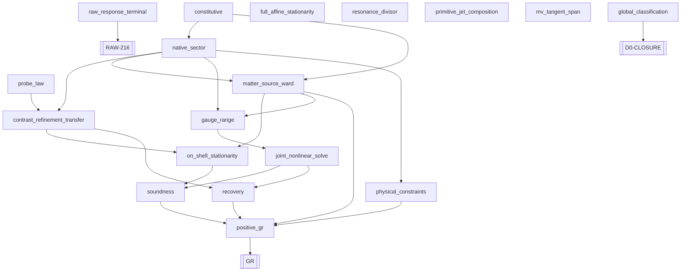

# D0 to GR assembly overview

Generated by `python tools/gr_assembly.py render`. Do not hand-edit.

Scientific acceptance and live execution are separate. Historical research does not discharge a premise.

| Goal | Composition |
|---|---|
| GR | OPEN |
| RAW-216 | OPEN |
| D0-CLOSURE | OPEN |

| Obligation | Group | Missing logical inputs | Accepted application |
|---|---|---|---|
| constitutive | native | none; conclusion still needs accepted evidence | none |
| native_sector | native | constitutive | none |
| probe_law | geometry | none; conclusion still needs accepted evidence | endpoint-probe-to-geometric-law |
| contrast_refinement_transfer | native | native_sector | none |
| matter_source_ward | native | native_sector, constitutive | none |
| on_shell_stationarity | native | contrast_refinement_transfer, matter_source_ward | none |
| gauge_range | refinement | native_sector, matter_source_ward | none |
| joint_nonlinear_solve | refinement | gauge_range | none |
| soundness | composition | joint_nonlinear_solve, on_shell_stationarity | none |
| recovery | composition | joint_nonlinear_solve, contrast_refinement_transfer | none |
| physical_constraints | composition | native_sector | none |
| positive_gr | composition | soundness, recovery, matter_source_ward, physical_constraints | none |
| raw_response_terminal | original | none; conclusion still needs accepted evidence | none |
| full_affine_stationarity | support | none; conclusion still needs accepted evidence | none |
| resonance_divisor | support | none; conclusion still needs accepted evidence | none |
| primitive_jet_composition | support | none; conclusion still needs accepted evidence | none |
| mv_tangent_span | support | none; conclusion still needs accepted evidence | none |
| global_classification | separate | none; conclusion still needs accepted evidence | none |

## Declared dependency DAG

Incoming inputs of a method are AND; different methods are alternatives.
The diagram is a proof plan, not evidence that any transition is closed.



Historical catalogue: 44 preserved IDs; 22 indexed scoped negative results including typed input.
Use `search` for their exact scope and owners. No historical result is accepted automatically.

## Agent entry

```bash
python tools/gr_assembly.py next
python tools/task_dispatch.py TASK-ID
python tools/gr_assembly.py why OBLIGATION
python tools/gr_assembly.py search QUERY
```

`next` uses live PRs once. `--offline` means unverified planning and never authorizes launch.
Independent conditional lemmas retain their assumptions. A free slot alone does not prove prerequisites.

## Provenance

Current-route input: `77d3ab6059bd1a3ce48637b97b9f30aa8825fc5f`.
Historical graph input: `180ddd187b76035b83ba784ce3c0844f3192ba7d`.
The preserved source pin is not a current execution head or an acceptance decision.
