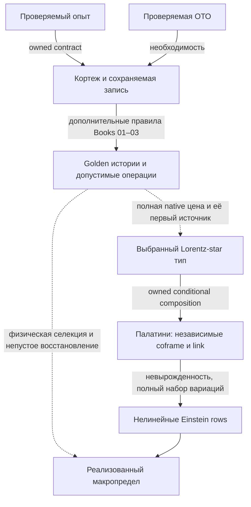

# D0 → ОТО: сборка оснований, источника и физического предела

17 октября 2026; дополнен 18 октября. Научный синтез интегратора в существующем Draft [#334](https://github.com/gvakhrushev/d0_15/pull/334).
Вход: `ec4256c9146530d3e98774cad755024b4aaa247d`; отдельно прочитан принятый
main `1aa3ff8b35133b1209164e0cd7da62ffefa647e2`, включая #367. Это не новая
очередь работ и не объявление закрытия исходного fixed-source/raw задания.

**Потреблённое продолжение:** [точная полная локальная решёточная семья](A4D_AF_STAR_FULL_LATTICE_STATIONARY_FAMILY_2026_10_17.md)
теперь закрывает локальную вакуумную recovery-часть на независимом
геометрическом носителе AF: все16 тетрадных и24 связевых строк во внутренних
узлах, настоящие golden веса, неплоский гладкий предел. Граница фиксирована;
физические N/P, материя и глобальное замыкание остаются открытыми.
Вход `275244e5` и [полная пятиисходная золотая цена](A4D_LABELLED_GOLDEN_RECORD_FULL_SOURCE_2026_10_18.md)
теперь добавляют собственные уравнения свободной подготовки и точный
ненулевой source на той же исходной метрике. Это уточняет остаток ниже,
не повышая построенный протокол до вынужденной динамики D0.

Проверка настоящей композиции теперь включена в §§7.1–8.3 того же
владельца. Два реальных старых исхода исключают независимую балансировку
его scene-флагов при естественной CAR-склейке. Общая подготовка должна
решать единый полный operator Euler. Геометрический запрос выражен
восемью CAR-словами и полным trace, но неплоские unipotent-плакетки
доказанно не входят в старый класс положительных изометрий. Поэтому
дальнейшая native сборка использует уже существующий full-Lorentz
positive-adjoint/Julia интерфейс со всеми его ветвями и источниками.
Ни подстановка adjoint вместо inverse, ни смена clock этого не исправляют.
В §7.3 уже решён единый preparation Euler настоящих128 исходов на
pure-time блоке: полный градиент скалярен при I16/16. Его ν-источник
строго положителен для любой подготовки на этом блоке, поэтому это
не совместный свободный ν-корень. Получен конкретный native source и
исключена его скрытая компенсация материей в указанном UV-секторе;
другие supports и общий continuum source остаются отдельной задачей.

Продолжение на входе `3447a184` теперь замыкает §§8.4–8.6 того же
владельца: весь Lorentz-перенос и coframe coefficients восстанавливаются
из actual raising X даже поперёк ненулевого null-направления. На заданном
addressed full-Lorentz Julia interface получена когерентная программа
star/golden запроса и строгий перенос её полного конечного первого
источника, включая work leakage. Не нужны отдельный U-oracle,
измерение элементов матрицы или дополнительная trace-копия материи.
Рабочие записи и их preparation остаются настоящими входными ресурсами.
Теперь остаток — физический допуск и вынужденность chiral программы,
её действительная старая история и независимая материя, затем exact
joint/global recovery. Доступность и реализация запроса ещё не выбирают
закон D0; повторять восстановление геометрии для этого не нужно.
§8.7 потребляет уже существующий Role/site selector: star-тип внутри
канонического oriented linear-curvature класса уже вынужден. Доказать
нужно ненулевую компоненту **полной native цены** в этом классе, сохранив
историю; I/Holst не является конкурентом внутри его исходных предпосылок.

Проверка этого forcing на входе `6c78c60e` теперь доведена до настоящей
source-пробы в §§8.8–8.9. Из когерентных путей выведен полный event source
с interference Gram и normalizer; scalar и amplitude веса не смешиваются.
Для всей заданной finite H+J+R найдена mixed coframe/link вариация с нулевым
источником, тогда как тот же Palatini stencil ненулевой. Прямое
отождествление двух источников исключено на этом carrier; stationary
reduction с настоящими observer/matter/torsion equations этим не исключена.
Проверка Book03 также различает явные penalty-функции и пока не заданные
S_coeff,J_coup,S_terminal и общий S_heat. Их нельзя считать вычисленным
полным действием по одному названию stack. Следующий шаг — source-preserving
stationary reduction реально заданной цены либо вывод полной собственной
geometry-history amplitude/price map. Новый compiler не заменяет этот шаг.

На входе `8c3a615c` эта stationary reduction уже выполнена в §§8.10–8.12:
все24 Lorentz-link и3 observer equations решаются вместе с полной
подготовкой над каждой близкой постоянной физической метрикой. Rank27
доказан через vacuum grade2 и tensor symmetry, а не численный minor.
Полная reduced цена сохраняет прежний отклик на форму плоского тора.
Но её faithful section не продолжается над всеми q(x): точное уравнение
на Q=e₀+e₁ запрещает одну реальную off-diagonal metric wave даже при
свободной связи и подготовке. На Q=2e₁, напротив, построен подъём всех
десяти metric slots; пять внутренних направлений ещё требуют своих
source equations. Поэтому старую stored-domain классификацию нельзя
просто перенести, а повторять homogeneous исключение для «закрытия ОТО»
больше не имеет смысла. Следующий научный переход должен предъявить
собственную пространственную stationary ветвь/полную history price с её
физической материей и источником. Общее отрицание D0→ОТО не получено.

На входе `7966c217` §§8.13–8.15 используют уже существующую balanced
подготовку, а не новую цену. Полная stationary fibre имеет104 real
параметра. Реальная суперпозиция vacuum+top снимает spatial preparation
препятствие: на owned gapped root построен первый подъём всех десяти
metric components для ВСЕХ Fourier-мод. На той же rank8 подготовке
rank27 amplitude theorem решает homogeneous internal source equations.
Reference128, все16 grades и rank-birth variations сохраняются.

Оставшийся переход теперь вычисляется на этом подъёме: полный источник
имеет13 внутренних направлений в mixed mode и19 в axial mode. Численный
расчёт всего носителя на q1100 решает линейную внутреннюю систему, но
обнаруживает ненулевой preparation residual второго порядка. Точное
cokernel-условие уже выписано; результат одной частоты не исключает
другие neutral Fourier modes и пока не является строгим no-go.
Это остаётся задачей существования nonlinear section, но следующий
результат снимает её с критического пути конечного GR comparison.

На входе `e989bc01` §§8.16–8.18 доказывают более сильное утверждение.
У ЛЮБОЙ C¹ секции всех внутренних уравнений через тот же faithful или
real-even root постоянный metric Hessian одинаков:7+/3zero. Формула
`L A+B=0` даёт `B*ker L=0` без обращения L. Отдельно полное translation
действие, homogeneous rank27 и eigenpreparation доказывают
`DR|ker L=0`, включая все rank births и reference128. Поэтому первый
источник настоящего R на любой секции равен γDd. Две постоянные
метрические вариации исключают `DΓ=c_EH DI_EH+ΛDVol+DR_same`:
off-diagonal variation требует Λ=0, diagonal variation даёт γ≠0.
Это точное препятствие источника всех таких секций, а не численный
остаток одного выбранного подъёма.

Тем самым дальнейший перебор Fourier kernels и подготовок вокруг этих
корней не может исправить данный exact finite GR переход. Смена complex
rank при том же Reρ вообще даёт эквивалентную вариационную задачу;
на фиксированном real χ carrier весь source уже фиксирует R_shell=I₈/8.
Реально иная time-sign подготовка сохранена с exact first lift и actual
численным second-source obstruction; это потреблённый тест, не новый
маршрут. Вместе с уже доказанным `M z c<beta` при controlled small-heat
refinement следующий шаг теперь строго направлен на actual complete
history/price, её native calibration law и допустимую оценку предела.
Новая цена, counterterm или residual-defined matter не добавлены.
Иные корни, independent physical matter и controlled limits этим конечным
утверждением не исключены; физическое D0→ОТО остаётся открытым.

## 1. Итог сборки

На входе `ba3902b3` §§8.31–8.33 доказывают точное конечное
существование всех preparation/coframe/observer equations условной
полной code−coherent цены при заданном конечном коде с β>0. Минимум
берётся по реальной подготовке, масштабу и coframe Gram tetrahedron.
Вырожденную геометрию исключает explicit null-history entropy birth;
phase-only V₄ covariance переносит angle/scale equations на все16
coframe строки без изотропного prior. Все reference128, внешние
amplitude directions и nonzero-Fourier field equations сохранены.

Первый logarithmic correction выбирает G1=1, оставляя две физические
shear координаты. Полный конечный код действительно различает их,
поэтому Bell/isotropic point не назначается решением. Теорема позволяет
подготовке и геометрии сместиться. Uniform det G>0 в n→∞ не доказан.

Остаток теперь точно определён: homogeneous Lorentz-link source
`2J_r(Ω_r)=−B_r(Ω_r u_r)`. Двенадцать stabilizer directions исчезают;
в canonical circulant embedding все24 link equations равносильны
четырём scalar costate conditions. Их точная сумма квадратов и recursion
выведены из той же полной цены. Это следующий геометрический шаг,
а не ещё один preparation census. Physical full-code/Info admission,
resource/controller equations, independent matter и spatial/global
переход к ОТО остаются открытыми. Полный finite joint root пока не заявлен.

На входе `36ad880c` §§8.27–8.28 дают следующий положительный шаг:
полный coherent-memory source сходится в C¹ даже через rank births,
без spectral floor, на фиксированном полном data/reference носителе.
Доказательство использует uniform C² native-channel jets; одна лишь
сходимость канала раньше этого не давала. Return normalizer также
вычислен с обеими preparation/return-projector derivatives. Entropy-only
критические точки допускают ненулевые eigenvalues, но имеют нулевой
полный первый источник; их нельзя принять за корни всей цены.

Уже определённая полная code−coherent цена даёт иной результат.
Из двух настоящих leading exit rows выведен fixed-code коэффициент β;
предельный функционал равен `βT TrρA²−S(R_T)/logφ`. Для любого
заданного β>0 balanced ±λ подготовка решает ВСЕ operator/preparation/
clock first equations при единственном положительном Tλ². Actual
flat-shell Bell state использует исходный reference128, а поперечные
вариации поля и подготовки не удалены. Таким образом есть ненулевой
совместный предельный корень полной условной цены, а не только баланс
одной scale строки. Теперь требуются physical code/Info binding со всеми
controller источниками и finite native stationary continuation; C¹ limit
не даёт его автоматически при logarithmic transverse Hessian. Ни новое
действие, ни физическое закрытие ОТО этим результатом не назначаются.

На входе `420f6545` §8.26 проверяет буквальное MDL-чтение Book03
отдельно от Shannon mean. На полном tagged golden законе наибольшая
вероятность всегда у field-independent bypass; разрыв до остальных
исходов не меньше одной φ-единицы цены. У исходной native long history
MAP — полная blank-история с C¹ пределом
`−log Tr(ρ exp(−4p²T A_0²))/log φ`. Её настоящий scale source
положителен при nonblank подготовке. Но преимущество одной истории
над каждой другой не даёт концентрации: остальные вместе сохраняют
положительную вероятность. Mean, MAP и scalar sum на одном полном
законе имеют разные источники и не взаимозаменяемы.

Следующий шаг поэтому определён точнее: нужна собственная карта
историй в геометрические классы памяти, с multiplicity, holonomy и
ресурсами, затем перенос её полного источника в S_stack. Book03
§03.10(f) сам различает geometry sum и feedback partition; coherent
сумма сохраняет cross Gram terms. Ни смена названия цены на MDL,
ни готовое trace-log identity не строит эту карту. Условные Einstein
конструкции остаются положительными входами для её проверки.

На входе `2bfb8974` §§8.22–8.25 потребляют положительную tagged-exit
конструкцию #363 (`33911def`). Её exits реализуются конечным CNOT
копированием сохранённой истории, а golden coin не требует нового угла.
Выведен весь закон нефильтрованного сравнения с central/spatial failures.
Его полная entropy mean имеет положительный endpoint scale source в
доказанном weak window; selected logdet на той же вариации имеет
отрицательный source. Central survival term усиливает положительный
общий scale ответ. При fixed coins/controllers joint roots этой mean
лежат в общем blank kernel; free controller rows остаются отдельными.
Длинная история даёт явный положительный weighted count-source на
фиксированном data carrier. Возможная фильтрация меняет весь закон;
одной условной нормировкой это сравнение не исправляется.

Таким образом, условный curvature ratio (1,1,−1) сохранён и execution
стал конкретнее, но прямое связывание полной mean с logdet исключено
для данного readout. Собственные normalization/clock строки logdet
также не вынуждают double clock; volume coefficient3/2 сохраняется.
Следующая необходимая связка — настоящая полная valuation либо native
constraint с собственным источником. Она не заменяется назначенным
остатком, другой stationary section или повторным подбором heat ratio.
Проверка буквальных Book01/cocycle definitions уточняет эту связку:
при complete w=q binding остаток B равен0. Реальное условное событие
может иметь отрицательный normalization source, но вместе со всем
взвешенным дополнением снова даёт прежнюю полную entropy mean.
Перебор success cuts не добавляет независимый компенсатор. Настоящий
другой physical raw partition или закон агрегации всё ещё требует вывода.

На входе `4838004d` §§8.19–8.20 того же source owner потребляют полную
native Julia/golden среднюю: при νR≤1/64 её scale source положителен
для ЛЮБОЙ nonblank подготовки на полном data⊗reference128. Для каждой
фиксированной конечной длины полностью сохранённой истории существует
своё общее для всех подготовок weak window. Если scale независимо
допустим, весь joint critical set здесь blank и имеет нулевой первый
источник. Отдельный точный preparation-saddle аргумент не подменяет
этот scale proof. Ни rank selection, ни ещё одна конечная длина истории
не создают недостающий Einstein source в объявленной области.

Это даёт следующий точный вход сборки: настоящая полная цена H/ℓ+B
должна иметь B_ν=−H_ν/ℓ<0 на nonblank joint root либо предъявить
реальный constraint source. Написана полная формула binding defect
между кодовыми S_h и Born q_h, включая normalizer. Внутренняя stationary
редукция и выполненные квадратные блоки Book03 не заменяют этот вклад.
Отрицательный heat source уже существует в другой определённой цене,
но его равенство данному B не доказано. Новые action/Info не вводятся.
Совместный long-history/refinement предел этой теоремой не решён;
physical admission/selection и independent matter остаются открытыми.

Отдельный §8.21 затем решает long-history source при фиксированном
data carrier: `H_n=4p²(nν²)Tr(ρ A_0²)log(1/ν²)+O_C¹(1)`.
Полный128^n tape, все повторные exits и начальные preparation jets
сохранены. Контроль Fisher information доказывает именно источник,
а не только сходимость значений. Ведущий функционал Rayleigh/count;
при nν²→T>0 и a≥a_0>0 свободная scale строка остаётся положительной.
Каждая derivative берётся при фиксированном целом n, без вычитания
divergence или выбора новой физической нормировки. Предел a→0,
spatial refinement и физический допуск растущей памяти отдельно открыты.

**Формулу нелинейной ОТО заново искать не требуется.** В корпусе уже есть
положительная композиция: выбранная конечная Lorentz-star запись → полная
цена построенного golden-AF опыта → предел Палатини → все десять вакуумных
уравнений Эйнштейна. Есть и непустые конечные кривые критические семейства
на всех внутренних coframe/link вариациях при фиксированной границе.
Для [полного пятиисходного опыта](A4D_LABELLED_GOLDEN_RECORD_FULL_SOURCE_2026_10_18.md)
уже решены и все свободные AF/scene/reference preparation rows;
геометрическая семья переносится в его полную ожидаемую Cost−Info.

**Открыт переход от построенного опыта к собственному закону D0.** Нужно
вывести его полную цену и источник из тех же допустимых историй, включая
геометрию, материю, подготовку, наблюдателя и архив. Затем нужен физический
переход к классическому уравнению с непустым полным восстановлением.
Способность реализовать нужный оператор и наличие правильного предела его
отклика сами по себе этого перехода не доказывают.

Обратная половина замысла пользователя уже имеет точную формулировку:
**любая проверяемая ОТО обязана реализовать функциональный кортеж D0**.
Это необходимость операционного основания, а не доказательство того, что
один лишь кортеж выбирает все динамические детали D0. Ни эту половину,
ни уже полученную геометрическую половину не следует повторно выводить.

Новые аналитические связки этого синтеза:

1. §4 отделяет условный прибор от совместного закона геометрии и указывает,
   почему нормировка источника ещё не доказывает классическую селекцию.
2. §5 даёт точное соотношение исходной raw-нормы и нормы макроскопического
   источника. Сильный старый терминал сохраняется; его необходимость для
   любого вывода ОТО из предыдущих результатов не следует.
3. §§6–7 сводят положительную сборку к полному первому источнику выбранного
   типа, а не к буквальному совпадению двух микроскопических приборов.
4. Обновлённый §8 связывает собственное CAR/clock чтение, новую полную
   цену с решённой подготовкой и достаточную Cartan-классификацию.
   Native программа, прежняя история и независимая материя остаются
   разными явно указанными предпосылками.

## 2. Что именно дают первые книги

Это карта прочитанных несущих разделов и их владельцев, а не заявление о
перепроверке каждого доказательства десяти книг. Основные входы: BOOK 00
§§00.3e–00.4, 00.8–00.9; BOOK 01 §§01.0–01.8, 01.15–01.16, 01.22a–01.24;
BOOK 02 — конечные операторы и тестовая экстенсиональность; BOOK 03
§03.3; BOOK 06 — история/переходы; BOOK 07 — операционное чтение и предел.

| Кирпич | Уже принадлежащий результат | Что из него не следует без следующей стрелки |
|---|---|---|
| [BOOK 00](../../01_BOOKS/BOOK_00_ENTRY_CONTRACT_AND_ADMISSIBILITY.md), [PopperianBootstrap](../../03_FORMALIZATION/D0/Foundation/PopperianBootstrap.lean) | Killing test эквивалентен принятому verification contract; из него следуют сохраняемая различимость, функциональный кортеж и независимость вердикта от catalogue | Единственная буквальная таблица состояний, полный физический процесс или уравнение Эйнштейна |
| [BOOK 01](../../01_BOOKS/BOOK_01_CONDENSED_FOUNDATIONS_AND_GRAPH_BIRTH.md): Σ=(C,C*,D_min,Δ,R,O) | Сначала код/канон/различение/архив/доступ; конечные инструменты и сцена — дальнейшее построение | Нельзя ставить гладкую геометрию вместо исходного носителя и затем считать её допустимость доказанной |
| Там же: condensed/profinite support | Совместимые конечные чтения и ограниченный admissible subfunctor: конечная факторизация, операторный подъём, положительный ответ, проективность и halt | Произвольный морфизм ambient condensed category не становится физической операцией D0 |
| φ, прямой ход и первый возврат | Для заданной примитивной семантики `p+p²=1`; golden cost/cylinder structure уже имеет владельцев | Возврат другого порядка меняет runtime; φ нельзя заново подбирать под нужный физический коэффициент |
| Сцена (9,11,13), §01.22a | Связаны торальные возвраты, ограничение ёмкости и typed preparation; это содержательные предпосылки, а не три выбранных числа | Полином, нулями которого назначены 9,11,13, не является независимым выводом сцены |
| π₀ и golden precision | Конечный фазовый инвариант и контролируемая шкала чтения | π₀ не заменяет π в обычной гладкой производной; масштаб точности сам не выбирает физическую связь |
| [EmpiricalTheoryFactorization](../../03_FORMALIZATION/D0/Foundation/EmpiricalTheoryFactorization.lean) | Фактор по полному заданному семейству тестов; injective evaluation и единственная факторизация любого согласованного summary | Физическая осуществимость и полнота семейства тестов не доказываются определением фактора |
| [BOOK 03](../../01_BOOKS/BOOK_03_FINITE_ACTION_OPERATORS_AND_SCENE_DYNAMICS.md) §03.3 | История имеет цену Cost−Info и вес; классическая вариация описывается через минимальную цену | Средняя условная энтропия произвольно сконструированного прибора не отождествлена автоматически с ценой геометрической истории |
| [BOOK 06](../../01_BOOKS/BOOK_06_EVOLUTION_FORGETTING_AND_TIME.md), [StaticToDynamicsOwner](../../03_FORMALIZATION/D0/Evolution/StaticToDynamicsOwner.lean) | Владельцы некоммутативности, архива циркуляций и golden ladder; границы self-reading/refinement явно описаны | Это не универсальная теорема о единственном переходе всех допустимых историй |

### 2.1. Обратное доказательство: почему проверяемая ОТО требует Σ

Пусть протокол проверки ОТО удовлетворяет принятому `KillingTest`.
Если разные проверяемые исходы x≠y дают одну запись, сравнение одной и той
же пары записей должно одновременно вернуть «same» и «different». Получено
противоречие. Поэтому запись инъективна на различаемых состояниях. Вместе
с остальными частями контракта это ровно уже доказанные
`killingTest_record_injective` и `killingTest_forces_functional_tuple`.
`alternative_burden` распространяет аргумент на любой альтернативный протокол.

Это относится и к косвенному детектированию: проверяется различие записей
и предсказаний, даже если объект не наблюдается непосредственно. Поэтому
интерпретация ускоренного расширения также нуждается в Σ. Аргумент не
выбирает конкретную модель тёмного сектора и не устанавливает её истинность.
Два различных `Line` в формальном контракте не следует без отдельного
аргумента переименовывать в причинно независимые физические лаборатории.

Точная логическая запись:

    VerifiedGR(P) ⇒ FunctionalTuple(P).

Она не равна `FunctionalTuple(P) ⇒ Einstein(P)`. Второе утверждение требует
динамической сборки ниже. Также не нужно доказывать изоморфизм всех сырых
внутренних состояний: [универсальная факторизация](../../03_FORMALIZATION/D0/Foundation/EmpiricalTheoryFactorization.lean)
уже говорит, какая эквивалентность действительно нужна — равенство всех
допустимых результатов. В тесты входят и будущие продолжения: равные
текущие маргинальные распределения не разрешают стереть различимую позднее
фазу или историю.

### 2.2. Как применять condensed математику и DAG

Condensed язык удерживает совместимость чтений и различие объекта от одной
его реализации. Он полезен для склейки диаграммы истории/операции/записи.
Само слово «склейка» не даёт оценки производной после умножения на растущий
масштаб. Это уже показано в [condensed-history source obstruction](A4D_CONDENSED_HISTORY_SOURCE_OBSTRUCTION.md):
конечные стадии и их предел могут вести себя по-разному для масштабируемого
источника; endpoint Gram не определяет cross comparison.
Первичный внешний контекст — [лекции Шольце по condensed mathematics](https://arxiv.org/html/2605.03658),
а физически ограниченный subfunctor берётся из BOOK 01, не из этих лекций.

Реестры используются как карта уже имеющихся владельцев. Но
`presupposition_edges.json` хранит концептуальные предпосылки, а не
компилированные доказательства композиции. `forcing_routes.json` отдельно
проверяет независимость заявленных маршрутов: 20 проверено, 0 сохранилось
до ремонта, 3 после ремонта. Это не число опровергнутых теорем D0.
В частности, `D0-SPECTRAL-EINSTEIN-001` с графовым `G=2L` и
`D0-GRAVITY-MACRO-EINSTEIN-INTERFACE-001` с набором конечных свойств нельзя
подставить вместо одного нелинейного Lorentz источника. Реальный DAG сборки
должен соединять совпадающие носители, действия, вариации и пределы.

## 3. Последние подходы: что сохраняется и почему возникал круг

| Подход 14–17 октября | Положительный результат, который сохраняем | Какой переход нельзя повторно считать закрытым |
|---|---|---|
| [Прямое вынуждение native цены](A4D_NATIVE_DIRECT_FORCING_ATTACK.md) | Конкретные return/code условия различают цены; построены строгие контроли неполных структурных требований | Совпадение вакуума, монотонность, cutoff и refinement ещё не выбирают всю Cost−Info |
| [Полная геометрия](A4D_COFRAME_TORSION_INTRINSIC_GR_RECONSTRUCTION.md) | Coframe, все24 LC-компоненты, нелинейный Einstein covector | Реконструкция геометрии не равна источнику цены прибора |
| [Центрированный конечный probe и φ/π₀](A4D_PHI_PI0_CONTINUUM_CLOSURE.md) | Непустые endpoint preparations, оценка O(h/ε+ε²), golden Cauchy-чтение | Точная sampled-Einstein source fibre выбранного warp пуста; измерение конечной разности не создаёт отсутствующих совместных корней |
| [Stored joint kernel](A4D_NATIVE_FULL_JOINT_KERNEL_AND_MATTER_REDUCTION.md) | Exact off-shell elimination и классификация ближайших faithful/rank8 корней как плоских | Новое сканирование тех же семейств не создаст неплоскую ветвь; crossing не равен совместной нелинейной ветви |
| [Foundation forcing](A4D_FOUNDATION_FORCING_NOT_CATALOGUE_SEARCH.md) | Генераторный intertwining с производными и оценками для слов; цена входит в ту же диаграмму | Представимость заданного Q ещё не вынуждает физический Q |
| [Полная история и feasible gain](A4D_NATIVE_FEASIBLE_GAIN_AND_ACTION_SOURCE.md) | Точная оптимальная цена/источник в указанном классе тестов; строгий gain deficit | Томографическая полнота не даёт полный quantum-information optimum |
| [Fixed-beta IR feedback](A4D_NATIVE_FEEDBACK_IR_EINSTEIN_TORSION_SELECTION_2026_10_17.md) | Настоящие curvature/torsion коэффициенты исходной цены, условное подавление torsion | Положительная вспомогательная метрика, surviving volume и observer source не исчезают от одного EH-коэффициента |
| [AF active-left / retained-right](A4D_AF_LEFT_RIGHT_ACTIVE_ARCHIVE_GR_COMPILATION_2026_10_17.md) | Конечный AF оператор сохраняет старый right provenance; старый commutant no-go нельзя переносить на другой регистр | Членство в алгебре не доказывает допустимость перехода и полную стоимость его исполнения |
| [v8/AF zero-mode boundary](A4D_AF_V8_FLAT_ZERO_MODE_INTERTWINER_BOUNDARY_2026_10_17.md) | Точное различие событий неизменённого v8 и AF уже доказано | Не нужно снова пытаться назвать один буквальный v8 round тем же AF round |
| [Free-actuator no-go](A4D_AF_ACTUATOR_ELIMINATION_EINSTEIN_SOURCE_NO_GO_2026_10_17.md) | Если вся цена F(E), независимая стационарность E зануляет этот источник | После on-shell устранения E нельзя вернуть потерянный источник через искусственно навязанную E(g) |
| [Принятый #367](https://github.com/gvakhrushev/d0_15/blob/1aa3ff8b35133b1209164e0cd7da62ffefa647e2/02_REGISTRY/research/A4D_AF_RECORD_COST_INFO_COUPLING_GAP_2026_10_17.md) | Старый AF probe не несёт lapse/shift/matter источников, необходимых его EH-identification | Это не опровержение новой явно star-зависимой конструкции; её физическая привязка остаётся отдельной |
| [AF-star nonlinear composition](A4D_AF_STAR_PALATINI_NONLINEAR_EINSTEIN_COMPOSITION_2026_10_17.md) | Один полный Book-pointer, C² Palatini limit, все10 Einstein rows, nonflat pp-wave и конечные 25m критические направления | Пока не доказаны native execution/full price, плотность этих направлений и unrestricted joint recovery |

Повторявшаяся схема была такой: находился правильный геометрический ответ,
затем выяснялось, что его вход, цена, вариации либо физическая подготовка
отличаются от исходного процесса; после этого начинался поиск другого
ответа. Последняя положительная композиция позволяет остановить этот круг:
теперь надо потребить её геометрическую часть и доказать оставшуюся связь
с полным native источником.

Пунктир обозначает незакрытую физическую предпосылку, а не ещё одну
геометрическую формулу. Обратная стрелка H→B не замыкает прямую стрелку C→G.

## 4. Условный прибор и закон геометрии — разные объекты

### 4.1. Лемма о недоопределённости совместного закона

Пусть G — конечный набор геометрических меток, Ω — конечный набор полных
записей, и для каждого g дано положительное нормированное q_g(ω).
Для любой положительной вероятности π на G положим

    Pπ(g,ω)=π(g)q_g(ω).

Тогда `Pπ(ω|g)=q_g(ω)` для всех π, а `Pπ(g)=π(g)`. Доказательство — деление
на `Σω Pπ(g,ω)=π(g)`. Следовательно, даже точное знание всех условных
опытов не определяет геометрический marginal.

Это логический контроль, а не два построенных M1-допустимых мира D0.
**Не предлагается добавить π как физический постулат.** Наоборот, нужно
из исходных историй вывести, какие записи представляют геометрию, как
они взвешены совместно с прибором и какая цена управляет её вариациями.
При вариационном пути вместо вероятностного требуется доказать соответствие
геометрической вариации действительной вариации полной native цены.

### 4.2. Нельзя смешивать цену истории, среднюю цену и free energy

В конечном положительном секторе с фиксированной reference measure пусть
истинные ненормированные веса заданы `exp(-a Sω(x))`, a=log φ. Тогда

    Z=Σω exp(-a Sω),       Γ=−log Z/a,
    DΓ=E[DS],
    D²Γ=E[D²S]−a Cov(DS,DS),
    D(E[S])=E[DS]−a Cov(S,DS).                         (4.1)

Все тождества следуют прямым дифференцированием конечной суммы. Для двух
направлений в Hessian берётся соответствующая билинейная covariance.
При движении reference measure нужны её настоящие производные; их нельзя
включить в «константу». Это тот же структурный вопрос, который уже решён
в [history-density synthesis, §2](A4D_HISTORY_DENSITY_PALATINI_SYNTHESIS.md):
после оптимизации массы с KL-членом получается free energy, а не средняя f.

Контроль: если `Sω=−log qω/a` и `Σqω=1`, то Z=1, Γ=0, но
`E[S]=H(q)/a` обычно непостоянна. Поэтому источник Shannon-энтропии
условного указателя нельзя без отдельного binding назвать источником
ненормированного веса геометрической истории. Обратное также неверно:
эти формулы не выбирают Γ вместо средней цены как физическое действие.
Выбор уже должен следовать из native процесса и конкретного Book consumer.
Квантовую coherent историю нельзя заменить этим положительным commuting
сектором без доказанной декомпозиции.

### 4.3. Нормировка источника сохраняет критические точки, но не создаёт классическую концентрацию

В AF-композиции `S=B+t² A`, где B не зависит от полей. При фиксированном
t>0 равенства `DS=0` и `DA=0` эквивалентны. Это законная математическая
нормировка, не контрчлен. Но если дополнительно пытаться назначить именно
этому S вес геометрии, для двух bounded A получим

    φ^(−S(g1))/φ^(−S(g2))=φ^(−t²(A(g1)−A(g2))) → 1.    (4.2)

Следовательно, C²-сходимость нормированного A сама не доказывает
концентрацию геометрических историй при t→0. Положение мод при положительном
перемасштабировании может сохраняться; концентрация вероятности — другое
утверждение. Также golden код не даёт её автоматически: exact-cost слов
`F_(n+1)`, каждое имеет вес p^n, а их суммарная масса стремится к φ/√5.
Число слов компенсирует экспоненциальный кодовый вес.

Для пути BOOK 03 «наиболее вероятная история → классический предел» нужно
потребить реальный native закон истории/макроскопического чтения и
контролировать этот предел. Для пути через принадлежащую конечную
вариационную задачу достаточно доказать её полное source/variation
соответствие и восстановление критических состояний. Не требуется
добавлять искусственную температуру, число повторений или Gibbs-подготовку.

## 5. Точное различие двух требований к пределу

### 5.1. Исходная raw задача сильнее сходимости макроскопического источника

Здесь только исходная нормировка [probe/source owner](A4D_PHI_PI0_CONTINUUM_CLOSURE.md):
`I_h=h² A_h`, h=1/L, L^4 ячеек; десять метрических компонент уже packed.
Пусть ΔXi — разность сырых метрических источников двух действий в одной
и той же конвенции. Определим

    r_h(x)=h^(-2) ΔXi_h(x),
    N_h=h^(-2) Σx ||ΔXi_h(x)||₁=Σx ||r_h(x)||₁,
    F_h[V]=h² Σx ΔXi_h(x)·V(x)=h⁴ Σx r_h(x)·V(x).       (5.1)

Для **всех решёточных** packed-проб с `max_(x,a)|V_a(x)|≤1` двойственность
ℓ¹/ℓ∞ даёт точное равенство

    sup |F_h[V]|=h⁴ N_h.                               (5.2)

Верхняя оценка — неравенство треугольника; равенство достигается выбором
знака каждой компоненты r. Если разрешены только гладкие пробы, остаётся
верхняя оценка, а равенство не утверждается.

Таким образом исходный терминал `N_h→0` требует `sup|F_h|=o(h⁴)`.
Обычная сходимость этого макроскопического источника требует `sup|F_h|→0`.
Они не эквивалентны. Например, для фиксированного ненулевого packed-тензора C
алгебраическое семейство `r_h(x)=h C` удовлетворяет

    N_h=||C||₁ h^(-3) → ∞,       sup|F_h|=||C||₁ h → 0. (5.3)

Это контрпример импликации между нормами, **не** построенный native
совместный корень. Для fixed-source корня r имеет специальный вид
`tau−rho_cmp,h`; (5.3) не утверждает реализуемости именно такого остатка.
Ничего здесь не доказывает даже слабую сходимость фактического native
источника. Члены volume/aether или lapse/shift residual, сохраняющиеся
после макроскопического pairing, остаются реальными препятствиями.

### 5.2. Следствие для стратегии, не изменение контракта

Первоначальная задача #216/#310/#334 с независимо заданными g,tau,
точными корнями и raw norm остаётся OPEN с прежним терминалом. Подменять
её средним или слабым результатом нельзя. Но более общий пользовательский
вопрос «выходит ли макроскопическая ОТО из D0?» требует собственной
точной теоремы, а не молчаливого добавления `o(h⁴)` как универсальной
необходимой предпосылки. Эти две математические задачи должны быть видны
вместе, без объявления одной решённой за счёт другой.

Для всех десяти Einstein rows достаточен полный предельный source pairing
со всеми гладкими компактно поддержанными метрическими пробами, вместе
с полными link/matter/observer условиями и правильным пределом решений.
Распределительное равенство становится поточечным при нужной регулярности.
Одна TT-проба, конечный заранее фиксированный набор или растущее число
однотипных проб этого не дают.

Операционная φ-точность совместима с таким утверждением: если для каждого
первого k тестов уже доказана количественная сходимость с константами,
можно заранее выбрать h_k так, чтобы все k ошибок были ≤φ^(−k).
Для расширения с плотного счётного семейства на все пробы нужна локальная
равномерная оценка источников в выбранной тестовой норме. Это расписание
чтения, не выбор новой физической clock law и не исходная raw-оценка.

## 6. Положительная сборка: универсальность полного первого источника

### 6.1. Не нужно требовать буквального v8=AF

Исходный v8 и построенный AF уже различены точным zero-mode событием.
Это закрывает буквальное неизменённое одношаговое отождествление. Для
макроскопической ОТО нужен более точный по назначению объект: одинаковый
полный предельный ковектор на физически допустимых вариациях.

Выбранный [Role-star owner](MEMO_A4D_STAR_DENSITY_VARIATION_PRESSURE.md)
имеет `d_A=1`, `d_E=1` **в объявленном типе**: локальная based plaquette,
нечётная curvature insertion, квадратичные relative-solder legs, фиксированная
комплементарная Role orientation, G₂ и internal star. Его старый `d_P=1`
сформулирован только для указанного плоского L=2 quotient. Новая
[нелинейная композиция, §2.1](A4D_AF_STAR_PALATINI_NONLINEAR_EINSTEIN_COMPOSITION_2026_10_17.md)
потребляет именно тип первого отклика, а не глобальную уникальность всех
действий. Коэффициент этого типа должен быть константой по полям;
произвольная λ(g) вносит дополнительный источник.

### 6.2. Лемма переноса источника через гладкую полную цену

Пусть X — компактный гладкий конечномерный chart **всех заявленных** полей
и их подготовок. Пусть μ_hw≥0 не зависит от X и имеет ограниченную сумму;
f_hw и Df_hw равномерно ограничены. Пусть F∈C² около e₀, F′(e₀)≠0, c₀≠0,
и истинная полная цена на этом chart имеет уже выведенный вид

    S_h,t=B_h+Σw μ_hw [F(e₀+c₀t² f_hw)−F(e₀)]+C_h,t,
    DB_h=0.                                                   (6.1)

Прямое дифференцирование и теорема о среднем дают, равномерно на chart,

    t^(−2) DS_h,t
      =c₀ F′(e₀) Σw μ_hw Df_hw + t^(−2) DC_h,t + O(t²).        (6.2)

Действительно, источник каждого слагаемого после деления на t² равен
`c₀ F′(e₀+c₀t²f) Df`; его отличие ограничено
`|c₀|² t² sup|F″| |f| ||Df||`. Сумма масс ограничена. Для C²-версии нужен
соответствующий дополнительный контроль производных; из одного F∈C²
здесь не объявляется O(t²) для второй производной.

Если существующий geometric/quadrature owner даёт
`Σ μ_hw Df_hw → γ D S_P`, γ≠0, и **полный** оставшийся источник сходится
к `D S_m`, то

    t^(−2) DS_h,t → c D S_P + D S_m,
    c=c₀ F′(e₀)γ ≠ 0.                                        (6.3)

При moving μ нужно также сохранить
`t^(−2)Σ Dμ [F(e₀+c₀t²f)−F(e₀)]`; при moving reference/clock/preparation
их источники входят туда же. C нельзя объявить постоянным по названию
«controller», «архив» или «нормировка».

Это общий аналитический consumer, а не ещё одна выбранная физическая
цена. Он дополняет имеющуюся [центральную variational equivalence](A4D_CENTRAL_RECORD_VARIATIONAL_EQUIVALENCE.md)
и показывает, почему после доказанного native binding не требуется
перебирать формы entropy/readout с одним и тем же ненулевым первым
откликом. Для конкретного AF опыта соответствующий более сильный C²
результат **уже доказан** его владельцем.

### 6.3. Главная несущая предпосылка

Нужно получить (6.3) для полной native цены без подстановки желаемого
результата в E(g), а до этого доказать принадлежность её leading response
выбранному типу и ненулевую чувствительность. Факт `d_A=1` работает после
этих предпосылок. Он не выводит из одного слова «натуральность» locality,
parity, quadratic solder degree, отсутствие самостоятельной плотности,
observer terms или всех higher-order contributions.

Это существенные, проверяемые условия. Уже [discrete target-span owner](MEMO_A4D_DISCRETE_PALATINI_TARGET_SPAN.md)
имеет легальные Vol_rel и torsion invariants вне выбранного star-only
типа. Одна gauge covariance не устраняет их. Нужно вывести их отсутствие,
подчинённый порядок либо собственную связанную динамику из того же
процесса. Геометрическую универсальность следует применять к доказанному
первому источнику, а не превращать её предпосылки в новый физический закон.

## 7. Составная теорема, которую теперь надо замкнуть

Пусть из D0 без внешнего выбора действия получены:

**N. Native source.** Один полный процесс/price map с реальной вариацией
всех полей. На регулярных charts его нормированный первый источник
сходится к `c D S_P + D S_m`, c≠0. Остаток включает подготовку, observer,
архив, reference и clock, а не только выбранную геометрическую строку.

**V. Variation and recovery.** Непустое семейство физически допустимых
совместно стационарных конечных состояний имеет регулярный невырожденный
предел. Каждая гладкая компактно поддержанная coframe/link/matter проба
имеет допустимый конечный подъём; источники и подъёмы сходятся с нужной
локальной равномерностью. При использовании плотного семейства имеется
оценка, позволяющая распространить равенство на все пробы.

**P. Physical classical selection.** Эти стационарные состояния действительно
являются рассматриваемым классическим сектором native истории, либо
входят в принадлежащую native вариационную задачу с доказанным source map.
Средняя условная цена прибора не подменяет эту предпосылку.

Тогда из нулевого конечного полного источника, N и V следует
`c D S_P + D S_m=0` на всех таких пробах. В вакууме 24 независимые link
вариации невырожденного coframe дают T=0. После этого 16 coframe rows
с шестью Lorentz frame identities дают все10 `Gμν=0`. Это nonlinear
Palatini consumer существующей композиции, без TT/линейного ограничения.
Утверждение о физической ОТО использует также P, а не только формальный
предел стационарных уравнений.

Для spin-free материи с независимо выведенным same-program S_m и
конвенцией `δS_m=½∫√|g| Tμν δgμν` получается `2c Gμν=Tμν`.
Для spinful CAR материи сначала остаётся Cartan spin source; нельзя
молча наложить torsion-free или заменить полную материю удобным скаляром.
Ненулевой c достаточен для вакуумного нулевого множества. Правильный знак
и относительная нормировка matter coupling — дополнительные физические
содержания, не исправляемые переименованием c.

Космологический член также должен иметь native владельца. Если полная
цена оставляет volume source, его нельзя вычеркнуть ради вакуумного
`G=0`: нужно вывести его коэффициент и соответствующее уравнение.
Отсутствие extensive baseline у построенного AF опыта не доказывает
отсутствия такого источника во всей D0. Операционная необходимость Σ
для космологических наблюдений из §2.1 не решает этот динамический вопрос.

**Где уже есть непустота.** AF владелец построил неплоский Ricci-flat pp-wave
и IFT-корни в 25 направлениях: один conformal bump и все24 Cartan.
На непересекающихся patches получены 25m направлений. Но увеличение их
числа не доказывает плотность во всех физических metric directions;
произвольные shear/lapse/shift пробы этим фактом не покрыты. Последующее
[полное локальное решение](A4D_AF_STAR_FULL_LATTICE_STATIONARY_FAMILY_2026_10_17.md)
снимает это ограничение на независимом геометрическом носителе внутри
фиксированной границы. V для полного физического семейства ещё не закрыта. Пустая exact-source
fibre старого warp также не служит положительной recovery теоремой.

### 7.1. Приоритет 18 октября: нелинейный bootstrap того же spin-2 источника

Новый пользовательский синтез меняет приоритет: вместо следующей
настройки Einstein readout проверять, вынуждает ли согласованное
взаимодействие собственного spin-2 сектора именно нелинейную ОТО.
Конечные preparation/coframe/observer roots сохраняются как отдельный
вход существования с шестью незакрытыми aligned-link equations;
их продолжение не подменяет эту задачу физической вынужденности.

**Линейный кирпич действительно полный.**
[Direct Schur owner](A4D_SCHUR_EINSTEIN_DIRECT_IDENTIFICATION.md), §§2–7,
независимо сравнивает все100 polynomial entries:

    K_Schur^[2](k)=−C₁(k)ᵀ A₀⁻¹ C₁(k)
                 =−½ K_G^(1)(k), det A₀=256.             (7.1)

Это все10 symmetric Lorentz slots, включая lapse/shift, четыре Bianchi
identities и generic gauge-kernel dimension4. Это НЕ только TT-проекция.
Но (7.1) — degree-two flat IR coefficient выбранного naked-star action,
не полный finite-UV Schur и не уже Hessian физической full128 цены.
Две characteristic excess directions сами не доказывают propagation,
positive residues, единственность физического graviton или matter coupling.
Отозванный перенос на observer-preserving stored reduction не возобновляется.

При локальной, Poincaré-инвариантной, согласованной по порядкам деформации
здорового Pauli–Fierz поля с не более чем двумя производными взаимодействующая
ветвь есть EH с возможной Λ, modulo local field redefinitions/boundaries.
Свободная ветвь тоже разрешена: ненулевое взаимодействие надо доказать.
Это [теорема Boulanger–Damour–Gualtieri–Henneaux, Thm1.1 и §7](https://arxiv.org/html/hep-th/0007220v2);
[Deser](https://arxiv.org/abs/gr-qc/0411023) даёт self-coupling construction.
Они не выводят полную D0-материю, не доказывают сходимость формального ряда
и не заменяют same-source identification.

Bootstrap может обойти прежнее требование регулярности источника при
det e=0 из [Cartan-classifier](A4D_REGULAR_NATURAL_SOURCE_TO_CARTAN_2026_10_17.md).
Взамен требуется доказанный smooth effective germ того же native процесса,
его настоящий PF free operator, отсутствие иных unsuppressed polarizations,
локальность и двухпроизводный leading sector, нелинейная gauge consistency
и nonzero self-coupling. Cluster factorization из Book03 не является
сама по себе finite-jet locality внутри связной сцены. Higher-curvature
вершины с тем же flat quadratic seed также требуют контролируемого IR
подавления; их отсутствие нельзя вывести из (7.1).

### 7.2. Первый расчёт bootstrap: кубический Ward без подбора действия

Пусть S(y,r) — ОДНА самостоятельно определённая полная цена,
y=(a,X), a включает operational metric и независимую matter, X —
сохраняемое представление sampling/paths. r содержит только поля,
которые действительно разрешено устранить по собственным equations.
Нужны C³ chart, эквивариантная stationary section S_r=0 и обратимость
A=S_rr на честном gauge-fixed complement. Uniform UV inverse здесь
не предполагается. Полная entropy C¹ через rank births из §§8.27–8.35
этого C³ входа НЕ предоставляет.

Для Γ(y)=S(y,r_*(y)) имеем

    L v=(v,−A⁻¹S_ry v),
    H_Γ=S_yy−S_yr A⁻¹S_ry,
    T_Γ(v₁,v₂,v₃)=D³S(Lv₁,Lv₂,Lv₃).                      (7.2)

Последнее равенство сокращает тяжёлую задачу: nonlinear r'' не нужно
искать для кубического jet. Дифференцируем DΓ=S_y дважды; все
добавочные члены имеют вид D²S[(0,r''),Lv]=0 по линейному stationary
equation. При S∈C³ section r_*∈C² достаточно; r''' не предполагается.
Independent matter не становится auxiliary по названию.

[Полный конечный Ward](A4D_FULL_EXPERIMENT_WARD_AND_METRIC_DESCENT.md)
уже доказывает совместную covariance Γ(a,X)=Γ(f*a,f⁻¹∘X).
Его генераторы R_a=L_ξa и R_X=−ξ∘X дают
D_aΓ R_a+D_XΓ R_X=0. Дважды дифференцируя по настоящим physical
направлениям h,w при δX=0, на full stationary background получаем

    T_Γ(h,w,R_a0)
      +H_Γ(h,R_a1 w)+H_Γ(w,R_a1 h)
        =−Γ_aaX(h,w,R_X0).                              (7.3)

R_X не зависит от a. В affine tensor charts R_a линейно зависит от a;
в constrained charts возможные DS·D²R слагаемые исчезают по полной
стационарности фона, а не по фиксации observer/preparation variables.
Все surviving matter/observer/measure rows остаются на левой стороне.

В physical chart g=η+h, с H_Γ,T_Γ производными по actual δg,
pure metric cubic test применим только к действительно metric-only
reduced vacuum germ. Все прочие секторы должны быть устранены по
собственным equations либо их mixed contributions доказанно равны0;
одного исчезновения X-source недостаточно. Тогда необходимое тождество
равно

    W₃(h,w;ξ)=T_Γ(h,w,2∂_(μξ_ν))
             +H_Γ(h,L_ξw)+H_Γ(w,L_ξh)=0.                (7.4)

Это polarized форма δ₀S₃+δ₁S₂=0. При произвольной spin-2 координате
вместо operational g проверяется actual δ₁ с допустимыми local field
redefinitions; нельзя назначить δ₁=L_ξh и объявить иной результат no-go.
Правая часть (7.3) — точный недостающий mixed detector/embedding jet.
Она пока НЕ вычислена для действительно редуцированной полной native
цены. Passive relabeling не зануляет её. Старые cone controls и пример
scalar-clock action не являются вычислением этого same-source jet.

Так новый маршрут имеет один конкретный первый consumer: получить
H_Γ и T_Γ той же native цены по (7.2), проверить её quadratic PF
identification и (7.3) на полном carrier. Не нужно снова изготавливать
curvature readout или предполагать бесконечную EH-вершину. У bare-star
цены nonlinear Palatini completion уже известен; повторить его — не
доказательство native forcing.

После W₃=0 остаются actual quartic consistency и замыкание gauge algebra:
δ₀S₄+δ₁S₃+δ₂S₂=0. В BV-обозначениях следующий obstruction есть
s₀W₂=−½(W₁,W₁); он должен быть локально s₀-exact, а не заменён
подобранным EH quartic. См. [первичный deformation framework](https://arxiv.org/abs/hep-th/9304057).
Полная nonlinear consistency вместе с указанными hypotheses потребляет
теорему уникальности; один cubic pass её не заменяет.

### 7.3. Космологический член нельзя смешивать с flat bootstrap

Пользовательский fixed-β синтез потребляет
[two-sided full-record owner](A4D_TWO_SIDED_SPATIAL_RECORD_EINSTEIN_SOURCE.md):
J_cal=J₄−J_ref,left−J_ref,right+constant. Оба reference сохраняют
свой настоящий a₀ volume term. Поэтому leading цена равна
+λ_J Vol+c_J∫R_L; это НЕ (15) reverse-IR owner, где добавлен лишь
пространственный curvature source и сохранён −λ_J Vol. Числа c_J,λ_J
потребляются из [reverse-IR (12)](sources/d0_reverse_einstein_ir_2026-10-17/RESULT_RU.md).
Для данного two-sided J₄−2J_ref геометрическая вариация даёт

    G_μν+Λg_μν=T_μν/(2c_J),
    Λ=−6 F₃(r)/(βF₂(r)), r=z/(1−z),
    F_s(r)=−Li_s(−r), c_J>0.                             (7.5)

При z=2⁻²⁰, β=3−√5 точное значение содержит ratio:
F₃/F₂≈1.00000011920936429, Λ≈−7.85410290253218701.
Число −(9+3√5)/2 — leading z→0 значение, не точное равенство при
этом ненулевом z. Для z=p² ratio≈1.06472863922942852,
Λ≈−8.36248729889420551. Tagged double clock сохраняет curvature
ratio и умножает этот formal Λ на3/2; это не выбор физической цены.

На formal vacuum shell (7.5) βR=−24F₃/F₂ (tagged: −36F₃/F₂).
Это НЕ малый controlled curvature parameter. Large-radius expansion
из reverse-IR owner, J=−λ_J R_macro⁴Vol+c_J R_macro²∫R+O(1),
не контролирует такие сильно искривлённые solutions. Поэтому R=4Λ
здесь — следствие truncated conditional equation; оно не доказанный
вакуум исходного exact v8 опыта. Exact finite estimator C_GR обходит
heat truncation как readout identity, но не выбирает свою physical price.

Кроме того, при Λ≠0 Minkowski не stationary vacuum. Действительный
bootstrap следует ставить на собственном (A)dS фоне либо вывести
vanishing total tadpole из того же full source. Нельзя совместить
flat star Schur и volume term другой цены как один free graviton:
на nonstationary фоне Hessian Ward содержит DS·DR, а не H R₀=0.
Это новый обязательный same-background consumer, не предложение
вычесть volume counterterm или назначить Λ=0.

### 7.4. Новый fixed-t consumer: recovery есть, но AF-скаляр нельзя исключить

Следующий пользовательский синтез предложил вывести t_n²≍h_n из
прибора как последний шаг AF–Palatini маршрута. Потребление точных
конечных equations даёт более сильный положительный результат и
одновременно выявляет другую настоящую границу этого утверждения.

[Full-lattice §§2,4](A4D_AF_STAR_FULL_LATTICE_STATIONARY_FAMILY_2026_10_17.md)
уже даёт Crit(A)=Crit(P) при фиксированном t>0; [полный five-cut
§§6.2–6.4](A4D_LABELLED_GOLDEN_RECORD_FULL_SOURCE_2026_10_18.md) переносит
его корни на все preparation/scene/reference rows. На balanced section
S=Φ_t(F), F=Σμ_x f_x, Φ_t′(0)=s_*p²t²>0. Радиальные строки дают
f_x=0, и точные vacuum equations не содержат O(t²) ошибки. В root
геометрические Hessian и cubic равны соответственно Φ_t′D²F и Φ_t′D³F.
На этой ветви t — точный модуль: даже ∂_tS=0 не выбирает t(h).

**Новая количественная recovery.** В full-lattice §5.2 доказано для
ТОЙ ЖЕ40-row семьи с настоящими golden counts:

    L_n=ceil(φ^(2n/67)), m_n=floor(32n/67),
    ||ρ_n−1||∞=O(p^(6n/67)), ||ρ_n−1||_(C²)=O(p^(2n/67)),
    ||G(g_n)||_(C⁰(K))=O(p^(2n/67)) →0.                 (7.6)

Последнее использует явную C² сходимость невырожденных coframe metrics
и C¹ сходимость связей на внутренних компактах. Конечные40 строки
при этом равны0 точно, с прежним fixed collar и fixed t. Это непустая
локальная вакуумная recovery построенного опыта с явной скоростью;
она не равна physical scale selection или исходному #216 raw terminal.
Более быстрая p^(n/16) оценка функционала на fixed smooth charts сама
не контролирует пространственные производные весовой коррекции полей.

**Вычисленный surviving preparation sector.** В five-cut §6.5 теперь
есть явное полное семейство, которое не позволяет назвать оставшуюся
задачу только выбором t. Меняем условную AF preparation в том же GNS:

    T_χ=Σ_x sqrt(χ_x)Q_x+sqrt(c_c)Q_c,
    c_c=(1−Σχ_xμ_x)/μ_c>0,  μ_χ,x=χ_xμ_x,
    v_χ,x=χ_x^−1/2 v_x,  U_χ=U,
    F_(μχ)(v_χ,U)=F_μ(v,U).                            (7.7)

χ положительна, близка к1 и равна1 на collar. Комплемент c_c сохраняет
точную нормировку и прежние boundary data. Равенство — функциональное,
из настоящей квадратичной однородности star, поэтому переносит все40
Euler rows. Глобальный f_χ=0 сохраняет E=p²I, scalar POVM-gradient
зануляет ВСЕ свободные preparation tangents, а близкая balanced scene
section сохраняет reference128. Не добавлено ни действия, ни материи.

В coframe typing новая предельная метрика равна χ^−1g, связь остаётся
LC для sqrt(χ)e_χ. Из flat seed при χ=exp(2ku) внутри patch получается

    g_χ=exp(−2ku)η,  G_uu=2k²≠0,  R=0,
    T_χ^a=−k du∧e_χ^a.                                  (7.8)

Если те же v трактуются непосредственно как raised CAR coefficients,
собственное inverse-Gram чтение даёт обратный множитель χg; этот
вариант также имеет G_uu=2k² на flat/null control. Нельзя менять typing
для спасения vacuum equation. Оба проверены без назначения Einstein frame.

У mixed AF-weight/geometry Hessian уже вычислена настоящая строка
`s_*p²t²Σδμ_x Df_x[V]`. Conditional AF-weight block при Ds=Db=0
здесь нулевой, так что его нельзя
объявить обратимым auxiliary и применить metric-only Schur. Следовательно
даже совпадение geometric cubic на fixed-μ section ещё не допускает
теорему чистого spin-2 bootstrap из §7.1: в полном carrier выжил скаляр.

Точный итог потребления: AF маршрут уже даёт непустой nonlinear GR
vacuum limit при fixed t; свободная stationary preparation этого cut
не вынуждает его для исходной метрики. Следующий конкретный positive
consumer — принадлежащий D0 source/constraint, который устраняет (7.7),
или независимый вывод динамики этого скалярного сектора. Старая полная
измеренная история может дать DH(w), но её нельзя присоединить без
своего source-preserving исполнения. Заморозить μ=τ или объявить
χ gauge по одному совпадению пяти флагов — не доказательство: полные
AF состояния и metric probes могут их различать. Это no-go для
универсального vacuum claim данного свободного cut, не no-go D0→ОТО.

### 7.5. Полная история замыкает preparation и nonlinear Euler bridge

Продолжение от `4baad450`: теперь выведен конкретный положительный
source consumer, который в §7.4 ещё был условием. Он потребляет
СОБСТВЕННУЮ цену уже измеренного старого Y, без нового Info/prior.
Оставшаяся предпосылка исполнения указана точно: inherited LEFT
fine-leaf projectors должны быть настоящими прошлыми outcomes и
входить в тот же полный cut также при неудаче preparation. Нынешние
пять флагов сами по себе такой Y не измеряют. См. [full-source
§§6.7–6.10](A4D_LABELLED_GOLDEN_RECORD_FULL_SOURCE_2026_10_18.md).

**Уравнение весов решено.** На f=0 полная энтропия равна H(r)+K;
её свободные probability equations требуют r_i=1/d_N для всех
измеренных fine leaves. Это включает READY/PENDING masses; они
больше не заморожены как canonical τ. Истинная Fibonacci inclusion
даёт для rank2 READY Q_w уровня k=m+2

    μ_N(Q_w)=2F_(N−k+2)/F_(N+3),
    μ_N(Q_w)/(2p^(k+1))
      =[1−(−p²)^(N−k+2)]/[1−(−p²)^(N+3)].              (7.9)

Веса всех одинаковых address words совпадают точно, cell weights
пропорциональны actual counts. Относительная ошибка PF coefficient
имеет явную golden bound O(p^(2(N−k)+4)). Coarse traciality не
предположена; достаточно измеренных diagonal probabilities. Полный
POVM-gradient скалярен на всей preparation sphere, включая scene и
reference128. Within-prefix χ теперь имеет собственный source
`−μ_N(Q_w)log(χ/c)/ℓ`, который исчезает только при χ=1.

**Получен настоящий off-shell stationary descent.** В локальном
balanced scene chart Var(B|i,S)>0 для произвольных близких полей
выведены все retained probability profiles:

    Z_i=1+2exp h(e_i), D=Σ_iZ_i,
    b_i=1/2, s_i=1−1/Z_i, r_i=Z_i/D,
    Γ(e,U)=log D/ℓ, G_POVM=(log D−1)I.                 (7.10)

Это явная smooth section со всеми нормированными preparation
вариациями, без обращения singular AF Hessian. Сохраняется один
reference128. Output probabilities положительны; нормированное
среднее D/d_N даёт uniform geometric C³ bounds на compact source
charts. Scene eigenbranches, где Db_i теряет ранг, отдельно не
классифицированы и не объявляются balanced автоматически.

**Замкнута нелинейная вакуумная стрелка для ЭТОЙ цены.** Из той же
радиальной однородности star и точного full-lattice M-intertwiner:

    DΓ=[c₀/(ℓD)]M*DP,  M обратим при 0<e_i<1/2,
    Crit Γ=Crit P                                     (7.11)

на полном независимом coframe/link носителе. Fixed-collar curved
семья переносится точно благодаря глобальному f=0. Тем самым
предыдущая C² recovery даёт локальный nonlinear Einstein limit при
fixed t с найденной скоростью; исчезнувший weight source не был
добавлен для компенсации Эйнштейна.

На общем root H_Γ=aM₀*H_P, с сохранённой поправкой
`a Φ″(0)Σ n_x Df_x⊗Df_x`; Hessians не пропорциональны. В homogeneous
flat IR chart эта поправка меняет только connection block на O(k²).
Его invertible A₀ и C₁ сохраняются, поэтому all10 degree-two Schur
есть ненулевой фиксированный множитель прежнего Einstein symbol.
Actual counts требуют своего явного weight chart/refinement; полного
UV inverse и propagation theorem этот вывод не даёт. Exact Noether
generators P переносятся как M⁻¹R_P. Finite lattice не объявляется
точно diffeomorphism invariant: continuum generators потребляются
на контролируемом Palatini limit. Это прямой conditional nonlinear
source bridge, не вставленный EH cubic/quartic.

**Исполнение нельзя заменить словом «архив».** Старые coarse prefix
probabilities не определяют Q_w внутри prefix. Сохранение полного
RIGHT marginal также не фиксирует активный LEFT marginal, когда
разрешён coherent work: три собственных addressed G/CNOT gates на
actual A₁ GNS/work сохраняют весь right archive и меняют left weights.
Полная цена их work не объявляется нулевой. Сам диагональный W_E
сохраняет входной Q marginal операторно; он его не выбирает. Поэтому
остаётся именно реальное LEFT leaf/effect/history-price binding (7.9),
а не общая ссылка на trace или refinement.

Если такого binding нет, источник (7.7) надо оставить взвешенным.
Он теперь полностью расшифрован: `ẽ=sqrt(w)e`, `ĝ=w g`,
`ω=ω_LC(ẽ)`, а исходная метрика удовлетворяет exact compensated
metric/scalar equations (13m) full-source. Scalar equation связана
со следом по Weyl identity. Это геометрическая форма Brans–Dicke
−3/2, не доказанная Weyl gauge всего D0. Operational meter продолжает
читать g. Для настоящего остального source требуется T=2w j_w;
massive matter нельзя подключать, потеряв эту строку. Так следующий
native consumer и его противоположная ветвь имеют явные equations.
Physical D0→GR и whole-work/matter/global obligations остаются открыты.

**Параллельный intake `94374b0a` интегрирован без потери.**
[CAR16 null-tomography/source owner](A4D_TWO_SIDED_CAR_NULL_TOMOGRAPHY_AND_CONFORMAL_CONTROL_2026_10_18.md)
даёт собственную chiral correction,4+12 split и nine independent null
effects, с явным cross-setting noncommutation. Это полезный полный16
кинематический интерфейс, не уже matter stress. Его N5 совпадает с
null contraction exact conformal formula для (13m). Born null zeros
не заменяют Einstein equations или полный Shannon source.
Его N6–N8 предупреждение о KL/Info потреблено точно: нынешний selector
использует H(r) с ОТРИЦАТЕЛЬНЫМ Hessian, не KL. Finite uniform
fine-leaf r_N не отождествляется с unequal PF reference; геометрические
PF веса выводятся через descendants (7.9). Поэтому coarse-address
entropy-контроль intake не опровергнут и не обходится подменой цены.
Оба пакета оставляют physical effect/valuation/admissible-tangent
binding открытым; variable-cost raw stopping cut не отождествлён с
этим finite fixed-measurement cut по одному имени AF level.

### 7.6. Проверка самого native исполнения: цена остановки решена, raw shortcut исключён

Продолжение от `afab5f09`, потребитель (7.9–7.11). В
[full-source §§6.11–6.12](A4D_LABELLED_GOLDEN_RECORD_FULL_SOURCE_2026_10_18.md)
построена exact raw-leaf→AF diagonal-code изометрия, согласованная
с обоими diagonal LEFT/RIGHT effects и настоящими inclusions.
Дополнение full GNS сохранено. Но LEFT=RIGHT лишь на correlated
code; произвольные full-GNS preparation variations его не сохраняют.
Поэтому это необходимая конструктивная часть binding, не весь (7.10).

**Stopping source больше не неизвестная нормировка.** Любой actual
complete F/R instrument, исполненный до bounded first-crossing cut,
имеет Σ_w M_w* M_w=I. При прежнем pathwise Book w=q его полная
ожидаемая Cost−Info точно H(q)/ℓ. Pending overshoot входит в обе
части и сокращается. Если исполнены дальнейшие rounds, retained
suffix entropy сохраняется. Эти два опыта не смешиваются.

**Literal SAME-qubit shortcut не работает даже в пределе.** Его
actual fullStep Kraus дают Markov transition [[p,p²],[p²,p]].
Полный stopping-price source решён двухсостоянийной recurrence;
единственный positive probability root имеет first-R mass

    r_n→1/[1+φ^(1+p/3)]≈0.35885277 ≠p².

Существеннее, READY prefixes FFFF и FRF одинаковой cost4 имеют
ratioφ, тогда как uniform terminal AF law даёт им равные masses.
У любого полного дальнейшего refinement старые массы сохраняются:

    TV(q_n,uniform_AF_n)≥(1−r_n)(p³−p⁴)/2,
    liminf TV≥0.0289061… .                              (7.12)

Таким образом исходный root не превращается в (7.10) одним ростом
глубины. На cost2 уже свободный leaf contrast имеет source −ε,
хотя actual одномерное preparation equation решено. Это точное
несовпадение допустимых касательных, не просьба ещё раз проверить CI.
Fresh independent coins дают canonical PF seed, но фиксированные
output probabilities также не предоставляют свободный AF simplex.

**Exact finite preparation не подменяет предельный вывод.** Для
finite G/CNOT words с basis inputs все unconditional probabilities —
algebraic integers в Z[a]; следовательно exact рациональный r_i=1/d,
d>1, невозможен. Это scoped gate этой compiler grammar, не запрет
continuum D0 inputs или refining approximation. Conditional fair
first-unequal bit — другая retained law с failures и residual records.

Есть положительный количественный consumer для последней возможности:
constant-control approximation уже существующего smooth native-query
germ переносит full word в C³ по явному product telescope. Near-fair
G-powers на ЕЩЁ coherent work дают positive full-pointer floor, не
стирая ни одного work outcome; явная smooth-log оценка переносит цену
в C³ и first source в C². Work preparation defect также учтён.
Для offblank work tangents нужен full-carrier operator bound; один
старый blank-input compiler theorem недостаточен. Growing work width
требует собственного error/floor budget, а не объявления density
теоремой о native jets или exact roots.

Следующая положительная стрелка теперь конкретна: actual READY/PENDING
LEFT instrument с его разрешённой preparation image либо full retained
query/compiler sequence с указанным source budget. Exact instrument
и source identity переносят точные корни через (7.11). Approximate
compiler route переносит source и Euler residual; exact finite native
critical family и физический закон выбора ею не доказаны. Для предела
остаток требуется оценить ПОСЛЕ собственной нормировки и реконструкции
геометрических equations, не только в абсолютной chart C² norm.
Новый Einstein readout или назначение t(h) этого перехода не заменяют.
Материя, controller и global source по-прежнему должны принадлежать
той же полной программе.

### 7.7. Исполненный LEFT-разрез и полный compiler

На входе `919a7d11` сняты две конкретные предпосылки предыдущего
раздела ВНУТРИ declared coherent-address class. См. [full-source
§§6.13–6.14](A4D_LABELLED_GOLDEN_RECORD_FULL_SOURCE_2026_10_18.md).
Для фиксированного уровня достаточно зарегистрировать active LEFT
path bits. Cost-n leaf определяется первыми n forbid-11 bits, поэтому

    C_Y=∏_(j=1)^n CNOT_(L_j→Y_j),
    J_Yψ=Σ_i P_i^Lψ⊗|enc(i)>,
    J_Y*(I⊗|enc(i)><enc(i)|)J_Y=P_i^L.                 (7.13)

Это точное слово на всём full GNS, включая offdiagonal matrix units,
с n fresh blank bits. Весь RIGHT algebra и reference128 сохраняются.
Физический допуск ACTIVE LEFT controls остаётся входом; passive RIGHT
tape его не предоставляет. Нужный effect interface больше не требует
неизвестного controlled G или clean READY/PENDING refinement.

Регистрация Y до success/failure split даёт полный POVM
F_(i,α)=P_i T_α* T_α P_i. Actual bimodule/diagonal structure сохраняет
старые leaves, поэтому это ТОЧНО instrument профиля (7.10), с Y
на обоих исходах. Под SAME Book w=q вся цена H(q_(Y,α))/ℓ:
любой actual code overhead сокращается между Cost и Info до вариации.
Иные factory/controller источники не объявляются включёнными только
по названию операции. Считать action числом CNOT для этого не нужно.

Все новые PURE preparation first equations решены: pulled-back POVM
блочно-диагонален по INITIAL Y, а на Y=0 равен исходному. Его
positive-support amplitude-gradient representative удовлетворяет
G_full^amp(ψ⊗0)=λ(ψ⊗0), включая offblank/entangling directions.
Invalid outcomes сохранены и рождаются квадратично. Это не finite
density-gradient или C² entropy theorem при rank births.

Вторая снятая предпосылка — full-carrier fixed-width approximation
REAL constant controls. Walsh decomposition controlled rotations через
CNOT, затем signed Gray rotations и Givens QR дают любой SO(2^k).
Golden powers плотны в one-bit rotations; M angles с ошибкой η/M
дают ||O_η−O||_op≤η на ВСЁМ carrier. При det O=−1 достаточно одного
fixed retained spectator. Precision не увеличивает число work wires.
Нет efficiency bound, physical clock law или Ψ_*(g) oracle.

Это само по себе не даёт C³ entropy при retained invalid codes.
Но first-source допускает более сильную нужную здесь оценку без floor:

    ||DS_η−DS_0||≤64 K L ε(1+|log ε|)/ℓ,               (7.14)

если complete outcome-amplitude germs C¹-близки с ошибкой ε≤1/4
и C¹ norms≤L, K — ВСЕ outcomes, включая нулевые. Она следует из
непрерывности ∇[−||v||²log||v||²] при v=0. Поэтому full operator
compiler сравнивает ambient pure-preparation и field first equations
также через rank births, без обещания C²/C³ source.

В каждой точке существующей REAL curved root family её известную
подготовку можно реализовать идеальным CONSTANT real data operator;
его approximation тензорно с I_ref сохраняет I128/128 точно. Здесь
не требуется программа для неизвестной field-dependent Ψ_*(g).
После умножения ошибки (7.14) на собственные inverse source coefficient,
M⁻¹ и spatial reconstruction получается vanishing normalized Euler
residual на тех же configured geometric points. Точные конечные
compiled roots или физический выбор этой семьи этим не доказаны.

**Потреблённый переход:** (7.13) реализует LEFT POVM (7.10), к которому
применяется nonlinear (7.11); (7.14) даёт source-preserving limiting
approximation route. Остаток находится перед этой собранной стрелкой:
physical active-LEFT/blank admission, actual полный Book binding и
stationary preparation/field↔matter constraints из того же исполнения.
Сам copy не готовит профиль и не выбирает опыт как native закон D0.
Новая Einstein-проба, clean READY gate или назначение t(h) не заменяют
этих obligations. Matter/global и raw/#216 границы сохранены.

**Параллельный intake `ef7ba66d..e3f37459` сохранён и потреблён.**
[Fine-history information/source owner](A4D_FINE_HISTORY_INFORMATION_LEAKAGE_SOURCED_GR_2026_10_18.md)
даёт exact global capacity-defect decomposition: Γ−S есть сумма
KL leaf/success/scene defects и conditional mutual information.
Это характеризует Shannon MAXIMUM данного positive probability
polytope, не физический выбор maximum и не новую KL-action.
Его относительная leafwise C¹ source bound независима от числа leaves,
но требует pointwise relative error и её derivative, сверх одной
глобальной operator approximation. Она дополняет (7.14), которая
покрывает также success/scene и нулевые исходы с более грубым K factor.

Детерминированный дополнительный W=f(Y,α) имеет H(W|Y,α)=0;
наш НОВЫЙ первичный Y всё равно вносит H(Y) в Γ и не стирается.
Этот же intake показывает строго различные finite-t source coefficients
при неоднородном f. Поэтому conditional fixed-t VACUUM equivalence
не завершает inhomogeneous Einstein equation с независимой материей.
Его weak-probe C³ comparison требует своих source norms, t→0 и
реального относительного matter coupling; физический clock law оттуда
не следует. Обе ветви сведены к одной цене, без потери этих границ.

### 7.8. PF-ветвь при настоящем фиксированном прошлом и совместимый raw16

На входе `ce063b4d` снят иной preparation gate, чем gate компилятора.
Если RIGHT — уже измеренное неизменяемое прошлое, свободные r_i
профиля (7.10) не являются автоматически native variations. В его
явной section LEFT и RIGHT leaf совпадают. Менять r_i там означает
менять прошлые RIGHT probabilities. Сохранить reference128 для
легализации такого изменения недостаточно.

Но из этого НЕ следует необходимость выбросить условный vacuum
bridge. [Full-source §§6.15–6.17](A4D_LABELLED_GOLDEN_RECORD_FULL_SOURCE_2026_10_18.md)
дают новую section при фиксированной JOINT RIGHT⊗ref density:

    r_i=μ_i, s_i=1−1/Z_i, b_i=1/2,
    Γ_PF=[H(μ)+Σ_i μ_i log Z_i]/ℓ,
    GΨ=R(Σ_i[−log μ_i+log Z_i−1]P_i)Ψ.                (7.15)

Последнее равенство зануляет весь preparation source на constraint
`Dρ_R=0`, даже для entangling tangents, нарушающих L/R matching или
CAR-product вне рассматриваемой точки. Оно не требует surjectivity
r-simplex, свободной сферы или capacity-maximum принципа. При полном
Book binding это stationarity собственной complete price, а не новой
назначенной энтропии. Физический upstream source при изменении старой
ρ_R остаётся за пределами этого fixed-past consumer.

При PF weights μ_i=p^(N+1) или p^(N+2) они сохраняются точно. Для
этой ветви PF-прошлое — явный вход, а не следствие tracial uniqueness
или physical state selection. При ином фиксированном μ соответствующие
weights и возможный χ-sector сохраняются; происхождение PF остаётся
native obligation. Для
`c=p²t²`, `L=log Z`, `e₀=p²`, `L′(e₀)=s_*ℓ` получаем

    Φ_PF(f)=[L(e₀+c f)−L(e₀)]/[c L′(e₀)],
    DΓ_PF=s_*p²t² M_PF* D(Σ_x μ_x f_x).               (7.16)

Тот же radial rank-one inverse доказывает exact vacuum Euler
equivalence при фиксированном t>0 на actual free-radial domain.
Fixed-collar full-lattice family с f=0 всюду переносится прямо,
со всеми16+24 interior rows. Используются прежние родные count/volume
weights и C² metric recovery; нового расписания t(h) для вакуума
не нужно. Не требуется делать эти PF weights результатом свободного
максимума на всех листьях.

Устранена также конкретная несовместимость прежнего scene seed с
observer. Seed в imΠ_s имеет N₀=0, поэтому P₁ пространственен и
не может быть тем же timelike raw m. Вместо него на полном CAR16

    m₀=sqrt(1−α)(cosθ e₀+sinθ e₀₁₂₃)+sqrtα e₁₂,
    α=1/(8p³), 0<θ<π/2.                              (7.17)

На U_Γ=imP_Γ⊗|c=1>,dim33, literal B имеет значение L_scene=4p³
на e₁₂ и0 на e₀,e₀₁₂₃. Поэтому b=1/2, VarB=(2L_scene−1)/4>0,
P₁m₀ timelike, top≠0 и ∂_αb=L_scene>0. Это pure raw factor,
не новая mixed-state convention или выбор reference-column.

Reference128 не добавляется к нему вторым matter-фактором. Native
шестишаговая activation даёт для matched old L/R leaf success
multiplicity13 или5, failure220 или84. Tensor scene33 даёт минимум
165 ортогональных success slots, достаточно128. Ортогональные S/F
frames на этом carrier строят (7.15) с ТОЧНОЙ исходной
`ρ_(R,ref)=ρ_R⊗I128/128`, включая все noncommutative RIGHT tests.
Real blockwise frame extension лежит в commutant всей RIGHT algebra.
Это снимает incompatible raw/reference lift, но не доказывает physical
admission и exact finite-word preparation. Generic SO approximation
не гарантирует exact RIGHT preservation; нужен actual structured
multiplicity-wire implementation, если past immutable на каждом шаге.

На raw field map `q=FηFᵀ`, `m=ρ(F)m₀` pairing даёт k>0 и
Q=FFᵀ; CAR/clock reconstruction читает тот же curved q,g.
Coupled δn(m,F), δL и moving-B jets сохранены: star f invariant
под одновременным `(e,U)→(Le,L_xUL_y⁻¹)`, а h′(b)=0 зануляет
весь DB-source. Все16 matter строки решены без удаления grades.
Независимого T на этой ветви нет. Failure log odds зависит от того
же e_i; capacity deficit без настоящего metric/link pullback не
объявляется новым stress. Измерение Π_s с последующим переопределением
observer из branchwise state могло бы убить P₁; такой chronological
update здесь не построен и не скрывается формулой полного B-effect.

Присланный пользователем синтез сохранён [исходным текстом](sources/d0_af_star_full_lattice_2026-10-17/USER_NATIVE_PRICE_SYNTHESIS_2026_10_18.txt),
SHA256 `d5706efac0dc8791f010557810a1e1ad835b3fdc2f8578432e5f13f883bd2570`.
Его точный finite-t vacuum не опровергается singular second derivative
compiled zero outcomes; это разные scopes. Но вывод maximum из
«отсутствия смещения» не является native law. Результат (7.15–7.17)
сильнее по совместимости и уже по физическому утверждению: имеется
полная constrained stationary section, без доказанного её forcing.

Перед физическим утверждением остался конкретный Book consumer.
Для actual LEFT effects `Σ_αF_iα=P_i` его native gain обязан дать
`Σ_α φ^(Info_iα−Cost_iα)=<P_i>`, вместе с вариациями conditional
terminal law. Одного нормировщика недостаточно. Поле response_rule
в finite Born theorem есть отдельная предпосылка, а не её доказательство.
Точное gain-defect identity

    D(q||ν)/ℓ−E_q Info
      =[D(q||w/N)−log N]/ℓ                            (7.18)

показывает кратчайший sufficient test: native expected-gain saturation
и raw Kraft N≤1 вынудят N=1,w=q на whole cut. Текущий operational
gain owner сначала подставляет likelihood ratio и потому не даёт
обратного доказательства. Даже w=q ещё требует native mean/stack
идентификации; MAP индивидуального пути её не заменяет. Следующий
шаг должен вывести эту полную varied price/историю и её admitted
operations. Никакая новая κ, entropy selector или fitted matter не
вводится. Physical GR, независимая материя и global/raw #216 остаются
отдельными незакрытыми требованиями.

Параллельный intake `ce063b4d..cd8e2a9e` принят как disjoint input:
[bimodule/blank/center theorem](A4D_RAW_JULIA_BLANK_SHARP_LEAF_POSTPROCESS_NOGO_2026_10_18.md)
отделяет active LEFT test от unchanged native neutral recorder.
Его center obstruction относится к свободной uniform profile; (7.15)
оставляет canonical RIGHT массы неизменными и потому не требует этого
cross-block transfer. [Two-sided fold](A4D_GNS_TWO_SIDED_PATH_UNFOLDING_AND_ARCHIVE_SOURCE_2026_10_18.md)
даёт точное source identity другой complete-pointer architecture,
если RIGHT действительно измерен. Её log average Z и наше average
log Z не совпадают off shell; RIGHT recording меняет полный архив.
Ни дополнительная multiplicity entropy, ни passive decoder не
подставляются в (7.15). Чужие owner/checker сохранены без правок.
Его новый minimal tree+bridge относится к свободной branch, а
RIGHT-dephasing сохраняет только actual commuting geometric effects
и jets; полная новая RIGHT entropy/source остаётся самостоятельной.

## 8. Полный source: что теперь вычислено и что ещё требуется

### 8.1. Потреблённые входы 17–18 октября

Полное [операционное CAR/clock чтение](sources/d0_operational_car_clock_readout_2026-10-17/RESULT_RU.md)
восстанавливает исходные `q=FηFᵀ`, `g=q^-1` по сохранённым CAR
коэффициентам и clock, со всеми десятью metric entries. Оно не зависит
от выбора full16/reference128 состояния сцены. Допустимость самих probe
words — отдельная native предпосылка. Поэтому «метрика пока неизвестна»
больше не является общим остатком; нужно доказать её связь с тем же
физически выбранным source, сохраняя исходное чтение.

[Точная Cost−Info события](sources/d0_cost_info_event_source_2026-10-17/RESULT_RU.md)
даёт `S_mean=H(q)/log φ` для полного same-history среза при w=q, N=1.
Это не event surprisal и не literal H+J+R. Open Julia D-вакуум имеет
нулевую mean price и первый источник для всех геометрий; для этого
кандидата ненулевого c_native нет. У [полного spectral H+J+R](A4D_FULL_SPECTRAL_TENSOR_SIGNATURE_2026_10_17.md)
другая tensor signature: положительная метрика не становится Lorentz
метрикой простым переобозначением. Не следует смешивать эти цены ради
желаемого source.

[Регулярный natural-source → Cartan theorem](A4D_REGULAR_NATURAL_SOURCE_TO_CARTAN_2026_10_17.md)
даёт достаточный завершающий шаг без заранее выбранного полиномиального
действия. Нужны настоящие R1–R3: регулярный локальный источник с
продолжением к вырожденным coframes, чистая naturality без surviving
observer/clock/background, и differential одного действия. Тогда источник
имеет Palatini/Holst/volume вид; при ненулевом Palatini coefficient
spin-free Cartan equation даёт T=0 и все10 Einstein rows.
Теорема не вычисляет c_native и не доказывает R1–R3 для любой D0 цены.
Для matter источника остаются его независимый вывод и spin equation.

[Структурный stationary-fibre descent](sources/d0_structural_source_closure_2026-10-17/RESULT_RU.md)
снимает лишнее требование единственности внутреннего состояния: достаточно
связных регулярных stationary fibres. Но полный Schur kernel, Ward
условия и locality estimates должны принадлежать реальным полям и той же
цене. Томография геометрической истории не выбирает её динамику;
[macrohistory owner](sources/d0_geometric_macrohistory_2026-10-17/RESULT_RU.md)
сохраняет эту границу для действительных геометрических записей.

### 8.2. Новое положительное замыкание цены заданного протокола

[Пятиисходный owner](A4D_LABELLED_GOLDEN_RECORD_FULL_SOURCE_2026_10_18.md)
выводит полную same-history цену из настоящего закона вероятностей,
включая failure подготовки и два отдельных success-флага. При f=0
свободное prefix equation решается
`s_*=logistic(h(p²)+log2)`, а сцена — b=1/2. Canonical p^6 не решает
первое уравнение при свободной подготовке. Операторный градиент энтропии
равен const I на всём носителе: все normalized AF/scene/reference
preparation rows исчезают по своим уравнениям, включая entangling и
rank directions. Все528 scene-моды и полный reference128 сохраняются.

На этой конфигурации точный полный source есть

    DS_full=s_* p²t² Σ μ_y Df_y,    s_*>0.

Старая периодическая completion уже имеет f=0 глобально, даже вне
внутренней области. Поэтому свободная AF подготовка не видит внешнего
скалярного f, и прежняя искривлённая семья переносится в **полные
совместные корни данной configured цены**. Внешние геометрические строки
по-прежнему фиксированы и могут быть ненулевыми. Исходная метрика g
сохраняется; χg не вводится. Это закрывает preparation-часть для этого
протокола, не для произвольной native программы.

При реальных более ранних labels w после их сохранения остаётся

    DS_all=DH(w)/log φ+s_* p²t² Σ w_y Df_y.

Каждый решённый terminal block имеет одинаковую условную энтропию;
chain rule и зависимые от w lifts не устраняют DH(w). Нужны собственные
истинные уравнения старой истории, её доказанная неизменность либо
детерминированность. Геометрически управляемый E пока не выведен из
native primitives; если сделать E свободным actuator, старый no-go
вновь действует. Это и есть точная общая стрелка, которую нужно замкнуть.

Её primitive часть стала уже: §8.1 нового owner точно факторизует
настоящий четырёхкопийный T_E вдоль единственной существующей golden
rotation и вычисляет `DT=(√p/2)t²T_(p²)J DF_star` при F_star=0.
Следовательно не требуется новый произвольный matrix actuator. Требуется
native geometric SELECT с этим jet, действительными coframe/link данными
и собственными сохранёнными ресурсами/ценой. Фиксированный G/CNOT compiler
работает после предоставления такого query, но не создаёт его.

### 8.3. Сохранённая off-shell normal form и дальнейший consumer

**Потреблён следующий результат:** [полная AF source normal form](A4D_AF_FULL_SOURCE_EINSTEIN_NORMAL_FORM_2026_10_17.md)
соединяет фактический AF/scene feedback, точное logdet-развёртывание и
density/coframe-карту. Получена биекция всех совместных stationary sets
на объявленной области, без f=0 и замораживания сцены. Вычислены полный
графовый источник и изменение метрического чтения. Общий путь через
«Einstein + остаток» проверен: он не доказывает физическую ОТО, поскольку
остаток может полностью компенсировать выделенную гравитационную строку.
Кроме того, прежний row-only перенос dC не обязан оставаться exact one-form;
считать его отдельным действием материи было бы ошибкой. Полное действие
исправляет integrability, но не выбирает physical source.

Для полной цены вида t^-2 K_lead+G+O(t²) действительный следующий источник
есть DG на stationary manifold K_lead, если такой регулярный manifold
получен. Поэтому нужны реальные полные metric lifts на нём и совпадение
операционного чтения с метрикой источника. Формула ниже теперь потребляет
именно этот совместный объект; не требуется ещё один вакуумный коэффициент.

Первый потребляемый результат теперь формулируется так:

> Вывести из допустимых операций и полного Cost−Info native истории её
> leading first-response map на совместных полях и показать, что его
> геометрическая часть принадлежит выбранному ненулевому Lorentz-star
> типу; вычислить одновременно все остальные источники. Доказательство
> должно сохранять реальное происхождение геометрического чтения и цену
> его выполнения. Затем применить уже готовый Palatini consumer.

Проверка начинается с конечных примитивов и их полных source jets,
используя [имеющуюся generator/jet reduction](A4D_FOUNDATION_FORCING_NOT_CATALOGUE_SEARCH.md).
Она должна сразу различать три случая: кинематически выведенный E из
того же процесса; независимо варьируемый E с полным controller source;
условно поданный извне E. Последний даёт математический прибор, но не N.
Противоречие в конкретном primitive diagram меняет эту стрелку, а не
отбрасывает foundation tuple или всю геометрическую композицию.

После этого реально независимыми становятся: распространение полного
source на плотный класс вариаций/предел; непустое совместное recovery;
материальный источник и его относительная связь. Средним агентам имеет
смысл передавать именно зафиксированные леммы с одним носителем и одним
потребителем. Сейчас новый набор агентов и очередной каталог гипотез
не запускается: сначала интегратор закрепляет этот общий интерфейс.

Не возобновлять без изменившейся предпосылки: literal v8=AF single-round,
старые faithful/rank8 nonflat searches, φ/π₀ как подгонку continuum
коэффициента, tomography⇒maximal gain, free-actuator pullback, вывод всех
Einstein rows из одной curvature probe. Эти маршруты уже имеют конкретные
владельцы границ, перечисленные выше.

## 9. Статус и проверка этого результата

Сохранены сильная положительная AF-композиция, все исходные материалы и
точный исходный raw терминал. Добавлены аналитические доказательства
(4.1)–(4.2), (5.1)–(5.3), (6.1)–(6.3) и их прямой consumer §7; это
исследовательский текст, не новый Lean owner и не повышенный CORE claim.
Для них достаточно прямой проверки конечных тождеств, предпосылок и
масштабов; неизменённые дорогие расчёты повторно не запускались.

Полная physical D0→ОТО ещё не доказана. Однако остаток сформулирован
конкретно: N/P и полное V, при уже имеющемся геометрическом consumer.
Процент готовности не выводится из числа файлов, пройденных проверок или
числа закрытых промежуточных задач. Следующее продвижение должно закрыть
одну из этих связей в общей теореме, а не снова обнаружить формулу ОТО.
