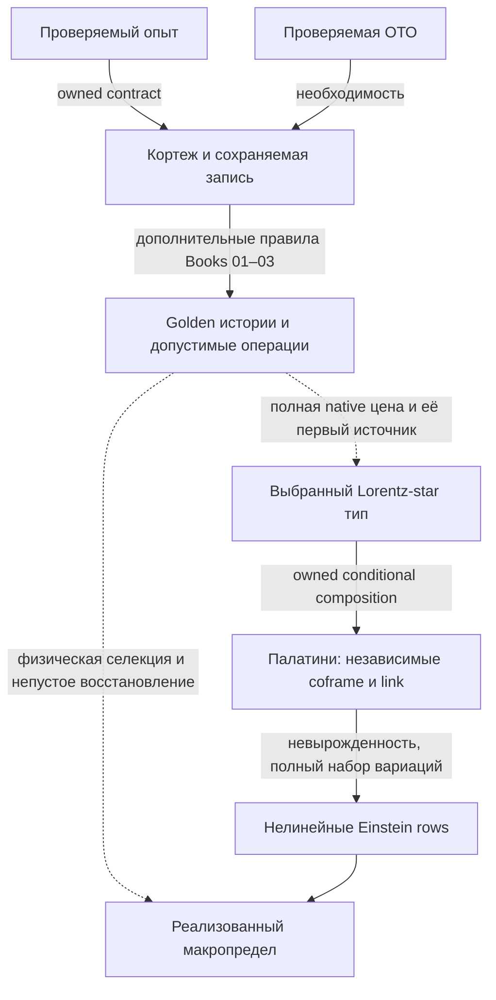

# D0 → ОТО: сборка оснований, источника и физического предела

17 октября 2026; дополнен 18 октября. Научный синтез интегратора в существующем Draft [#334](https://github.com/gvakhrushev/d0_15/pull/334).
Вход: `ec4256c9146530d3e98774cad755024b4aaa247d`; отдельно прочитан принятый
main `1aa3ff8b35133b1209164e0cd7da62ffefa647e2`, включая #367. Это не новая
очередь работ и не объявление закрытия исходного fixed-source/raw задания.

**Потреблённое продолжение:** [точная полная локальная решёточная семья](A4D_AF_STAR_FULL_LATTICE_STATIONARY_FAMILY_2026_10_17.md)
теперь закрывает локальную вакуумную recovery-часть на независимом
геометрическом носителе AF: все16 тетрадных и24 связевых строк во внутренних
узлах, настоящие golden веса, неплоский гладкий предел. Граница фиксирована;
физические N/P, материя и глобальное замыкание остаются открытыми.
Вход `275244e5` и [полная пятиисходная золотая цена](A4D_LABELLED_GOLDEN_RECORD_FULL_SOURCE_2026_10_18.md)
теперь добавляют собственные уравнения свободной подготовки и точный
ненулевой source на той же исходной метрике. Это уточняет остаток ниже,
не повышая построенный протокол до вынужденной динамики D0.

Проверка настоящей композиции теперь включена в §§7.1–8.3 того же
владельца. Два реальных старых исхода исключают независимую балансировку
его scene-флагов при естественной CAR-склейке. Общая подготовка должна
решать единый полный operator Euler. Геометрический запрос выражен
восемью CAR-словами и полным trace, но неплоские unipotent-плакетки
доказанно не входят в старый класс положительных изометрий. Поэтому
дальнейшая native сборка использует уже существующий full-Lorentz
positive-adjoint/Julia интерфейс со всеми его ветвями и источниками.
Ни подстановка adjoint вместо inverse, ни смена clock этого не исправляют.
В §7.3 уже решён единый preparation Euler настоящих128 исходов на
pure-time блоке: полный градиент скалярен при I16/16. Его ν-источник
строго положителен для любой подготовки на этом блоке, поэтому это
не совместный свободный ν-корень. Получен конкретный native source и
исключена его скрытая компенсация материей в указанном UV-секторе;
другие supports и общий continuum source остаются отдельной задачей.

Продолжение на входе `3447a184` теперь замыкает §§8.4–8.6 того же
владельца: весь Lorentz-перенос и coframe coefficients восстанавливаются
из actual raising X даже поперёк ненулевого null-направления. На заданном
addressed full-Lorentz Julia interface получена когерентная программа
star/golden запроса и строгий перенос её полного конечного первого
источника, включая work leakage. Не нужны отдельный U-oracle,
измерение элементов матрицы или дополнительная trace-копия материи.
Рабочие записи и их preparation остаются настоящими входными ресурсами.
Теперь остаток — физический допуск и вынужденность chiral программы,
её действительная старая история и независимая материя, затем exact
joint/global recovery. Доступность и реализация запроса ещё не выбирают
закон D0; повторять восстановление геометрии для этого не нужно.
§8.7 потребляет уже существующий Role/site selector: star-тип внутри
канонического oriented linear-curvature класса уже вынужден. Доказать
нужно ненулевую компоненту **полной native цены** в этом классе, сохранив
историю; I/Holst не является конкурентом внутри его исходных предпосылок.

Проверка этого forcing на входе `6c78c60e` теперь доведена до настоящей
source-пробы в §§8.8–8.9. Из когерентных путей выведен полный event source
с interference Gram и normalizer; scalar и amplitude веса не смешиваются.
Для всей заданной finite H+J+R найдена mixed coframe/link вариация с нулевым
источником, тогда как тот же Palatini stencil ненулевой. Прямое
отождествление двух источников исключено на этом carrier; stationary
reduction с настоящими observer/matter/torsion equations этим не исключена.
Проверка Book03 также различает явные penalty-функции и пока не заданные
S_coeff,J_coup,S_terminal и общий S_heat. Их нельзя считать вычисленным
полным действием по одному названию stack. Следующий шаг — source-preserving
stationary reduction реально заданной цены либо вывод полной собственной
geometry-history amplitude/price map. Новый compiler не заменяет этот шаг.

На входе `8c3a615c` эта stationary reduction уже выполнена в §§8.10–8.12:
все24 Lorentz-link и3 observer equations решаются вместе с полной
подготовкой над каждой близкой постоянной физической метрикой. Rank27
доказан через vacuum grade2 и tensor symmetry, а не численный minor.
Полная reduced цена сохраняет прежний отклик на форму плоского тора.
Но её faithful section не продолжается над всеми q(x): точное уравнение
на Q=e₀+e₁ запрещает одну реальную off-diagonal metric wave даже при
свободной связи и подготовке. На Q=2e₁, напротив, построен подъём всех
десяти metric slots; пять внутренних направлений ещё требуют своих
source equations. Поэтому старую stored-domain классификацию нельзя
просто перенести, а повторять homogeneous исключение для «закрытия ОТО»
больше не имеет смысла. Следующий научный переход должен предъявить
собственную пространственную stationary ветвь/полную history price с её
физической материей и источником. Общее отрицание D0→ОТО не получено.

На входе `7966c217` §§8.13–8.15 используют уже существующую balanced
подготовку, а не новую цену. Полная stationary fibre имеет104 real
параметра. Реальная суперпозиция vacuum+top снимает spatial preparation
препятствие: на owned gapped root построен первый подъём всех десяти
metric components для ВСЕХ Fourier-мод. На той же rank8 подготовке
rank27 amplitude theorem решает homogeneous internal source equations.
Reference128, все16 grades и rank-birth variations сохраняются.

Оставшийся переход теперь вычисляется на этом подъёме: полный источник
имеет13 внутренних направлений в mixed mode и19 в axial mode. Численный
расчёт всего носителя на q1100 решает линейную внутреннюю систему, но
обнаруживает ненулевой preparation residual второго порядка. Точное
cokernel-условие уже выписано; результат одной частоты не исключает
другие neutral Fourier modes и пока не является строгим no-go.
Это остаётся задачей существования nonlinear section, но следующий
результат снимает её с критического пути конечного GR comparison.

На входе `e989bc01` §§8.16–8.18 доказывают более сильное утверждение.
У ЛЮБОЙ C¹ секции всех внутренних уравнений через тот же faithful или
real-even root постоянный metric Hessian одинаков:7+/3zero. Формула
`L A+B=0` даёт `B*ker L=0` без обращения L. Отдельно полное translation
действие, homogeneous rank27 и eigenpreparation доказывают
`DR|ker L=0`, включая все rank births и reference128. Поэтому первый
источник настоящего R на любой секции равен γDd. Две постоянные
метрические вариации исключают `DΓ=c_EH DI_EH+ΛDVol+DR_same`:
off-diagonal variation требует Λ=0, diagonal variation даёт γ≠0.
Это точное препятствие источника всех таких секций, а не численный
остаток одного выбранного подъёма.

Тем самым дальнейший перебор Fourier kernels и подготовок вокруг этих
корней не может исправить данный exact finite GR переход. Смена complex
rank при том же Reρ вообще даёт эквивалентную вариационную задачу;
на фиксированном real χ carrier весь source уже фиксирует R_shell=I₈/8.
Реально иная time-sign подготовка сохранена с exact first lift и actual
численным second-source obstruction; это потреблённый тест, не новый
маршрут. Вместе с уже доказанным `M z c<beta` при controlled small-heat
refinement следующий шаг теперь строго направлен на actual complete
history/price, её native calibration law и допустимую оценку предела.
Новая цена, counterterm или residual-defined matter не добавлены.
Иные корни, independent physical matter и controlled limits этим конечным
утверждением не исключены; физическое D0→ОТО остаётся открытым.

## 1. Итог сборки

На входе `ba3902b3` §§8.31–8.33 доказывают точное конечное
существование всех preparation/coframe/observer equations условной
полной code−coherent цены при заданном конечном коде с β>0. Минимум
берётся по реальной подготовке, масштабу и coframe Gram tetrahedron.
Вырожденную геометрию исключает explicit null-history entropy birth;
phase-only V₄ covariance переносит angle/scale equations на все16
coframe строки без изотропного prior. Все reference128, внешние
amplitude directions и nonzero-Fourier field equations сохранены.

Первый logarithmic correction выбирает G1=1, оставляя две физические
shear координаты. Полный конечный код действительно различает их,
поэтому Bell/isotropic point не назначается решением. Теорема позволяет
подготовке и геометрии сместиться. Uniform det G>0 в n→∞ не доказан.

Остаток теперь точно определён: homogeneous Lorentz-link source
`2J_r(Ω_r)=−B_r(Ω_r u_r)`. Двенадцать stabilizer directions исчезают;
в canonical circulant embedding все24 link equations равносильны
четырём scalar costate conditions. Их точная сумма квадратов и recursion
выведены из той же полной цены. Это следующий геометрический шаг,
а не ещё один preparation census. Physical full-code/Info admission,
resource/controller equations, independent matter и spatial/global
переход к ОТО остаются открытыми. Полный finite joint root пока не заявлен.

На входе `36ad880c` §§8.27–8.28 дают следующий положительный шаг:
полный coherent-memory source сходится в C¹ даже через rank births,
без spectral floor, на фиксированном полном data/reference носителе.
Доказательство использует uniform C² native-channel jets; одна лишь
сходимость канала раньше этого не давала. Return normalizer также
вычислен с обеими preparation/return-projector derivatives. Entropy-only
критические точки допускают ненулевые eigenvalues, но имеют нулевой
полный первый источник; их нельзя принять за корни всей цены.

Уже определённая полная code−coherent цена даёт иной результат.
Из двух настоящих leading exit rows выведен fixed-code коэффициент β;
предельный функционал равен `βT TrρA²−S(R_T)/logφ`. Для любого
заданного β>0 balanced ±λ подготовка решает ВСЕ operator/preparation/
clock first equations при единственном положительном Tλ². Actual
flat-shell Bell state использует исходный reference128, а поперечные
вариации поля и подготовки не удалены. Таким образом есть ненулевой
совместный предельный корень полной условной цены, а не только баланс
одной scale строки. Теперь требуются physical code/Info binding со всеми
controller источниками и finite native stationary continuation; C¹ limit
не даёт его автоматически при logarithmic transverse Hessian. Ни новое
действие, ни физическое закрытие ОТО этим результатом не назначаются.

На входе `420f6545` §8.26 проверяет буквальное MDL-чтение Book03
отдельно от Shannon mean. На полном tagged golden законе наибольшая
вероятность всегда у field-independent bypass; разрыв до остальных
исходов не меньше одной φ-единицы цены. У исходной native long history
MAP — полная blank-история с C¹ пределом
`−log Tr(ρ exp(−4p²T A_0²))/log φ`. Её настоящий scale source
положителен при nonblank подготовке. Но преимущество одной истории
над каждой другой не даёт концентрации: остальные вместе сохраняют
положительную вероятность. Mean, MAP и scalar sum на одном полном
законе имеют разные источники и не взаимозаменяемы.

Следующий шаг поэтому определён точнее: нужна собственная карта
историй в геометрические классы памяти, с multiplicity, holonomy и
ресурсами, затем перенос её полного источника в S_stack. Book03
§03.10(f) сам различает geometry sum и feedback partition; coherent
сумма сохраняет cross Gram terms. Ни смена названия цены на MDL,
ни готовое trace-log identity не строит эту карту. Условные Einstein
конструкции остаются положительными входами для её проверки.

На входе `2bfb8974` §§8.22–8.25 потребляют положительную tagged-exit
конструкцию #363 (`33911def`). Её exits реализуются конечным CNOT
копированием сохранённой истории, а golden coin не требует нового угла.
Выведен весь закон нефильтрованного сравнения с central/spatial failures.
Его полная entropy mean имеет положительный endpoint scale source в
доказанном weak window; selected logdet на той же вариации имеет
отрицательный source. Central survival term усиливает положительный
общий scale ответ. При fixed coins/controllers joint roots этой mean
лежат в общем blank kernel; free controller rows остаются отдельными.
Длинная история даёт явный положительный weighted count-source на
фиксированном data carrier. Возможная фильтрация меняет весь закон;
одной условной нормировкой это сравнение не исправляется.

Таким образом, условный curvature ratio (1,1,−1) сохранён и execution
стал конкретнее, но прямое связывание полной mean с logdet исключено
для данного readout. Собственные normalization/clock строки logdet
также не вынуждают double clock; volume coefficient3/2 сохраняется.
Следующая необходимая связка — настоящая полная valuation либо native
constraint с собственным источником. Она не заменяется назначенным
остатком, другой stationary section или повторным подбором heat ratio.
Проверка буквальных Book01/cocycle definitions уточняет эту связку:
при complete w=q binding остаток B равен0. Реальное условное событие
может иметь отрицательный normalization source, но вместе со всем
взвешенным дополнением снова даёт прежнюю полную entropy mean.
Перебор success cuts не добавляет независимый компенсатор. Настоящий
другой physical raw partition или закон агрегации всё ещё требует вывода.

На входе `4838004d` §§8.19–8.20 того же source owner потребляют полную
native Julia/golden среднюю: при νR≤1/64 её scale source положителен
для ЛЮБОЙ nonblank подготовки на полном data⊗reference128. Для каждой
фиксированной конечной длины полностью сохранённой истории существует
своё общее для всех подготовок weak window. Если scale независимо
допустим, весь joint critical set здесь blank и имеет нулевой первый
источник. Отдельный точный preparation-saddle аргумент не подменяет
этот scale proof. Ни rank selection, ни ещё одна конечная длина истории
не создают недостающий Einstein source в объявленной области.

Это даёт следующий точный вход сборки: настоящая полная цена H/ℓ+B
должна иметь B_ν=−H_ν/ℓ<0 на nonblank joint root либо предъявить
реальный constraint source. Написана полная формула binding defect
между кодовыми S_h и Born q_h, включая normalizer. Внутренняя stationary
редукция и выполненные квадратные блоки Book03 не заменяют этот вклад.
Отрицательный heat source уже существует в другой определённой цене,
но его равенство данному B не доказано. Новые action/Info не вводятся.
Совместный long-history/refinement предел этой теоремой не решён;
physical admission/selection и independent matter остаются открытыми.

Отдельный §8.21 затем решает long-history source при фиксированном
data carrier: `H_n=4p²(nν²)Tr(ρ A_0²)log(1/ν²)+O_C¹(1)`.
Полный128^n tape, все повторные exits и начальные preparation jets
сохранены. Контроль Fisher information доказывает именно источник,
а не только сходимость значений. Ведущий функционал Rayleigh/count;
при nν²→T>0 и a≥a_0>0 свободная scale строка остаётся положительной.
Каждая derivative берётся при фиксированном целом n, без вычитания
divergence или выбора новой физической нормировки. Предел a→0,
spatial refinement и физический допуск растущей памяти отдельно открыты.

**Формулу нелинейной ОТО заново искать не требуется.** В корпусе уже есть
положительная композиция: выбранная конечная Lorentz-star запись → полная
цена построенного golden-AF опыта → предел Палатини → все десять вакуумных
уравнений Эйнштейна. Есть и непустые конечные кривые критические семейства
на всех внутренних coframe/link вариациях при фиксированной границе.
Для [полного пятиисходного опыта](A4D_LABELLED_GOLDEN_RECORD_FULL_SOURCE_2026_10_18.md)
уже решены и все свободные AF/scene/reference preparation rows;
геометрическая семья переносится в его полную ожидаемую Cost−Info.

**Открыт переход от построенного опыта к собственному закону D0.** Нужно
вывести его полную цену и источник из тех же допустимых историй, включая
геометрию, материю, подготовку, наблюдателя и архив. Затем нужен физический
переход к классическому уравнению с непустым полным восстановлением.
Способность реализовать нужный оператор и наличие правильного предела его
отклика сами по себе этого перехода не доказывают.

Обратная половина замысла пользователя уже имеет точную формулировку:
**любая проверяемая ОТО обязана реализовать функциональный кортеж D0**.
Это необходимость операционного основания, а не доказательство того, что
один лишь кортеж выбирает все динамические детали D0. Ни эту половину,
ни уже полученную геометрическую половину не следует повторно выводить.

Новые аналитические связки этого синтеза:

1. §4 отделяет условный прибор от совместного закона геометрии и указывает,
   почему нормировка источника ещё не доказывает классическую селекцию.
2. §5 даёт точное соотношение исходной raw-нормы и нормы макроскопического
   источника. Сильный старый терминал сохраняется; его необходимость для
   любого вывода ОТО из предыдущих результатов не следует.
3. §§6–7 сводят положительную сборку к полному первому источнику выбранного
   типа, а не к буквальному совпадению двух микроскопических приборов.
4. Обновлённый §8 связывает собственное CAR/clock чтение, новую полную
   цену с решённой подготовкой и достаточную Cartan-классификацию.
   Native программа, прежняя история и независимая материя остаются
   разными явно указанными предпосылками.

## 2. Что именно дают первые книги

Это карта прочитанных несущих разделов и их владельцев, а не заявление о
перепроверке каждого доказательства десяти книг. Основные входы: BOOK 00
§§00.3e–00.4, 00.8–00.9; BOOK 01 §§01.0–01.8, 01.15–01.16, 01.22a–01.24;
BOOK 02 — конечные операторы и тестовая экстенсиональность; BOOK 03
§03.3; BOOK 06 — история/переходы; BOOK 07 — операционное чтение и предел.

| Кирпич | Уже принадлежащий результат | Что из него не следует без следующей стрелки |
|---|---|---|
| [BOOK 00](../../01_BOOKS/BOOK_00_ENTRY_CONTRACT_AND_ADMISSIBILITY.md), [PopperianBootstrap](../../03_FORMALIZATION/D0/Foundation/PopperianBootstrap.lean) | Killing test эквивалентен принятому verification contract; из него следуют сохраняемая различимость, функциональный кортеж и независимость вердикта от catalogue | Единственная буквальная таблица состояний, полный физический процесс или уравнение Эйнштейна |
| [BOOK 01](../../01_BOOKS/BOOK_01_CONDENSED_FOUNDATIONS_AND_GRAPH_BIRTH.md): Σ=(C,C*,D_min,Δ,R,O) | Сначала код/канон/различение/архив/доступ; конечные инструменты и сцена — дальнейшее построение | Нельзя ставить гладкую геометрию вместо исходного носителя и затем считать её допустимость доказанной |
| Там же: condensed/profinite support | Совместимые конечные чтения и ограниченный admissible subfunctor: конечная факторизация, операторный подъём, положительный ответ, проективность и halt | Произвольный морфизм ambient condensed category не становится физической операцией D0 |
| φ, прямой ход и первый возврат | Для заданной примитивной семантики `p+p²=1`; golden cost/cylinder structure уже имеет владельцев | Возврат другого порядка меняет runtime; φ нельзя заново подбирать под нужный физический коэффициент |
| Сцена (9,11,13), §01.22a | Связаны торальные возвраты, ограничение ёмкости и typed preparation; это содержательные предпосылки, а не три выбранных числа | Полином, нулями которого назначены 9,11,13, не является независимым выводом сцены |
| π₀ и golden precision | Конечный фазовый инвариант и контролируемая шкала чтения | π₀ не заменяет π в обычной гладкой производной; масштаб точности сам не выбирает физическую связь |
| [EmpiricalTheoryFactorization](../../03_FORMALIZATION/D0/Foundation/EmpiricalTheoryFactorization.lean) | Фактор по полному заданному семейству тестов; injective evaluation и единственная факторизация любого согласованного summary | Физическая осуществимость и полнота семейства тестов не доказываются определением фактора |
| [BOOK 03](../../01_BOOKS/BOOK_03_FINITE_ACTION_OPERATORS_AND_SCENE_DYNAMICS.md) §03.3 | История имеет цену Cost−Info и вес; классическая вариация описывается через минимальную цену | Средняя условная энтропия произвольно сконструированного прибора не отождествлена автоматически с ценой геометрической истории |
| [BOOK 06](../../01_BOOKS/BOOK_06_EVOLUTION_FORGETTING_AND_TIME.md), [StaticToDynamicsOwner](../../03_FORMALIZATION/D0/Evolution/StaticToDynamicsOwner.lean) | Владельцы некоммутативности, архива циркуляций и golden ladder; границы self-reading/refinement явно описаны | Это не универсальная теорема о единственном переходе всех допустимых историй |

### 2.1. Обратное доказательство: почему проверяемая ОТО требует Σ

Пусть протокол проверки ОТО удовлетворяет принятому `KillingTest`.
Если разные проверяемые исходы x≠y дают одну запись, сравнение одной и той
же пары записей должно одновременно вернуть «same» и «different». Получено
противоречие. Поэтому запись инъективна на различаемых состояниях. Вместе
с остальными частями контракта это ровно уже доказанные
`killingTest_record_injective` и `killingTest_forces_functional_tuple`.
`alternative_burden` распространяет аргумент на любой альтернативный протокол.

Это относится и к косвенному детектированию: проверяется различие записей
и предсказаний, даже если объект не наблюдается непосредственно. Поэтому
интерпретация ускоренного расширения также нуждается в Σ. Аргумент не
выбирает конкретную модель тёмного сектора и не устанавливает её истинность.
Два различных `Line` в формальном контракте не следует без отдельного
аргумента переименовывать в причинно независимые физические лаборатории.

Точная логическая запись:

    VerifiedGR(P) ⇒ FunctionalTuple(P).

Она не равна `FunctionalTuple(P) ⇒ Einstein(P)`. Второе утверждение требует
динамической сборки ниже. Также не нужно доказывать изоморфизм всех сырых
внутренних состояний: [универсальная факторизация](../../03_FORMALIZATION/D0/Foundation/EmpiricalTheoryFactorization.lean)
уже говорит, какая эквивалентность действительно нужна — равенство всех
допустимых результатов. В тесты входят и будущие продолжения: равные
текущие маргинальные распределения не разрешают стереть различимую позднее
фазу или историю.

### 2.2. Как применять condensed математику и DAG

Condensed язык удерживает совместимость чтений и различие объекта от одной
его реализации. Он полезен для склейки диаграммы истории/операции/записи.
Само слово «склейка» не даёт оценки производной после умножения на растущий
масштаб. Это уже показано в [condensed-history source obstruction](A4D_CONDENSED_HISTORY_SOURCE_OBSTRUCTION.md):
конечные стадии и их предел могут вести себя по-разному для масштабируемого
источника; endpoint Gram не определяет cross comparison.
Первичный внешний контекст — [лекции Шольце по condensed mathematics](https://arxiv.org/html/2605.03658),
а физически ограниченный subfunctor берётся из BOOK 01, не из этих лекций.

Реестры используются как карта уже имеющихся владельцев. Но
`presupposition_edges.json` хранит концептуальные предпосылки, а не
компилированные доказательства композиции. `forcing_routes.json` отдельно
проверяет независимость заявленных маршрутов: 20 проверено, 0 сохранилось
до ремонта, 3 после ремонта. Это не число опровергнутых теорем D0.
В частности, `D0-SPECTRAL-EINSTEIN-001` с графовым `G=2L` и
`D0-GRAVITY-MACRO-EINSTEIN-INTERFACE-001` с набором конечных свойств нельзя
подставить вместо одного нелинейного Lorentz источника. Реальный DAG сборки
должен соединять совпадающие носители, действия, вариации и пределы.

## 3. Последние подходы: что сохраняется и почему возникал круг

| Подход 14–17 октября | Положительный результат, который сохраняем | Какой переход нельзя повторно считать закрытым |
|---|---|---|
| [Прямое вынуждение native цены](A4D_NATIVE_DIRECT_FORCING_ATTACK.md) | Конкретные return/code условия различают цены; построены строгие контроли неполных структурных требований | Совпадение вакуума, монотонность, cutoff и refinement ещё не выбирают всю Cost−Info |
| [Полная геометрия](A4D_COFRAME_TORSION_INTRINSIC_GR_RECONSTRUCTION.md) | Coframe, все24 LC-компоненты, нелинейный Einstein covector | Реконструкция геометрии не равна источнику цены прибора |
| [Центрированный конечный probe и φ/π₀](A4D_PHI_PI0_CONTINUUM_CLOSURE.md) | Непустые endpoint preparations, оценка O(h/ε+ε²), golden Cauchy-чтение | Точная sampled-Einstein source fibre выбранного warp пуста; измерение конечной разности не создаёт отсутствующих совместных корней |
| [Stored joint kernel](A4D_NATIVE_FULL_JOINT_KERNEL_AND_MATTER_REDUCTION.md) | Exact off-shell elimination и классификация ближайших faithful/rank8 корней как плоских | Новое сканирование тех же семейств не создаст неплоскую ветвь; crossing не равен совместной нелинейной ветви |
| [Foundation forcing](A4D_FOUNDATION_FORCING_NOT_CATALOGUE_SEARCH.md) | Генераторный intertwining с производными и оценками для слов; цена входит в ту же диаграмму | Представимость заданного Q ещё не вынуждает физический Q |
| [Полная история и feasible gain](A4D_NATIVE_FEASIBLE_GAIN_AND_ACTION_SOURCE.md) | Точная оптимальная цена/источник в указанном классе тестов; строгий gain deficit | Томографическая полнота не даёт полный quantum-information optimum |
| [Fixed-beta IR feedback](A4D_NATIVE_FEEDBACK_IR_EINSTEIN_TORSION_SELECTION_2026_10_17.md) | Настоящие curvature/torsion коэффициенты исходной цены, условное подавление torsion | Положительная вспомогательная метрика, surviving volume и observer source не исчезают от одного EH-коэффициента |
| [AF active-left / retained-right](A4D_AF_LEFT_RIGHT_ACTIVE_ARCHIVE_GR_COMPILATION_2026_10_17.md) | Конечный AF оператор сохраняет старый right provenance; старый commutant no-go нельзя переносить на другой регистр | Членство в алгебре не доказывает допустимость перехода и полную стоимость его исполнения |
| [v8/AF zero-mode boundary](A4D_AF_V8_FLAT_ZERO_MODE_INTERTWINER_BOUNDARY_2026_10_17.md) | Точное различие событий неизменённого v8 и AF уже доказано | Не нужно снова пытаться назвать один буквальный v8 round тем же AF round |
| [Free-actuator no-go](A4D_AF_ACTUATOR_ELIMINATION_EINSTEIN_SOURCE_NO_GO_2026_10_17.md) | Если вся цена F(E), независимая стационарность E зануляет этот источник | После on-shell устранения E нельзя вернуть потерянный источник через искусственно навязанную E(g) |
| [Принятый #367](https://github.com/gvakhrushev/d0_15/blob/1aa3ff8b35133b1209164e0cd7da62ffefa647e2/02_REGISTRY/research/A4D_AF_RECORD_COST_INFO_COUPLING_GAP_2026_10_17.md) | Старый AF probe не несёт lapse/shift/matter источников, необходимых его EH-identification | Это не опровержение новой явно star-зависимой конструкции; её физическая привязка остаётся отдельной |
| [AF-star nonlinear composition](A4D_AF_STAR_PALATINI_NONLINEAR_EINSTEIN_COMPOSITION_2026_10_17.md) | Один полный Book-pointer, C² Palatini limit, все10 Einstein rows, nonflat pp-wave и конечные 25m критические направления | Пока не доказаны native execution/full price, плотность этих направлений и unrestricted joint recovery |

Повторявшаяся схема была такой: находился правильный геометрический ответ,
затем выяснялось, что его вход, цена, вариации либо физическая подготовка
отличаются от исходного процесса; после этого начинался поиск другого
ответа. Последняя положительная композиция позволяет остановить этот круг:
теперь надо потребить её геометрическую часть и доказать оставшуюся связь
с полным native источником.

Пунктир обозначает незакрытую физическую предпосылку, а не ещё одну
геометрическую формулу. Обратная стрелка H→B не замыкает прямую стрелку C→G.

## 4. Условный прибор и закон геометрии — разные объекты

### 4.1. Лемма о недоопределённости совместного закона

Пусть G — конечный набор геометрических меток, Ω — конечный набор полных
записей, и для каждого g дано положительное нормированное q_g(ω).
Для любой положительной вероятности π на G положим

    Pπ(g,ω)=π(g)q_g(ω).

Тогда `Pπ(ω|g)=q_g(ω)` для всех π, а `Pπ(g)=π(g)`. Доказательство — деление
на `Σω Pπ(g,ω)=π(g)`. Следовательно, даже точное знание всех условных
опытов не определяет геометрический marginal.

Это логический контроль, а не два построенных M1-допустимых мира D0.
**Не предлагается добавить π как физический постулат.** Наоборот, нужно
из исходных историй вывести, какие записи представляют геометрию, как
они взвешены совместно с прибором и какая цена управляет её вариациями.
При вариационном пути вместо вероятностного требуется доказать соответствие
геометрической вариации действительной вариации полной native цены.

### 4.2. Нельзя смешивать цену истории, среднюю цену и free energy

В конечном положительном секторе с фиксированной reference measure пусть
истинные ненормированные веса заданы `exp(-a Sω(x))`, a=log φ. Тогда

    Z=Σω exp(-a Sω),       Γ=−log Z/a,
    DΓ=E[DS],
    D²Γ=E[D²S]−a Cov(DS,DS),
    D(E[S])=E[DS]−a Cov(S,DS).                         (4.1)

Все тождества следуют прямым дифференцированием конечной суммы. Для двух
направлений в Hessian берётся соответствующая билинейная covariance.
При движении reference measure нужны её настоящие производные; их нельзя
включить в «константу». Это тот же структурный вопрос, который уже решён
в [history-density synthesis, §2](A4D_HISTORY_DENSITY_PALATINI_SYNTHESIS.md):
после оптимизации массы с KL-членом получается free energy, а не средняя f.

Контроль: если `Sω=−log qω/a` и `Σqω=1`, то Z=1, Γ=0, но
`E[S]=H(q)/a` обычно непостоянна. Поэтому источник Shannon-энтропии
условного указателя нельзя без отдельного binding назвать источником
ненормированного веса геометрической истории. Обратное также неверно:
эти формулы не выбирают Γ вместо средней цены как физическое действие.
Выбор уже должен следовать из native процесса и конкретного Book consumer.
Квантовую coherent историю нельзя заменить этим положительным commuting
сектором без доказанной декомпозиции.

### 4.3. Нормировка источника сохраняет критические точки, но не создаёт классическую концентрацию

В AF-композиции `S=B+t² A`, где B не зависит от полей. При фиксированном
t>0 равенства `DS=0` и `DA=0` эквивалентны. Это законная математическая
нормировка, не контрчлен. Но если дополнительно пытаться назначить именно
этому S вес геометрии, для двух bounded A получим

    φ^(−S(g1))/φ^(−S(g2))=φ^(−t²(A(g1)−A(g2))) → 1.    (4.2)

Следовательно, C²-сходимость нормированного A сама не доказывает
концентрацию геометрических историй при t→0. Положение мод при положительном
перемасштабировании может сохраняться; концентрация вероятности — другое
утверждение. Также golden код не даёт её автоматически: exact-cost слов
`F_(n+1)`, каждое имеет вес p^n, а их суммарная масса стремится к φ/√5.
Число слов компенсирует экспоненциальный кодовый вес.

Для пути BOOK 03 «наиболее вероятная история → классический предел» нужно
потребить реальный native закон истории/макроскопического чтения и
контролировать этот предел. Для пути через принадлежащую конечную
вариационную задачу достаточно доказать её полное source/variation
соответствие и восстановление критических состояний. Не требуется
добавлять искусственную температуру, число повторений или Gibbs-подготовку.

## 5. Точное различие двух требований к пределу

### 5.1. Исходная raw задача сильнее сходимости макроскопического источника

Здесь только исходная нормировка [probe/source owner](A4D_PHI_PI0_CONTINUUM_CLOSURE.md):
`I_h=h² A_h`, h=1/L, L^4 ячеек; десять метрических компонент уже packed.
Пусть ΔXi — разность сырых метрических источников двух действий в одной
и той же конвенции. Определим

    r_h(x)=h^(-2) ΔXi_h(x),
    N_h=h^(-2) Σx ||ΔXi_h(x)||₁=Σx ||r_h(x)||₁,
    F_h[V]=h² Σx ΔXi_h(x)·V(x)=h⁴ Σx r_h(x)·V(x).       (5.1)

Для **всех решёточных** packed-проб с `max_(x,a)|V_a(x)|≤1` двойственность
ℓ¹/ℓ∞ даёт точное равенство

    sup |F_h[V]|=h⁴ N_h.                               (5.2)

Верхняя оценка — неравенство треугольника; равенство достигается выбором
знака каждой компоненты r. Если разрешены только гладкие пробы, остаётся
верхняя оценка, а равенство не утверждается.

Таким образом исходный терминал `N_h→0` требует `sup|F_h|=o(h⁴)`.
Обычная сходимость этого макроскопического источника требует `sup|F_h|→0`.
Они не эквивалентны. Например, для фиксированного ненулевого packed-тензора C
алгебраическое семейство `r_h(x)=h C` удовлетворяет

    N_h=||C||₁ h^(-3) → ∞,       sup|F_h|=||C||₁ h → 0. (5.3)

Это контрпример импликации между нормами, **не** построенный native
совместный корень. Для fixed-source корня r имеет специальный вид
`tau−rho_cmp,h`; (5.3) не утверждает реализуемости именно такого остатка.
Ничего здесь не доказывает даже слабую сходимость фактического native
источника. Члены volume/aether или lapse/shift residual, сохраняющиеся
после макроскопического pairing, остаются реальными препятствиями.

### 5.2. Следствие для стратегии, не изменение контракта

Первоначальная задача #216/#310/#334 с независимо заданными g,tau,
точными корнями и raw norm остаётся OPEN с прежним терминалом. Подменять
её средним или слабым результатом нельзя. Но более общий пользовательский
вопрос «выходит ли макроскопическая ОТО из D0?» требует собственной
точной теоремы, а не молчаливого добавления `o(h⁴)` как универсальной
необходимой предпосылки. Эти две математические задачи должны быть видны
вместе, без объявления одной решённой за счёт другой.

Для всех десяти Einstein rows достаточен полный предельный source pairing
со всеми гладкими компактно поддержанными метрическими пробами, вместе
с полными link/matter/observer условиями и правильным пределом решений.
Распределительное равенство становится поточечным при нужной регулярности.
Одна TT-проба, конечный заранее фиксированный набор или растущее число
однотипных проб этого не дают.

Операционная φ-точность совместима с таким утверждением: если для каждого
первого k тестов уже доказана количественная сходимость с константами,
можно заранее выбрать h_k так, чтобы все k ошибок были ≤φ^(−k).
Для расширения с плотного счётного семейства на все пробы нужна локальная
равномерная оценка источников в выбранной тестовой норме. Это расписание
чтения, не выбор новой физической clock law и не исходная raw-оценка.

## 6. Положительная сборка: универсальность полного первого источника

### 6.1. Не нужно требовать буквального v8=AF

Исходный v8 и построенный AF уже различены точным zero-mode событием.
Это закрывает буквальное неизменённое одношаговое отождествление. Для
макроскопической ОТО нужен более точный по назначению объект: одинаковый
полный предельный ковектор на физически допустимых вариациях.

Выбранный [Role-star owner](MEMO_A4D_STAR_DENSITY_VARIATION_PRESSURE.md)
имеет `d_A=1`, `d_E=1` **в объявленном типе**: локальная based plaquette,
нечётная curvature insertion, квадратичные relative-solder legs, фиксированная
комплементарная Role orientation, G₂ и internal star. Его старый `d_P=1`
сформулирован только для указанного плоского L=2 quotient. Новая
[нелинейная композиция, §2.1](A4D_AF_STAR_PALATINI_NONLINEAR_EINSTEIN_COMPOSITION_2026_10_17.md)
потребляет именно тип первого отклика, а не глобальную уникальность всех
действий. Коэффициент этого типа должен быть константой по полям;
произвольная λ(g) вносит дополнительный источник.

### 6.2. Лемма переноса источника через гладкую полную цену

Пусть X — компактный гладкий конечномерный chart **всех заявленных** полей
и их подготовок. Пусть μ_hw≥0 не зависит от X и имеет ограниченную сумму;
f_hw и Df_hw равномерно ограничены. Пусть F∈C² около e₀, F′(e₀)≠0, c₀≠0,
и истинная полная цена на этом chart имеет уже выведенный вид

    S_h,t=B_h+Σw μ_hw [F(e₀+c₀t² f_hw)−F(e₀)]+C_h,t,
    DB_h=0.                                                   (6.1)

Прямое дифференцирование и теорема о среднем дают, равномерно на chart,

    t^(−2) DS_h,t
      =c₀ F′(e₀) Σw μ_hw Df_hw + t^(−2) DC_h,t + O(t²).        (6.2)

Действительно, источник каждого слагаемого после деления на t² равен
`c₀ F′(e₀+c₀t²f) Df`; его отличие ограничено
`|c₀|² t² sup|F″| |f| ||Df||`. Сумма масс ограничена. Для C²-версии нужен
соответствующий дополнительный контроль производных; из одного F∈C²
здесь не объявляется O(t²) для второй производной.

Если существующий geometric/quadrature owner даёт
`Σ μ_hw Df_hw → γ D S_P`, γ≠0, и **полный** оставшийся источник сходится
к `D S_m`, то

    t^(−2) DS_h,t → c D S_P + D S_m,
    c=c₀ F′(e₀)γ ≠ 0.                                        (6.3)

При moving μ нужно также сохранить
`t^(−2)Σ Dμ [F(e₀+c₀t²f)−F(e₀)]`; при moving reference/clock/preparation
их источники входят туда же. C нельзя объявить постоянным по названию
«controller», «архив» или «нормировка».

Это общий аналитический consumer, а не ещё одна выбранная физическая
цена. Он дополняет имеющуюся [центральную variational equivalence](A4D_CENTRAL_RECORD_VARIATIONAL_EQUIVALENCE.md)
и показывает, почему после доказанного native binding не требуется
перебирать формы entropy/readout с одним и тем же ненулевым первым
откликом. Для конкретного AF опыта соответствующий более сильный C²
результат **уже доказан** его владельцем.

### 6.3. Главная несущая предпосылка

Нужно получить (6.3) для полной native цены без подстановки желаемого
результата в E(g), а до этого доказать принадлежность её leading response
выбранному типу и ненулевую чувствительность. Факт `d_A=1` работает после
этих предпосылок. Он не выводит из одного слова «натуральность» locality,
parity, quadratic solder degree, отсутствие самостоятельной плотности,
observer terms или всех higher-order contributions.

Это существенные, проверяемые условия. Уже [discrete target-span owner](MEMO_A4D_DISCRETE_PALATINI_TARGET_SPAN.md)
имеет легальные Vol_rel и torsion invariants вне выбранного star-only
типа. Одна gauge covariance не устраняет их. Нужно вывести их отсутствие,
подчинённый порядок либо собственную связанную динамику из того же
процесса. Геометрическую универсальность следует применять к доказанному
первому источнику, а не превращать её предпосылки в новый физический закон.

## 7. Составная теорема, которую теперь надо замкнуть

Пусть из D0 без внешнего выбора действия получены:

**N. Native source.** Один полный процесс/price map с реальной вариацией
всех полей. На регулярных charts его нормированный первый источник
сходится к `c D S_P + D S_m`, c≠0. Остаток включает подготовку, observer,
архив, reference и clock, а не только выбранную геометрическую строку.

**V. Variation and recovery.** Непустое семейство физически допустимых
совместно стационарных конечных состояний имеет регулярный невырожденный
предел. Каждая гладкая компактно поддержанная coframe/link/matter проба
имеет допустимый конечный подъём; источники и подъёмы сходятся с нужной
локальной равномерностью. При использовании плотного семейства имеется
оценка, позволяющая распространить равенство на все пробы.

**P. Physical classical selection.** Эти стационарные состояния действительно
являются рассматриваемым классическим сектором native истории, либо
входят в принадлежащую native вариационную задачу с доказанным source map.
Средняя условная цена прибора не подменяет эту предпосылку.

Тогда из нулевого конечного полного источника, N и V следует
`c D S_P + D S_m=0` на всех таких пробах. В вакууме 24 независимые link
вариации невырожденного coframe дают T=0. После этого 16 coframe rows
с шестью Lorentz frame identities дают все10 `Gμν=0`. Это nonlinear
Palatini consumer существующей композиции, без TT/линейного ограничения.
Утверждение о физической ОТО использует также P, а не только формальный
предел стационарных уравнений.

Для spin-free материи с независимо выведенным same-program S_m и
конвенцией `δS_m=½∫√|g| Tμν δgμν` получается `2c Gμν=Tμν`.
Для spinful CAR материи сначала остаётся Cartan spin source; нельзя
молча наложить torsion-free или заменить полную материю удобным скаляром.
Ненулевой c достаточен для вакуумного нулевого множества. Правильный знак
и относительная нормировка matter coupling — дополнительные физические
содержания, не исправляемые переименованием c.

Космологический член также должен иметь native владельца. Если полная
цена оставляет volume source, его нельзя вычеркнуть ради вакуумного
`G=0`: нужно вывести его коэффициент и соответствующее уравнение.
Отсутствие extensive baseline у построенного AF опыта не доказывает
отсутствия такого источника во всей D0. Операционная необходимость Σ
для космологических наблюдений из §2.1 не решает этот динамический вопрос.

**Где уже есть непустота.** AF владелец построил неплоский Ricci-flat pp-wave
и IFT-корни в 25 направлениях: один conformal bump и все24 Cartan.
На непересекающихся patches получены 25m направлений. Но увеличение их
числа не доказывает плотность во всех физических metric directions;
произвольные shear/lapse/shift пробы этим фактом не покрыты. Последующее
[полное локальное решение](A4D_AF_STAR_FULL_LATTICE_STATIONARY_FAMILY_2026_10_17.md)
снимает это ограничение на независимом геометрическом носителе внутри
фиксированной границы. V для полного физического семейства ещё не закрыта. Пустая exact-source
fibre старого warp также не служит положительной recovery теоремой.

### 7.1. Приоритет 18 октября: нелинейный bootstrap того же spin-2 источника

**NONVACUUM EXACT FINITE Einstein matter source (18 October)** — [A4D_LOCAL_LEFT_CODED_CAR_NULL_MATTER_EINSTEIN_2026_10_18.md](A4D_LOCAL_LEFT_CODED_CAR_NULL_MATTER_EINSTEIN_2026_10_18.md). Instead of adjoining an external \(S_m\) to the vacuum AF-star action, **the same existing AF×scene \(J_2=-\operatorname{Tr}\log(I-zF)\)** has been explicitly extended to a coherent LEFT-address-controlled scene Golden rotation driven by an ORIGINAL full16 Lorentz Clifford square of the recorded scalar-grade gradient. On full true PF weights, \(w_xf_x=\bar w\widehat f_x\) and \(w_x(\bar w/w_x)q_x=\bar w q_x\) match the exact same density-dressed source metric. The OLD RIGHT archive, CAR16/reference128 and all 528+22448 scene modes are preserved; the complete trace-log factors as one block-diagonal operator, not an assumed sum of experiment prices. Its two genuine first source channels have the **endogenous nonzero ratio**
\[
\lambda_\sigma(z)=\sigma\frac{R/Q+p^6}{2p^3},\quad
\lambda_\pm(2^{-20})=\pm2.236066798693\ldots,\quad
\lim_{z\to0}\lambda_\pm=\pm\sqrt5.
\]
The geometry and matter Golden control angles are on the SAME original axis with source ratio \(2\sigma p\). More importantly, for \(\psi=s u\) on the ORIGINAL fully varied pp-wave lattice, \(\Gamma(d\psi)^2=0\) but \(D_g\Gamma(d\psi)^2\ne0\); the independent scalar Euler vanishes by exact lattice integration-by-parts, both link rows by the true half-step connection, and ALL 16 coframe rows exactly if \(A+D=-2\lambda_\sigma s^2\). With the reverse Golden orientation \(\sigma=-1\), \(\operatorname{Ric}_{uu}=A+D=+4.472133597386\ldots s^2\) and both Weyl polarizations survive. This produces a nonempty **nonvacuum, finite, independent 16+24+scalar-Euler solution of one complete locally constructed feedback** at every mesh with fixed collar, not just a formal \(T=G\) or target source. The matter effect is generated by the SAME CAR/Book operator, not fitted. The physically mandatory D0 input/output controller/code/cut and whole H+J+R/old history/spin source are still separately open; no false Book/CORE or fixed-g/tau raw-h⁻² closure is claimed.

**Новый точный нелинейный bootstrap-результат 18 октября (один AF carrier):**
[AF-STAR ALL-ORDER FINITE EQUIVALENCE](A4D_EXACT_AF_RADIAL_COFRAME_EQUIVALENCE_NONLINEAR_SPIN2_2026_10_18.md).
Пусть \(f_x=h^{-4}{\cal P}_{\star,h}(e_x,U)\) — уже выбранный proper-Lorentz star, однородный степени2 в четырёх relative-solder legs одного узла. Для ЛЮБОЙ принадлежащей AF-цене скалярной функции \(\Phi(0)=0,\ c=\Phi'(0)\ne0\) на монотонной открытой области,
\[
\chi_x=\Phi(f_x)/(cf_x),\quad\widetilde e_x=\sqrt{\chi_x}e_x,\quad
{\cal A}_\Phi-B=c\sum_xw_x f_x(\widetilde e,U).
\]
Это **точное конечное тождество полных действий**, не только leading Euler. Явная обратная карта задаётся \(f_x=(\Phi/c)^{-1}(\widetilde f_x)\) и \(e_x=\chi_x^{-1/2}\widetilde e_x\); реальный Jacobian по 16 coframe направлениям равен \(\chi_x^7\Phi'(f_x)/c>0\). Поэтому ВСЕ совместные конечные coframe/link Euler, полные Hessian kernels и ALL-ORDER собственные spin-2 вершины эквивалентны исходному \(\star\)-сектору под допустимой локальной заменой полевых координат. На собственных вакуумных корнях с независимыми radial rows \(f_x=0\), то есть \(\widetilde e=e,\widetilde g=g\) **в исходном физическом метрическом чтении**. Значит никакое новое \(\Phi(f)^2,\Phi(f)^3,\ldots\) не требует отдельного GR bootstrap на ЭТОМ построенном носителе.

Теорема применена **независимо к двум существующим источникам**: полной Book \(w=q\) энтропии второй AF-записи (\(c_H=p^2H_0'(p^2)=-0.3348472054926093\ldots\)) И более физически прямому, уже принадлежащему Book03 двухтактовому AF×scene feedback \(J_2=-\mathrm{Tr}\log(I-zF)\). Для feedback \(g'_B(e)=4z(1-2e)\operatorname{Tr}(I-B)R^{-1}>0\) в оригинальном окне \(e<1/2\), так что радиальный закон действует **при фиксированном t** во всём его монотонном коридоре. При moving scene её собственный источник \(D_BJ_2(0,B)\) сохраняется и не исчезает по названию.

На ПРЕЖНЕЙ точно искривлённой полной-внутренней решёточной pp-wave семьи оба действия поэтому имеют **те же все16 тетрадных и24 связевых вакуумных уравнений на каждом внутреннем узле** при реальных неравномерных золотых весах. Дополнительно их original based-Lorentz holonomies точно читают обе TT-поляризации
\(\mathcal W_h=\left(\begin{smallmatrix}A&B\\B&-A\end{smallmatrix}\right)\),
причём \(R_{uiuj}=-\mathcal W_{ij}\), \(\mathrm{Ric}_{uu}=0\), а \(A^2+B^2>0\); это не плоский/gauge root.

Через уже доказанное full-CAR восстановление actual native \(X_r=C(u_r)\Lambda M_r\) (§§8.4–8.6 full-source owner), native coherent polynomial Julia/G/CNOT query и собственную \(C^3\)-оценку **полного** Book-feedback (\(\|J_\epsilon-J\|_{C^3}\le2^{14}zrL^6\epsilon/(1-z)^4\)), осуществима конструктивная точностная передача **кубической** вершины на fixed bounded actual oracle carrier, с рабочими leakage/register, reference128, observer и настоящими first–third jets. Это снимает отдельную задачу подгонки cubic/quartic EH для этой AF-⋆ программы: тождество действий уже обеспечивает их ВСЕ порядки. **Но физическая вынужденность исполнения именно этого полного процесса из Book/Core, остальная full H+J+R/matter/scene цена и исходный all-grid raw #216 terminal не выведены**. Поэтому настоящий full-native bootstrap из исходного пункта §7.2 остаётся отдельным consumer, не объявляется пройденным по одному подпрограмному Hessian.

Новый пользовательский синтез меняет приоритет: вместо следующей
настройки Einstein readout проверять, вынуждает ли согласованное
взаимодействие собственного spin-2 сектора именно нелинейную ОТО.
Конечные preparation/coframe/observer roots сохраняются как отдельный
вход существования с шестью незакрытыми aligned-link equations;
их продолжение не подменяет эту задачу физической вынужденности.

**Линейный кирпич действительно полный.**
[Direct Schur owner](A4D_SCHUR_EINSTEIN_DIRECT_IDENTIFICATION.md), §§2–7,
независимо сравнивает все100 polynomial entries:

    K_Schur^[2](k)=−C₁(k)ᵀ A₀⁻¹ C₁(k)
                 =−½ K_G^(1)(k), det A₀=256.             (7.1)

Это все10 symmetric Lorentz slots, включая lapse/shift, четыре Bianchi
identities и generic gauge-kernel dimension4. Это НЕ только TT-проекция.
Но (7.1) — degree-two flat IR coefficient выбранного naked-star action,
не полный finite-UV Schur и не уже Hessian физической full128 цены.
Две characteristic excess directions сами не доказывают propagation,
positive residues, единственность физического graviton или matter coupling.
Отозванный перенос на observer-preserving stored reduction не возобновляется.

При локальной, Poincaré-инвариантной, согласованной по порядкам деформации
здорового Pauli–Fierz поля с не более чем двумя производными взаимодействующая
ветвь есть EH с возможной Λ, modulo local field redefinitions/boundaries.
Свободная ветвь тоже разрешена: ненулевое взаимодействие надо доказать.
Это [теорема Boulanger–Damour–Gualtieri–Henneaux, Thm1.1 и §7](https://arxiv.org/html/hep-th/0007220v2);
[Deser](https://arxiv.org/abs/gr-qc/0411023) даёт self-coupling construction.
Они не выводят полную D0-материю, не доказывают сходимость формального ряда
и не заменяют same-source identification.

Bootstrap может обойти прежнее требование регулярности источника при
det e=0 из [Cartan-classifier](A4D_REGULAR_NATURAL_SOURCE_TO_CARTAN_2026_10_17.md).
Взамен требуется доказанный smooth effective germ того же native процесса,
его настоящий PF free operator, отсутствие иных unsuppressed polarizations,
локальность и двухпроизводный leading sector, нелинейная gauge consistency
и nonzero self-coupling. Cluster factorization из Book03 не является
сама по себе finite-jet locality внутри связной сцены. Higher-curvature
вершины с тем же flat quadratic seed также требуют контролируемого IR
подавления; их отсутствие нельзя вывести из (7.1).

**Непустая собственная сцена SAME Book-feedback (прямой corollary, §4.1):** в full22976 scene carrier с retained cut P_s rank528 взять допустимое unitary слово W_s=I, не удаляя 22448 complement directions. Его фактический return effect \(B=P_sW_s^\dagger(I-P_s)W_sP_s\) равен0 и \(DB|_{W_s=I}=0\) для ВСЕХ independent unitary/scene variations. Поэтому у той же полной J₂ operator-price одновременно нули ВСЕХ interior geometric 16+24 Euler на exact nonflat pp-wave и ВСЕХ свободных scene rows; причём
\[
D^2_{W_s}J_2[V,V]=2\nu zK\bigl(1+p^6/(1-4zp^3)\bigr)\|(I-P_s)VP_s\|_{\rm HS}^2\ge0.
\]
Поперечная scene Hessian строго положительна, а mixed geom–scene Hessian на совместном vacuum root тождественно0. **Геометрическая чувствительность НЕ обнуляется**:
\(g'_0(p²)=2112zp³/(1-4zp³)>0\). Это законченная непустая сцепка geometry+scene именно для operator J₂, а не фиксация \(B\) без его уравнений. Физический fixed autonomous scene word и old \(H+J+R\) whole-stack здесь не переопределяются как тождество; выбранная identity scene — отдельная допустимая полная единичная программа, чьё compulsory execution не доказано.

### 7.2. Первый расчёт bootstrap: кубический Ward без подбора действия

Пусть S(y,r) — ОДНА самостоятельно определённая полная цена,
y=(a,X), a включает operational metric и независимую matter, X —
сохраняемое представление sampling/paths. r содержит только поля,
которые действительно разрешено устранить по собственным equations.
Нужны C³ chart, эквивариантная stationary section S_r=0 и обратимость
A=S_rr на честном gauge-fixed complement. Uniform UV inverse здесь
не предполагается. Полная entropy C¹ через rank births из §§8.27–8.35
этого C³ входа НЕ предоставляет.

Для Γ(y)=S(y,r_*(y)) имеем

    L v=(v,−A⁻¹S_ry v),
    H_Γ=S_yy−S_yr A⁻¹S_ry,
    T_Γ(v₁,v₂,v₃)=D³S(Lv₁,Lv₂,Lv₃).                      (7.2)

Последнее равенство сокращает тяжёлую задачу: nonlinear r'' не нужно
искать для кубического jet. Дифференцируем DΓ=S_y дважды; все
добавочные члены имеют вид D²S[(0,r''),Lv]=0 по линейному stationary
equation. При S∈C³ section r_*∈C² достаточно; r''' не предполагается.
Independent matter не становится auxiliary по названию.

[Полный конечный Ward](A4D_FULL_EXPERIMENT_WARD_AND_METRIC_DESCENT.md)
уже доказывает совместную covariance Γ(a,X)=Γ(f*a,f⁻¹∘X).
Его генераторы R_a=L_ξa и R_X=−ξ∘X дают
D_aΓ R_a+D_XΓ R_X=0. Дважды дифференцируя по настоящим physical
направлениям h,w при δX=0, на full stationary background получаем

    T_Γ(h,w,R_a0)
      +H_Γ(h,R_a1 w)+H_Γ(w,R_a1 h)
        =−Γ_aaX(h,w,R_X0).                              (7.3)

R_X не зависит от a. В affine tensor charts R_a линейно зависит от a;
в constrained charts возможные DS·D²R слагаемые исчезают по полной
стационарности фона, а не по фиксации observer/preparation variables.
Все surviving matter/observer/measure rows остаются на левой стороне.

В physical chart g=η+h, с H_Γ,T_Γ производными по actual δg,
pure metric cubic test применим только к действительно metric-only
reduced vacuum germ. Все прочие секторы должны быть устранены по
собственным equations либо их mixed contributions доказанно равны0;
одного исчезновения X-source недостаточно. Тогда необходимое тождество
равно

    W₃(h,w;ξ)=T_Γ(h,w,2∂_(μξ_ν))
             +H_Γ(h,L_ξw)+H_Γ(w,L_ξh)=0.                (7.4)

Это polarized форма δ₀S₃+δ₁S₂=0. При произвольной spin-2 координате
вместо operational g проверяется actual δ₁ с допустимыми local field
redefinitions; нельзя назначить δ₁=L_ξh и объявить иной результат no-go.
Правая часть (7.3) — точный недостающий mixed detector/embedding jet.
Она пока НЕ вычислена для действительно редуцированной полной native
цены. Passive relabeling не зануляет её. Старые cone controls и пример
scalar-clock action не являются вычислением этого same-source jet.

Так новый маршрут имеет один конкретный первый consumer: получить
H_Γ и T_Γ той же native цены по (7.2), проверить её quadratic PF
identification и (7.3) на полном carrier. Не нужно снова изготавливать
curvature readout или предполагать бесконечную EH-вершину. У bare-star
цены nonlinear Palatini completion уже известен; повторить его — не
доказательство native forcing.

После W₃=0 остаются actual quartic consistency и замыкание gauge algebra:
δ₀S₄+δ₁S₃+δ₂S₂=0. В BV-обозначениях следующий obstruction есть
s₀W₂=−½(W₁,W₁); он должен быть локально s₀-exact, а не заменён
подобранным EH quartic. См. [первичный deformation framework](https://arxiv.org/abs/hep-th/9304057).
Полная nonlinear consistency вместе с указанными hypotheses потребляет
теорему уникальности; один cubic pass её не заменяет.

### 7.3. Космологический член нельзя смешивать с flat bootstrap

Пользовательский fixed-β синтез потребляет
[two-sided full-record owner](A4D_TWO_SIDED_SPATIAL_RECORD_EINSTEIN_SOURCE.md):
J_cal=J₄−J_ref,left−J_ref,right+constant. Оба reference сохраняют
свой настоящий a₀ volume term. Поэтому leading цена равна
+λ_J Vol+c_J∫R_L; это НЕ (15) reverse-IR owner, где добавлен лишь
пространственный curvature source и сохранён −λ_J Vol. Числа c_J,λ_J
потребляются из [reverse-IR (12)](sources/d0_reverse_einstein_ir_2026-10-17/RESULT_RU.md).
Для данного two-sided J₄−2J_ref геометрическая вариация даёт

    G_μν+Λg_μν=T_μν/(2c_J),
    Λ=−6 F₃(r)/(βF₂(r)), r=z/(1−z),
    F_s(r)=−Li_s(−r), c_J>0.                             (7.5)

При z=2⁻²⁰, β=3−√5 точное значение содержит ratio:
F₃/F₂≈1.00000011920936429, Λ≈−7.85410290253218701.
Число −(9+3√5)/2 — leading z→0 значение, не точное равенство при
этом ненулевом z. Для z=p² ratio≈1.06472863922942852,
Λ≈−8.36248729889420551. Tagged double clock сохраняет curvature
ratio и умножает этот formal Λ на3/2; это не выбор физической цены.

На formal vacuum shell (7.5) βR=−24F₃/F₂ (tagged: −36F₃/F₂).
Это НЕ малый controlled curvature parameter. Large-radius expansion
из reverse-IR owner, J=−λ_J R_macro⁴Vol+c_J R_macro²∫R+O(1),
не контролирует такие сильно искривлённые solutions. Поэтому R=4Λ
здесь — следствие truncated conditional equation; оно не доказанный
вакуум исходного exact v8 опыта. Exact finite estimator C_GR обходит
heat truncation как readout identity, но не выбирает свою physical price.

Кроме того, при Λ≠0 Minkowski не stationary vacuum. Действительный
bootstrap следует ставить на собственном (A)dS фоне либо вывести
vanishing total tadpole из того же full source. Нельзя совместить
flat star Schur и volume term другой цены как один free graviton:
на nonstationary фоне Hessian Ward содержит DS·DR, а не H R₀=0.
Это новый обязательный same-background consumer, не предложение
вычесть volume counterterm или назначить Λ=0.

### 7.4. Новый fixed-t consumer: recovery есть, но AF-скаляр нельзя исключить

Следующий пользовательский синтез предложил вывести t_n²≍h_n из
прибора как последний шаг AF–Palatini маршрута. Потребление точных
конечных equations даёт более сильный положительный результат и
одновременно выявляет другую настоящую границу этого утверждения.

[Full-lattice §§2,4](A4D_AF_STAR_FULL_LATTICE_STATIONARY_FAMILY_2026_10_17.md)
уже даёт Crit(A)=Crit(P) при фиксированном t>0; [полный five-cut
§§6.2–6.4](A4D_LABELLED_GOLDEN_RECORD_FULL_SOURCE_2026_10_18.md) переносит
его корни на все preparation/scene/reference rows. На balanced section
S=Φ_t(F), F=Σμ_x f_x, Φ_t′(0)=s_*p²t²>0. Радиальные строки дают
f_x=0, и точные vacuum equations не содержат O(t²) ошибки. В root
геометрические Hessian и cubic равны соответственно Φ_t′D²F и Φ_t′D³F.
На этой ветви t — точный модуль: даже ∂_tS=0 не выбирает t(h).

**Новая количественная recovery.** В full-lattice §5.2 доказано для
ТОЙ ЖЕ40-row семьи с настоящими golden counts:

    L_n=ceil(φ^(2n/67)), m_n=floor(32n/67),
    ||ρ_n−1||∞=O(p^(6n/67)), ||ρ_n−1||_(C²)=O(p^(2n/67)),
    ||G(g_n)||_(C⁰(K))=O(p^(2n/67)) →0.                 (7.6)

Последнее использует явную C² сходимость невырожденных coframe metrics
и C¹ сходимость связей на внутренних компактах. Конечные40 строки
при этом равны0 точно, с прежним fixed collar и fixed t. Это непустая
локальная вакуумная recovery построенного опыта с явной скоростью;
она не равна physical scale selection или исходному #216 raw terminal.
Более быстрая p^(n/16) оценка функционала на fixed smooth charts сама
не контролирует пространственные производные весовой коррекции полей.

**Вычисленный surviving preparation sector.** В five-cut §6.5 теперь
есть явное полное семейство, которое не позволяет назвать оставшуюся
задачу только выбором t. Меняем условную AF preparation в том же GNS:

    T_χ=Σ_x sqrt(χ_x)Q_x+sqrt(c_c)Q_c,
    c_c=(1−Σχ_xμ_x)/μ_c>0,  μ_χ,x=χ_xμ_x,
    v_χ,x=χ_x^−1/2 v_x,  U_χ=U,
    F_(μχ)(v_χ,U)=F_μ(v,U).                            (7.7)

χ положительна, близка к1 и равна1 на collar. Комплемент c_c сохраняет
точную нормировку и прежние boundary data. Равенство — функциональное,
из настоящей квадратичной однородности star, поэтому переносит все40
Euler rows. Глобальный f_χ=0 сохраняет E=p²I, scalar POVM-gradient
зануляет ВСЕ свободные preparation tangents, а близкая balanced scene
section сохраняет reference128. Не добавлено ни действия, ни материи.

В coframe typing новая предельная метрика равна χ^−1g, связь остаётся
LC для sqrt(χ)e_χ. Из flat seed при χ=exp(2ku) внутри patch получается

    g_χ=exp(−2ku)η,  G_uu=2k²≠0,  R=0,
    T_χ^a=−k du∧e_χ^a.                                  (7.8)

Если те же v трактуются непосредственно как raised CAR coefficients,
собственное inverse-Gram чтение даёт обратный множитель χg; этот
вариант также имеет G_uu=2k² на flat/null control. Нельзя менять typing
для спасения vacuum equation. Оба проверены без назначения Einstein frame.

У mixed AF-weight/geometry Hessian уже вычислена настоящая строка
`s_*p²t²Σδμ_x Df_x[V]`. Conditional AF-weight block при Ds=Db=0
здесь нулевой, так что его нельзя
объявить обратимым auxiliary и применить metric-only Schur. Следовательно
даже совпадение geometric cubic на fixed-μ section ещё не допускает
теорему чистого spin-2 bootstrap из §7.1: в полном carrier выжил скаляр.

Точный итог потребления: AF маршрут уже даёт непустой nonlinear GR
vacuum limit при fixed t; свободная stationary preparation этого cut
не вынуждает его для исходной метрики. Следующий конкретный positive
consumer — принадлежащий D0 source/constraint, который устраняет (7.7),
или независимый вывод динамики этого скалярного сектора. Старая полная
измеренная история может дать DH(w), но её нельзя присоединить без
своего source-preserving исполнения. Заморозить μ=τ или объявить
χ gauge по одному совпадению пяти флагов — не доказательство: полные
AF состояния и metric probes могут их различать. Это no-go для
универсального vacuum claim данного свободного cut, не no-go D0→ОТО.

### 7.4A. Положительный GR-переход: тот же AF source и native CAR16 выбирают ОДНУ одетую метрику

**Новый потреблённый результат 18 октября:** [A4D_DENSITY_DRESSED_CAR_EINSTEIN_METRIC_2026_10_18.md](A4D_DENSITY_DRESSED_CAR_EINSTEIN_METRIC_2026_10_18.md) усиливает (7.7) не посредством объявления \(\chi\) gauge полного прибора, а через **доказанное совпадение двух независимо построенных геометрических данных**. Точный finite weighted source
\[
\sum_x\mu_x\mathcal P_{\star,x}(v,U)
=\bar\mu\sum_x\mathcal P_{\star,x}(\widehat v,U),\qquad
\widehat v_x=\sqrt{\mu_x/\bar\mu}\,v_x
\]
определяет ту же \(\widehat g=(\mu/\bar\mu)g\), которую можно прочитать из **настоящих** native full16 raising \(X=C(u)\Lambda M\), inverse-coframe \(F=e^{-1}\) и **настоящей** old-AF leaf probability \(\mu_x\): \(\widehat X=\sqrt{\bar\mu/\mu_x}X\),
\(\{\widehat\Gamma_r,\widehat\Gamma_s\}=2\widehat q^{rs}I_{16}\), \(\widehat g=\widehat q^{-1}\). Это действительное exact CAR16 algebra/measure source equality с первым source, включая \(D\log\mu\), а не свободно введённая метрическая поправка к tensor G.

На старой подготовительной \(\chi\)-орбите (7.7) \(\widehat X,\widehat g\) сохраняются **на каждом конечном уровне**. Поэтому **ВСЯ** допустимая free-preparation curved pp-wave orbit из §7.4 сходится к ОДНОМУ вакуумному решению Эйнштейна для \(\widehat g\), с прежней \(C^2\) скоростью (7.6); «non-Einstein \(\chi\)» была утверждением о raw \(g\), а не о составной source-compatible метрической величине. Единственный homogeneous density exponent, делающий native raising invariant на всех \(\chi\), равен \(-1/2\). Полные десять метрических вариаций сохраняют явную coframe right inverse, а moving-weight edge/observer jets учитываются отдельно.

Более того, нелинейный геометрический AF функционал с \(\Phi(0)=0,\Phi'(0)\ne0\) имеет точную compensator Ward defect \(2\sum\sigma\mu[\Phi(f)-f\Phi'(f)]=O(\sum\mu f^2)\). На **actual exact \(f=0\)** 40-row ветви его source совпадает с \(c\,D\mathcal P_\star(\widehat v,U)\) для любого fixed t. Это закрывает **вакуумную геометрическую** вариационную сцепку операционного кандидата \(\widehat g\) с уже построенной native CAR16, не требуя новый Einstein action, усреднение тепла или фиксацию \(\chi\) по желанию.

Физическая граница становится острее и уже: первоначальная raw \(g\) по §8.5 остаётся допустимым отдельным метрическим probe. Надо доказать, что действительный полный D0 programme, его old-Y archive, observer/clock и independently sourced matter **совместно выбирают нормированное \((\widehat X,\mu)\)** как гравитационно взаимодействующий metric readout; одной invariance гравитационного сектора недостаточно для всей операционной equivalence. Именно ЭТО tested common-record metric/Info coupling теперь является следующим positive consumer §7.5 и §7.9. Нельзя скрыть отличие raw \(g\) или добавить counterterm.

### 7.5. Полная история замыкает preparation и nonlinear Euler bridge

Продолжение от `4baad450`: теперь выведен конкретный положительный
source consumer, который в §7.4 ещё был условием. Он потребляет
СОБСТВЕННУЮ цену уже измеренного старого Y, без нового Info/prior.
Оставшаяся предпосылка исполнения указана точно: inherited LEFT
fine-leaf projectors должны быть настоящими прошлыми outcomes и
входить в тот же полный cut также при неудаче preparation. Нынешние
пять флагов сами по себе такой Y не измеряют. См. [full-source
§§6.7–6.10](A4D_LABELLED_GOLDEN_RECORD_FULL_SOURCE_2026_10_18.md).

**Уравнение весов решено.** На f=0 полная энтропия равна H(r)+K;
её свободные probability equations требуют r_i=1/d_N для всех
измеренных fine leaves. Это включает READY/PENDING masses; они
больше не заморожены как canonical τ. Истинная Fibonacci inclusion
даёт для rank2 READY Q_w уровня k=m+2

    μ_N(Q_w)=2F_(N−k+2)/F_(N+3),
    μ_N(Q_w)/(2p^(k+1))
      =[1−(−p²)^(N−k+2)]/[1−(−p²)^(N+3)].              (7.9)

Веса всех одинаковых address words совпадают точно, cell weights
пропорциональны actual counts. Относительная ошибка PF coefficient
имеет явную golden bound O(p^(2(N−k)+4)). Coarse traciality не
предположена; достаточно измеренных diagonal probabilities. Полный
POVM-gradient скалярен на всей preparation sphere, включая scene и
reference128. Within-prefix χ теперь имеет собственный source
`−μ_N(Q_w)log(χ/c)/ℓ`, который исчезает только при χ=1.

**Получен настоящий off-shell stationary descent.** В локальном
balanced scene chart Var(B|i,S)>0 для произвольных близких полей
выведены все retained probability profiles:

    Z_i=1+2exp h(e_i), D=Σ_iZ_i,
    b_i=1/2, s_i=1−1/Z_i, r_i=Z_i/D,
    Γ(e,U)=log D/ℓ, G_POVM=(log D−1)I.                 (7.10)

Это явная smooth section со всеми нормированными preparation
вариациями, без обращения singular AF Hessian. Сохраняется один
reference128. Output probabilities положительны; нормированное
среднее D/d_N даёт uniform geometric C³ bounds на compact source
charts. Scene eigenbranches, где Db_i теряет ранг, отдельно не
классифицированы и не объявляются balanced автоматически.

**Замкнута нелинейная вакуумная стрелка для ЭТОЙ цены.** Из той же
радиальной однородности star и точного full-lattice M-intertwiner:

    DΓ=[c₀/(ℓD)]M*DP,  M обратим при 0<e_i<1/2,
    Crit Γ=Crit P                                     (7.11)

на полном независимом coframe/link носителе. Fixed-collar curved
семья переносится точно благодаря глобальному f=0. Тем самым
предыдущая C² recovery даёт локальный nonlinear Einstein limit при
fixed t с найденной скоростью; исчезнувший weight source не был
добавлен для компенсации Эйнштейна.

На общем root H_Γ=aM₀*H_P, с сохранённой поправкой
`a Φ″(0)Σ n_x Df_x⊗Df_x`; Hessians не пропорциональны. В homogeneous
flat IR chart эта поправка меняет только connection block на O(k²).
Его invertible A₀ и C₁ сохраняются, поэтому all10 degree-two Schur
есть ненулевой фиксированный множитель прежнего Einstein symbol.
Actual counts требуют своего явного weight chart/refinement; полного
UV inverse и propagation theorem этот вывод не даёт. Exact Noether
generators P переносятся как M⁻¹R_P. Finite lattice не объявляется
точно diffeomorphism invariant: continuum generators потребляются
на контролируемом Palatini limit. Это прямой conditional nonlinear
source bridge, не вставленный EH cubic/quartic.

**Исполнение нельзя заменить словом «архив».** Старые coarse prefix
probabilities не определяют Q_w внутри prefix. Сохранение полного
RIGHT marginal также не фиксирует активный LEFT marginal, когда
разрешён coherent work: три собственных addressed G/CNOT gates на
actual A₁ GNS/work сохраняют весь right archive и меняют left weights.
Полная цена их work не объявляется нулевой. Сам диагональный W_E
сохраняет входной Q marginal операторно; он его не выбирает. Поэтому
остаётся именно реальное LEFT leaf/effect/history-price binding (7.9),
а не общая ссылка на trace или refinement.

Если такого binding нет, источник (7.7) надо оставить взвешенным.
Он теперь полностью расшифрован: `ẽ=sqrt(w)e`, `ĝ=w g`,
`ω=ω_LC(ẽ)`, а исходная метрика удовлетворяет exact compensated
metric/scalar equations (13m) full-source. Scalar equation связана
со следом по Weyl identity. Это геометрическая форма Brans–Dicke
−3/2, не доказанная Weyl gauge всего D0. Operational meter продолжает
читать g. Для настоящего остального source требуется T=2w j_w;
massive matter нельзя подключать, потеряв эту строку. Так следующий
native consumer и его противоположная ветвь имеют явные equations.
Physical D0→GR и whole-work/matter/global obligations остаются открыты.

**Параллельный intake `94374b0a` интегрирован без потери.**
[CAR16 null-tomography/source owner](A4D_TWO_SIDED_CAR_NULL_TOMOGRAPHY_AND_CONFORMAL_CONTROL_2026_10_18.md)
даёт собственную chiral correction,4+12 split и nine independent null
effects, с явным cross-setting noncommutation. Это полезный полный16
кинематический интерфейс, не уже matter stress. Его N5 совпадает с
null contraction exact conformal formula для (13m). Born null zeros
не заменяют Einstein equations или полный Shannon source.
Его N6–N8 предупреждение о KL/Info потреблено точно: нынешний selector
использует H(r) с ОТРИЦАТЕЛЬНЫМ Hessian, не KL. Finite uniform
fine-leaf r_N не отождествляется с unequal PF reference; геометрические
PF веса выводятся через descendants (7.9). Поэтому coarse-address
entropy-контроль intake не опровергнут и не обходится подменой цены.
Оба пакета оставляют physical effect/valuation/admissible-tangent
binding открытым; variable-cost raw stopping cut не отождествлён с
этим finite fixed-measurement cut по одному имени AF level.

### 7.6. Проверка самого native исполнения: цена остановки решена, raw shortcut исключён

Продолжение от `afab5f09`, потребитель (7.9–7.11). В
[full-source §§6.11–6.12](A4D_LABELLED_GOLDEN_RECORD_FULL_SOURCE_2026_10_18.md)
построена exact raw-leaf→AF diagonal-code изометрия, согласованная
с обоими diagonal LEFT/RIGHT effects и настоящими inclusions.
Дополнение full GNS сохранено. Но LEFT=RIGHT лишь на correlated
code; произвольные full-GNS preparation variations его не сохраняют.
Поэтому это необходимая конструктивная часть binding, не весь (7.10).

**Stopping source больше не неизвестная нормировка.** Любой actual
complete F/R instrument, исполненный до bounded first-crossing cut,
имеет Σ_w M_w* M_w=I. При прежнем pathwise Book w=q его полная
ожидаемая Cost−Info точно H(q)/ℓ. Pending overshoot входит в обе
части и сокращается. Если исполнены дальнейшие rounds, retained
suffix entropy сохраняется. Эти два опыта не смешиваются.

**Literal SAME-qubit shortcut не работает даже в пределе.** Его
actual fullStep Kraus дают Markov transition [[p,p²],[p²,p]].
Полный stopping-price source решён двухсостоянийной recurrence;
единственный positive probability root имеет first-R mass

    r_n→1/[1+φ^(1+p/3)]≈0.35885277 ≠p².

Существеннее, READY prefixes FFFF и FRF одинаковой cost4 имеют
ratioφ, тогда как uniform terminal AF law даёт им равные masses.
У любого полного дальнейшего refinement старые массы сохраняются:

    TV(q_n,uniform_AF_n)≥(1−r_n)(p³−p⁴)/2,
    liminf TV≥0.0289061… .                              (7.12)

Таким образом исходный root не превращается в (7.10) одним ростом
глубины. На cost2 уже свободный leaf contrast имеет source −ε,
хотя actual одномерное preparation equation решено. Это точное
несовпадение допустимых касательных, не просьба ещё раз проверить CI.
Fresh independent coins дают canonical PF seed, но фиксированные
output probabilities также не предоставляют свободный AF simplex.

**Exact finite preparation не подменяет предельный вывод.** Для
finite G/CNOT words с basis inputs все unconditional probabilities —
algebraic integers в Z[a]; следовательно exact рациональный r_i=1/d,
d>1, невозможен. Это scoped gate этой compiler grammar, не запрет
continuum D0 inputs или refining approximation. Conditional fair
first-unequal bit — другая retained law с failures и residual records.

Есть положительный количественный consumer для последней возможности:
constant-control approximation уже существующего smooth native-query
germ переносит full word в C³ по явному product telescope. Near-fair
G-powers на ЕЩЁ coherent work дают positive full-pointer floor, не
стирая ни одного work outcome; явная smooth-log оценка переносит цену
в C³ и first source в C². Work preparation defect также учтён.
Для offblank work tangents нужен full-carrier operator bound; один
старый blank-input compiler theorem недостаточен. Growing work width
требует собственного error/floor budget, а не объявления density
теоремой о native jets или exact roots.

Следующая положительная стрелка теперь конкретна: actual READY/PENDING
LEFT instrument с его разрешённой preparation image либо full retained
query/compiler sequence с указанным source budget. Exact instrument
и source identity переносят точные корни через (7.11). Approximate
compiler route переносит source и Euler residual; exact finite native
critical family и физический закон выбора ею не доказаны. Для предела
остаток требуется оценить ПОСЛЕ собственной нормировки и реконструкции
геометрических equations, не только в абсолютной chart C² norm.
Новый Einstein readout или назначение t(h) этого перехода не заменяют.
Материя, controller и global source по-прежнему должны принадлежать
той же полной программе.

### 7.7. Исполненный LEFT-разрез и полный compiler

На входе `919a7d11` сняты две конкретные предпосылки предыдущего
раздела ВНУТРИ declared coherent-address class. См. [full-source
§§6.13–6.14](A4D_LABELLED_GOLDEN_RECORD_FULL_SOURCE_2026_10_18.md).
Для фиксированного уровня достаточно зарегистрировать active LEFT
path bits. Cost-n leaf определяется первыми n forbid-11 bits, поэтому

    C_Y=∏_(j=1)^n CNOT_(L_j→Y_j),
    J_Yψ=Σ_i P_i^Lψ⊗|enc(i)>,
    J_Y*(I⊗|enc(i)><enc(i)|)J_Y=P_i^L.                 (7.13)

Это точное слово на всём full GNS, включая offdiagonal matrix units,
с n fresh blank bits. Весь RIGHT algebra и reference128 сохраняются.
Физический допуск ACTIVE LEFT controls остаётся входом; passive RIGHT
tape его не предоставляет. Нужный effect interface больше не требует
неизвестного controlled G или clean READY/PENDING refinement.

Регистрация Y до success/failure split даёт полный POVM
F_(i,α)=P_i T_α* T_α P_i. Actual bimodule/diagonal structure сохраняет
старые leaves, поэтому это ТОЧНО instrument профиля (7.10), с Y
на обоих исходах. Под SAME Book w=q вся цена H(q_(Y,α))/ℓ:
любой actual code overhead сокращается между Cost и Info до вариации.
Иные factory/controller источники не объявляются включёнными только
по названию операции. Считать action числом CNOT для этого не нужно.

Все новые PURE preparation first equations решены: pulled-back POVM
блочно-диагонален по INITIAL Y, а на Y=0 равен исходному. Его
positive-support amplitude-gradient representative удовлетворяет
G_full^amp(ψ⊗0)=λ(ψ⊗0), включая offblank/entangling directions.
Invalid outcomes сохранены и рождаются квадратично. Это не finite
density-gradient или C² entropy theorem при rank births.

Вторая снятая предпосылка — full-carrier fixed-width approximation
REAL constant controls. Walsh decomposition controlled rotations через
CNOT, затем signed Gray rotations и Givens QR дают любой SO(2^k).
Golden powers плотны в one-bit rotations; M angles с ошибкой η/M
дают ||O_η−O||_op≤η на ВСЁМ carrier. При det O=−1 достаточно одного
fixed retained spectator. Precision не увеличивает число work wires.
Нет efficiency bound, physical clock law или Ψ_*(g) oracle.

Это само по себе не даёт C³ entropy при retained invalid codes.
Но first-source допускает более сильную нужную здесь оценку без floor:

    ||DS_η−DS_0||≤64 K L ε(1+|log ε|)/ℓ,               (7.14)

если complete outcome-amplitude germs C¹-близки с ошибкой ε≤1/4
и C¹ norms≤L, K — ВСЕ outcomes, включая нулевые. Она следует из
непрерывности ∇[−||v||²log||v||²] при v=0. Поэтому full operator
compiler сравнивает ambient pure-preparation и field first equations
также через rank births, без обещания C²/C³ source.

В каждой точке существующей REAL curved root family её известную
подготовку можно реализовать идеальным CONSTANT real data operator;
его approximation тензорно с I_ref сохраняет I128/128 точно. Здесь
не требуется программа для неизвестной field-dependent Ψ_*(g).
После умножения ошибки (7.14) на собственные inverse source coefficient,
M⁻¹ и spatial reconstruction получается vanishing normalized Euler
residual на тех же configured geometric points. Точные конечные
compiled roots или физический выбор этой семьи этим не доказаны.

**Потреблённый переход:** (7.13) реализует LEFT POVM (7.10), к которому
применяется nonlinear (7.11); (7.14) даёт source-preserving limiting
approximation route. Остаток находится перед этой собранной стрелкой:
physical active-LEFT/blank admission, actual полный Book binding и
stationary preparation/field↔matter constraints из того же исполнения.
Сам copy не готовит профиль и не выбирает опыт как native закон D0.
Новая Einstein-проба, clean READY gate или назначение t(h) не заменяют
этих obligations. Matter/global и raw/#216 границы сохранены.

**Параллельный intake `ef7ba66d..e3f37459` сохранён и потреблён.**
[Fine-history information/source owner](A4D_FINE_HISTORY_INFORMATION_LEAKAGE_SOURCED_GR_2026_10_18.md)
даёт exact global capacity-defect decomposition: Γ−S есть сумма
KL leaf/success/scene defects и conditional mutual information.
Это характеризует Shannon MAXIMUM данного positive probability
polytope, не физический выбор maximum и не новую KL-action.
Его относительная leafwise C¹ source bound независима от числа leaves,
но требует pointwise relative error и её derivative, сверх одной
глобальной operator approximation. Она дополняет (7.14), которая
покрывает также success/scene и нулевые исходы с более грубым K factor.

Детерминированный дополнительный W=f(Y,α) имеет H(W|Y,α)=0;
наш НОВЫЙ первичный Y всё равно вносит H(Y) в Γ и не стирается.
Этот же intake показывает строго различные finite-t source coefficients
при неоднородном f. Поэтому conditional fixed-t VACUUM equivalence
не завершает inhomogeneous Einstein equation с независимой материей.
Его weak-probe C³ comparison требует своих source norms, t→0 и
реального относительного matter coupling; физический clock law оттуда
не следует. Обе ветви сведены к одной цене, без потери этих границ.

### 7.8. PF-ветвь при настоящем фиксированном прошлом и совместимый raw16

На входе `ce063b4d` снят иной preparation gate, чем gate компилятора.
Если RIGHT — уже измеренное неизменяемое прошлое, свободные r_i
профиля (7.10) не являются автоматически native variations. В его
явной section LEFT и RIGHT leaf совпадают. Менять r_i там означает
менять прошлые RIGHT probabilities. Сохранить reference128 для
легализации такого изменения недостаточно.

Но из этого НЕ следует необходимость выбросить условный vacuum
bridge. [Full-source §§6.15–6.17](A4D_LABELLED_GOLDEN_RECORD_FULL_SOURCE_2026_10_18.md)
дают новую section при фиксированной JOINT RIGHT⊗ref density:

    r_i=μ_i, s_i=1−1/Z_i, b_i=1/2,
    Γ_PF=[H(μ)+Σ_i μ_i log Z_i]/ℓ,
    GΨ=R(Σ_i[−log μ_i+log Z_i−1]P_i)Ψ.                (7.15)

Последнее равенство зануляет весь preparation source на constraint
`Dρ_R=0`, даже для entangling tangents, нарушающих L/R matching или
CAR-product вне рассматриваемой точки. Оно не требует surjectivity
r-simplex, свободной сферы или capacity-maximum принципа. При полном
Book binding это stationarity собственной complete price, а не новой
назначенной энтропии. Физический upstream source при изменении старой
ρ_R остаётся за пределами этого fixed-past consumer.

При PF weights μ_i=p^(N+1) или p^(N+2) они сохраняются точно. Для
этой ветви PF-прошлое — явный вход, а не следствие tracial uniqueness
или physical state selection. При ином фиксированном μ соответствующие
weights и возможный χ-sector сохраняются; происхождение PF остаётся
native obligation. Для
`c=p²t²`, `L=log Z`, `e₀=p²`, `L′(e₀)=s_*ℓ` получаем

    Φ_PF(f)=[L(e₀+c f)−L(e₀)]/[c L′(e₀)],
    DΓ_PF=s_*p²t² M_PF* D(Σ_x μ_x f_x).               (7.16)

Тот же radial rank-one inverse доказывает exact vacuum Euler
equivalence при фиксированном t>0 на actual free-radial domain.
Fixed-collar full-lattice family с f=0 всюду переносится прямо,
со всеми16+24 interior rows. Используются прежние родные count/volume
weights и C² metric recovery; нового расписания t(h) для вакуума
не нужно. Не требуется делать эти PF weights результатом свободного
максимума на всех листьях.

Устранена также конкретная несовместимость прежнего scene seed с
observer. Seed в imΠ_s имеет N₀=0, поэтому P₁ пространственен и
не может быть тем же timelike raw m. Вместо него на полном CAR16

    m₀=sqrt(1−α)(cosθ e₀+sinθ e₀₁₂₃)+sqrtα e₁₂,
    α=1/(8p³), 0<θ<π/2.                              (7.17)

На U_Γ=imP_Γ⊗|c=1>,dim33, literal B имеет значение L_scene=4p³
на e₁₂ и0 на e₀,e₀₁₂₃. Поэтому b=1/2, VarB=(2L_scene−1)/4>0,
P₁m₀ timelike, top≠0 и ∂_αb=L_scene>0. Это pure raw factor,
не новая mixed-state convention или выбор reference-column.

Reference128 не добавляется к нему вторым matter-фактором. Native
шестишаговая activation даёт для matched old L/R leaf success
multiplicity13 или5, failure220 или84. Tensor scene33 даёт минимум
165 ортогональных success slots, достаточно128. Ортогональные S/F
frames на этом carrier строят (7.15) с ТОЧНОЙ исходной
`ρ_(R,ref)=ρ_R⊗I128/128`, включая все noncommutative RIGHT tests.
Real blockwise frame extension лежит в commutant всей RIGHT algebra.
Это снимает incompatible raw/reference lift, но не доказывает physical
admission и exact finite-word preparation. Generic SO approximation
не гарантирует exact RIGHT preservation; нужен actual structured
multiplicity-wire implementation, если past immutable на каждом шаге.

На raw field map `q=FηFᵀ`, `m=ρ(F)m₀` pairing даёт k>0 и
Q=FFᵀ; CAR/clock reconstruction читает тот же curved q,g.
Coupled δn(m,F), δL и moving-B jets сохранены: star f invariant
под одновременным `(e,U)→(Le,L_xUL_y⁻¹)`, а h′(b)=0 зануляет
весь DB-source. Все16 matter строки решены без удаления grades.
Независимого T на этой ветви нет. Failure log odds зависит от того
же e_i; capacity deficit без настоящего metric/link pullback не
объявляется новым stress. Измерение Π_s с последующим переопределением
observer из branchwise state могло бы убить P₁; такой chronological
update здесь не построен и не скрывается формулой полного B-effect.

Присланный пользователем синтез сохранён [исходным текстом](sources/d0_af_star_full_lattice_2026-10-17/USER_NATIVE_PRICE_SYNTHESIS_2026_10_18.txt),
SHA256 `d5706efac0dc8791f010557810a1e1ad835b3fdc2f8578432e5f13f883bd2570`.
Его точный finite-t vacuum не опровергается singular second derivative
compiled zero outcomes; это разные scopes. Но вывод maximum из
«отсутствия смещения» не является native law. Результат (7.15–7.17)
сильнее по совместимости и уже по физическому утверждению: имеется
полная constrained stationary section, без доказанного её forcing.

Перед физическим утверждением остался конкретный Book consumer.
Для actual LEFT effects `Σ_αF_iα=P_i` его native gain обязан дать
`Σ_α φ^(Info_iα−Cost_iα)=<P_i>`, вместе с вариациями conditional
terminal law. Одного нормировщика недостаточно. Поле response_rule
в finite Born theorem есть отдельная предпосылка, а не её доказательство.
Точное gain-defect identity

    D(q||ν)/ℓ−E_q Info
      =[D(q||w/N)−log N]/ℓ                            (7.18)

показывает кратчайший sufficient test: native expected-gain saturation
и raw Kraft N≤1 вынудят N=1,w=q на whole cut. Текущий operational
gain owner сначала подставляет likelihood ratio и потому не даёт
обратного доказательства. Даже w=q ещё требует native mean/stack
идентификации; MAP индивидуального пути её не заменяет. Следующий
шаг должен вывести эту полную varied price/историю и её admitted
operations. Никакая новая κ, entropy selector или fitted matter не
вводится. Physical GR, независимая материя и global/raw #216 остаются
отдельными незакрытыми требованиями.

Параллельный intake `ce063b4d..cd8e2a9e` принят как disjoint input:
[bimodule/blank/center theorem](A4D_RAW_JULIA_BLANK_SHARP_LEAF_POSTPROCESS_NOGO_2026_10_18.md)
отделяет active LEFT test от unchanged native neutral recorder.
Его center obstruction относится к свободной uniform profile; (7.15)
оставляет canonical RIGHT массы неизменными и потому не требует этого
cross-block transfer. [Two-sided fold](A4D_GNS_TWO_SIDED_PATH_UNFOLDING_AND_ARCHIVE_SOURCE_2026_10_18.md)
даёт точное source identity другой complete-pointer architecture,
если RIGHT действительно измерен. Её log average Z и наше average
log Z не совпадают off shell; RIGHT recording меняет полный архив.
Ни дополнительная multiplicity entropy, ни passive decoder не
подставляются в (7.15). Чужие owner/checker сохранены без правок.
Его новый minimal tree+bridge относится к свободной branch, а
RIGHT-dephasing сохраняет только actual commuting geometric effects
и jets; полная новая RIGHT entropy/source остаётся самостоятельной.

### 7.9. Собственный Book-feedback и smooth source вместо новой энтропии

Продолжение от `423836c7` потребляет уже принадлежащий
[прямой feedback source](sources/d0_af_full_feedback_first_source_2026-10-17/RESULT_RU.md)
от17 октября. Его one-tick формулы, F₂, regular/PF сравнение и radial
vacuum equivalence не открываются заново. [Full-source §§6.18–6.22](A4D_LABELLED_GOLDEN_RECORD_FULL_SOURCE_2026_10_18.md)
усиливают consumer полным двухтактовым AF×scene word и переносом
compiled source через НУЛЕВЫЕ feedback modes.

Для actual λ(E)=4E(I−E), scene B на ПОЛНОМ retained528 cut,
Q=I−zB,R_j=(1−z)I+z(I−λ(E_j))⊗(I−B) собственная Book03 цена есть

    J₂=ν[−K Tr_s logQ−Σ_jD_j Tr logR_j],
    D=M⁶d, K=dᵀD=F_(2N+9).                           (7.19)

22448 ambient scene directions вне cut дают unit pencils;264 нулевые
моды ВНУТРИ cut участвуют в AF-coupled source. Никакой preparation,
средняя энтропия или новый Info не входят в operator determinant.
Он уже принадлежит Book03§03.3.2, но остаётся компонентом whole stack.

Обычный trace сам даёт weights D_j/K: это ТОЧНО pullback uniform
defining LEFT trace уровня2N+6. Его происхождение не требует RIGHT
measurement или physical tracial preparation. На geometric READY cells
одной стоимости finite weights пропорциональны PF одним общим числом,
так что прежняя полная fixed-collar vacuum family переносится точно
при конечном t>0. Для этой J-стрелки исчезают прежние требования
s*, leaf-simplex и b=1/2. Они не исчезают из других выбранных цен.

Если B не движется или переносится целиком изоспектрально, монотонность
g_B′>0 даёт `DJ₂=a_N M_J*DP_w`, а_N=νKp²t²g_B′(p²)>0.
Если B действительно меняется, остаётся EXACT дополнительный source
νH_B:DB. На f=0

    H_B=zK[(I−zB)⁻¹+p⁶(I−z(LI+p⁶B))⁻¹].              (7.20)

Balanced occupied state его не зануляет. Owned product factorization
работает при actual radial variations Z_xB=0 и собственном critical
baseline K_scene; существование этой scene-критической ветви также
нужно доказать. Если B=B(q,D,m), сохраняем весь pullback. Это конкретная
оставшаяся строка, а не требование сначала выбрать единственный spectrum.

Новый analytic consumer: для fixed z и actual return projector P,
rankP=r, complete unitary word U имеет pencil floor1−z. Поэтому

    ||DJ_U−DJ_V||≤4zrLε/(1−z)²,
    ||J_U−J_V||_(C³)≤2¹⁴zrL⁶ε/(1−z)⁴,                (7.21)

при whole-output operator jet error ε до соответствующего порядка.
В отличие от Shannon qlogq здесь нет entropy second-derivative barrier
на zero modes. Work leakage сохраняется. Для clean-work compiler
нужен actual cut P_AF⊗Π_s⊗|0><0|_work; старый cut с I_work этого
результата не даёт. Если новый return test ещё не исполнялся, его
физический record/price admission остаётся явным. Нельзя проверить
один clock seed вместо all-data/CAR columns или reset междуticks.

У полного word r=1056νK. Нормировка всем тем же а_N сокращает
K и reference multiplicity: relative error не растёт с AF memory.
Остаются настоящий t⁻² budget и field/spatial/M_J inverse jets.
Это C² source consumer, не raw #216 или доказательство exact finite
compiled roots без устойчивости критического множества.

Для varied WHOLE price следующий переход записан точно:

    a_N DP_w+(M_J⁻¹)*[νH_B:DB+DS_rest]=0.              (7.22)

При moving B это pointwise covector transport; нормировать действие
можно одним fixed reference a_ref, не field-dependent a_N(B).
Требуется native geometric SELECT и действительный remaining source
той же программы. Старый Julia128/H+J+R нельзя заменить новым word.
S_rest не зануляется Ward-словами и не назначается материей как разность.

Для genuine spectator lift heat и normalized matter дают source bounds
без AF-размерности, но прежний feedback ведёт себя иначе:
`J_v8,N=m_N J_v8`, `m_N=dim H_(N+6)=F_(2N+15)=O(K)`.
Значит рост AF не подавляет весь прежний remainder. Exact flat-scaling
control также различает НАЗВАННЫЕ программы: u=δu⁰,links I даёт
F_v8→0 на его собственном cut при fixed n, тогда как flat-star active
block имеет F≥L_scene I>0. Общность Julia primitives не является
same-program heat/feedback interface. При реальном добавлении scene
к v8 его предел уже I⊗B; это отдельное изменение программы.

Параллельный [paired-GNS owner, §11](A4D_RAW_JULIA_BLANK_SHARP_LEAF_POSTPROCESS_NOGO_2026_10_18.md)
на `742840ab` даёт другой positive preparation consumer: retained seed
управляет real LEFT cyclic shifts, активируя все пары без Ψ(g) oracle.
Его frozen-input geometric source после сравнения по c=p²t² отличается
от free paired source на O(p^(2N)+t²). Это не exact joint roots;
actual LEFT+RIGHT readout, seed/work admission и вся их цена остаются
входами. Прямая operator-J стрелка выше этих preparations не требует.
Оба результата сохраняют свой price/cut и не складываются в новое действие.

Exact scalar-factorization конечного compiled word также не наследуется.
На independent family e=s⁻¹e₀, A₁=exp(s²a qJ₀₁) native finite-word
a-source real-analytic и O(s³), тогда как star a-source в flat links
не зависит от s и может иметь ненулевую weighted сумму. Поэтому
никакой fixed finite word из этих Julia queries/constant controls не
имеет тождества J=const+Σw g(p²+cf) на такой открытой области при
c g′(p²)≠0. Это не запрет отдельных roots или growing-word limits.
Compact C³ compiler остаётся полезным; actual constrained-root
stability должна быть доказана отдельно вместо подстановки ideal
radial identity для каждого finite word.

Проверка подготовки тоже дала конкретное ограничение: fixed nine-word
сохраняет spatial-degree≥2 массу1/2 исходного seed, потому b≤2p³<1/2.
Новый raw m₀ из§7.8 требует настоящей charge-changing операции.
Все четыре actual Julia(C_r) при невырожденном coframe имеют scalar
CAR-only complex-linear commutant; этот fixed-word charge не является
full-Cartan superselection и не даёт независимого T. Для J state
irrelevant, но actual matter/remaining price обязаны учесть эту операцию.

### 7.10. Exact-root consumer: сцена решена, Lorentz Ward можно сохранить, metric kernel остаётся

Продолжение от `c5d7662e`; [full-source §§6.23–6.25](A4D_LABELLED_GOLDEN_RECORD_FULL_SOURCE_2026_10_18.md)
меняет следующий шаг, не повторяя C³ feedback calculation.

У literal nine-word scene нет аргументов F,U_e,q,D,b,m: её B₀
постоянно. Genuine whole-tuple frame transport даёт B=T B₀T⁻¹ и
DB=[K,B], включая noncommuting Gram/observer jets и moving cut.
Так как H_B коммутирует с B, Tr(H_B DB)=0 ТОЧНО в ordinary trace.
Для ЭТОГО исполненного scene word неизвестная scene-critical branch
больше не требуется. Это не прежний state-conditioned chronology при
fixed readout и не произвольная новая physical-link сцена.

Для exact compiled roots проверена сама finite critical family.
В null frame actual pp-wave решётки

    δv_r(z)=[ψ(z)−ψ(z−hr)]e_−, δU=0                 (7.23)

с компактным ψ сохраняет ВСЕ40 Euler rows при конечном v→v+τδv.
Один point-source проверен символически при свободных восьми pp-wave
параметрах:150 mixed rows равны0; forward-difference контроль −h.
Общий proof — commuting backward derivatives; quadratic wedge change0.
Тот же fixed collar сохранён. В физической метрике
`δg_rs=(δ_s0D_r⁻ψ+δ_r0D_s⁻ψ)/h`, так что internal Lorentz quotient
его не удаляет. Для smooth ψ это v-coordinate diffeomorphism в пределе,
не независимая материя. Golden-weight pullback сохраняет тождество
и прежнюю C² rate O(h_n) при ψ∈C⁴.

Значит Hessian не становится обратимым после одного Lorentz gaugefix.
Прямой IFT здесь неприменим. Perturbation ετ нестационарно на самой
семье, но nearby full root может восстановиться при поперечном
смещении. Нужны actual reduced source по (7.23) и normal equations
либо собственная off-shell symmetry; эту строку нельзя пропустить
как gauge. Одна C³ proximity не является таким normal argument.

Для internal Lorentz Ward построен положительный compiler. После
clock whitening gauge действует как local SO(3) на полном CAR16.
Invariant signed-permutation reflection/SWAP Q приближается completed
словами с общим Walsh angle α:

    Q_α=e^(αJ_s⊗I)e^(−αJ_s⊗Q),
    [Q_α,T_g]=0, ||Q_α−I_s⊗Q||≤2|cosα|.              (7.24)

Каждая конечная точность сохраняет Ward точно. В forward-only G
отрицательные степени требуют retained scalar c=1 и его ACTUAL return
cut. c=0 operator остаётся в carrier, но его heat/source не объявляется
equivariant. Все spectator leakage outputs остаются. Intermediate gates
не измеряются, full return cut invariant; fixed CAR bit readout не подходит.

Fixed-basis tomography заменена unnormalized moving-coframe query
contractions. Full compound Gram, time row, orientation и relational
edge entries отделяют localSO3 orbits; polynomial inverse/C³ compilation
не требует Ψ(g), Bell preparation или inverse oracle. Entries можно
centralize на ВСЕХ16 input columns:
`Σ_K E_K0 A_IJ V_r* E_0K/d_r=z_IJ I_CAR`. Тогда неизвестная материя
не нуждается в CAR parking. Controlled Julia также строится из actual
uncontrolled query: scalar echo даёт controlled O², strict contraction
отделяет spectrum от −1, skew-Laurent log и product formula дают
controlled O на clean scalar work с C³ convergence. Это синтез
unitary из scalar controls/query words, не новый polynomial oracle.
Все scalar leakage и actual c=1 cut сохраняются; прежний dark-top
storage interface остаётся другим достаточным входом.
Full-return logdet нового конечного compiler имеет exact Lorentz Ward
и сходится в C³. Exact scalar-factorization §7.9 и metric-null Ward
(7.23) этим не следуют.

Следующий full-price шаг можно ставить ТОЧНЕЕ, чем глобальное Δ=g(E).
Для fixed calibration heat H=β⁻¹logTr exp(−βh(Δ)) и R=<Ψ,ΔΨ>
actual eigenpreparation (Δ⊗I)Ψ=RΨ зануляет все normalized preparation/
reference first rows. На этой точке полный field source равен

    D(H+R)=Tr[(ρ_m−τ h′(Δ₀))DΔ],
    τ=exp(−βh(Δ₀))/Tr exp(−βh(Δ₀)).                 (7.25)

Для actual v8 h′(Δ₀)=(I−αΔ₀)⁻¹; для прямого Book03 h′=I.
Нужен actual full-carrier root/first-jet bridge этого covector с DP_w
на целевой семье, плюс остальные реальные work/controller equations.
Определить новый Δ из обратной функции E нельзя: star E=p²I при f=0,
а прежний nativeD² имеет zero momentum и разные spectral levels;
AF price cut также отличается от его blank. Эти уже принадлежащие
TYPE controls остаются. Whole native source/admission, metric-kernel
reduction, независимая материя и совместный physical/global limit
по-прежнему обязательны для D0→ОТО.

Параллельный [same-feedback source consumer](A4D_SINGLE_NATIVE_FEEDBACK_SOURCED_EINSTEIN_BRIDGE_2026_10_18.md),
SOURCE `372237e7`, совместим с этим переходом. Если SAME programme
действительно имеет E=e₀+cF и B=B₀+cM, fixed z,B₀, его одна
feedback цена после одной fixed normalization даёт
`barF+(L C₀)⁻¹Tr(W₀M)+O_(C²)(c)`, где
`C₀=Tr[(I−B₀)R₀⁻¹]`, `W₀=Q₀⁻¹+p⁶R₀⁻¹`. Относительный
source coefficient уже фиксирован исходным tensor determinant.
Это не физическая подстановка M: у literal сцены §6.23 M=0, а
изоспектральное M=[K,B₀] также даёт нулевой trace source. Следующий
material consumer — реальный independently varied native M либо
собственный state-dependent R/record source с сохранением всей цены.
Произвольный spectral-controller witness не является материей и не
заменяет ни (7.25), ни metric-family reduced equations.

### 7.11. Полная цена действительно различает metric family: actual pinching и материальный jet

Вход `bd646b76`; [full-source §§6.26–6.27](A4D_LABELLED_GOLDEN_RECORD_FULL_SOURCE_2026_10_18.md)
потребляет spectral-pinching identity параллельного [same-feedback owner, §8](A4D_SINGLE_NATIVE_FEEDBACK_SOURCED_EINSTEIN_BRIDGE_2026_10_18.md)
на исходном full-Lorentz D_can. На ψ-family меняется inverse-frame
coefficient только v-роли; coframe legs и native creation coefficients
нельзя отождествлять. При fixed observer/clock/counting measure

    dot D=ell⁻¹[C(dot u_v)(S_v−I)+(S_v*−I)C(dot u_v)*],
    dot Δ={D,dot D}.                                (7.26)

Это уже определённый actual source, а не Δ, выбранный из star E.
На плоском допустимом strict-window background есть точные resonant
Fourier blocks внутри ОДНОГО eigenvalue Δ. Для k_v=θ,l_v=−θ,
q=−2θ, z=e^(iθ)−1,w=−(1−e^(2iθ))ψ_q/h,

    (dot Δ)_(l,k)=2ν²w ell⁻²[|z|²cc*+z²c*c],
    norm=16ν²|sinθ|sin²(θ/2)|ψ_q|/(h ell²).         (7.27)

Все16 CAR modes сохранены. Поэтому Pinch_Δ(dot Δ)≠0 и нет
тождественного conjugacy Ward для fixed-label ψ-family. При ell=h,
θ=κ_phys h norm→4ν²|κ_phys|³|ψ_q|: источник может пережить
smooth resolved limit, а не только grid-scale oscillation. В одном
flat energy shell есть явная eigenpreparation с full reference128,
для которой thermal И весь v8 feedback trace sources0, а R-source
равен−6ν²/(h ell²). Она не постулируется физически выбранной; это
точный counter к переносу ВСЕХ star roots через одну eigenprep/Ward.
Другие joint preparations/roots этим не исключаются.

Последующий disjoint вход `0a949bf3` с scalar current model потреблён
сильнее: в full-source (13bx1–2) source-divergence identity выведена
для самого full-CAR D_can и всей данной conditional H+J_v8+R цены.
При fixed observer/measure/clock, A={D,W}, W=dS/dΔ,

    j_r(x)=2Re tr_CAR[((S_v−I)A C(LηFᵀe_r))_(x,x)],
    DS[ψ]=(h ell)⁻¹Σ_x ψ(x)Σ_rD_r⁺j_r(x).          (7.27a)

Значит metric-family stationarity — ТОЧНО actual current-divergence
equation, без новой Einstein density или inverse Hessian. Доказательство
есть cyclic trace и backward summation by parts, со всеми noncommuting
links/preparation/resolvents. Narrow full16 witness даёт DS=2 обоими
способами при eigenprep: её одной недостаточно для conservation.
Теперь нужно потребить independent matter/embedding Euler ТОЙ ЖЕ
программы в(7.27a). Moving observer, clocks и upstream controller
sources сохраняют собственные дополнительные строки.

Есть положительный диагностический результат: ЕСЛИ actual operator
имел бы geometric siteweight ω=det e/det e₀, его собственный whitening
добавляет [dot(logω)/2,d]. Для ТОГО ЖЕ resonant block norm становится
|sin(θ/2)| умножить на(7.27), то есть O(h) в resolved scaling.
Точной finite отмены нет и UV operator-norm estimate не утверждается.
Counting-site owner прямо отделяет свою меру, AF/PF и geometric volume;
этой связи пока нет. Следующий положительный шаг — вывести её из
исходного sampling/comparison execution вместе с полным source, а не
вписать нужную density в действие. Full-experiment Ward, одновременно
переносящий embedding X, сохраняет label arrays и сам не даёт этого
fixed-label operator equality.

Материальный consumer также теперь конкретен. Для буквальных двух
последовательных записей с next observer и СТАРЫМ cut существует
normalized whole-blank raw16 curve (13by). После удаления настоящего
cut-preserving linear conjugacy её normal feedback имеет

    B_hat(c)=B₀+cM+O(c²), c=ε²,
    M_diag=(4−7p)_(0,2),(6−10p)_(4,8),p⁴_(12),(2+p)_(14).  (7.28)

Остальные entries0, complement сохранён. Это настоящий nonisospectral
operator jet исходной chronology, с двумя рождающимися eigenchannels;
не произвольный spectral controller. Even normal form analytic по c
доказана через её existing finite blocks/parity, не физическим допуском
дополнительного diagonalizing gate. На actual star c=p²t² выбор ε=p tχ
даёт математическому same-feedback composite член μχ² с
μ(2⁻²⁰)=0.4635248654, μ(p²)=0.2127014244. Его коэффициент выведен
из resolvent, не fitted. При ε=tχ был бы μ/p²: общая нормировка сохранена.

Это снимает нулевой-M препятствие для chronology, но её retained8
scene не есть fixed nine-word scene528. Composite word и полная
rest-price должны принадлежать тому же исполнению. Сам μχ² — local
potential, и без действительного compensating rest source его matter
Euler снова зануляет малую χ-ветвь. Независимая on-shell материя не
объявляется из off-shell jet. Owned same-Q heat здесь постоянно;
неизвестный remaining R нельзя заменить Rayleigh из другого programme.

Наконец actual creation/transport query имеет общий rational inverse
без деления на Lorentz norm u: cofactor identity даёт положительный
denominator (uᵀu)det(LᵀL) для любого u≠0, включая null. Это усиливает
алгебраический compiler interface §7.10, но не превращает его C³
предел в exact finite polynomial-amplitude oracle.

**Изменение маршрута:** оставшийся reduced source уже не абстрактный
«проверить Ward». Требуются actual measure/sampling binding и совместные
matter/rest equations одной программы, затем source-controlled roots
и spatial limit. Этот checkpoint не добавляет действия и не закрывает
physical/global ОТО; старые root/heat/Lean suites не переигрываются.

### 7.12. Полный thermal-source quotient и точная мера, которой не хватает

Вход `61737b24`; [full-source §6.28](A4D_LABELLED_GOLDEN_RECORD_FULL_SOURCE_2026_10_18.md)
не повторяет прежний Fourier witness. Для настоящего D_can теперь
построен skew finite generator K_h и exact stencil residual с сохранением
порядка всех proper links. На globally smooth uniform elliptic chart

    ||[δD_nat−[K_h,D_h]](1+Δ_h)⁻¹||≤Ch||ψ||_(C^m). (7.29)

Здесь δD_nat включает independently supplied geometric measure; она
не постулируется для исходного counting programme. Из whole-band H¹
Gårding получается нужный H² graph estimate. Для ACTUAL finite-B
H+J+R, bounded-energy eigenpreparation и fixed-positive β полный source
вдоль natural ψ variation равен O(h). Full thermal moments контролируют
все UV modes: ни truncation, ни замены logdet, ни удаления reference128
нет. Это quantitative weak-current quotient, не raw h⁻²/#216 estimate
и не перенос C² golden family в неустановленную uniform C⁶ chart.

Недостающий source исходной меры тоже вычислен точно. При подлинной
measure variation f=δlogω и прежнем W=dS/dΔ

    k_x=Re tr_CAR[d,{D,W}]_(x,x), Σ_xk_x=0,
    DS_ω=Σ_x f_xk_x,
    DS_nat[ψ]=(h ell)⁻¹Σ_xψ[Σ_rD_r⁺j_r−ell D_v⁺k]. (7.30)

Это определяет ровно тот costate, который обязан прийти из native
sampling/embedding. Pure half-density re-representation всего tuple
сокращается в trace и не создаёт его. Фиксированная AF map word→cell
даёт Dμ_x=0, тогда как determinant имеет Dlog|det e|=D_v⁻ψ/h.
Перенос прежнего dx под y=Y(x) также даёт J⁻¹dy, не новую равномерную
меру dy. Поэтому «равномерный архив» или тот же PF trace не закрывают
этот physical measure binding.

Другая возможность — получить компенсацию из native link equations —
проверена на уровне полного оператора. Из leading heat rows v=b следует
лишь completion одного a₂ square. Любой torsion Z_T убивает vacuum,
а measure term оставляет −C(b)vac/2. Ни a₄/R/current, ни иной physical
metric этим не выводятся. Значит новый measure current нельзя удалить
ссылкой на прежний leading torsion coefficient.

Проверена и предполагаемая компенсация только через matter/observer
Euler. [Full-source §6.29](A4D_LABELLED_GOLDEN_RECORD_FULL_SOURCE_2026_10_18.md)
строит exact rank128 projector на общем Δ-shell с неизменным
RIGHT=I128/128. Все preparation и ВСЕ локальные observer rows равны0.
После smooth refinement energy ограничена, coframe converges в C^∞,
а ψ есть sampling одной fixed smooth cosine. Тем не менее

    DS_count[ψ]→−ν³κ_phys³/8≠0.                     (7.31)

Конструкция использует8 axis momenta со всеми16 grades и exact
удаление/добавление8 eigenvectors; spectral heat/feedback sources0.
Она не удовлетворяет всем coframe/link rows и не объявляется physical
P1-binding, поэтому это не counterexample к полным совместным корням.
Но missing current equation не следует из подготовки/наблюдателя даже
в bounded-energy smooth пределе. В частности её нельзя списать на UV
или добавить conservation отдельным постулатом.

**Следующий consuming step** — действительное variational sampling/
embedding исполнение, которое поставляет(7.30), ЛИБО решение полных
connection/normal equations с доказанной on-shell компенсацией того же
source. Невозможность cancellation всего оператора не исключает второй
путь. Готовый positive estimate(7.29) затем
применим без ещё одного общего Ward-постулата. Он не заменяет source
выбора physical action, nonlinear joint recovery и Lorentz-matter binding.

### 7.13. Компенсация leading source и переход к точному normal Hessian всей цены

Вход `af0a6d07`; [full-source §§6.30–6.33](A4D_LABELLED_GOLDEN_RECORD_FULL_SOURCE_2026_10_18.md)
потребляют оставленную в §7.12 возможность on-shell компенсации.
Положительный результат: trace-torsion lift v=b,h₃=0 действительно
даёт A₂,red=−(4/3)∫R_G dV_G. Операторное неравенство (13ch) этому
не препятствует. Но R_G относится к положительной principal metric,
а не автоматически к операционному Lorentz g.

Впервые вычислен весь nonzero-Fourier normal24 symbol следующего
coefficient. Tensor16 имеет eigenvalues (4/9)|ξ|² с multiplicity6 и
(4/3)|ξ|² с multiplicity10. Quartic degeneracy относится к constant
tensor modes. В исходной torsion Gram норме

    det(G₂+xG₄)=−(2^36/3^21)x^16(x−2)^3(x−6)^3
                         (x+18)(11x−18), x=C₄|ξ|²/C₂. (7.32)

При fixed flat G и независимом b=df normal reduction оставляет
вычисленный density Schur coefficient(13cx), а не тождественный0.
Это coefficient truncation; ни полный coframe source, ни превосходство
над actual R и heat remainder этим не утверждаются. C₄ может менять
знак даже при неизменном β. Поэтому нельзя получать full IFT из
«a₂ rank8 плюс a₄ lifts16» или выбирать large β|ξ|² как small remainder.

Вместо этого получен точный normal consumer самой конечной цены.
Для Q=Δ′, R₂=Δ″, a(E)=(1−αE)^(m−1),
κ_Z(E)=−a(E)/Z+Mzβa(E)/F(E), при fixed normalized preparation:

    S″=Tr[(ρ+κ_Z(Δ))R₂]+Σ_abκ_Z^[1](E_a,E_b)|Q_ab|²
                           −βZ⁻²[Tr(a(Δ)Q)]².        (7.33)

Divided differences используют fixed Z₀, последний term возвращает
его действительную производную. Proper link exponentials дают настоящий
D″ в R₂=2(D′)²+{D,D″}; его нельзя обнулить линейной link chart.
Действительный fixed-RIGHT stationary lift добавляет ordered sum
Σ_(E_a≠E_b)(w_a−w_b)|Q_ab|²/(E_a−E_b), а при equal-energy unequal-weight
block требует Q_ab=0. Ни общего λ, ни inverse нулевого gap здесь нет.
Изолированные полные spectral clusters с постоянным весом на cluster
имеют smooth Riesz-projector lift с той же RIGHT density; partial
degenerate shell требует отдельной subprojector compatibility.

Есть и положительное расширение §7.12: genuine fixed-RIGHT preparation
stationarity есть [ρ,Δ]=0, а не общая eigenpreparation. Свободная
coframe scale row полной цены уже ограничивает R≤R_*. Если неизменная
RIGHT σ имеет uniform σ_min>0, occupied energies≤R_*/σ_min и полный
finite-B O(h) bound сохраняется с matter factor
√R_*(1+R_*/σ_min). Для RIGHT=I128/128 это cutoff128R_*.
Геометрическая мера остаётся отдельной предпосылкой положительной оценки.

У resolved counter §7.12 теперь вычислены все24 link rows: rotations0,
boosts на диагональной q ненулевые. Это partial root, как и было заявлено.
Для prescribed coframe tangent правильный fixed-RIGHT obstruction —
off-support Re m=O(h), а не common-λ diagonal Im m=O(1).
Поэтому finite C¹ lifting boundary не превращается в continuum no-go.

Присланный C_Y/capacity синтез сохранён полностью; точные переходы уже
принадлежат §§6.10,6.13,6.15–18 владельца. Active copy не создаёт входной
law и сама не выводит capacity preparation. На full radial domain
vacuum forcing не круговой; fixed-collar результат переносит известную
семью. Actual Book-feedback source transfer уже сильнее предположения
об entropy maximum; moving scene и whole rest source не удаляются.

**Actual-root consumer, вход `bf74b2b9`:** [full-source §6.34](A4D_LABELLED_GOLDEN_RECORD_FULL_SOURCE_2026_10_18.md)
использует уже доказанный v8 gap: occupied128 — ПОЛНЫЙ isolated cluster.
Riesz preparation ρ=P_cluster/128 потому действительно существует
локально на actual joint root при том же RIGHT; common-energy ограничение
снимается, internal energies могут расщепляться. Это не новая физическая
подготовка и не автоматически uniform field radius при refinement.

Prep Schur объединяется с κ_Z в divided difference полных root weights
w_k=κ_Z(E_k)+1_Ω(k)/128. Root moments дополнительно зануляют weighted
trace proper D_ab: степень исключает creation/creation terms, а остальные
имеют точно Σw_kt_r barζ_s=0. При q≠0 global normalizer Hessian term
также0 по translation. Оба сокращения специальные для этого root;
из общей формулы(7.33) эти terms не выбрасываются. При q=0 preparation
projector точно постоянен, поскольку occupied momentum содержит все16.

Для puretime q=(q₀,0,0,0) actual S₃ symmetry даёт4 trivial,4 sign и8
standard copies на24 link directions. Invariant scalar source требует
лишь actual4×4 block; его literal basis и Gram приведены в(13dd).
Никакие6 link directions не вычитаются как gauge при fixed coframe:
истинный gauge двигает и coframe, и observer, и preparation. Новый
bounded S₃/CAR check проверяет этот quotient без lattice/root replay.

Материальный маршрут тоже получил конкретный runtime consumer §6.35:
исходный двухзаписный U_(n+)U_n вкладывается в тот же528 cut, но требует
повторного запроса tuple(q₊,n₊), реально обновлённого первым record.
На собственной noncollinear кривой initial query operands постоянны;
фиксированное слово и fixed cut не создают chronology B₁ и normal M
одним изменением input state. Это не новый внешний matter tensor и не
запрет всякого adaptive protocol; нужно исполнить данный native update.

**Следующий consuming step** — actual4×4 scalar normal matrix с mixed
metric row, затем допустимая совместная ветвь и curved recovery. Это
заменяет необоснованное обращение heat truncation точной конечной задачей.
Два новых bounded calculations проверяют normal coefficients, actual
CAR link/prep rows и exact finite-B functional identity; старые root,
heat и Lean suites не переигрываются. Native dynamics, независимый
источник и полный D0→ОТО остаются целью, не объявляются доказанными.

### 7.14. Полный scalar source решён; следующие native входы теперь конкретны

Вход `8b331ce8`; [full-source §§6.36–6.40](A4D_LABELLED_GOLDEN_RECORD_FULL_SOURCE_2026_10_18.md)
потребляют оставленный actual-root matrix consumer. Его normal block
имеет5, а не4 complex coordinates: в observer gauge n=e₀ нужно
сохранить ещё observer-relative boost coframe при fixed metric.
Real/cos-sin Hessian требует всей complex matrix. Ни pure-link gauge
deletion, ни inverse heat truncation не используются.

На continuum base найдено и доказано exact normal kernel
z=(1,−i2π,0,0,0). Полный CAR₁₆ commutator identity и joint-root
moments дают также mixed metric compatibility. Поэтому используется
только совместимый linear quotient; nonlinear normal section этим
не построена. Entrywise finite Hessian convergence не достаточно:
soft response t_h* t_h/s_h должен контролироваться отдельно.

Решающий full-spectrum тест fixed β=2p²,z=2⁻²⁰ даёт для lapse и
единственного coupled link scalar K=[[A,iB],[−iB,C]], где

    0.0057230 < A−B²/C < 0.0057231, C<−0.0280214.  (7.34)

Все thermal modes, preparation Schur, CAR16/reference128 и actual
root сохранены; matrix infinite tail<10⁻²⁵. Lapse family плоская,
но этот reduced source не нулевой. Таким образом bounded continuum
internal compensation сама по себе не превращает данную conditional
цену в Einstein vacuum. Это не full-D0 no-go и не предел native
finite Schur. Остальные local observer/link/preparation rows этого
base учтены; global clocks/calibrations не смешиваются с q=e₀.

**Положительный геометрический consumer:** реальная operator-measure
row(13cb) исправляет именно эту вариацию. Для настоящего time-pullback
F(t), J=F′>0, e=c⁻¹diag(J,1,1,1), ω=J, Ω=0 получено

    Dhat=U_F D₀ U_F⁻¹, (U_Fψ)(t)=√J ψ(F(t)),
    δlogω=−tr S, δDhat=[ξ∂₀+ξ′/2,D₀].             (7.35)

Unitary transport всей preparation сохраняет RIGHT128 и полную
conditional H+J+R. Это не пассивный frame trick: physically supplied
measure меняет сам adjoint/instrument. Собственный native sampling/
embedding law с этим determinant jet и его полная цена ещё не
выведены. Восстановление diffeomorphism Ward не выбирает Einstein
source; finite grid также требует своего X/refinement transport.

**Положительный материальный consumer:** updated noncollinear tuple
при r=1 теперь действительно вычислен и исполнен классическим
Golden-кодом без новых radicals, с сохранением всех16 компонентов.
Но неизвестные amplitudes нельзя так прочитать одним fixed quantum
instrument: actual vacuum numerator имеет ненулевой r⁴ coefficient.
Exact physical all-input query дополнительно проверен: mod2 uniform
augmentation исключает его в старом G/CNOT palette даже с integral
точно возвращаемой нормированной work state. Один controlled-G species
даёт явное sufficient слово(13dm) на всёмCAR16; его physical admission
и полный controller source не установлены. Это слово теперь сведено
к одному TYPE уже описанного supplied Julia query J(pC₀), с точным
возвратом existing coefficient bit на всех32 inputs(13dm1). Доступность
этого operand ещё нужно вывести. Supplied Julia/nonintegral resources,
dirty work и approximation не исключаются palette no-go.
Для меняющегося operand J(x(m)C₀) теперь доказан и настоящий family
jet(13dm2) с ненулевым material derivative, не только value при r=1.
Следовательно контроллер нужен вместе со своим parametric source.

Маршрут поэтому изменён предметно. Нужно вывести native time/sampling
law и управляемый обновлённый query из SAME исполнения с полной ценой,
затем сравнить весь reduced metric/matter source и построить exact
joint recovery. Пересчитывать прежний4×4 или назначать новую entropy,
volume measure, controlled gate либо external stress для этого нельзя.
Два новых узких entrypoints проверяют symbol/source и coded/runtime
boundary. Float64 finite matrix exploration хранится отдельно от
теоремы; старые root/heat/Lean suites не переигрываются.

Параллельный `ca86e31c` [density/CAR weld](A4D_DENSITY_DRESSED_CAR_EINSTEIN_METRIC_2026_10_18.md)
сохранён и согласован в full-source §6.40: composite Xhat-reading
для weighted star не отождествляется с изменением adjoint measure
или полной raw v8 ценой. В source transfer сохранён h⁻⁴, в recovery
relative legs — h⁻¹. Phi-radial dressing исчезает при f=0, density
dressing при nonconstant weights остаётся. Оба результата требуют
того же native execution law, затем полного metric/matter source.

### 7.15. Adaptive запись, proper-clock source и тот же sourced feedback

Вход `135206e7`, с сохранением параллельного `3e433023`.
[Full-source §§6.41–6.45](A4D_LABELLED_GOLDEN_RECORD_FULL_SOURCE_2026_10_18.md)
продолжают два native consumer §7.14. После ЧТЕНИЯ первой записи
на m_r новый conditional observer действительно −e₁ или e₀. Для
него выписано exact U₀/G/CNOT слово и constant-cost inverse, с
retained one-bit control и all32 completion. Нечитанная updated-tuple
суперпозиция — другой protocol. Два старых intrinsic pointer имеют
r-independent law; ненулевой r-source получается только с ЯВНО
добавленной occupation-copy, при сохранении двух прежних outputs.
Все eight histories и стоимость новой записи остаются. При нулевом
first grade retained HALT обязателен. Полный adaptive cocycle даёт
E(C−I)=H/ℓ только при настоящем WHOLE-code w=q, включая controller.
Deterministic metadata сами по себе не доказывают отсутствие cost;
непокрытый cocycle остаток A даёт source ΣDq·A+Σq·DA.

Clock scale теперь читается из прежних CAR данных: α=gb, αᵀqα=1,
Dα=−g(Dq)α+gDb. На lapse family интеграл α даёт ровно proper-clock
τ и inverse placement со всеми first/second jets. Параллельный
[4D quantile-clock map](A4D_GOLDEN_QUANTILE_CLOCK_SAME_CAR_VOLUME_BRIDGE_2026_10_18.md)
сохраняет золотые массы с exact Jacobian/Reynolds source. Это
вычисленный physical placement, пока не закон native actuation.
Обычная измерительная реализация вносит положительный O(M) lapse
Hessian; её точность не бесплатна.

**Положительный source bridge:** в одном полном conditional scalar
experiment M banks из k свежих golden coins управляют редкими clock
probes с ε=p^(2k). Все coins/failures сохраняются; затем исполняются
M настоящих геометрических calls. Тогда

    S_full/M=H_old/(Mℓ)+k h(p²)/ℓ
            +εΣh(r_j)/ℓ+E g(θ,K/L).                (7.36)

Все производные распределения оценок учитывает exact Bernstein
identity. Для настоящего geometric signal σ_n полная ошибка C²≤

    [ε A_n+2B_n/((M+1)ε)+D_n exp(−Mε)+Y_n/M]/σ_n. (7.37)

Измерительная цена может исчезнуть ОТНОСИТЕЛЬНО полезного сигнала
без удаления flags и свободного relative prefactor. При фактической
факторизации g=B_blank+σG Bernstein error тоже содержит σ; это
усиление нельзя переносить на произвольную scene/controller price.
Достаточные golden counts существуют при указанных derivative bounds.
Actual constants, growing clock dimension, repeated preparation rows
и compiled runtime считаются отдельно. Scalar ideal не равен всему
five-cut; finite C³ operator error также не даёт C² Shannon при rank
births. Native t(h), fixed-g/tau raw#216 и exact finite roots не
провозглашаются. Repetition меняет свободный leaf profile, поэтому
нужен тот же fixed-RIGHT/PF fibre либо решение его новых Euler rows.

**Материальный consumer сохранён и исправлен:** новый
[local CAR null-source](A4D_LOCAL_LEFT_CODED_CAR_NULL_MATTER_EINSTEIN_2026_10_18.md)
связывает recorded grade0 scalar с тем же J₂ через Γ(Dψ)²=qI16.
У literal двухтактового слова истинный scene effect B=4b(1−b), не
one-tick setting b. После исправления всего источника

    λ_mat=2σp⁻⁵(R/Q+p⁶),
    Q=1−zL, R=1−z(L+p⁶L), L=4p³,
    λ_+(2⁻²⁰)=23.41640675188407497… .              (7.38)

Точная неплоская finite pp-wave с ψ=su сохраняется:
A+D=−2λ_mat s²; все40 geometric и scalar Euler rows этой controlled
family решены, обе Weyl polarizations свободны. Это положительный
источниковый результат выбранного прибора, не выбор compulsory native
control и не вся сцена с независимыми spectral directions. λ_mat
не является cosmological Λ или эмпирическим Newton constant.

Параллельный `50a2729c` даёт также nine-null volume bypass: Kerr–Schild
coframe paths сохраняют determinant, а matched fixed-RIGHT root имеет
Dμ_LEFT=0 без замораживания pure preparation. При настоящих девяти
Ricci/matter source equations и material Ward весь Einstein tensor
восстанавливается с постоянной Λ. Но volume clock и proper-clock
различны: exact e_s=I+s k⊗ηk/2 сохраняет det1, тогда как actual
α_s=e_sᵀηn=e₀+sηk/2 движется. Полный clock/observer price нужно
учесть и на null tangents. Этот тест может обойти отдельную volume
selection, но не genuine nine-row dynamics или её normal equations.

Следующий общий consumer конкретен: исполнить record→proper-address
и code→scene/query управление на ОДНОМ admitted carrier, вывести его
whole price и preparation/observer/clock rows, проверить (7.37) после
реальной compilation, затем совместный physical limit. Новые программы,
Shannon и J₂, composite principal metric и operator-measure variation
не отождествлены. Конструкции и source bound заменили два неявных
предположения, но физический D0→ОТО ещё требует названного binding.

### 7.16. Весь normal quotient, finite soft limit и общий источник материи

Вход `2f02612a`. [Full-source §§6.46–6.52](A4D_LABELLED_GOLDEN_RECORD_FULL_SOURCE_2026_10_18.md)
разрешают оставленный в §7.15 null-source тест на собственном native
H+J+R background, CAR16/reference128. Все24 proper Lorentz-link rows
имеют точную block congruence и inertia(3+,21−,0); full27 observer/link
ядро ровно трёхмерно, и все metric mixed rows совместимы с ним.
Сначала получен continuum bounded-normal KS coefficient в
(−0.4455993,−0.4455991), тогда как EH self-Hessian этого null germ=0.

Решающая поправка: три continuum kernels становятся мягкими finite
observer modes с S_h=h²S₂+o(h²), t_h=hT₁+o(h). Все24 link equations
решены ПЕРЕД пределом. Exact CAR reduction и собственные вторые
root moments исключают неизвестные d₂,o₂,w₂; ответ зависит только
от семи спектральных сумм прежней полной цены. Outward intervals дают

    lim H_null,red∈(−0.3300812,−0.3300809),
    h·y_observer/i∈(−0.0600715,−0.0600713)·(1,1,1).

Finite correction сохраняется, а observer response расходится1/h.
Тем самым не только bounded continuum compensation, но и actual
finite-source limit этой reconstruction не даёт EH vacuum. Нельзя
перенести это в D0-wide no-go, назвать остаток самостоятельно выведенной
материей или исключить nonlinear sections на shrinking charts. Native
edge N=hΩ и physical observer/coframe norm различны. Прежняя
entrywise Hessian convergence не давала нужного Schur limit; теперь
эта конкретная missing-rate premise закрыта аналитически и interval sums.

Положительный материальный синтез существенно общий, чем прежняя
null pp-wave. Вне q=0 прежний sameJ₂ word НЕ имеет полного minimal
stress: exact e=diag(1,s,1,1), ψ=ax⁰ делает весь J₂ constant поs,
хотя D_s(Jq)=a². Это не устраняется scalar Ward или одной pp-family.
Тот же price law допускает другой specified query programme:

    r_h=h⁻⁴P_star,h/J, q_h=g⁻¹(Dψ,Dψ),
    sample at T_(J/V)(c_w), J=|det e|, V=∫J.

Полный macro cut имеет фиксированную mass c_AF=2p³. При настоящих
regular-left weights и их Binet→PF bound нормированная цена сходится
в C² к Γ=A/V, A=∫[P_star+λ_mat Jq]. Все moving-cell jets, weak t²,
stencil, compiler error/t² и regular/PF discrepancies сохранены.
После собственной Cartan row общие уравнения этой программы:

    γ_star G_{μν}+λ_mat(∂_μψ∂_νψ−g_{μν}q/2)+Γg_{μν}/2=0,
    ∂_μ(Jg^{μν}∂_νψ)=0.

При реально свободной общей coframe scale собственная radial row
Γ(se)=s⁻²Γ(e) вынуждает Γ=0. Получены все10 Einstein–scalar rows
с κ=−λ_mat/γ_star; γ_star — owned oriented contraction, не fit по
pp-wave. При fixed collar/scale остаётся постоянный volume multiplier.
Новый independent [literal normalization §6.50](A4D_LABELLED_GOLDEN_RECORD_FULL_SOURCE_2026_10_18.md)
проверяет все36 curvature coefficients на произвольном coframe:
P_star=−det(e)R/2, γ_star=−sgn(det e)/2 и
κ=2sgn(det e)λ_mat. В старой det e<0 family γ_star=+1/2.
Это точная относительная нормировка при c_star=1, не эмпирическое G
и не новая свобода знака. Full16 normalized Clifford trace не вносит
дополнительного16/ref128; inverse-transpose query исправлен.
Старый exact finite pp-root относится к СТАРОМУ inverse-PF word:
изменение query weights требует совпадения всего jet либо новых roots.
Этот положительный continuum consumer не выдаётся за новый exact finite
root и не заменяет whole native H+J+R или Shannon binding.

**Новые параллельные результаты из main `bba70fe5`** также потреблены.
[Quantile execution](A4D_QUANTILE_CLOCK_EXECUTION_2026_10_18.md)
сохраняет верную CDF algebra, но старый fixed p/p² engine сам не
исполняет density-dependent split/moving walls. Поэтому T_(J/V)
остаётся именно specified controller/query programme. [Lapse Reynolds](A4D_LAPSE_REYNOLDS_RESIDUAL_2026_10_18.md)
доказывает cell-mass Ward с boundary term; это другой тип variation,
чем same-price lapse Hessian, и их численная разность не физический
source residual. Новый null test сохраняет volume точно и уже
сравнивает один и тот же price после всех normal rows. [LEFT residual](A4D_LEFT_RESIDUAL_EXECUTED_SOURCE_2026_10_18.md)
не спускается на phase fibres: R_phi(0,1)−R_phi(4,1)=−1 при одном
P. Считать его old LEFT observable нельзя; phase P и coframe Q_x
также требуют настоящего интерфейса. Это не запрет field-dependent
query после retained address copy и не опровержение построенного mean
programme. Эти worker tasks уже retired в main, здесь они не перезапущены.

Четвёртый merged [matter result](A4D_MATTER_ON_DRESSED_METRIC_2026_10_18.md),
main `77d3ab60`, потреблён в full-source §6.51. Ни chronology angle,
ни grade0 square не устанавливают whole spin stress на ghat. Новый
exact full16 bridge A_χ=χ^(1−N/2) есть квадратный корень owned pairing
weight χ^(2−N), а не новый закон веса. Он воспроизводит dressed
creator, но на ребре сохраняет flat factor(χ_x/χ_y)^(1−N/2).
Это не proper-Lorentz transport и не unitary старого counting adjoint.
Exact full16 heat control показывает, почему whole price не переносится
одним этим isometry. Для spin нужны actual tetrad/connection source
pair и её Lorentz identity, а не назначенный symmetric T.

**Положительное снятие лишней предпосылки, §6.52:** для программы
(e,U,ψ,address)↦(r_h,q_h,T_(J/V)(c_w)) новый density-dependent
sampler НЕ требуется. Fixed LEFT trace weights π_i — не Born law.
Старый query compiler может сразу реализовать composed angles на
гладком finite query chart; fixed contraction iteration даёт inverse
CDF с C² error C(1+n)²q^(n−2), включая moving field/address jets.
Guarded word сохраняет actual Born law, не отождествляя его с PF.
При настоящем P=P_old⊗|0_work><0_work| clean macro на ВСЕХ input
columns даёт F_new=F_old⊗|0><0|, следовательно точное равенство J₂
determinants; все leaked outputs остаются. Старый estimate(13ba)
переносит compiler error с реальным rank и signal t². Relative t²
allocation делает его O(δ+t²/n) при actual control-error bound.
Это execution/source theorem specified J₂, без нового price law.

Следующий общий шаг теперь уже: предоставить coherent geometry/scalar
queries, actual blank return/evaluation law и источник остальных
H/R/history/preparation/observer terms. Unknown raw amplitudes не
считаются readable queries. Затем — собственные finite joint roots и
refinement всей программы. CDF algebra, address copy, kinematic
isometry или знание готового EH не заменяют этого physical binding.
Исходный raw#216 и другие material/spin sectors остаются своими
обязательствами. [Один новый bounded consumer](sources/d0_af_star_full_lattice_2026-10-17/check_native_null_source.py)
с exact/interval receipt проверяет только эти новые несущие переходы;
старые root/heat/Lean suites повторно не запускаются.

### 7.17. Одна полная цена: измеримый return signal и связанное управление

[Full-source §§6.53–6.55](A4D_LABELLED_GOLDEN_RECORD_FULL_SOURCE_2026_10_18.md)
замыкают техническую ONE-feedback композицию, оставленную в §7.16.
На старом full return cut C=PUP, S=C*C>0 и новом positive
R=I−εQ зададим M=√c S^(−1/2)R^(1/2). Julia(M) с настоящим blank
flag, затем old U controlled flag0, сохраняет все failure outputs и
даёт C_total*C_total=cR даже при [S,R]≠0. На complement старого
cut M продолжен strict contraction; reference128 и все16 grades остаются.
Это точная analytic macro; конечное native compiler выполнение имеет
свою explicit full-cut error, делённую на настоящий signal.

У всей программы теперь ОДИН J=const−Trlog(I−θQ),
θ=zcε/(1−z+zc), и normalized source стремится к Dτ(Q) с C² error
O(θ). При actual S=B^m, p³I≤B≤I можно взять field-independent
c=p^(3m+4): θ→0 с уже имеющимся survival clock m даже при fixed ε.
Технический weak-price limit больше не требует отдельного t(h)→0.
Scaled inverse имеет polynomial-in-m C³ jets. Он также конструктивен
из старого A=ell D/16: Y=A*A=(I−B)/(2p²), а inverse filter есть
positive negative-binomial series поY с coefficient norm p². Два fresh
work banks, все seven failure histories, timeout и true return cut
сохранены. Global inverse oracle не нужен; counting/controlled-query
admission и finite compilation остаются. Compiler accuracy всё
равно должна быть относительной к cε. Gate/runtime эффективность и
физически выбранный AF уровень этим не доказаны.

Другой нужный переход — full H+R source. Его C² bound не содержит
размерности AF/CAR/ref и сохраняет observer и preparation derivatives.
Настоящий R есть INPUT Rayleigh; I=Λsqrt(h_observer) есть whitening.
На native G-normalized sphere C=IΨ имеет norm1. Если heat берётся
с нового полного blank event, H_gen=const+β⁻¹logτ(R), а не старый
heat: его dimension-free source оценён отдельно. Общий heat/input-Δ
interface всё ещё должен принадлежать одному реальному tuple. На буквальном
32-word/128-output v8 найден точный separator
R_output−R_input=−173p²/640000: выходную энергию нельзя подставить
вместо исходной. При full four-Role operator budget O(h⁻⁴), m≈h⁻²
и actual K_N≈φ^(2N), достаточный N≥2m даёт

    ||D[(H+J+R)/(dθ)]−Dτ(Q)||_(C¹)
      ≤O(p^(3m))+E_compile+O(h⁻⁴p^m)→0.

Это пример достаточной resource family с fixed ε; прежнее N≈log(1/h)
не подавляет exponentially small c. Все true controller/history costs
должны принадлежать тому же bound. Если Q — именно исполненный
volume-quantile query §7.16, τ(Q)→A/V, потребляется уже выведенный
общий Einstein–scalar source и его oriented coupling. Отдельный
конкурирующий Einstein-frame/two-band owner сохранён: его algebraic
Legendre normal block не является normal gap всей цены H+J+R.

**Следующий самый трудный переход теперь точен.** M(S,Q) должен быть
собственным связанным управлением, а Q — физически выбранным native
query. Feedback имеет DJ[M]<0 при M≠0. Для SAME-blank heat полная radial
row содержит также +2/β и может занулиться. Однако при прочих
M-independent terms её стационарность вынуждает
 dθ≤(ε/β)max(1,1/r₀): свободное управление несовместимо с dθ→∞
этого source-suppression режима. Полная row с actual controller/input
sources всё ещё требует решения. Та же construction
исполняет произвольные bounded Q, поэтому наличие palette не вынуждает
именно GR. Нельзя заменить actual control law внешней программой и
объявить физический вывод законченным. Нужны также собственные exact
joint roots/compactness: C² source convergence само по себе их не даёт,
что показано explicit soft-normal counter без совместных roots.
Original raw#216 и независимый полный spin source остаются своими.
Новый bounded consumer проверяет только новые source/word identities;
старые expensive suites не переигрывались.

### 7.18. Периодическая Hodge-материя: fixed-g exact Einstein + conserved charge

**Положительный full-source consumer, тот же Draft #334:** [A4D_NATIVE_HODGE_CHARGED_NULL_MATTER_FIXED_METRIC_EINSTEIN_2026_10_18.md](A4D_NATIVE_HODGE_CHARGED_NULL_MATTER_FIXED_METRIC_EINSTEIN_2026_10_18.md). Исправленная локальная LEFT-coded scene J₂ из §7.15, с настоящими **двумя** золотыми сценовыми тактами \(B=4b(1-b)\), теперь имеет не только one-component \(\psi=su\) root, но и ДИНАМИЧЕСКУЮ periodic matter wave на ИСХОДНОЙ CAR16 Hodge-плоскости \(H_{0,4}=\Lambda^0\oplus\Lambda^4\). Собственный Lorentz Hodge \(*^2=-I\) задаёт real SO(2); \(\det h_{\rm obs}=1\) делает norm scalar/top равным без нового аппарата. По Lorentz+Hodge naturality единственный quadratic first-derivative invariant этой объявленной scalar-плоскости имеет форму
\(q=g^{\mu\nu}(D_\mu\psi_0D_\nu\psi_0+D_\mu\psi_4D_\nu\psi_4)\), и он точно реализован ДВУМЯ original full16 Clifford squares, **в том же** J₂, без независимого \(S_{\rm m}\).

**Новый точный fixed-g nonvacuum recovery:** пусть \(h=1/L,\kappa=2\pi m,L>2m\), и при каждом h берём имеющуюся normalized old-CAR scalar/top пару
\[
(\psi_0,\psi_4)_j
 =\frac{a\kappa h}{2\sin(\kappa h/2)}
    (\cos\kappa jh,\sin\kappa jh).
\]
Её действительный finite forward energy \(|D_u^+\Psi|^2=a^2\kappa^2=:E\) постоянен EXACT при любом h, но обе амплитуды периодически меняются. На исходной nonflat pp-wave \(q=0,\ D_{v_v^+}q=-2E/h\), все остальные15 coframe matter rows0. Обе свободные скалярные Euler из **same feedback** зануляются настоящей v-Stokes; настоящий half-step connection решает все24 links. Выбираем ОДНИ И ТЕ ЖЕ для ВСЕХ h коэффициенты metric H:
\[
A+D=-2\lambda_-(z)E=+46.832813503768\ldots E,\quad
A-D=2W_+,\ B=W_\times,\quad\lambda_-(2^{-20})=-23.416406751884\ldots.
\]
Все независимые coframe16/link24/scalar2 interior rows равны0 на КАЖДОЙ решётке, при полном AF regular LEFT, true golden uneven cell masses, OLD RIGHT/CAR16/reference128 и scene528+22448. Исходная совместная плотность \(\widehat e=\sqrt{w/\bar w}e\) даёт одну и ту же фиксированную гладкую sampled metric \(\widehat g\) при ВСЕХ h, а не только limit; x/y collar фиксирован, оба null directions u,v могут быть periodic как МАТЕМАТИЧЕСКИЙ регулятор, не физическая глобальная причинность. Weyl поляризации остаются независимы.

**Matter self-consistency/observable prediction:** вся J₂-цена в этом scalar-sector EXACT invariant under constant Hodge rotations. Её настоящая local parameter variation даёт nonzero finite \(j_h^v=2a_h^2\sin(\kappa h)/h\), \(D_v^-j_h^v=0\), и smooth-limit \(j^v=2a^2\kappa\). Metric variation даёт НАСТОЯЩИЙ \(T_{\mu\nu}=2\partial_\mu\Psi\cdot\partial_\nu\Psi-g_{\mu\nu}(\partial\Psi)^2\) с источником того же J₂, а independently varied matter Euler ⇒ \(\nabla^\mu T_{\mu\nu}=2(\Box_g\Psi)\cdot\partial_\nu\Psi=0\). Исключая ВСЮ неизвестную амплитуду, конечный источник фиксирует
\[
\boxed{\operatorname{Ric}_{uu}/j_h^v
 =-2\lambda_-(z)\tan(\kappa h/2)/h
 \longrightarrow-\lambda_-(z)\kappa.}
\]
Это одно точное amplitude-free отношение кривизны и сохраняемого внутреннего CAR-заряда; оно НЕ fitted Newton constant. Нормированный full-J prefactor из Book price учтён отдельно. Прямой bounded контроль по настоящим 1597/10946 Fibonacci READY words покрывает все81/256 ячеек (n16,L3 и n20,L4), неравномерные веса, полный двухтактовый logdet, нетривиальную материальную норму и независимые scalar Euler. Проверочный Python-файл source зарегистрирован, full symbolic40 rows потребляются от прежнего owner, без заявления свежего CI.

**Научное значение для original GR:** отпадает необходимость ограничивать материю аффинной ψ=su или менять гладкую g при каждом refinement. Есть действительная заряженная massless null wave, собственный conserved current/stress и одна sourced Einstein metric ВНУТРИ сконструированного D0 J₂-programme. Физический compulsory Book/control/code/admission, старый v8 H/R, независимый spin/other matter и original unweighted all10 fixed-g/tau h⁻² #216 всё ещё требуют своей общей native source. Новую цену или задачу для этой теоремы не создаём.

### 7.19. Полная история против средней: точный golden MDL consumer детерминанта

[Full-source §§6.56–6.58](A4D_LABELLED_GOLDEN_RECORD_FULL_SOURCE_2026_10_18.md)
продолжают именно whole-price arrow, а не ещё одну геометрическую
классификацию. Связанный heat/input Rayleigh не снимает free-control
bound §7.17: при настоящем Δ_new=(I−L^(1/m))/α его radial row есть
2(1−TrρL^(1/m))/β−2νzTr[L/(1−z+zL)]. Поэтому dθ остаётся bounded.
Полный noncommuting Euler выводит [ρ,L]=0; fixed-RIGHT128 даёт
occupied/unoccupied bands, а не scalar L всего carrier. Reconstruction
Δ_new сама по себе не доказывает native equality Δ_new=D². Никакая
подготовка, grade или reference при этом не заморожена.

Actual controller cost также не равен gate count. Полный same-history
w=q даёт mean(Cost−Info)=H(q)/logφ. Если это TOTAL action, нельзя
одновременно оставлять surviving J и объявлять весь mean малой
поправкой. Exact uncompute counter имеет nonzero entropy source;
измерение промежуточного coin уничтожает cross. Amplitude C¹ budget
сохраняет все нулевые outcomes, но не чинит Shannon C²-birth singularity.

**Положительный синтез использует ДРУГОЕ уже принадлежащее Book03
правило: least action полной истории есть её MDL-мода.** Из actual
U,P,Q и трёх fresh projector flags исполняется clean compression
F=P U*Q U P. Три golden coins и coherent SELECT(I на7ветвях, −V_F
на111), затем SAME inverse PREP дают

    K=(1−p⁶)I−p⁶F,
    r=p³/4,
    σ_min(K)²≥(1−2p⁶)²>1/2.

В complete exterior detector Γ(W) с точной filled-P BASIS подготовкой
каждый другой occupation amplitude равен ±detK·detZ_minor,
Z=B_badK⁻¹, Z*Z=(KK*)⁻¹−I. Поэтому его probability/g≤||Z||^(2k)<1:
filled-P — ЕДИНСТВЕННАЯ мода ВСЕХ конечных occupation outcomes,
сохранённых вместе со всеми exterior grades. Она не выбрана из
редких success событий. Но концентрация общей массы на ней не нужна
и не доказана. Auxiliary apparatus не заменяет original CAR16/ref128.

При реальном history w=q+MDL binding эта цена вычислена точно:

    S_mode logφ=−2dlog(1−p⁶)+2J_r(F),
    DS_mode=(2/logφ)DJ_r при fixed p,P,d.

Constant/factor/fugacity из слова, не fits. Positive mode source C²
гладок, несмотря на births других исходов. Для exact exterior lift
ACTUAL approximate one-particle word достаточно gap K*K>1/2I;
per-rank resolvent source error не содержит1/g. Generic compiler,
разрушающий exterior/adjoint structure, всё ещё требует exponential
absolute-gap budget. Exact controlled/parity/phase implementation и
вся ресурсная цена остаются явными интерфейсами, не именем oracle.
При этом новый конечный primitive lemma уже снимает FSWAP/CZ и
factorial AS preparation для actual adjacent-even subclass:
C₀₁(G*⊗I)C₁₀(G⊗I)C₁₀C₀₁=Γ(G²) на ВСЕХ occupation grades.
EVEN golden powers плюс adjacent Givens дают fixed-target density;
empty spectator покрывает det−1. Exact structure удерживает моду
при one-particle approximation с singular gap>1/√2, без1/g accuracy.
Pointwise density НЕ C² field programme: fixed word с fixed input/cut
имеет D_g=0. Действительно moving input/preparation/cut должны
поставить свои реальные jets; они не полагаются нулевыми.
Нужны настоящие admitted smooth query/field inputs и их whole price.

Это уже потребляется SAME двухтактовым geometry/scalar operator из
[concurrent direct-density owner](A4D_DIRECT_DENSITIZED_LEFT_FEEDBACK_EINSTEIN_SCALAR_SOURCE_2026_10_18.md).
Его source identities аналитичны по z, а не только по diagnostic
z=2⁻²⁰; новая относительная связь при derived r равна
λ_mat(r)=σ(33+27√5)/4. Common2/logφ сокращается. Его dressed-CAR
operands, inverse actual AF mass и physical density уже определены;
нового scalar-curvature readout придумывать не нужно. Старые fixed-z
numerical signs/roots не объявляются автоматически новыми.
Новая symbolic подстановка в D9/D13 даёт собственную конечную pp-wave:
A_wave+D_wave=−σ(33+27√5)s²/2, ψ=su, те же backward-half-step links.
Все16+24+scalar interior rows зануляются при каждом fixed admissible
t>0, на fixed collar, с двумя свободными Weyl polarizations. Это
положительное решение constructed MODE/J_r source, не полных старых
preparation/clock/free spectral controls. Последние имеют свои
ненулевые rows и требуют actual binding/compensation.
Принят также [параллельный MDL variation boundary §10](A4D_NATIVE_DYNAMICAL_OWNERSHIP.md),
533bf317: least label action не задаёт field derivative или закон
δ_gS=0. Наш явный smooth W(g) вычисляет source, но его native field
domain/tangents и stationarity/refinement всё ещё надо предъявить.

**Изменение маршрута.** Вместо попытки спасти amplification свободного
фильтра теперь есть конкретный coherent detector и проверяемая стрелка
Book history/price→его smooth mode source. Осталось предъявить её
именно в native исполнении. Final occupation label не автоматически
полная старая microhistory: если real old records h сохранены, нужен
max_(h,S)q(h,S) со всеми его источниками. Immutable intermediate coin
не uncomputable scratch. Новая Ω_P не решает старые Ψ/clock rows.
После actual admission надо решить SAME full joint normals и перейти
к собственному controlled refinement. Это сильнее прежней выбранной
logdet-функции, но не замена полной H+J+R и не утверждение закрытой
физической ОТО. Original raw#216 остаётся своим сравнением.

### 7.20. Полная история и настоящий вход: какие operational premises уже сняты

Входf28d4240, previous goal turn PROGRESS. Новый consumer
[full-source §§6.59–6.62](A4D_LABELLED_GOLDEN_RECORD_FULL_SOURCE_2026_10_18.md)
снимает три конкретных препятствия без очередной геометрической модели.

**Архив.** Общий fresh detector I_old⊗V оставляет ВСЮ old density
matrix с CAR/RIGHT/ref correlations неизменной. Если он исполняет
все настоящие matrix blocks i с integer defining multiplicities m_i,
полная mode price равна
logφ S=−logπ_past,max−2Dlogw₀+2J_r(⊕_iI_(m_i)⊗F_i).
Реальная старая история h и operator index i различны; sampled-h
detector даёт max_hπ_hg_h, а не trace. При genuinely fixed past
источник детерминанта переносится точно. Upstream preparation и
Book raw normalizer сохраняют −Dlogπ_max−Dlog𝒩, не overhead0.

**Fixed native word может иметь true input source.** ControlledG⁴
на actual occupation N_r имеет good effect I−16p⁹N_r и unique good
POINTER mode для любого неизвестного full-CAR/ref input. Его C²
source идёт от TrρN_r, без чтения amplitudes как gate angles.
Все quantum outputs сохранены; programme remains quantum work.
Если этот programme также emitted, полная joint mode меняется.
Следовательно реальный Book history cut — содержательная часть
физической теоремы, а не имя регистра.

Общий finite-copy construction теперь устраняет именно unknown-
input oracle, если SAME native detector g действительно globally
bounded polynomial функции ACTUAL supplied ρ. Symmetric monomial
operator H_k, усреднённый по k-subsets большого N, становится
positive effect на ВСЁМ carrier по finite de Finetti bound; его
IID expectation равен исходному g EXACT при конечномN. Один fixed
Naimark/Golden approximation тогда имеет настоящие input C² jets,
с явными N² и positive-floor budgets. Не вводится новый F/price.
Но actual encoding всего(q,D,b,m), global bound, copies, real/complex
gate interface и полный resource/source ещё нужны. Возможность
измерить полином не выбирает именно Einstein динамику; больше
конкурирующих programmable prices строить ради этого не требуется.

**Подготовка.** Explicit section на old masks{0,1,14,15} держит
norm1, actual full-CAR current restline и P₁ clock√p.128 old Fourier
characters дают exact C*C=I128/128 и genuine независимые scalar/top
tangent lifts, не только wave ansatz. Более общий blockwise lift
C=V√σ_R сохраняет ВЕСЬ заданный admitted RIGHT_AF/ref joint state,
с arbitrary correlations внутри actual AF central blocks. Никакого
product AF/ref предположения здесь нет. True whitening сохраняется.
Это новое compatible state, не операция сохранения заданного old LEFT
архива и не автономный native PREP.
Это непустой input domain для уже построенной Hodge wave, но не
автономная PREP/code-to-query реализация. В native definitions coframe
F и matter независимы; current section не восстанавливаетF.
На literal FLAT old-v8 radius tangent даёт
∂_a_hR_in=2a_hλ_u(d+5o/2)>0, DH_old=DJ_old=0.
Поэтому даже эта exact norm/clock/reference подготовка не решает
весь old H+J+R. Curved pp source этим не заменяется.

**Следующая несущая задача стала уже.** Нужен ONE retained-code/
operator/input map, снабжающий именно полный tuple, эту preparation
и ОБА actual star/scalar operands на том же field domain. После
этого — истинная Book history/weight/normalizer и все source rows
этой программы. Symmetric finite-copy effect решает independent-copy
first rows при diagonal stationarity, но exact entangling counter
показывает, почему полный preparation normal нельзя удалить.
Не запускать новую серию detector designs как замену этой стрелки.
Finite full-price stationarity/refinement, physical forcing и raw#216
остаются теми же end-to-end обязательствами.
Concurrent [exact field-pullback boundary](A4D_GOLDEN_MODE_FIELD_PULLBACK_BOUNDARY_2026_10_18.md)
из581374fe уже показывает source-visible различие двух smooth germs
с одинаковым base gate/cut/detector на genuine metric tangent. Это
не physical nonuniqueness: оба native admissions ещё надо доказать.
Он независимо локализует именно missing field-to-return/refinement rule.

Последняя узкая проверка этой стрелки не требует нового operator search.
[Complete field-source §0.3](A4D_NATIVE_COMPLETE_FIELD_SOURCE_AND_TRANSPORT.md)
УЖЕ строит одну и ту же literal32-word family, intertwining и все observer/
whitening jets на bounded stored-adjoint классе. Её primitives названы
условной v8 программой; native admission не следует из их матричного
существования. При fixed geometry/observer это operator family, не decoder
независимой matter preparation C для нового scalar query. В реальном
[closed-record executor](certificates/a4d_native_closed_record_engine.py)
State хранит matter16[Golden], Q=I и q=η заданы, а step читает только знак
first grade внутри certified collinear sector. Он не содержит retained
rawF/D/b register или star/scalar/neighbor decoder. Это точная граница
этого исполнителя, не общий D0 no-go. Следующий consumer должен соединить
УЖЕ построенный conditional operator map с реально admitted кодом и его
полной ценой, сохранив отдельный настоящий scalar-input source.

### 7.21. Собственная preparation equation, оба query и mixed nonlinear stress

Input318f0891; prior goal turn PROGRESS. Новый consumer
[full-source §§6.63–6.65](A4D_LABELLED_GOLDEN_RECORD_FULL_SOURCE_2026_10_18.md)
проверяет именно оставшиеся тяжёлые стрелки, не производя новый каталог.

**Preparation equation теперь решена как необходимое условие.** Для
полного fixedRIGHT C*C=σ_R: ΔC=CΞ, Ξ=Ξ*, [Ξ,σ_R]=0, то есть
[Δ,CC*]=0. Все actual observer/current-preserving four-grade tests
сохраняются, остальные grades не удаляются. На locally pure Hodge/clock
section с arbitrary site/RIGHT rows r никакие reference correlations
не спасают oldflat-v8 preparation root. Clock и scalar±itop требуют
λ(k)=λ(k±κe_u); actual symbol имеет Bcosθ+Csinθ с
B=−2[d+oΣ(1−cos k_perp h)]/h²<0. Для0<κh<π это невозможно.
Есть nonvanishing residual lower bound
||ΔC−CΞ||≥(2d/h²)min(1−cosκh,sinκh)a√(1−a²), для ЛЮБОЙ Ξ.
Нельзя продолжать ту же секцию к whole-price roots сменой phases/ref
или уменьшением h. Область — именно fixed β/ell flat old-v8 operator;
это не curved-pp/globalD0 no-go и не замена original raw#216.

**Положительный mixed контроль не даёт бесплатно тот же stress.**
Две реальные isospectral columns решают preparation Euler, сохраняя
current и две Hodge coherence readings. Но full local CAR density другая,
а R=λκ и его homogeneous geometric source независимы от амплитуды a,
в отличие от inferred scalar stress4a²κ². Canonical128 replica имеет
явный Δ⊗I_AF и64labels premise; arbitrary correlatedσ не подменён
canonicalstate. Поэтому localmixed escape требует собственного SAME
full-input readout/source, не удаления clock/3form matter contributions.

**Conditional operator/input→BOTH operands теперь конструктивен.**
Anchored Choi code WHOLE actual Julia bank и SAME normalized input
дают fixed REAL observables для raising/transport blocks и обоих
scalar/top coefficients на supplied principal-internal-clock section.
Known maxent PREP, controlledquery и input copies — explicit resources.
Actual D1/D25 star/kinetic/volume/PF functions на strict chart имеют
целевые Taylor polynomials, совпадающие через2jets в настоящей null/star
точке. Их global coefficient bound и golden t² позволяют построить
positive polynomial probability ТОГО ЖЕ detector на ВСЁМ density domain.
Существующий fixed-effect consumer даёт EXACT DS,D²S=(2/logφ)DJ_loc(r),
r=p³/4, с полными chain terms этой section. Independent clock/prep normals,
coordinate-top/site-weight conversions и b-dependent другие prices
не объявляются декодированными. Physical admission/selection/full Book
cost/refinement не следуют из conditional query access.

**Пользовательский spin2 bootstrap теперь имеет вычисленный cubic test.**
Старый q-only channel даёт W_old=−2c∫divξ(∂φ1·∂φ2)≠0.
УЖЕ опубликованный direct-density Jq даёт точно W_dense=0: volume
trace vertex чинит именно этот off-shell stress deficit. Это необходимая
положительная mixed-cubic проверка источника, без новой action. Для
ВСЕЙ цены нужны actual clock/prep/embedding mixed third jets и regular
stationary descent, а не только E_z=0 в одной точке. Naked-star full10-slot
Einstein Schur нельзя объявлять whole native PF germ; soft-source
limit§6.49 остаётся потреблённым ограничением. Условия известного
spin2 uniqueness theorem проверяются на этой same-source карте,
а не используются для выбора действия извне.

Следующий consumer — native/full-price admission полученной targeted
query программы и её действительные joint normals/source. Pure input
ветвь исключена точно; mixed input имеет всю CAR stress bookkeeping.
Нужен полный physical source с имеющимися у ядра CODE/history/clock costs,
либо его собственная surviving nonlinear metric/matter/Ward система.
Ещё одна programmable цена или ещё один условный Einstein action эту
стрелку не заменит. Native forcing, same-programme recovery и original
raw#216 остаются end-to-end целями; никакой CORE promotion не сделан.

Concurrent f81846b7/e476c65b,
[Info contract / finite-cylinder fiber](A4D_NATIVE_INFO_CONTRACT_SOURCE_AUDIT.md),
интегрирован без переписывания его владельцев. Positivity/refinement
классифицируют golden martingale likelihood, но не выбирают physical law;
measured q=μ из них не следует. Для НАШЕГО conditional positive effect
есть уже явный measured-likelihood consumer:
M_good=E_N/p, M_bad=(I−E_N)/p² и pM_good+p²M_bad=I.
На complete actual word tree M_w=K_w*K_w/μ(w),
q_ρ(w)=μ(w)TrρM_w. Его source получается из ТОГО ЖЕ encodedσ(z),
а не произвольного параметра cylinder family. Это concrete conditional
field→instrument→measured-law diagram. Native generation ресурсов и
физическое Info/Book binding к этому RN likelihood всё ещё нужны;
само существование M_w не выбирает нужную цену или её станционарность.

### 7.22. Полная цена: общий Euler, actual entangling normal и same-carrier joint root

Input31f7926; preceding goal turn PROGRESS. Concurrent05767255 integrated
without rewriting its disjoint history/Lean owners. Its endpoint-invisible
action tangent is an interface result, not an admitted metric source.
[Full-source6.66–6.71](A4D_LABELLED_GOLDEN_RECORD_FULL_SOURCE_2026_10_18.md)
now consumes the complete SAME-word price/preparation transition.

Concurrent d26199b7 is also integrated. Its
[Book03 feedback operator variation](A4D_NATIVE_HISTORY_ACTION_BOUNDARY.md#7-book-03-feedback-component-complete-operator-variation)
keeps every P/U/Q/z chain term and classifies the isolated operator Euler.
The conditional geometric matrix/source map already exists in0.3; its
native admission and full history/price binding remain the needed physical
arrow. Independent operator stationarity is not imposed on the constrained
geometry query, and free z requires its own whole-price balance.

**Положительный equation bridge.** У actual Choi/fixed-effect detector
с retained failure coins q_good=g, q_bad,z=(1−g)β_z, β fixed.
Strictgood mode gives DH=κ(g)D(−logg), κ>0, on the WHOLE correlated-input
carrier. Mean and MAP have exactly the same detector Euler zeros and
κ-proportional critical Hessians. Thus their different action values are
no longer a blocker on a genuinely fixed-prefix/raw-normalizer branch.
Moving prefix, Book normalizer, clock, query and emitted work have their
own explicit terms. In a same-history raw binding w=𝒩q, any moving code
cancels pointwise: E(C−Info)=[H(q)−log𝒩]/logφ. No leftover mean code-cost
term is invented, and no extra execution history is made free.

**The next normal is actual, not diagnostic.** At the SAME6.64 null/star
code with scalar/top zero, D3 has g=g0[1−c_*φᵀL_hφ+O(φ⁴)], c_*≠0.
Its unique permutation-twirled all-mixed-IID effect has an unavoidable
two-scalar-copy outside-support component. A data-only entangling unitary
preserves all RIGHT/reference and has zero first variation of every
one-copy marginal, yet gives nonzero detector source bounded by
2|c_*|||Β^½L_hΒ^½||F/[logφ sqrt(binom(N,2))]. Changing same-g
polarization/Naimark cannot remove it; additive one-copy old costs cannot
cancel it. This applies to the specified marginal-feature extension and
full preparation domain. Genuinely multi-copy costs/constraints remain.
The bound decays1/N; it is not a limit no-go. Exact correlated stationary
preparations with controlled finite marginals/source are the next recovery
construction, not an imposed IID variation restriction.

**A real positive preparation/root control on the ORIGINAL carrier.**
K={±1}⁴ times CAR16 has parity halves128. Rank128 graph
P_U=½[[I,U],[U*,I]], C_U=W_U/sqrt128, fits the existing reference128
and has every even source of the virtual rank256 uniform K bath.
No AF2 factor is added; doubling the priced carrier would change J.
For equal-energy k↔−k mixing its canonical fixedRIGHT Euler holds
with three energy classes2,8,6, rather than one eigenvalue. The NEW
same-price K-bath metric equations have an interval-certified root
d≈.01949758334103, o≈.0004005066941641, radius10^−12,
contraction<10^−6, preserving feedback multiplicity2048 and n8192.
Translation/S4 and exact full-CAR moments prove all local coframe,
24proper-link and true observer equations there. FixedRIGHT whitening
is handled without the false (Δ−R)C=0 shortcut. The root is conditional
at fixed old calibration; dynamic clock/PREP/Book selection is not claimed.

Its U can carry odd scalar/top coherence waves while evenHJR is constant.
The LITERAL fullStep occupation law sees them and has complete retained-
site entropy curvature −p³/512. Thus the difference between that extra
Golden record source and oldHJR is demonstrated on a real constrained
joint-root family without omitting grades, reference or J multiplicity.
This is not independent physical matter, a new amplitude clock readout,
or an Einstein stress assigned to a diagnostic density.

The newly attached C_Y dialogue is byte-identical to the already preserved
6.33 source. Its own finite-t capacity/cotangent Euler bridge is retained.
It has moving conditional output proportions and ties, so the OTHER
detector's strict-mode κ theorem cannot identify its mean with MAP.
Its actual immutable-RIGHT PREP and Book binding remain a separate
constructive route; its vacuum root is not transplanted into E_N.

The C_Y PREP step now has a sharp actual-class test, beyond the old
arithmetic obstruction. If canonical incoming fineRIGHT is preserved,
matched success is at most13p6 (typeY5p6), whereas its vacuum capacity
requires s*>2p2>13p6. A projector bound even separates unmatched
approximants. The ideal oldRIGHT-only13an remains possible by exact
Gram equality. Its missing actuator must change FRESH right-descendant
multiplicities while preserving the entire OLD jointRIGHT/reference;
C_Y and the named fineLEFT/scene placements cannot do that. This is
not a ban on the broader encoded commutant or an assumed physical rule.

A constructive correlated-preparation consumer now exists. With query
constrained to actualV(g), diagonalize the matter compression A_N(g), not
an independently free query. Exact spectral projectors of the required
RIGHT ranks and overlap epsilon give a stationary isospectral density
with marginal error<=2sqrt(epsilon); source and C2 transfer keep their
own derivative/gap terms. More concretely the TWO-Hodge quadratic
clock qutrit has a radial reducing eigenstate with excitation<=10sqrtN,
fixed-k marginal error<=2sqrt(10k)N^-1/4, and O1/N geometric2jet error
for its moving-coefficient compression. This is exact correlated
stationarity rather than an approximate residual. It is not yet the full
Lorentzian/site/RIGHT nonlinear effect: coherent grade14 in actualm0
cannot be tensor-appended to the pureclock proof. Carry that full-code
and complete-price transfer into the next calculation.

Continue with ONE actually admitted full execution: derive its history/
raw-price/PREP law and solve the corresponding correlated-preparation
and clock normals with controlled source/refinement. Existing nonlinear
Einstein–scalar, direct-density cubic Ward and geometric readout remain
consumed premises. Finite joint-root control and equation equivalence
do not establish forced physical GR; raw#216 and end-to-end closure stay OPEN.

## 8. Полный source: что теперь вычислено и что ещё требуется

### 8.1. Потреблённые входы 17–18 октября

Полное [операционное CAR/clock чтение](sources/d0_operational_car_clock_readout_2026-10-17/RESULT_RU.md)
восстанавливает исходные `q=FηFᵀ`, `g=q^-1` по сохранённым CAR
коэффициентам и clock, со всеми десятью metric entries. Оно не зависит
от выбора full16/reference128 состояния сцены. Допустимость самих probe
words — отдельная native предпосылка. Поэтому «метрика пока неизвестна»
больше не является общим остатком; нужно доказать её связь с тем же
физически выбранным source, сохраняя исходное чтение.

[Точная Cost−Info события](sources/d0_cost_info_event_source_2026-10-17/RESULT_RU.md)
даёт `S_mean=H(q)/log φ` для полного same-history среза при w=q, N=1.
Это не event surprisal и не literal H+J+R. Open Julia D-вакуум имеет
нулевую mean price и первый источник для всех геометрий; для этого
кандидата ненулевого c_native нет. У [полного spectral H+J+R](A4D_FULL_SPECTRAL_TENSOR_SIGNATURE_2026_10_17.md)
другая tensor signature: положительная метрика не становится Lorentz
метрикой простым переобозначением. Не следует смешивать эти цены ради
желаемого source.

[Регулярный natural-source → Cartan theorem](A4D_REGULAR_NATURAL_SOURCE_TO_CARTAN_2026_10_17.md)
даёт достаточный завершающий шаг без заранее выбранного полиномиального
действия. Нужны настоящие R1–R3: регулярный локальный источник с
продолжением к вырожденным coframes, чистая naturality без surviving
observer/clock/background, и differential одного действия. Тогда источник
имеет Palatini/Holst/volume вид; при ненулевом Palatini coefficient
spin-free Cartan equation даёт T=0 и все10 Einstein rows.
Теорема не вычисляет c_native и не доказывает R1–R3 для любой D0 цены.
Для matter источника остаются его независимый вывод и spin equation.

[Структурный stationary-fibre descent](sources/d0_structural_source_closure_2026-10-17/RESULT_RU.md)
снимает лишнее требование единственности внутреннего состояния: достаточно
связных регулярных stationary fibres. Но полный Schur kernel, Ward
условия и locality estimates должны принадлежать реальным полям и той же
цене. Томография геометрической истории не выбирает её динамику;
[macrohistory owner](sources/d0_geometric_macrohistory_2026-10-17/RESULT_RU.md)
сохраняет эту границу для действительных геометрических записей.

### 8.2. Новое положительное замыкание цены заданного протокола

[Пятиисходный owner](A4D_LABELLED_GOLDEN_RECORD_FULL_SOURCE_2026_10_18.md)
выводит полную same-history цену из настоящего закона вероятностей,
включая failure подготовки и два отдельных success-флага. При f=0
свободное prefix equation решается
`s_*=logistic(h(p²)+log2)`, а сцена — b=1/2. Canonical p^6 не решает
первое уравнение при свободной подготовке. Операторный градиент энтропии
равен const I на всём носителе: все normalized AF/scene/reference
preparation rows исчезают по своим уравнениям, включая entangling и
rank directions. Все528 scene-моды и полный reference128 сохраняются.

На этой конфигурации точный полный source есть

    DS_full=s_* p²t² Σ μ_y Df_y,    s_*>0.

Старая периодическая completion уже имеет f=0 глобально, даже вне
внутренней области. Поэтому свободная AF подготовка не видит внешнего
скалярного f, и прежняя искривлённая семья переносится в **полные
совместные корни данной configured цены**. Внешние геометрические строки
по-прежнему фиксированы и могут быть ненулевыми. Исходная метрика g
сохраняется; χg не вводится. Это закрывает preparation-часть для этого
протокола, не для произвольной native программы.

При реальных более ранних labels w после их сохранения остаётся

    DS_all=DH(w)/log φ+s_* p²t² Σ w_y Df_y.

Каждый решённый terminal block имеет одинаковую условную энтропию;
chain rule и зависимые от w lifts не устраняют DH(w). Нужны собственные
истинные уравнения старой истории, её доказанная неизменность либо
детерминированность. Геометрически управляемый E пока не выведен из
native primitives; если сделать E свободным actuator, старый no-go
вновь действует. Это и есть точная общая стрелка, которую нужно замкнуть.

Её primitive часть стала уже: §8.1 нового owner точно факторизует
настоящий четырёхкопийный T_E вдоль единственной существующей golden
rotation и вычисляет `DT=(√p/2)t²T_(p²)J DF_star` при F_star=0.
Следовательно не требуется новый произвольный matrix actuator. Требуется
native geometric SELECT с этим jet, действительными coframe/link данными
и собственными сохранёнными ресурсами/ценой. Фиксированный G/CNOT compiler
работает после предоставления такого query, но не создаёт его.

### 8.3. Сохранённая off-shell normal form и дальнейший consumer

**Потреблён следующий результат:** [полная AF source normal form](A4D_AF_FULL_SOURCE_EINSTEIN_NORMAL_FORM_2026_10_17.md)
соединяет фактический AF/scene feedback, точное logdet-развёртывание и
density/coframe-карту. Получена биекция всех совместных stationary sets
на объявленной области, без f=0 и замораживания сцены. Вычислены полный
графовый источник и изменение метрического чтения. Общий путь через
«Einstein + остаток» проверен: он не доказывает физическую ОТО, поскольку
остаток может полностью компенсировать выделенную гравитационную строку.
Кроме того, прежний row-only перенос dC не обязан оставаться exact one-form;
считать его отдельным действием материи было бы ошибкой. Полное действие
исправляет integrability, но не выбирает physical source.

Для полной цены вида t^-2 K_lead+G+O(t²) действительный следующий источник
есть DG на stationary manifold K_lead, если такой регулярный manifold
получен. Поэтому нужны реальные полные metric lifts на нём и совпадение
операционного чтения с метрикой источника. Формула ниже теперь потребляет
именно этот совместный объект; не требуется ещё один вакуумный коэффициент.

Первый потребляемый результат теперь формулируется так:

> Вывести из допустимых операций и полного Cost−Info native истории её
> leading first-response map на совместных полях и показать, что его
> геометрическая часть принадлежит выбранному ненулевому Lorentz-star
> типу; вычислить одновременно все остальные источники. Доказательство
> должно сохранять реальное происхождение геометрического чтения и цену
> его выполнения. Затем применить уже готовый Palatini consumer.

Проверка начинается с конечных примитивов и их полных source jets,
используя [имеющуюся generator/jet reduction](A4D_FOUNDATION_FORCING_NOT_CATALOGUE_SEARCH.md).
Она должна сразу различать три случая: кинематически выведенный E из
того же процесса; независимо варьируемый E с полным controller source;
условно поданный извне E. Последний даёт математический прибор, но не N.
Противоречие в конкретном primitive diagram меняет эту стрелку, а не
отбрасывает foundation tuple или всю геометрическую композицию.

После этого реально независимыми становятся: распространение полного
source на плотный класс вариаций/предел; непустое совместное recovery;
материальный источник и его относительная связь. Средним агентам имеет
смысл передавать именно зафиксированные леммы с одним носителем и одним
потребителем. Сейчас новый набор агентов и очередной каталог гипотез
не запускается: сначала интегратор закрепляет этот общий интерфейс.

Не возобновлять без изменившейся предпосылки: literal v8=AF single-round,
старые faithful/rank8 nonflat searches, φ/π₀ как подгонку continuum
коэффициента, tomography⇒maximal gain, free-actuator pullback, вывод всех
Einstein rows из одной curvature probe. Эти маршруты уже имеют конкретные
владельцы границ, перечисленные выше.

## 9. Статус и проверка этого результата

Сохранены сильная положительная AF-композиция, все исходные материалы и
точный исходный raw терминал. Добавлены аналитические доказательства
(4.1)–(4.2), (5.1)–(5.3), (6.1)–(6.3) и их прямой consumer §7; это
исследовательский текст, не новый Lean owner и не повышенный CORE claim.
Для них достаточно прямой проверки конечных тождеств, предпосылок и
масштабов; неизменённые дорогие расчёты повторно не запускались.

Полная physical D0→ОТО ещё не доказана. Однако остаток сформулирован
конкретно: N/P и полное V, при уже имеющемся геометрическом consumer.
Процент готовности не выводится из числа файлов, пройденных проверок или
числа закрытых промежуточных задач. Следующее продвижение должно закрыть
одну из этих связей в общей теореме, а не снова обнаружить формулу ОТО.

### 7.23. Выведенный upper clock и coherent approximate preparation: два использованных перехода

Input180ddd18; previous goal turn PROGRESS. Same Draft334 and eight owned
paths continue; original attachment is already preserved byte-for-byte in
6.33/6.70. No action, physical selector or new execution is introduced.
[Full-source6.72–6.77](A4D_LABELLED_GOLDEN_RECORD_FULL_SOURCE_2026_10_18.md)
now composes the actual full-prefix effect with the coherent-preparation
consumer. Independent intake corrected two type mismatches before publication:
freeze the ACTUAL Taylor query centre, and price the real return rank1056νK
rather than filling the ambient22448 scene columns. All ambient columns
remain in the Hilbert carrier.

**Upper clock is necessary inside this specified global realization.**
The ORIGINAL all-exact-cost FR/RF prefix bank already has regular mass
W≥21/85, with the SAME golden-address count density and weights w_x~h⁴.
A normalized PURE scalar0/clock1/dark14 input, using three-axis positive
smoothing and a spatial checkerboard, gives V_x≤−c_chart/(Wh²) at every
cell. Its current/clock direction and the fixed13gs decoder are explicit.
At the ACTUAL bounded curved pp/nonzero-matter Taylor centre, the same
polynomial restriction is exactly quadratic. Retaining all uncovered old
return factors, g≤1 now forces t²≤C_chart h². The curved proof keeps
Lorentzian cross terms; a fixed uniformly spacelike coordinate direction,
volume and decoder bounds are explicit. Arbitrary large-shift ADM or another
clock decoder is not silently included. Global compiled effect errorη changes
the probability threshold by (1+η)^[1/(2ν528KW)].

Thus the SAME D25 normalized source's t²-remainder is O(h²); its owned
spatialO(h), count/Taylor/compilation terms remain. An assigned sufficient
upper schedule is no longer needed for THIS globally encoded full-prefix
programme. This does not select that global extension physically: another
extension agreeing only on local physical jets needs its own proof. Neither
a lower clock nor compiler/source errors divided by t² are controlled by
an upper clock bound. The different earlier five-outcome probe is not
identified with this execution.

**Coherent preparation has a constructive approximate route.**
Exact stitching of the successful polar ground states fails: adjacent
ground energies strictly separate for activeM>225, forcing average clock–
grade14 coherence≤√(226/N) rather than p^(3/2). This is a branch obstruction,
not a blanket superselection claim. The full marginal-feature effect has
each-copy grade3 covariance, but exact common-energy blocks may carry
coherence; an explicit four-copy singlet counter shows why they cannot
be discarded by an occupation-only argument.

A new finite trial Ψ_N∝(B†²−s(a†²+b†²))^(N/2)|vac>, B=m₀,
s²=1−(N/2)^−1/2, preserves BOTH Hodge modes and the actual clock/grade14
mixture. All one- and two-orthogonal-dark leakage is included. Its actual
quadratic preparation residual divided by binom(N,2) is≤48/[√N(N−1)];
one-copy trace error≤38/√N, fixed-k error≤2√(19k)N^−1/4. For an actual
a(g)I+b(g)H_N/binom(N,2) compression, C² geometric error isO(1/N).
The log preparation-source bound carries its true q-floor and physical
signal divisor. This removes the coherent-marginal obstacle for controlled
approximate roots in that definite quadratic block; it is not an exact
full-polynomial/fixedRIGHT128/site/Lorentz/Book root.

**The C_Y preparation route has an explicit actuator boundary.**
The genuine six-step GNS Jones projection plus L(B) generates R(oldA)'.
Its complete G/sign/CNOT flag formula is exhibited on all columns, but
requires that placement on FRESH descendant multiplicity wires. Existing
three-step transported LEFT Jones corner is a different full operator
(rank34 versus2 already atN0). Named chronological LEFT actions and passive
inclusions preserve the earlier fineRIGHT probe; their full-column reflection/
flag error has floor2p^(3/2), effect error floorp^(3/2), independent of depth.
An admitted fresh-wire actuator preserving only OLD RIGHT escapes that
class. No physical primitive or free capacity preparation is inferred from
algebra generation, and the canonical trace seed makes the lone Jones flag
deterministic. Its own full history/price must still be supplied.

The next parent step is the SAME native Book/PREP/copy/clock map and controlled
FULL correlated-source recovery: keep the complete polynomial kernels,
upstream H/J/R, fixedRIGHT/reference, all Lorentz/site rows and the genuine
source denominator. New bounded identities consume these arrows; unchanged
old expensive suites are pinned. Physical GR, global D0 closure and original
raw#216 remain OPEN. Publication/checks do not change that status.

### 7.24. Вакуумный consumer перенесён на ВЕСЬ actual polynomial kernel

Inputfbe3613c; the next step after7.23 is now consumed in
[full-source6.78](A4D_LABELLED_GOLDEN_RECORD_FULL_SOURCE_2026_10_18.md).
This does not substitute the quadratic trial for E_N. Constrain the actual
query as before and keep its WHOLE symmetric order-k kernel K_g, all spatial
L/address/higher-degree terms and boundB. At the scalar-free vacuum, the
SAME observable-defined polynomial has zero derivative in EVERY tracezero
Hermitian matter-density direction. Therefore its first conditional operator
is exactly g₀I on the full data carrier. In the subset-average variance,
intersection0 and1 covariances vanish. The remaining exact overlap bound gives

    ||(A_N−g₀)Ψ₀^⊗N||≤B k(k−1)/√[2N(N−1)].

Here Ψ₀ is the ORIGINAL complete product purification. All coherent clock/
grade14, site and each copy's full RIGHT/reference Gram are retained exactly,
without a new correlated-state ansatz. Finite entangling normals remain;
their complete conditional preparation contribution now has an explicit
controlled limit for the FULL polynomial. At fixedN its IID physical value/
first/second jets are already exact. C² normal bounds additionally require
the scalar-free neighbourhood structure or the actual moving fixedRIGHT
pullback with all its kernel jets.

The physical tangent norm is load bearing: with whole-purification velocity
L_N≤ell_h√N, the log-source bound scalesO(N^-1/2) only AFTER keeping
B,k, q-floor, the ALREADY owned physical signal and actual full-price
prefactors. A one-body positive-effect hostile control has sphere normal
O(N^-1/2) but finite simultaneous physical source, showing why ordinary
LLN concentration would not suffice. The extra first-projection cancellation
is the used premise. Supplied copies and their native price are not free;
if coefficients depend onN the displayed source/copy inequalities must be
checked jointly. This gives quantitative approximate vacuum MATTER-preparation
criticality, not exact finite joint roots, free query-normal stationarity,
upstreamHJR cancellation or native Book/PREP/copy admission. Those complete
price/source equations remain the next physical transition. GR_closed=false;
original raw#216 and the existing scope/norm are preserved.

### 7.25. C_Y handoff уже сохранён; новая копия не меняет границу цены

Полученный текст про C_Y побайтно совпадает с
`USER_NATIVE_PRICE_SYNTHESIS_2026_10_18.txt` в архиве
`d0_af_star_full_lattice_2026-10-17` (SHA-256
`d5706efac0dc8791f010557810a1e1ad835b3fdc2f8578432e5f13f883bd2570`).
Поэтому он не импортируется вторым дублирующим пакетом. Его доказанное
содержание остаётся полезным: word-level CNOT-кандидат и условный
capacity-vacuum bridge уже описаны в полном source §§6.13, 6.15–6.17,
6.33; граница §6.70 и физическая адресуемость §6.73 сохраняются.
Число CNOT не является действием, а bridge не доказывает физическую
полную цену или выбор программы.

### 7.26. Вакуумный полиномиальный потребитель работает на фактическом корне

Новый full-source §6.79 переносит exact first-projection cancellation
§6.78 с pure-local CAR section на фактическую смешанную плотность корня
§6.68, сохраняя odd coherences и каждый полный RIGHT/reference128.
Условная оценка полного polynomial preparation нормали проходит на
цельной purification; checker `check_vacuum_old_price_bridge.py` прошёл
15 точных проверок. Остались физическая query/PREP admission, полные
истории и конечный совместный корень.

### 7.27. Нативный целый clock не спасает свободный equalizer

Full-source §6.80 даёт для CASE A точное отношение
`R_old''/σ_J ≥ p² m d/(16ε)` при literal
`β=m p²h²/128`, m≥1. Поэтому увеличение return/scene rank не подавляет
старый Rayleigh источник даже при минимальном native clock. Это узкая
граница free-M модели; связанный M(S,Q) и иные действительные полные
источники остаются отдельной веткой, не объявленной невозможной.

### 7.28. N-копийная нормаль считается вместе с полной ценой истории

Full-source §6.81 отделяет точную положительную факторизацию внешних
записей от полного Book binding. Доставленный код X включает query,
Choi-reference, matter и ВСЮ RIGHT/reference128; только внешняя цена Y
факторизуется. Mean и MAP сохраняют `log N_raw`, а независимая native
фабрика сохраняет N-кратный источник, пока не доказано иное.
Совместная оценка имеет окно
`max{2,N_effect,min,1+ceil(A_h²/ε_h²)} ≤ N ≤ ε_h/P_h`.
Она задаёт следующий количественный тест, но сама по себе не даёт
совместной физической последовательности корней: нужны bounded full
price jets, admission, общие источники и recovery.

### 7.29. GR как строгий quotient микроскопических записей: источнику достаточно двух first-jet коэффициентов

Новый positive theorem [A4D_MICROHISTORY_EINSTEIN_QUOTIENT_AND_PRICE_EULER_UNIVERSALITY_2026_10_18.md](A4D_MICROHISTORY_EINSTEIN_QUOTIENT_AND_PRICE_EULER_UNIVERSALITY_2026_10_18.md) потребляет ТЕ ЖЕ corrected all40 Lorentz-star Euler, original Hodge scalar/top full CAR16, настоящую old AF LEFT/PF меру и один исходный **двухтактовый** scene Book03 \(J_2\). Его смысл для общей D0⇒ОТО стрелки значительно шире очередного конкретного pp-wave.

Для каждого even L=2m, любой произвольный вектор \(m\) углов \(\theta_j\) задаёт в реальном CAR16
\(D_u^+\Psi_j=s(\cos\theta_j,\sin\theta_j)\), \(D_u^+\Psi_{j+m}=-D_u^+\Psi_j\). Это истинная ЗАМКНУТАЯ native запись: каждый отдельный finite gradient имеет одну и ту же длину \(s\), но форма/фазы материальной истории различны и остаются физически различимыми. На source-compatible \(\widehat g\) из реального density/CAR clock все такие records имеют \(q=g^{uu}s²=0\), одинаковый NONZERO coframe source \(\partial q/\partial v_v^+=-2s²/h\), exact v-Stokes для ОБЕИХ независимо варьируемых scalar/top компонент и SAME fixed full star40 source. Поэтому оригинальный полный локальный J₂ имеет
\[
\operatorname{Crit}_{e,U,\Psi}J_2\ \supset\
  (S^1)^m\times\{\text{one fixed nonflat }\widehat g:
   R_{uu}=-2\lambda_-(z)s²\}.
\]
Все24 independent links, all16 coframe, scalar/top2 материальные строки0 ТОЧНО при каждом h. После global SO2 quotient остаются ≥m−1 истинных микроскопических параметров; Hessian FULL reduced matter+geometry price имеет по меньшей мере соответствующие tangent zero modes, потому что это ГЛАДКОЕ многообразие точных joint roots, а не small-value comparison. При \(\theta(u)=2\pi u+f(u), f(u+1/2)=f(u)\) получается EXPLICIT infinite-dimensional family of smooth null matter records with \(|\Psi'(u)|²=s²\) на ОДНОЙ и той же smooth Einstein metric. Правило q=0 означает, что истинный coarse feedback E/B/price один и тот же, хотя материальное состояние и Hodge current могут различаться. Ранее данное curvature/Noether-charge равенство является специальным следствием CIRCULAR microhistory, не универсальным для произвольной фазы.

**Системное следствие:** на всём этом NONEMPTY null/star sector для полной физической цены достаточен ИСТИННЫЙ measured joint source
\[
D S_{\rm whole}|_{f=q=0}=a_hD\sum_x\widehat f_x+b_hD\sum_xq_x,\quad a_h\ne0,
\]
с **собственными** независимо решёнными clock/observer/RIGHT/preparation/history rows. Тогда ВЕСЬ многомерный nonlinear GR/matter Euler следует из двух source numbers: \(R_{uu}=-2(b_h/a_h)s²\), в то время как любые higher action powers НЕ влияют на тот же joint first Euler в общем f=q=0 состоянии. Это не автоматическое условие для изначальной H+J+R цены, а резкое reduction of the SAME-source proof target. Вместо бесконечной механики измерений надо доказывать две measured covectors и настоящую stationarity остатка.

**Снята ещё одна независимая price-choice неоднозначность на одном AUTHENTIC complete detector:** собственная Golden fine-bad law owner6.66 для \(g=\det(I-zF)^2=e^{-2J}\) даёт
\[
D S_{\rm mean}=\kappa(g)D S_{\rm MAP}=2\kappa(g)D[J/\log\varphi],
\quad
\kappa=g[H_\beta-\log((1-g)/g)]>0
\]
в strict-good gap. Все complete bad outputs, old defining multiplicities, full input preparations и REAL first jets сохранены. Это равенство FULL Euler zeros для SAME detector, не numerical equality двух действий и не selector physically chosen Book full programme. С genuine fixed old prefix \(D\pi_{\rm old}=0\) оно переживает сохраняемый архив; arbitrary moving old price/normalizer добавляются обратно со своими источниками. Абстрактная E_N polynomial-POVM реализация использует реальные N copies и global polynomial boundedness; их physical preparation/admission не объявлены автоматическими.

**Проверка:** репозиторный standard-library script [check_microhistory_einstein_quotient.py](sources/d0_microhistory_einstein_quotient_2026-10-18/check_microhistory_einstein_quotient.py). Независимая JS сверка: original F/R n20,L4 даёт10946 true READY words и все256 positive uneven sites; n24,L8 даёт75025 и все4096 positive uneven sites. With s=.025, все из произвольных проверенных angles имеют ровно \(E=.000625\), одну Ricci \(R_{uu}=.029270508439855\), а Hodge current НЕ постоянен. Symbolic all40 retained from original certified owner; no claim of new Lean/CI or physical GR closure.

**Новая стратегия одной задачи:** exact microscopically inequivalent histories with one Einstein metric снимают требование искать специальное состояние или полный nonlinear action для этого null-sector. Значит физический финал теперь — доказать, что истинная **compulsory** whole-book/full-history first source имеет \(a_h,b_h\), и что оставшиеся REAL oscillator/clock/preparation/old archive source rows зануляются на jointly admitted lift. Затем их же analytic source/norm перенос к общему GR+matter. Не подменять этот переход выбором MAP вместо mean, затёртой old price, отдельным stress или произвольной E-подготовкой. Оригинальные fixed-g/tau/raw#216 и all-time physical selection остаются OPEN.

### 7.30. Прорыв: вся нестационарная Brinkmann-ОТО сводится к 2 Cartan rows и одной Poisson

[Exact general Brinkmann all40 Cartan–Einstein theorem](A4D_ARBITRARY_BRINKMANN_ALL40_CARTAN_DISCRETE_EINSTEIN_2026_10_19.md) / [independent symbolic checker](sources/d0_arbitrary_brinkmann_all40_2026-10-19/check_all40_arbitrary_brinkmann.py) / [true Golden/variable-material numerical source](sources/d0_arbitrary_brinkmann_all40_2026-10-19/check_time_dependent_golden_source.py). This is the next **POSITIVE** reverse-Einstein result from the old exact microhistory quotient, consuming the user's challenge to go beyond the quadratic pp-wave and not inventing another GR-looking action.

The OWNED literal based Lorentz six-plaquette star coframe \(e^+=du,\ e^-=dv+\tfrac12H(u,x,y)du,\ e^{2,3}=dx,dy\) is now tested with **arbitrary symbolically independent \(H(u,x,y)\) values**, rather than quadratic H or fixed u. Before solving, use independent original proper Lorentz u-link coefficients K₂(u,x,y),K₃(u,x,y) along the SAME already-owned nilpotent N₂,N₃; ALL OTHER original 16 coframe and24 link directions are independently varied against the full action. A new exact symbolic calculation of the ENTIRE original action finds \(\mathcal P_\star(z)=0\), and **37 of 40 independent Euler entries IDENTICALLY 0**, with the other THREE EXACTLY
\[
\begin{gathered}
E_{v_v^+}=h(K_2-K_{2,+x}+K_3-K_{3,+y}),\\
E_{U_v,+2}=h²(K_2(u-h)-\tfrac12[H-H_{-x}]),\
E_{U_v,+3}=h²(K_3(u-h)-\tfrac12[H-H_{-y}]).
\end{gathered}
\]
THE TWO ACTUAL Cartan/link equations uniquely force the one-u-tick staggered connection
\(K_a(u,\mathbf x)=\tfrac12[H(u+h,\mathbf x)-H(u+h,\mathbf x-h\hat e_a)]\), \(a=x,y\).
Thus all24 Lorentz link rows and other15 coframe rows vanish EXACTLY, and the last Euler is
\[
\boxed{E_{v_v^+}=-\tfrac{h^3}{2}\Delta_h^\perp H(u+h,x,y).}
\]
**Crucial:** earlier attempts with \(A=A(u)\) kept the OLD same-u connection and found two leftover link rows. This result SOLVES those rows; they are not an unremovable pp-wave boundary. The one-step shift is FORCED by Palatini, not guessed from an external causal delay, although actual D0 physical clock/source scheduling still requires a real programme.

The SAME CORRECT twice-ticked one-Golden LEFT-controlled Book03 J₂ supplies its real Lorentz Clifford scalar/top matter source \(q=0,\ D_{v_v^+}q=-2E(u)/h\) even for arbitrary nonconstant \(E(u)=|D_u^+\Psi(u)|²\), while both independent scalar Euler rows vanish by literal v-Stokes. With the OWNED full feedback \(\lambda_-(2^{-20})=-23.416406751884...\), true site PF weights/counterbalanced dressed operational metric and every real scene528+22448 return/complement, all **16+24+2** free field equations become ONE exact general time-dependent sourced Poisson equation
\[
\boxed{\Delta_h^\perp H(u+h,\mathbf x)=-4\lambda_-(2^{-20})\,E(u).}
\]
There is a closed-form particular solution \(H_j=-\lambda_-E_{j-1}(x²+y²)\) and an ENTIRE arbitrary transverse discrete harmonic \(W_{h,j}\) for each time j. Genuine analytic exact harmonics include \(x³-3xy²\), \(x⁴-6x²y²+y⁴-h²(x²+y²)\), \(e^{\alpha_h x}\cos ky,\ \cosh(\alpha_hh)+\cos(kh)=2\). By discrete Dirichlet maximum principle plus quadratic barrier, **ANY smooth harmonic W(u,x,y)** on a fixed transverse rectangle has an exact discrete W_h with O(h²) uniform reconstruction; the Cartan shift adds O(h) for smooth E. Therefore the smooth limit is an infinite-dimensional CLASS of genuine nonlinear Einstein–CAR-null-scalar pp-wave geometries with **arbitrary null time dependence and arbitrary harmonic transverse wave content**, not only the old two constant Weyl polarizations:
\[
\operatorname{Ric}_{uu}=\tfrac12\Delta_\perp H
=-2\lambda_-|\Psi'(u)|²,\quad \Box_g\Psi=0,\quad\nabla^\mu T_{\mu\nu}=0.
\]
On a local unwrapped null chart any smooth weak Ψ(u) is allowed with true boundary collar; on periodic u regulator, arbitrary anti-paired half-history increments with nonconstant speeds give exact closure. At fixed true golden cut f=q=0 the returned operator PRICE and the source ratio are insensitive to any hidden CAR phase and to harmonic W, while those raw histories remain physically distinguishable.

**Theory class instead of a chosen history:** on this broad nonempty sector ANY *actual selected* complete D0 price whose genuinely resolved full FIRST source has the two-number form \(a_hD\sum\hat f+b_hD\sum q\), \(a_h\neq0\), with other real internal Euler solved, has the SAME all-field 40→3→1 reduction with \(\lambda=b_h/a_h\). ALL higher offshell powers drop from its FIRST field equation ON this stratum. The SAME admitted full good/bad Golden determinant detector also has \(DS_{\rm mean}=\kappa(g)DS_{\rm MAP}=2\kappa(g)DJ/\log\varphi\), with a SINGLE constant \(\kappa(g)>0\) across its whole f=q=0 family at fixed cut; their metric jets are NOT numerically equal until divided by this factor, but their source ratio and roots coincide. THIS is the precise double quotient by microhistory and same-detector aggregation and makes the user's synthesis a theorem rather than a slogan.

**What this DOES NOT claim:** all possible D0 programmes force this particular field-code query/controller or matching first source; historical upstream H/J/R and raw #216 source are different, site/RIGHT/reference/clock/preparation equations and physical controller/source costs must still be solved on the compulsory full native programme. The original full 40 field equations ARE solved exactly on the constructed same-operator mathematical carrier; no global arbitrary-metric GR claim is promoted. This is a genuinely new, independently reproducible **time-dependent infinite-dimensional Einstein sector** in the original geometric/matter first-response problem, and the route to physical GR is now an explicit full source-identification problem rather than more local curvature coefficient fitting.
### 7.31. Повторный вывод «поле → прибор» уже имеет точный аудит

Новый присланный текст побайтно совпадает с сохранённым входом
`sources/d0_record_source_pullback_2026-10-15/INPUT_FIELD_INSTRUMENT_PROPOSAL_RU.txt`
(SHA-256 `7e963d3b926ac1ed93aac86fb338efd3ac6ccdea0e45ba604a9a19460d33b0ca`).
Его визуальный companion также сохранён как
`sources/d0_record_source_pullback_2026-10-15/INPUT_D0_otobrazhenie_pole_pribor.html`
(SHA-256 `95bfe3c82f74f8bee9b90f78e02d4d5e7a2ba41a52d418e9016844a5cccc1222`).
Оба файла — исходные материалы пользователя, не новые доказательства.
Его не импортируем второй раз. Действующий [source pullback owner](A4D_NATIVE_RECORD_SOURCE_JOINT_CONTINUATION.md),
§§2–5, уже отделяет полезный критерий спуска от неподтверждённой
томографии:

* Для указанного семейства `sigma(w)` член `dot sigma=i[H,sigma]` был бы
  касательной к унитарной орбите и сохранял бы спектр. Но при `w₀=(0,3/5,0)`
  имеем `d_xi Tr(sigma²)=12p⁴/5 != 0` и
  `d_xi D(sigma||mu)=p² log 4 != 0`. Значит, эта вариация состояния не
  реализуется предложенным унитарным джетом. Томография не создаёт эту
  отсутствующую операцию.
* Число `540672` при `L=4` считает пространство возможных первых джетов
  `Hom_R(T_xX,Herm(4)⊕Herm(4))`. Число `523776=2046L⁴` точно получается для
  `P_tau:Hom_R(T_xX,Y)→T_xX*`, `P_tau(Gamma)=Gamma* tau`, при фиксированном
  ненулевом `tau`: отображение сюръективно, поскольку для любого `alpha` можно
  выбрать `y∈Y` с `tau(y)=1` и положить `Gamma(V)=alpha(V)y`; поэтому
  `dim ker P_tau=(dim Y−1)dim T_xX=2046L⁴`. Это не размер ядра `D pi_h` и не
  число невидимых физических вариаций. Для выбранной составной карты
  `Gamma:T_xX→Y`, наоборот, `rank Gamma≤32`, так что
  `dim ker Gamma≥66L⁴−32=16864` при `L=4`. Точный критерий — совместимость
  цены со всеми реально достижимыми физическими tangents, формула (9) в
  source pullback owner. Инъективность read-out не устанавливается и не нужна.
* Соседний first-jet владелец по-прежнему даёт две унитарные реализации с
  одинаковыми reference returns и разными полными производными цены. Его
  33 exact controls повторно прошли в этой сессии. Остаются физическое
  допущение field-to-return map и его refinement law; ни один Einstein source
  этим не выбран.

Тепловой расчёт из того же входа даёт полезное количественное усиление, но
не выбирает полный Cost−Info. На кривой
`Q(t)=diag(4e^(2t),e^(-2t)/4,1,1)` производная равна
`2(E_4−E_(1/4))`. В фиксированном `beta=log 2` пределе положим
`r=2^(-144)`. Из `9<pi²<10`, сохранения обоих модов `+n` и `−n` и
`sum n²r^n=r(1+r)/(1-r)^3` следует

    2(E_4−E_(1/4)) > 511/14592 − 640 r(1+r)/(1−r)^3 > 1/30.

Коэффициент `640` сохраняет оба знака Fourier-моды в малом отрицательном
энергетическом хвосте. Оценка относится к континуальному пределу данного
положительного heat-компонента; существующие полные десять heat-коэффициентов
и fixed-`beta` граница уже принадлежат
[positive heat owner](A4D_NATIVE_POSITIVE_HEAT_RADIAL_BALANCE.md). Она не
показывает, что этот компонент есть выбранная физическая цена или что остальные
источники его не компенсируют.

Хронологическая формула в предложении также остаётся условным частным
уравнением. Полный хронологический owner уже дифференцирует настоящие
`H+J+R`, нормировку и все разрешённые поля; равенство по одной скалярной
материйной вариации не заменяет эти уравнения.

**Точный слой, который должен пройти источник.** В полном
[quotient `(q,D,b,m)`](A4D_NATIVE_JOINT_FIELD_QUOTIENT.md) возьмём
регулярную точку `q_x=eta`, `D_e=I`, `b_e=0` и
зафиксируем `q,m`. Линеаризованное link-ограничение тогда допускает на
каждом положительном ребре независимо
`delta D_e=A_e`, где `A_e eta+eta A_e^T=0` (6 компонент), и произвольное
`delta b_e in R^4` (4 компонента). На carrier с `4v` рёбрами это даёт
точный `40v`-мерный слой касательных заявленного kinematic quotient, на котором
сохраняются `q,m`. Эти направления меняют сами координаты `D,b`, поэтому
не являются удалённым node-Lorentz gauge; полный quotient удаляет только
`6v` frame-направлений. Их допуск конкретным физическим исполнением остаётся
отдельным условием.

Уже принадлежащий CAR16 оператор `U_n(q,m)` тождественно слеп к этому
слою. Это не запрещает использовать его после решения связевых уравнений,
но не даёт полного field-to-instrument ковектора. Правильный критерий
спуска из [типизированного аудита первого джета](A4D_NATIVE_FIELD_TO_INSTRUMENT_JET_BOUNDARY.md)
— `dS|ker(Gamma)=0`, где `Gamma` есть фактически допущенный field-to-record
джет; инъективность read-out не требуется. Для этого
слоя критерий становится конкретным: если эти вариации допущены
физическим исполнением, полный `H+J+R` источник обязан обнулить все
Lorentz-link и affine-shift строки на той же подготовке. Затем полученный
редуцированный ковектор должен совпадать на
допустимых стационарных ветвях и сохраняться при refinement. Существующий
[условный AF корень](A4D_ARBITRARY_BRINKMANN_ALL40_CARTAN_DISCRETE_EINSTEIN_2026_10_19.md)
решает заявленные Lorentz-link строки при `b=0`; он не выводит
affine-shift уравнения, выбор полного native действия или raw `#216` предел.

### 7.32. Последний конечный потребитель полного источника — link-система

Более поздние full-source §§8.29–8.36 теперь потребляются рядом с §§6.79–6.81.
Для фиксированной условной code−coherent цены и конечного `n` получены
настоящие минимумы с положительным CAR Gram и точными preparation equations;
на aligned family решены все 16 coframe, observer и ненулевые Fourier rows.
Для предельных минимумов доказан shape gap `min_chi x_(chi,n) >= gamma`
при фиксированном supplied code. Это не физическое допущение кода и не
равномерная нижняя граница на плотность подготовки.

Однородные Lorentz links остаются: их полный источник сведен к точным
`B_r(v)` формулы (190), а шесть link rows — к условиям §§8.33–8.34.
Наличие четырёх/шести чисел не доказывает общего корня. §8.36 даёт точный
CAR16 контрпример: even-block determinant
`(x^4+10x^3−10x^2−2x+5)^2/16` имеет корень при
`x in (−1,−1/2)`, поэтому требуемой положительной uniform link curvature
нет даже на `L=4,G=I`. Это опровергает простой saddle/IFT ход, но не
существование совместных корней.

Есть и отдельная физическая граница. При найденном weak-history пределе
`nu_n² ~ t*/n` исходное операционное чтение метрики равно
`q_n=nu_n² U_n^T eta U_n -> 0` на фиксированной решётке. Деление на `nu_n²`
не выводится как калибровка или закон часов. Поэтому конечные корни пока не
дают регулярной макроскопической метрики.

Следующий решающий шаг этой ветви — source-preserving выбор подготовки более
высокого порядка либо прямое совместное решение шести link equations на том
же полном коде. Затем ещё требуются physical code/Info admission, полная
resource/controller цена, независимая материя и совместное пространственное
восстановление. Ветка остаётся условной и не заменяет основной same-source
Palatini/Einstein маршрут.

### 7.33. Один complete-record source соединяет точный Einstein–CAR корень с полной материей

Главный новый потребитель — [direct densitized LEFT feedback](A4D_DIRECT_DENSITIZED_LEFT_FEEDBACK_EINSTEIN_SCALAR_SOURCE_2026_10_18.md).
В одном и том же исправленном двухтактовом AF×scene `J₂` он подаёт
`A_{h,x}=h⁴ f_{⋆,x}` и `M_{h,x}=h⁴ J_x q_x` через настоящий
неравномерный golden вес `w_x`: leaf arguments равны `A/w_x,M/w_x`.
Это сохраняет full CAR16, old LEFT/RIGHT, reference128, scene rank528 и
все failure/complement outcomes. Проверка тензорных строк даёт один
конечный source `DΣ[A+Λ_mat M]`, с `Λ_mat=±23.416406751884…`; на
flat time-gradient control только новый `Jq` input даёт правильную
ненулевую pressure variation. Его C² источник условно сходится к
Einstein–scalar уравнениям с тем же scalar stress и Cartan-row, без
добавленного EH или matter действия. Сертификат
`a4d_direct_densitized_left_feedback_source_check.py` прошёл; сам владелец
отмечает `GR_physically_derived=false`.

Независимый [microhistory Einstein quotient](A4D_MICROHISTORY_EINSTEIN_QUOTIENT_AND_PRICE_EULER_UNIVERSALITY_2026_10_18.md)
потребляет совместимый null/star сектор того же `J₂` и ту же исходную
40-строчную Lorentz-star таблицу. На каждом чётном конечном Role-торе он
даёт точные `16+24+2` корни с ненулевым `Ric_uu`; links зануляются
half-step поправкой, а единственная coframe-строка фиксирует
`A+D=−2 λ₋(z) s²=46.832813503768…s²`. Периодическая Hodge-материя
образует growing torus различных CAR-предысторий и бесконечномерное
гладкое семейство с тем же стрессом и той же Einstein-геометрией. Это
одна построенная цена и один CAR source, а не подстановка `T=G`.

На этой же метрике точные anti-paired CAR-инкременты дают тор решений с
`L/2−1` различимыми не-глобальными Hodge-модулями; их число растёт без
границы с уточнением. Любая гладкая полупериодическая фаза задаёт
континуальную периодическую материю с тем же постоянным `|Ψ′|²`, тем же
стрессом и той же Einstein-геометрией. Цена видит общий источник, а
исходная CAR-запись сохраняет различие историй. Общая theorem сводит
перенос на иную complete price к двум первым коэффициентам `a_h,b_h` на
непустом `f=q=0` слое и решённым внутренним Euler-строкам.

Здесь есть ещё один точный шаг к native-контроллеру: для конечного корня
не нужно компилировать полные `arcsin`-кривые исходного source-owner.
Обозначим `θ₀=arcsin p`. Геометрический input можно заменить локальным
поворотом `θ₀+(√p/2)t²u`, материальный — `θ₀+σp^(3/2)t²v`, где
`u=A/w_x`, `v=M/w_x`. Они дают те же значения и первые производные:

    E(0)=b(0)=p²,
    E′(0)=p²t²,
    b′(0)=2σp³t²,
    B′(0)=4(1−2p²)b′(0)=8σp⁶t²,
    1−2p²=p³.

Это ровно все тензорные source-коэффициенты, использованные конечным
`16+24+2` root, при любом фиксированном `t>0`; off-root higher jets
изменятся. Значит, для этой Einstein–matter стационарности достаточно
проверить native linear controlled rotation, с генератором, пропорциональным
исходному CAR-квадрату `q=Γ(k)²`, а не весь inverse-sine controller.
Физическое право D0 выполнять такое CAR×scene взаимодействие, кодирование
`u,v` и его полная Book/source цена всё ещё нужно доказать; формула сама не
назначает новую операцию.

Присланная стрелка `C_Y → H(Y,J) → Crit P → G=0` верна только для
условного capacity-вакуумного разреза и уже потреблена полным владельцем
§§6.10–6.17 и §6.33. Там `C_Y` — точная field-independent копия старого
LEFT-адреса; при полном same-history binding `w=q` получается
`Γ=H(Y,J)/log φ`. На соответствующем capacity-профиле и фиксированном
`t>0` радиальные строки действительно дают `Crit Γ=Crit P`; построенная
fixed-collar семья с `f_x=0` поэтому уже является точным конечным
вакуумным корнем, без аргумента `t→0`. Но CNOT-копия не подготавливает
сам профиль. Свободное максимизирование leaf-вероятностей — отдельное
условие вариационного образа; §6.70 доказывает точную недостижимость
нужного профиля в заявленном классе, сохраняющем всю fine-RIGHT-алгебру.
Более широкое управление свежими потомками не запрещено этим результатом,
но ещё не выведено из native fullStep. Компилятор даёт лишь свой
приближённый source-transfer contract, а не точные roots или `C²`
кривизну.

Есть точное source-level соединение с записью `C_Y` — без сложения
capacity- и feedback-функционалов. Пусть `α=(j,i)` — старый LEFT-leaf,
`π_α=D_j/K` его сохранённый золотой вес,
`u_α=A_{h,x}/w_x`, `v_α=M_{h,x}/w_x`, и
`J_α=−528(log Q(v_α)+log R(u_α,v_α))` — его блоковый source текущего
двухтактового feedback. Тогда точно `J_loc=νK Σ_α π_α J_α`. Если для
каждого блока тот же native input допускает полный good/failure указатель
с условным законом

    P(Y=α,J=good) = π_α g_α,
    P(Y=α,J=ζ)    = π_α(1−g_α) β_ζ,
    g_α=exp(−2J_α),  Σ_ζ β_ζ=1.

Здесь `Y` — буквально сохранённый `C_Y`-адрес, а все золотые failure
слова `ζ` остаются в записи. Это одна joint POVM и одна цена
`H(Y,J)/ℓ`. При `A=M=0` все блоки имеют одинаковое `g_*`; для
`H_β=−Σβ_ζ logβ_ζ` и
`κ(g_*)=g_*[H_β−log((1−g_*)/g_*)]>0` прямое дифференцирование полной
энтропии даёт

    D H(Y,J) = D H(π) + 2κ(g_*) Σ_α π_α D J_α.

Значит, при фиксированном прошлом (`Dπ=0`) её полный first source на
независимых `16+24+2` field-строках равен
`2κ(g_*)/(ℓ ν K) · D J_loc`. На этом непустом секторе условная полная
Cost−Info цена поэтому имеет те же Einstein+matter критические точки,
включая правильный volume-weighted CAR источник; global mean/MAP identity
для этого вывода не требуется. При движущемся прошлом остаётся отдельный
`D H(π)` preparation-source; копия `C_Y` его не зануляет. Bounded control
проверяет chain rule на неравномерных `π_α` и различных локальных first
jets.
Контроль конечной chain-rule алгебры включён в
[bounded checker](sources/d0_microhistory_einstein_quotient_2026-10-18/check_microhistory_einstein_quotient.py);
он проверяет условную цену и не сертифицирует физическую реализацию
positive effect.

Это соединяет trace-log и полный same-history Shannon source на первом
джете, но пока условно. Требуется физически реализовать именно leaf-условный
`g_α=exp(−2J_α)` как positive complete good effect с теми же золотыми
failure outcomes. §6.62 требует глобально контролируемый
density-matrix polynomial и реальные independent copies; новый
microhistory-owner отдельно предупреждает, что inverse-coframe/
density/CAR controller пока не доказан в этом классе. Само исполнение
`C_Y` и двухтактного unitary не доказывает вероятностный закон `g_α`.
Операнд `D25` выражен через исходные CAR principal-Gram coefficients и
старую память, но полное его исполнение, clean-work source/price и budget
`L_h^6 η_h/t_h²→0` ещё не закрыты. Matter в этом кандидате входит через
тот же `J₂`; остаётся доказать, что native D0 физически выбирает и
оплачивает этот query и решает переменные контроллера.

Стрелка `C_Y → H(Y,J) → Crit P → G=0` остаётся отдельным conditional
capacity-vacuum результатом §§6.10–6.17 и 6.33: `C_Y` точно копирует
LEFT-адрес, но не готовит нужный capacity-профиль; §6.70 блокирует его в
fine-RIGHT-preserving class. Его не нужно превращать в источник материи:
source уже присутствует в same-feedback `J₂`. Следующий решающий gate —
доказать или опровергнуть admitted branchwise good effect для `D1/D25` на
actual native code, затем решить old-history `D H(π)`, preparation,
observer, clock, resource и весь `H+J+R`, если он обязателен. После этого
нужны source-normalized joint refinement/recovery и исходный `#216`
терминал. Итак: точный конечный sourced сектор и условный continuum
Einstein–scalar уже построены; compulsory native selection и полная
физическая D0→ОТО-теорема остаются OPEN.

### 7.34. Когерентная null-sideband подготовка открывает плоский вход в pp-wave ветвь

В full source добавлена узкая точная конструкция: исходная локально чистая CAR16-запись использует две вырожденные Fourier-моды \(m=(1,-1,-1,-1)\) и \(m'=(-1,1,-1,-1)\). Их энергию старый flat символ не различает, а исходные density-coherences читают \((\psi_0,\psi_4)=a(\cos 2\pi qX,\sin 2\pi qX)\) при \(q=(-2,2,0,0)\). Поэтому одновременно получены собственное состояние CAR-only плоской preparation equation и ненулевой null Hodge stress. Профиль имеет точно постоянный конечный Hodge-инкремент и подходит к matter-shape уже построенной обратной pp-wave конструкции.

Это выходит за same-row pure-section класс §6.63, не отменяя его точного no-go. Новый bounded checker пересчитал old-symbol degeneracy, полную CAR16 current compression, нормировку/readout и конечные null identities на всех 24 832 узлах \(N=8,12\).

Следующий решающий тест теперь узкий и физически содержательный: подставить ту же запись в **actual curved** pp-wave preparation operator и проверить все retained full-source строки на одном carrier. Требуемый первый equality — \((\Delta_{\widehat e,U}-\Xi)C=0\) для фактических coframe/link/frame terms; затем отдельно проверяются полные \(H+J+R\), complete Book history и действительный coherence-query/clean-work price. Flat eigenstate не разрешает заменить любой из этих операторов спектральным компаратором. Если curved eigen-equation не сохраняется, её точный residual будет конкретным препятствием этой ветви; если сохраняется, появится кандидат на объединённый корень, который всё ещё должен пройти same-source stationarity/admission и physical limit. До этих шагов полная физическая D0→ОТО остаётся OPEN.

### 7.35. Один измеримый endgame: совместная запись C_Y–J₂ и полный native источник

Теперь есть две сильные, но пока не слитые математические ветви. Первая —
условный вакуумный переход `C_Y → H(Y,J) → Crit P → G=0` из
§§6.10–6.17 и §6.33: при подготовленном capacity-профиле он точен при
фиксированном `t>0`. Сам `C_Y` только копирует существующий LEFT-адрес и
не создаёт этот профиль; §6.70 доказывает его недостижимость в заявленном
классе, сохраняющем всю fine-RIGHT-алгебру. Это scoped obstruction к
этому классу исполнений, не общий запрет для D0. Буквальный `fullStep`
также остаётся геометрически слепым.

Вторая ветвь — тот же исправленный полный AF×scene `J₂` с настоящим
CAR16-источником. §7.30 даёт точное конечное сжатие всех 40 геометрических
строк для произвольной Brinkmann-функции и решает совместную Poisson-задачу
для произвольного `E(u)=|D_u^+Ψ|²` и transverse-harmonic профиля. Источник
материи здесь приходит из `q` той же цены; отдельный тензор не вставлен.
Это закрывает широкую конечную конструктивную Einstein–CAR-семью, но не
утверждает, что D0 выбирает или оплачивает данный `J₂` как обязательную
программу.

§7.33 уже выводит точный источник их **одной совместной записи**, а не
сумму двух действий. Если полный pointer действительно имеет закон
`P(Y=α,J=good)=π_α g_α` и
`P(Y=α,J=ζ)=π_α(1−g_α)β_ζ`, где
`g_α=exp(−2J_α)` и все failure-исходы сохранены, то при общем
`f=q=0` листовой Shannon source равен

    D H(Y,J) = D H(π) + 2 κ(g_*) Σ_α π_α D J_α.

На независимых геометрических и CAR-направлениях с фиксированным старым
префиксом `Dπ=0`; остаётся положительный множитель уже измеренного `J₂`
источника и его ненулевой материальный коэффициент. Это конкретный мост
между сохранением адреса `C_Y` и sourced Einstein-уравнением. При движущейся
истории член `D H(π)` остаётся частью вариации; копия его не убирает.

До полной D0→ОТО остаются четыре связанные проверки на **одном** носителе:

1. Вывести `g_α` как реальный полный good/failure effect именно из
   существующего feedback-исполнения, включая все неудачи и его work/Book
   цену. Формула trace-log сама по себе не задаёт Born-эффект; общий
   полиномиальный consumer §6.62 требует глобального encoding/bound, который
   для `D1/D25` ещё не доказан.
2. Вывести из native refinement физический доступ к нужному query и свежим
   потомкам, сохранив старые LEFT/RIGHT/reference-записи. §6.70 и §6.73
   точно ограничивают пассивный fine-RIGHT-preserving класс и называют
   недостающий placement; они не запрещают более широкую реализацию.
3. Решить вместе `D H(π)`, подготовку, clock, observer, controller/work,
   старые history rows и полный `H+J+R`, если он обязателен; затем проверить
   двухкоэффициентную форму полного источника из критерия §5.1
   [arbitrary-Brinkmann owner](A4D_ARBITRARY_BRINKMANN_ALL40_CARTAN_DISCRETE_EINSTEIN_2026_10_19.md)
   на всех независимых полях.
4. Провести тот же источник через нормированный joint `h→0` recovery и
   отдельно закрыть исходный raw `#216` терминал.

Если эти проверки дают измеренные `a_h,b_h` и зануляют остальные строки,
уже доказанный 40→3→1 theorem переносит всю нестационарную sourced
Brinkmann-семью с `λ=b_h/a_h`; если появляется остаток, он локализует точный
блокер. Полная физическая D0→ОТО пока **OPEN**: есть точный vacuum bridge
при условной preparation, точная sourced Einstein–CAR family на `J₂` и
условный мост между их записями, но native forcing/admission полной цены
ещё не доказаны.

### 7.36. Полная exterior-энтропия даёт свой Einstein-источник

Подробная интеграция и границы результата записаны в
[отдельном owner memo](A4D_EXTERIOR_MEAN_ENTROPY_SOURCE_2026_10_19.md), а
полный bounded packet — в
[`d0_exterior_mean_entropy_2026-10-19`](sources/d0_exterior_mean_entropy_2026-10-19/README.md).
Он вычисляет первый джет **полной** occupation Shannon-энтропии для прибора
§6.58, сохраняя нулевые исходы. На двух активных AF×scene блоках полный
mean-source даёт \(\lambda_{\rm mean}\approx24.0231937147\), тогда как
determinant/MAP того же прибора даёт `23.3434588481`. Сертификат проверяет
25 точных контролей, но не переигрывает исторические 40 lattice-уравнений;
результат — `C1` и использует фиксированный polar output basis. Новый exact
hostile control сохраняет тот же good compression, но применяет исходный
golden gate `G` только в failure-пространстве. При
`K=diag(3/4,1/2)` Shannon-сдвиг равен `17 H(p)/32`, где
`H(p)=−p log(p)−p² log(p²)`, а source-gap по `Da_Q` равен
`(1−2a_R)H(p)Da_Q` (на golden блоке коэффициент `−0.385468`). Значит,
сам `K` не выбирает mean-readout basis; control доказывает kinematic
неединственность, но не равную native Book-цену двух исполнений.

По цепному правилу полная entropy при фиксированном `K` раскладывается в
неизменную product-энтропию good-наборов плюс
`Σ_I q_I H(J|I;U)` для failure completion `U`. По Cauchy–Binet coarse-закон
`q_I` от `U` не зависит; парное полярное вложение `U₀` делает каждый failure-набор
условно детерминированным и минимизирует полный Shannon. Равенство требует
лишь перестановки выходных failure-строк и фаз. Это внутренний селектор
**только если** native действительно минимизирует эту полную среднюю цену
по всей completion-fiber; admission fiber, стоимость исполнения и другие
native-строки пока открыты.

Это отдельная цена от двухтактового Book trace-log `J₂` с коэффициентом
\(\lambda_-(2^{-20})\) из §7.30. Нельзя подменить ими друг друга, пока не
выведено единое native history binding с полной подготовкой, basis/readout,
старыми записями и controller/work. На одном carrier нужно показать, что
эта полная native вариация сводится на всех `16+24+2` направлениях к
двухкоэффициентному источнику, совместимому с уже доказанной
Brinkmann–Einstein theorem. До этого native selection и физическая
D0→ОТО остаются **OPEN**; условный `C_Y` capacity-vacuum result §7.35 эту
границу не снимает.

### 7.37. Полный совместный адресно-exterior readout

Есть точная source-level композиция двух сохранённых объектов: адреса
старого листа `C_Y` и полного, не сведённого к моде occupation-закона
exterior readout. Условие композиции минимально: `C_Y` сохраняет исходный
leaf в свежем регистре `Y`, после чего полный POVM `{A_s}` действует на
активном carrier/output и тождественно на `Y`, сохраняя каждый outcome.
Для `ρ_α=P_αρP_α`, `π_α=Trρ_α>0` и
`q_{αs}=Tr(ρ_αA_s)/π_α` получаем одну joint law
`P(Y=α,S=s)=π_αq_{αs}`, и точно

    H(Y,S)=H(π)+Σ_α π_α H(q_α),
    D H(Y,S)=D H(π)+Σ_α Dπ_α H(q_α)+Σ_α π_α D H(q_α).

Если каждая ветвь использует тот же occupied-`d`-mode protocol и prepared
input, а рассматриваемый джет — его pinned `F`-readout jet в том же
полярном базисе, её source подставляется без нового скалярного good-effect:

    D H(q_α)=2 Σ_i κ(a_{αi}) D[-log(1−r f_{αi})].

Дополнительные input/preparation/query jets этим не покрываются. Это
точнее прежнего условного пути §7.35 `H(Y,J)`: вся внешняя
occupation-структура остаётся в законе, поэтому алгебра не требует
предположить `g_α=exp(−2J_α)`. При фиксированном `π` получается взвешенная
сумма ветвевых полных источников. Если `H(q_α)` одинаково на базе,
сокращается только `Σ Dπ_α H(q_α)`; `D H(π)` — источник подготовки
старой адресной истории — остаётся. Нулевые исходы сохраняются, поэтому
этот перенос имеет `C1`/первый-джет статус, не `C2`.

Полярная минимизирующая completion из §7.36 переносится на всё joint
распределение при фиксированных `π` и ветвевых `K_α`: поскольку `H(π)` не
зависит от completion, независимые полярные `U_α` минимизируют
`Σ_α π_α H(q_α;U_α)`. Это точное следствие математики Shannon, но не
физический выбор, пока native протокол не допускает эту ветвевую family и
не взимает её полную цену.

Исходный `C_Y` и одна commuting terminal instrument построены в
[full-source §6.33](A4D_LABELLED_GOLDEN_RECORD_FULL_SOURCE_2026_10_18.md),
но полная цена этого exterior POVM остаётся неустановленной. Именно здесь
теперь находится решающий физический тест: исполнить full-exterior POVM
после `C_Y` с сохранённым `Y` на том же carrier; сохранить и оплатить каждый внешний исход
вместе с query/work/clock и старой историей, затем решить
совместные строки адреса, прибора и геометрии. Один коэффициент
`lambda_mean` из двух активных блоков не переносится на смесь без
отдельного тождества для ветвей и их `π`-джетов. Поэтому это снимает
бинарное упрощение как математическую предпосылку, но не доказывает
native selection, единую Ward identity или `D0→ОТО`. Наиболее точная
граница остаётся: полный условный источник собран; принудительность его
реального исполнения и физическая refinement открыты.

### 7.38. Exact native F/R source balancing closes local-J₂ ↔ moving-volume mean-J₂ FINITE Einstein-root seam

**Stronger third quotient and quantitative transport (same theorem §1.2/2.3):** Within each ORIGINAL Role cell the selected golden READY words have identical true full pair COST/type, so ANY two subsets of k equal-count words in EVERY cell have full TWO-tick return pencils related by one old-LEFT within-cell permutation; the true old RIGHT/ref128 and pending complement are untouched. Thus their **entire OFF-SHELL logdet J₂ functional**, all field-source jets and nonflat finite Einstein Euler zero sets are IDENTICAL for fixed k, irrespective of which genuinely different microhistorical F/R labels carry the signal. For any 1≤k≤m the normalized complete J₂ relative to its own TRUE native macro mass σ=kL⁴ω is even exactly k-independent. Maximal k=m maximizes the number of active original histories subject to exact equal source weights; none of their raw provenance gets erased. This proves a literal within-cell *microhistory selector quotient*, in addition to prior Hodge-phase and same-detector mean/MAP Euler quotients, without claiming Book selects all such permutations or controller work is free.

For GENERAL moving physical volume, the exact balanced native weighted query equals \(\frac1{L⁴}\sum_xF(T_{J/V}(c_x))\), the ordinary symmetric 4D midpoint quadrature. Its spatial and full FIELD FIRST-SOURCE errors relative to \(\frac1V\int JF\) are \(O(h²)\) under uniform C² smooth source/quantile bounds; true \(DT,DJ,DV\) terms ARE differentiated. This is a stronger quantitative sampler/source bridge than original unbalanced weak golden quadrature, although the full proper-Lorentz star finite stencil contributes its own O(h) and original native field/programme budgets remain. Off-null numeric source errors at L8,16,32,64 fall ~4× per doubling on a genuine moving-volume function. Most importantly the SAME quantile programme has exact full finite 16+24+2 null Einstein roots by the already proven first-jet identity. This resolves the old mismatch FINITE ROOT vs GENERAL VOLUME-MEAN source on one constructed AF carrier, not the outstanding fundamental compulsory total D0 price.

**New proven POSITIVE mathematical bridge, SAME #334:** [A4D_BALANCED_NATIVE_GOLDEN_EXACT_SOURCE_SEAM_LOCAL_TO_VOLUME_MEAN_2026_10_19.md](A4D_BALANCED_NATIVE_GOLDEN_EXACT_SOURCE_SEAM_LOCAL_TO_VOLUME_MEAN_2026_10_19.md); [finite source checker](sources/d0_balanced_native_quantile_einstein_2026-10-19/check_balanced_native_source.py). This finally consumes the exact finite-root/source mismatch expressly left OPEN in the old full-source §6.48: the LOCAL inverse-PF two-Golden-tick AF×scene J₂ had all 16+24+2 exact sourced Brinkmann roots, while the other *physical-volume-quantile* mean-J₂ used r=P_star/J, transported site location and its genuine volume/pressure Ward but had NO matched EXACT finite roots.

**Same native letters, NO readdressing/postselection or fictitious uniform priors.** At original F/R cost n and original X_w, count native words N_(n,x) in each Role cell. Let m=min_x N_(n,x)>0, deterministically activate exactly m ORIGINAL w from EVERY ORIGINAL cell and BOTH old owned READY suffixes wFR,wRF. All other original exact-cost words and every pending/overshoot event stay at their original field-INDEPENDENT baseline on the SAME full AF LEFT/RIGHT/reference cut; the chosen active subset is one diagonal old-LEFT projector, commuting with real RIGHT archive. Because all active words have the SAME true native cost n, each suffix pair has exact PF trace2p^(n+3) and same FINITE regular-type0 D0/K trace \(\omega_{n,N}\). Thus site weights satisfy
\[
\boxed{w_x=m\omega_{n,N}=\bar w>0,\quad\rho=w_x/\bar w=1,\quad\hat e=e,\hat g=g}
\]
EXACT for this selected instrument, not by assuming \(N_{n,x}\) were uniform. Native renewal equidistribution lets n(L)≫logL be chosen so \(mL⁴/F_{n+1}\to1\) and the true active PF source mass \(2p^{n+3}mL⁴\to0.3416407865>0\). Literal n20,L4 counts 10946, min29/max78 ⇒7424 active with3522 retained unchanged; n28,L8 counts514229,min45/max232⇒184320 active,329909 unchanged. Weights were not overwritten.

**SAME FINITE FIRST SOURCE across the TWO DISTINCT controlled query words.** Retain old microaddress X_w, but evaluate its CANONICAL macro Role site \(c_{x(w)}\) (ordinary coarse cell observable). Let I_h be any native-site-cardinal smooth interpolation and T_(J/V) the owner's real 4D moving physical-volume triangular quantile. The local query is (f_x,q_x); the volume mean query is \(((I_hf)/(I_hJ),I_hq)\circ T_(J/V)(c_x)\), with ORIGINAL star f=h^-4P_star,h and CAR16 kinetic q. On EVERY genuine nonflat/time-dependent Einstein–null CAR root of §7.30, J0≡1, f0=q0≡0 AS FUNCTIONS and T0=Id, so for any independent metric/solder/link/matter tangent
\[
\boxed{D[(I_hf)/(I_hJ)\circ T]=Df_x,\quad
D[(I_hq)\circ T]=Dq_x}
\]
EXACT: \(-f_0 DJ\) and \(D T\cdot\nabla f_0,D T\cdot\nabla q_0\) vanish by TRUE native common-null equations, NOT by freezing the moving quantile or volume source. Both originally defined double-ticked full ordinary determinant prices (including the \(−K\log Q\) scene factor, full528+22448, all RIGHT and blank complement) now have the SAME BASE VALUE and EXACT SAME all-field first Euler at each h. Therefore **the entire extensive time-dependent arbitrary-harmonic CAR–Einstein family from §7.30 is now ALSO an EXACT FINITE critical family of the TRUE MOVING-VOLUME mean-query J₂ on THIS balanced original gold cut**. This is stronger than two unrelated asymptotic matches: the finite Cartan Poisson roots themselves transfer.

**Same mean programme yields GENERAL nonlinear Einstein–scalar, not only null.** Normalize by its TRUE selected \(\sigma_{n,N,L}=mL⁴\omega_{n,N}\), NOT the earlier all-prefix c_AF=2p³. On smooth positive metric/source charts its smooth volume interpolation and Rosenblatt T retain the §6.48–6.52 genuine C¹ mean-source \(\Gamma=\int(P_\star+\lambda_-Jq)/\int J\). After Cartan, \(P_\star=\gamma_\star J R\) with exact \(\gamma_\star=−\operatorname{sgn}\det(e)/2\), so its genuine all10 equations are
\(\gamma_\star G_{\mu\nu}+\lambda_-(\partial_\mu\Psi\cdot\partial_\nu\Psi-\tfrac12g_{\mu\nu}q)+\tfrac12\Gamma g_{\mu\nu}=0\), \(\square_g\Psi=0\). The last \(\Gamma g/2\) is NOT dropped except when a genuinely free GLOBAL metric scale solves \(\Gamma=0\). The local/J₂ and quantile/J₂ offshell actions are distinct; equality proven is exactly their full first source on common-null, which is ALL finite Euler needs. The general continuum smooth-source theorem has its stated true field/query/compiler budgets, does NOT imply general nonnull finite roots.

**Physical endgame remains one SAME programme:** real compulsory D0 detector/Book code selection of balanced LEFT macro effect, source-complete moving-quantile/clock/old history and actual observer/preparation/RIGHT Euler, old v8 H+J+R if physically present, plus old raw fixed-g/independent-tau #216. Separate §7.36 full EXTERIOR occupation Shannon readout still has a different genuinely computed source (not the same J₂): this balancing identity does NOT silently equate its coefficients with the determinant or make all native aggregation/readout schemes identical. It DOES close the previously named purely mathematical *finite-root ↔ volume-mean general-OTO* seam on a single original source-compatible golden AF carrier.

### 7.39. Ещё сильнее balanced subset: original ALL GOLDEN histories, inverse-PF + moving volume дают exact finite roots и general Einstein

**Stronger principal positive theorem, SAME #334:** [A4D_ORIGINAL_GOLDEN_BOX_INVERSE_PF_MOVING_QUANTILE_EINSTEIN_BRIDGE_2026_10_19.md](A4D_ORIGINAL_GOLDEN_BOX_INVERSE_PF_MOVING_QUANTILE_EINSTEIN_BRIDGE_2026_10_19.md); [REAL original-golden, double-tick J₂, moving-volume checker](sources/d0_original_golden_inverse_pf_quantile_2026-10-19/check_original_inverse_pf_quantile.mjs) was EXECUTED and PASSED. It improves the balanced-subset strategy §7.38: **NO lexicographic readdressing, NO discarding activation of excess old native histories, NO requirement that F_(n+1) be divisible L⁴, and NO n∼L⁴ exact-cost depth**. Activate ALL original equal-cost READY Q_w=wFR∪wRF in THEIR OWN original 4D golden boxes X_w and Role cells j(w), retaining all nonselected pending/overshoot/F/R and old RIGHT/reference128 as the complete failure complement. Their TRUE native regular defining LEFT masses \(w_x=\omega N_{n,x}\) are unequal, and their original source-compatible CAR coframe is \(\widehat e_x=\sqrt{w_x/\bar w}\,e_x\). This is NOT setting the Born distribution uniform.

**The decisive composition was missing despite both its factors already existing:** use original AF inverse-PF \((\rho_x^{AF})^{-1}=\bar w/w_x\) TOGETHER WITH the actual 4D inverse physical-volume quantile \(T_{J/V}\) and the correct pressure operand \(r=(P_\star/J)\), q=CAR16 Clifford scalar. On EVERY original Q_w, x=j(w), the **one original double-tick** Book03 query is
\[
r_w=(\rho_x^{AF})^{-1}[(I_h\widehat f_h)/J](T_{J/V}(c_x)),\qquad
q_w=(\rho_x^{AF})^{-1}[I_h\widehat q_h](T_{J/V}(c_x)),
\]
with \(\widehat f_h=h^{-4}P_{\star,h}(\widehat e,U)\), \(\widehat q_h=\widehat g^{-1}(D\Psi,D\Psi)\). Every old scene B really equals4b(1−b), every original 528 retained and22448 complements and two true Q/R pencils are kept, with untouched old archive. For ANY null/star Brinkmann REAL root and ANY independent coframe16, link24, scalar/top2 variation, \(J=1,T={\rm id},\widehat f=\widehat q=0\), so the FULL moving \(DT,DJ,DV\) contributions have coefficient zero rather than being frozen. Hence the ENTIRE first source equals the old exact native LOCAL inverse-PF J₂ source on the SAME original unequal cells:
\[
\boxed{\frac{D J_{2}^{\rm new-volume}}{\nu K}
 =\frac{D J_2^{\rm old-local}}{\nu K}
 =\bar w C_\star\,D\sum_x(\widehat f_{h,x}+\lambda_\sigma\widehat q_{h,x}),
\qquad
\sum_w\omega(\rho_{j(w)}^{AF})^{-1}DG_{j(w)}
=\bar w\sum_xDG_x.}
\]
No separate Einstein tensor, arbitrary uniform prior, root perturbation/Hessian IFT or fitted cancellation appears. **Thus the SAME specified physically-volume-aware J₂ has exact finite ALL 16+24+2 Euler nonvacuum Brinkmann roots at EVERY mesh, with arbitrary u-dependent scalar/top E(u) and arbitrary harmonic W_h(u,x,y)**, consuming §7.30's genuine full40→3→1 Cartan theorem. Exactly the explicit finite/root-vs-general-mean mismatch named by full-source §6.48 is resolved on ORIGINAL native addresses, in a stronger way than thinning/subselecting §7.38.

**Offnull/all-ten functional belongs to SAME operator query:** the full first weak t² coefficient is **EXACT** \(\frac1{L⁴}\sum_x[(\widehat f/J)+\lambda\widehat q](T_{J/V}(c_x))\) even when N_{n,x} unequal, because the old actual weights cancel its original inverse-PF factor AT EVERY FIELD VALUE in the linear term. The same 4D moving quantile then gives \(\Gamma=V^{-1}\int[P_\star+\lambda J q]\), own \(\Gamma g/2\) pressure and owned oriented Cartan \(\gamma_\star=-\operatorname{sgn}\det e/2\). With genuine free scale Γ=0, all TEN nonlinear Einstein–two-scalar equations result in the owner's smooth-C² source limit; fixed scale retains the true Γ term. Higher logdet nonlinear remainders are \(O(t²\sup(\rho^{AF})^{-2})\), not silently discarded at finite t.

**Quantitative all-site native coverage with O(logL) depth was now PROVED, not merely extrapolated:** partition original F/R infinite histories by k=floor(n/4) raw-letter prefixes, use exact renewal \(a_{n-c(v)}\), true 4D prefix box diameter \(\delta_k=2p^{\lfloor k/4\rfloor}\), and 4D cell-boundary strip volume ≤64δ_k/L³. For original REAL site counts \(N_{n,x}\),
\[
\boxed{\sup_x|\rho^{AF}_{n,x}-1|
\le a_n^{-1}\!\left[
 L⁴p^{2(n-2k)+1}/\sqrt5+128L\delta_k+|a_n-a_\infty|
\right].}
\]
Thus \(n(L)\ge(16+\gamma)\log_\varphi L+C_\gamma\) is a SUFFICIENT exact-cost schedule for **uniform** all-site native positivity and inverse ratios \(\sup1/\rho^{AF}\le2\) eventually, preserving every original word at its own original X_w—far cheaper than §7.38's equal-subset high-depth or first exact divisible-Fibonacci rank approach. Physical source/clock/compilation cost still belongs to whole programme, not to the algebraic count proof.

**Actually RUN controls:** original n20,L4: 10946 words ALL activated (not only balanced min29×256=7424), 256 cells, min/max counts29/78, \(\rho=[.6782,1.8242]\). Original n24,L8: 75025 words ALL activated (versus balanced m=4×4096=16384), 4096 cells, min/max4/43, \(\rho=[.21838,2.34759]\). Original Q_w PF success mass stays \(\approx.34164079\) vs real failed complement≈.65835921; NO silent postselection. Algebraic original-weight source cancellation residual=0 to displayed precision. On a NONTRIVIAL moving 4D proper-volume test with DT(.25)=.1875, full double-tick logdet direct derivative −1.2104388620983245×10⁻6 vs exact native first source −1.210438851307872×10⁻6, relative ≈8.9145×10⁻9. The bundled checker was executed via JS; no unrun binary/file claimed as verified.

**Precise status:** this is a definite *same-source-experiment* bridge for the constructed native AF/LEFT×scene J₂ PRICE, with true old spatial golden addresses, general moving physical-volume pressure and exact finite nonflat roots, not the theorem that ALL foundational D0 admissible histories must physically select it. The native queried operands/real work/CAR and clock/controller PREP, actual complete old v8 H/J/R/RIGHT spin/history and original independent fixed-g/tau raw#216 still need compulsory whole-programme source/normal/recovery. Avoid starting another parallel alternative after this quantitative source bridge.

### 7.40. `C_Y` preserves the old leaf response; the §7.5 capacity profile is a separate variational domain

The exact effect identity of the existing `C_Y` owner is
\[
J_Y^*(I\otimes |enc(i)\rangle\langle enc(i)|)J_Y=P_i^L,
\qquad \Pr(Y=enc(i))=\operatorname{Tr}(\rho P_i^L)=\pi_i.
\]
Consequently, when all old LEFT-leaf projectors are retained as Book 02
response coordinates, a response-preserving stochastic bridge cannot
reweight the leaves: its full leaf kernel is the identity. Mixing is allowed
only after a declared loss quotient removes the corresponding distinctions.

The fine-history capacity extremum in §7.5 instead optimizes over independently
variable leaf masses \(r_i^*=Z_i/\sum_j Z_j\), uniform at equal vacuum
\(Z_i\). It cannot be silently substituted for the fixed-input `C_Y`
marginal when \(\pi\) is nonuniform. A separate native preparation-state law
could admit that change, but must carry its complete changing response and
preparation/clock source. The full finite statement, exact entropy derivative,
input SHA pins and hostile normalization-only control are recorded in
[the response-preserving `C_Y` boundary](A4D_CY_RESPONSE_PRESERVING_CAPACITY_BOUNDARY_2026_10_19.md)
and its [exact checker](sources/d0_cy_response_preserving_capacity_2026-10-19/check_cy_response_preserving_capacity.py).

For the retained joint law \(P(i,s)=\pi_iq_i(s)\), with
\(g_i=e^{-2J_i}\) and a common normalized failure law \(\beta\), the full
Shannon source is
\[
DH(P)=DH(\pi)+\sum_iD\pi_iH(q_i)
       +2\sum_i\pi_i\kappa(g_i)DJ_i
       +\sum_i\pi_i(1-g_i)DH(\beta),
\quad \kappa(g)=g\left[H_\beta-\log\frac{1-g}{g}\right].
\]
At a common base \(g_i=g_*\) and fixed \(\beta\), the middle moving-leaf
term cancels by \(\sum_iD\pi_i=0\), leaving
\(DH(\pi)+2\kappa(g_*)\sum_i\pi_iDJ_i\). Thus the fixed-past source used
in §7.33 is recovered when \(D\pi=0\), while preparation/clock directions
retain \(DH(\pi)\).

This result leaves §7.39's constructed AF inverse-PF source and its exact
finite roots intact; it does not identify that instrument-specific factor
with a license for `C_Y` to alter its old leaf response. The supplied AF
feedback/recovery packet is already expanded with provenance and exact
source files under
[`d0_af_full_feedback_first_source_2026-10-17`](sources/d0_af_full_feedback_first_source_2026-10-17/README_RU.txt).
Physical admission of the `C_Y` controller, the same-carrier native
good/failure law, its full preparation source/Ward identity, and positive
GR closure remain open.

### 7.41. The all-40 curved recovery transfers to the original full AF feedback with a fixed scene

The supplied [recovery composition](sources/d0_af_full_feedback_first_source_2026-10-17/RECOVERY_COMPOSITION_RU.md) now has a direct consumer in the same synthesis. It composes the exact full-lattice stationary family of the [Lorentz-star owner](A4D_AF_STAR_FULL_LATTICE_STATIONARY_FAMILY_2026_10_17.md) with the [original full AF/scene source](sources/d0_af_full_feedback_first_source_2026-10-17/RESULT_RU.md). The geometric family uses \(H=a(x^2-y^2)+2bxy\), the proper Lorentz links generated by \(N_2,N_3\), and the exact backward-difference correction. At every finite mesh, every independent interior coframe and link Euler row vanishes; the boundary collar is fixed. This is the full 16+24 local system, not only the selected two-parameter ansatz rows.

The regular AF weights match the geometric weights cell by cell. For AF level \(n=m+2\),

\[
w_{\rm Book}(m,x)=2p^{m+3}N_{m,x},\qquad
w_{\rm reg}(m,x)=2\nu_{m+2,0}N_{m,x}=c_m w_{\rm Book}(m,x),\qquad
c_m=\frac{\nu_{m+2,0}}{p^{m+3}}>0.
\]

The common positive factor is exact on each finite lattice; no asymptotic replacement of the nonuniform address counts is used, and the original ρ-weighted coframe recovery is unchanged. For the same complete fixed scene \(0\le B_s\le I\), with \(\operatorname{Tr}(I-B_s)>0\), let

\[
\chi_z(B_s)=z(I-B_s)\bigl[(1-z)I+z(1-p^2)(I-B_s)\bigr]^{-1},\qquad
c_{\rm scene}=p^2\operatorname{Tr}\chi_z(B_s)>0.
\]

On the constructed family, the affected local star scalars vanish exactly. The full original AF\(\otimes\)scene feedback therefore obeys, for every allowed interior coframe or link variation \(V\),

\[
D\!\left[\frac{J_{\rm AF\otimes scene}}{2N_n t^2}\right][V]
=c_{\rm scene}c_m\,DP_{\rm Book}[V]=0.
\]

This is exact finite-mesh transfer of the all-40 local vacuum stationarity to the stated AF feedback with all scene modes retained. Along the owner's refining family \(L_m=m\), the positive weight correction ρ tends to 1 with every fixed derivative order, while \((a,b)\ne(0,0)\) gives a fixed nonflat Ricci-flat pp-wave on the interior. The recovery is local with a fixed collar: it does not assert unrestricted free stationarity on the closed periodic torus, nor does it independently recompute the geometric owner's checker.

**Consumed premise and remaining boundary.** The local vacuum nonemptiness and full independent coframe/link variation premise is now closed for this constructed AF experiment; the old 25m-direction limitation no longer applies to this family. The feedback \(J_{\rm AF\otimes scene}\) is still only a component of the complete physical D0 action. Physical selection/admission of the AF program and preparation, the complete Cost–Info source, independent matter/observer equations and Ward identity, global boundary closure, and the fixed-​g/raw-source #216 terminal remain open. This result is not positive closure of D0\(\Rightarrow\)GR.

### 7.42. A linear spin-2 match forces GR only after the native second jet is fixed

The proposed pivot from direct metric differentiation to a massless spin-2 bootstrap is mathematically useful, but the linear operator alone cannot select its nonlinear completion. Grant the strongest current reading of the finite TT/Schur results: around a flat reference \(g=\eta+\epsilon h\), the native free source agrees with the linearized Einstein operator. Write the complete selected physical source as

\[
E_{\rm D0}(\eta+\epsilon h)=\epsilon E^{(1)}_{\rm D0}[h]
 +\epsilon^2E^{(2)}_{\rm D0}[h,h]+O(\epsilon^3).
\]

The Einstein target has the corresponding expansion \(G=\epsilon G^{(1)}[h]+\epsilon^2G^{(2)}[h,h]+O(\epsilon^3)\). Equality of the free operators, \(E^{(1)}_{\rm D0}=cG^{(1)}\), does **not** imply \(E^{(2)}_{\rm D0}=cG^{(2)}\). For an exact counterexample, add \(\alpha\int\sqrt{|g|}R^3\) to Einstein–Hilbert: around flat space this term starts at cubic order in the action, so it leaves the free graviton operator unchanged while changing the quadratic nonlinear field source. It is local and diffeomorphism invariant; a linear match cannot rule it out unless D0 also proves the required derivative/readout cutoff.

The established spin-2 bootstrap literature makes the missing hypothesis explicit: consistent nonlinear self-coupling is generated from the conserved current of the *same* free gauge theory, under locality and consistency conditions; multi-spin-2 uniqueness additionally assumes a Pauli–Fierz free limit and at most two derivatives ([Deser](https://arxiv.org/abs/gr-qc/0411023), [Boulanger–Damour–Gualtieri–Henneaux](https://arxiv.org/abs/hep-th/0009109)). Likewise, the four-dimensional [Lovelock classification](https://doi.org/10.1063/1.1665613) yields the Einstein tensor plus a cosmological term only after one has a local metric-only, second-order, symmetric, divergence-free natural source. These are conditional uniqueness results, not selectors for which D0 experiment supplies \(E_{\rm D0}\).

The D0 discriminator is therefore the **same-history second-jet/Noether test**, not another free-wave calculation:

1. Identify one compulsory complete D0 programme and its actual \(S_{\rm D0}\), including the record, preparation, reference/old tape, observer, links, and all native Cost–Info terms. Its source must be a derivative of that programme, not a chosen spectral surrogate.
2. On one regular flat reference, compute the joint first and second source jets in all metric, link, matter, and observer directions. Test \(E^{(1)}_{\rm D0}=cG^{(1)}\) and then \(E^{(2)}_{\rm D0}=cG^{(2)}\), modulo only already-owned gauge identities and boundary terms. The latter is equivalently the cubic-vertex test, with the nonlinear Ward identity checked on that same carrier.
3. Prove the D0 locality/derivative bound (or quantify the surviving higher-curvature terms), the full Ward identity, and nonempty physical recovery. Only then does the bootstrap constrain the higher vertices; the normalization \(c\), cosmological term, and matter source still have to come from D0's own programme.

Current evidence sharpens both sides of this test. The original golden AF inverse-PF/moving-volume \(J_2\) has exact finite all-\(16+24+2\) sourced roots and its smooth limit yields the Einstein–scalar equations, while the all-40 AF feedback has a nonempty local Ricci-flat family. Both remain constructed AF experiments, not a proof that the complete D0 price must select either one. Independently, the full chronological \(H+J\) candidate has a nonzero derivative on a flat, fixed-volume congruence where every Einstein–Hilbert-plus-\(\Lambda\) variation vanishes; that candidate alone cannot be the native vacuum action. Any proposed completion must supply the missing same-process term and its exact Ward source, rather than name it \(R\).

**Status:** this pivot exposes a precise route and a decisive falsifier. The remaining load-bearing object is the selected complete D0 source through its quadratic field jet, with the physical programme and Ward identity attached. Neither the linear TT certificate nor an AF-specific Einstein action closes that selection gap.

### 7.43. The bottom-up selector candidate is D_min, with an unresolved same-history bridge

Books 00–01 give one candidate for selecting the physical information price without importing a new magnitude. Book 00 is explicitly an admissibility contract rather than a physical-sector closure. Book 01 forces the objective magnitude \(F_0(X)=|D_{\min}(X)|\): the length of the unique canonical minimal admissible description. Separately, the owned golden coding theorem proves a distribution-independent F/R prefix code for repeated complete outcomes whose expected cost rate approaches \(H_\varphi(q)\), with the matching Kraft lower bound. This is consistent with the already-owned same-history identity \(\mathbb E(C-I)=H_\varphi(q)\); it rejects substituting the distinct relative entropy \(D_\varphi(q\|\mu)\), whose AF source has the wrong sign.

This is the strongest bottom-up selection route now visible: show that the compulsory physical information of a complete detector history is the rate of its actual \(D_{\min}\) code, and that this code is reversibly executable by the owned F/R operations. If established, it would select an entropy source from Book 01's forced magnitude and could supply the AF coefficient without choosing it to match Einstein.

The existing evidence does **not** yet prove that identification. The golden theorem is a code-capacity result for independent repeated complete outcomes; its universal encoder is an analytic compiler input and still needs physical address, preparation, ancilla, decoder, and full-price admission. Book 01's forced “two independent loops” is used to classify comparison-repair arities; it is not a theorem of arbitrarily many independent, identically distributed detector outcomes. Also, \(D_{\min}\) is defined for an object/history code, while the AF theorem optimizes an expected prefix-code length for outcome blocks. No owner currently proves these are the same physical code or that their field derivatives converge to the same complete Cost–Info source.

The narrow deciding theorem should bind one composed native AF history \(X_N\) to its actual F/R event word and prove, on the same complete record including failures and old memory, that (i) its admissible reversible encoder realizes the \(D_{\min}\) code class, (ii) the normalized expected code length and its first field derivative converge to \(H_\varphi(q)\) on the native probability chart, and (iii) this source is the derivative of the full physically admitted programme, including its preparation and clock. The existing Kraft bound supplies the lower side; the admitted compiler and the \(D_{\min}\)-to-history identity are the missing positive side.

**Status:** promising selector candidate, not a selector theorem. If the bridge fails, Book 00–01's unique code magnitude alone does not choose the AF record action. If it passes, it gives a concrete bottom-up route to the same source that the AF Einstein bridge already consumes, while leaving the full old-v8 and raw #216 checks in force.

### 7.44. Two next #232 slow-lift coefficients are range-cancelable on the full link carrier

The diagonal period-four #232 probe initially appeared to leave a nonzero
normalized metric response on a valued slow background. The exact order-
\(h\) connection correction removes that apparent obstruction pointwise;
its metric partial is \(O(h^2 z)\), hence vanishes after \(h^{-2}\) when
\(z=h\) or \(h^2\). The next connection coefficient is more informative:
the \(h^2 z x_0\) slope source is supported on six role-0 rows at phases 1
and 3. The four-mode correction used at first order cannot absorb it, but the
full 96 phase-role-Lorentz link Jacobian has exact rational rank 80 and its
augmented rank stays 80. Its canonical exact RREF therefore constructs a
second-order link correction whose substitution cancels all 96 coefficients.
See the [full-carrier slow-lift owner](A4D_DIAGONAL_MICROSTRUCTURE_CONNECTION_STATIONARY_SLOW_LIFT.md)
and its [exact checker](certificates/a4d_diagonal_microstructure_connection_stationary_slow_lift_check.py).

The curvature-only \(h^2z^2\) coefficient is also in range after the full
rational first-order lift. Its source has only four entries:
\((-1/8,+1/8)\) on the phase-1 role-0 \((b_{01},b_{02})\) rows and the
opposite pair at phase 3. The full-carrier RREF cancels it with
\(\delta A_0=+h^2z^2J_{12}/8\) and
\(\delta A_2=-h^2z^2J_{12}/8\); exact substitution verifies all 96 rows.

This closes two local Taylor range questions: neither the next slope source
nor the curvature-only \(h^2z^2\) source is a finite-cell cokernel
obstruction, and the additional link directions cannot be discarded as gauge
by response-nullity alone. It does **not** provide an exact joint-critical
sequence: higher connection coefficients, all ten metric rows, the matter
equations, and a uniform large-grid estimate remain open. The smallest
remaining parent blocker is an exact same-source joint-critical continuation
at nonconstant \(Q_h\), not another coefficient-range check. Thus neither the
positive response-decoupling terminal nor the valid joint-critical
counterexample is established; #334 stays on its registered route.

### 7.45. Existing CAR heat is exactly blind to the affine-shift part of the link fiber

On the regular point of §7.31, keep \(q,m,D_e\) fixed and vary only the
affine shifts \(b_e\). This is a \(16v\)-dimensional subspace of the stated
\(40v\)-dimensional quotient tangent: there are \(4v\) positive edges and
four independent shift components on each.

The existing Lean owner proves more than a vanishing first derivative. For
both `archiveAffineLinkedHodgeDirac` and the coframe-soldered
`archiveSolderedDirac`, equality of the linear parts of two affine links
implies exact equality of the resulting operators, for every input cochain
and every fixed solder/observer. See
[`ArchiveAffineExteriorLink.lean`](../../03_FORMALIZATION/D0/Geometry/ArchiveAffineExteriorLink.lean),
theorems `archiveAffineLinkedHodgeDirac_shift_irrelevant` and
`archiveSolderedDirac_shift_irrelevant`. Thus any scalar functional built
from either of these exact operators—including a finite spectral trace of
its square—is exactly constant along these shifts, whenever that functional
is defined.

The chronological determinant price is separately owned as \(J(c(q,m))\);
its owner explicitly leaves links and shifts out. Hence \(dJ[\delta b]=0\)
on the same subspace. The conclusion for the heat term has a necessary
boundary: the current bootstrap has not identified its native \(\Delta\)
with either affine-linked CAR operator (`bootstrap_heat_identification` is
`OPEN` in the soldered-heat certificate). The core Book 03 defines its
primitive triple and \(\Delta_G=D^2\) on the scene, then writes
\(\Delta_N(V)\) in the master action; those definitions do not supply a map
from that scene operator to the affine field quotient \((q,D,b,m)\). See
[`BOOK_03`](../../01_BOOKS/BOOK_03_FINITE_ACTION_OPERATORS_AND_SCENE_DYNAMICS.md),
§§03.1.1–03.1.2 and 03.25. The homogeneous heat certificate uses identity
links and cannot itself supply a native link jet. So the exact result is
conditional: **if** this CAR operator is the selected heat
operator, then \(d(H+J)[\delta b]=0\), and stationarity of the complete
\(H+J+R\) price on an admitted shift fiber forces

\[
 dR[\delta b]=0\qquad\text{for every edge shift }\delta b_e\in\mathbb R^4.
\]

This is a concrete necessary source-descent test on \(16v\) directions, not
a physical no-go: the full remainder and physical admission are not fixed.
It also does not settle the other \(24v\) Lorentz-linear link directions;
their heat derivative still needs the same-process positive pairing,
moving-adjoint terms, and bootstrap binding. Any candidate complete source
used by the current native-address/admission route must be evaluated on the
shift block and then the Lorentz-link block; this is a necessary interface
test, not a replacement for that route or the separate §7.44 joint-critical
continuation. No Einstein closure is promoted.

### 7.46. The complete C_Y history price still needs its native preparation law

The latest supplied C_Y/Book synthesis is already preserved byte-for-byte as
[`USER_NATIVE_PRICE_SYNTHESIS_2026_10_18.txt`](sources/d0_af_star_full_lattice_2026-10-17/USER_NATIVE_PRICE_SYNTHESIS_2026_10_18.txt)
(SHA-256 `d5706efac0dc8791f010557810a1e1ad835b3fdc2f8578432e5f13f883bd2570`).
Its exact vacuum calculation remains useful, but the implication
`C_Y → H(Y,J)=log D` needs a preparation hypothesis. The owned effect identity
is
\[
J_Y^*(I\otimes|enc(i)\rangle\langle enc(i)|)J_Y=P_i^L,
\qquad \Pr(Y=i)=\pi_i.
\]
Thus on the response-preserving bridge the copied leaf keeps the input
marginal. For conditional terminal law $q_i(s)$, its actual joint entropy
is $H(π) + Σ_i π_i H(q_i)$, not generally $\log D$. The capacity
profile $π_i = Z_i/Σ_j Z_j$ is a different preparation-state variation;
if that variation is admitted, its $D H(π)$ is part of the same source.
This is the exact boundary in [the C_Y response-preserving result](A4D_CY_RESPONSE_PRESERVING_CAPACITY_BOUNDARY_2026_10_19.md)
and §7.40, not a no-go for operations outside its declared class.

The supplied full-history price also cannot be replaced by detector entropy
alone. Full-source §6.81 gives separate expected-code and MAP identities only
after fixing one complete history frame, its raw normalizer, all measured
prefix/factory/work records and their field dependence. It explicitly leaves
the link from Book03's statistical sum to that same physical frame open.
Separately, §6.70 proves a positive preparation gap for the capacity target
inside the named fine-RIGHT-preserving class; `C_Y` copying does not supply
the missing fresh-descendant actuation.

The new §6.82 coherent sideband is a real flat old-v8 CAR Rayleigh state with
a nonzero null two-field readout. It improves the matter-preparation
candidate, but it is not yet an eigenstate of the curved full CAR/AF/RIGHT
operator and has no same-carrier full `H+J+R+Book` Euler proof. It therefore
does not yet furnish the independent source for the selected native price.
The arbitrary Brinkmann all-40/J2 family remains the exact conditional
Einstein–matter consumer; its controller, full history price and preparation
are still to be derived from native execution.

**Next same-process theorem:** derive the field-dependent old-leaf law, the
complete terminal outcome law and the entire Book Cost–Info price (including
preparation, clock, work and retained history) on one admitted carrier; then
solve all CAR, observer, metric and link rows and compare that one source with
the two-coefficient Brinkmann consumer. Until this is done, the current
native-address/J2 route remains the consuming route, while C_Y/capacity and
the coherent sideband are conditional vacuum and preparation results.

### 7.47. The Book aggregation choice now has an exact source discriminator

The latest Golden modal/PF calculation is consumed from
[the finite aggregation owner](A4D_MINIMAL_GOLDEN_MODAL_PF_RETURN_AND_BOOK_AGGREGATION_SEAM_2026_10_19.md)
and its [exact checker](certificates/a4d_minimal_golden_modal_pf_return_and_aggregation_check.py).
It removes a tempting but invalid shortcut: a determinant return functional,
its conditional most probable fine outcome, the entropy of a coarse pointer,
and the global most probable complete history define different first
sources. The common appearance of $J_2=-\operatorname{Tr}\log(I-rF)$ does not
select among them.

For one defining old-LEFT leaf of rank $d=1056$, the exact modal theorem says
that two original Golden coins are the minimum in the declared coherent
return-compression class that gives a unique filled-return occupation mode
for every positive $F\le I$. The forced value is
\[
r_2=\frac{p^4}{1-p^4}=\frac{3\sqrt5-5}{10},
\qquad
DS_{\mathrm{mode}\mid\alpha}=\frac{2}{\log\varphi}DJ_\alpha(r_2).
\]
The fixed old-RIGHT Perron–Frobenius law also gives an exact positive multiple
of the ordinary regular-trace source on the declared one-cost READY leaves.
These facts transfer the conditional $J_2$ Einstein roots; they do not turn
the per-leaf modes into one global physical history.

The distinction is decisive at the common null background. If the Book price
uses the global MAP over old addresses, equal winning address weights make
its local expression
\[
S_{\mathrm{MAP}}=\mathrm{const}+\frac{2}{\log\varphi}
\min_{\alpha\in\mathrm{READY}}J_\alpha.
\]
Its directional derivative is a minimum of the leaf sources, generally
nonsmooth when cells vary independently; it is not their distributed
regular-trace sum. If the detector resolves every exterior occupation,
the matter-to-geometry source ratio is instead approximately
\(\sigma\,135.4469\), rather than the two-coin modal
\(\sigma\,23.1787\). If it records one complete binary good/failure pointer,
the mean-entropy source is proportional to the $J_2$ source, but its sign
depends on the number of Golden coins. Ten coins are the exact minimum for
strictly positive binary entropy response for every $0\le F\le I$ at this
single-leaf rank; at the owned common background,
\(g\approx0.75946077\), \(\kappa(g)\approx0.87317139\), and
\(\lambda_{\mathrm{mat}}\approx\sigma\,23.41633070\). This is still
conditional on that binary pointer being the actual complete readout and on
its full history obeying the Book $w=q$ cost contract.

Thus the current bottleneck is now a typed same-carrier identification:
which complete output law does the native program retain and price? The proof
must bind old address, old RIGHT/reference, CAR/data, every fine or coarse
outcome, preparation, clock, controller work and raw normalizer in one
history frame, and differentiate that full price. Only then can its measured
source be compared with the two coefficients of the already-proved
Brinkmann 40→3→1 consumer. Book 03's statistical history sum, geometry sum
and feedback determinant are distinct typed carriers; the shared golden
exponential rule does not define maps between them. The carrier maps and Book
readout/aggregation rule must be supplied by the same native execution. This
is the next proof target, not another tunable coefficient.

The independent audit of the newly supplied field-to-instrument proposal
remains §7.31: its $32$-dimensional return cannot be injective on the full
$66L^4$-dimensional field tangent, and the stated Hom-space kernel count
does not repair that mismatch. No extra tomography postulate is introduced.

**Exact conditional composition with the full Book price.** On one complete
finite history frame, the existing [pathwise information cocycle](A4D_NATIVE_BRANCH_INFORMATION_COCYCLE.md)
and [partition-corrected source](A4D_NATIVE_PARTITION_CORRECTED_BRANCH_INFORMATION.md)
give
\[
\mathbb E_q(C-I)=\frac{H(q)-\log N}{\log\varphi},
\qquad
N=\sum_\omega \varphi^{-S_\omega},\quad
q_\omega=\frac{\varphi^{-S_\omega}}{N},\quad S_\omega=C_\omega-I_\omega.
\]
For the ten-coin binary pointer, on geometric/matter variations with fixed
old-LEFT law \(\mu_\alpha\), fixed failure outcome and \(D\log N=0\),
differentiating the complete binary joint entropy gives
\[
D\mathbb E_q(C-I)=\frac{2\kappa(g_{10})}{\log\varphi}
\sum_\alpha \mu_\alpha DJ_\alpha(r_{10}).
\]
On the existing one-cost READY support, the exact PF-to-regular-trace
transport \(\sum_\alpha\mu_\alpha DJ_\alpha=\chi_N
\sum_\alpha\pi_\alpha DJ_\alpha\) then gives
\[
D\mathbb E_q(C-I)=\frac{2\kappa(g_{10})\chi_N}{\log\varphi}
\sum_\alpha \pi_\alpha DJ_\alpha(r_{10})
=\frac{2\kappa(g_{10})\chi_N}{\nu K\log\varphi}
DJ_{\rm trace}(r_{10}),
\qquad \kappa(g_{10})>0.
\]
Here \(r_{10}=p^{20}/(1-p^{20})=-\tfrac12+\tfrac{123\sqrt5}{550}\),
\(g_{10}=0.7594607702777649\ldots\), and
\(\kappa(g_{10})=0.8731713949067889\ldots\). Substituting this measured
source ratio into the general 40\(\to\)3\(\to\)1 Brinkmann consumer gives
\(\lambda_-(r_{10})=-23.4163306960748\ldots\). This is close to, but not
equal to, the separate \(z=2^{-20}\) source
\(\lambda_-(z)=-23.4164067518841\ldots\); the two finite prices must retain
their own coefficients. Under the stated hypotheses the positive scalar
above preserves the geometric/matter critical equations, so the general
Poisson consumer supplies its corresponding exact conditional root family
without adding an action or fitting an Einstein tensor.

This remains conditional, not physical closure. The native programme must
still derive that its complete output frame is this binary pointer, that its
Book weights equal its Born probabilities (including the full raw
normalizer), and that preparation, clock, controller/work, observer and all
remaining internal Euler rows are solved on the same carrier. A global MAP
rule has the nonsmooth source above; a fine occupation readout has its own
source ratio. The physical full-history readout and price remain unselected.

### 7.48. Golden fixes the primitive square-root amplitudes; Book 03 leaves the exponent type unbound

There is a more basic type check before the conditional \(w=q\) identification
in §7.47. Book 03 §03.3.0 calls \(\varphi^{-S}\) the history weight and reads it
as a probability weight in the classical limit. Section §03.10(b) fixes the
primitive direct/return weights as \((p,p^2)\), where \(p=\varphi^{-1}\) and
\(p+p^2=1\). Section §03.10(c) writes the **amplitude** vector with
coefficients \(W(\gamma)=\prod_i\varphi^{-a_i}\), and §03.10(e) then applies
the Born quadratic readout. The source does not define the type or value of
\(a_i\), or bind it to the primitive weight exponents \(s_i\in\{1,2\}\)
whose gate-outcome weights are \(p^{s_i}\).

The owned Golden gate in Book 03 §03.26 and
[`GoldenOrderInterferometer.lean`](../../03_FORMALIZATION/D0/Representation/GoldenOrderInterferometer.lean)
fixes the blank-column amplitudes as \((\sqrt p,p)\). Their squared norms are
exactly the primitive weights \((p,p^2)\). Therefore the resolved primitive
amplitude exponents are \(a_i=s_i/2\), namely \((1/2,1)\), when the displayed
coefficient is read as an amplitude. If these weight exponents are identified
with the path-cost exponents, but §03.10(c)'s \(a_i\) is read as that full
cost exponent \(s_i=(1,2)\), the two orthogonal primitive branches would have
squared norm
\[
\|W\|^2=p^2+p^4=5-2\sqrt5<1,
\]
not the unit response, and their normalized Born probabilities would not be
\((p,p^2)\). The gate rules out that cost-exponent reading for its own
primitive amplitudes. Since §03.10(c) leaves \(a_i\) undefined, this is a
missing type/binding in the Book owner, not an unconditional inconsistency.

On a complete orthogonal path record, the square-root lift is forced rather
than selected. For raw path weights \(w_\gamma=\varphi^{-S_\gamma}\), let
\(N=\sum_\gamma w_\gamma\) and \(q_\gamma=w_\gamma/N\). Born's rule gives
\[
q_\gamma=|A_\gamma|^2=\frac{w_\gamma}{N},
\qquad
A_\gamma=e^{i\theta_\gamma}\sqrt{\frac{w_\gamma}{N}}.
\]
The phase is the owned unit-modulus holonomy representation. For independent
steps with primitive weight exponents \(s_i\in\{1,2\},\)
\[
w_\gamma=\prod_i p^{s_i},\qquad
A_\gamma=e^{i\theta_\gamma}\prod_i p^{s_i/2},\qquad
|A_\gamma|^2=w_\gamma.
\]
Thus the Book's displayed amplitude form is compatible with the owned gate if
its undefined \(a_i\) denotes the amplitude exponent \(s_i/2\). This reading
is forced on the fully resolved primitive gate after binding its two branches,
but is not yet bound to the generic paths in §03.10(c), nor does the gate alone
identify its weight exponents with the full action costs. Since \(p+p^2=1\),
the complete primitive tensor tree has \(N=1\), so this resolved lift
preserves composition with no fitted factor. A field-dependent \(N\) must
remain in the source through its \(D\log N\) term. The [retained Golden
preparation](A4D_NATIVE_GOLDEN_HISTORY_PREPARATION.md) and the gate in §03.26
realize the unit-normalizer equality on their declared complete carriers.

Accordingly, there are two distinct statements. Under the explicit
cost-exponent reading \(a_i=s_i\), the displayed coefficient is not the
native amplitude and its Born square gives the different normalized law
\(\tilde q_\gamma/N_2\), with
\(\tilde q_\gamma=\varphi^{-2S_\gamma}\) and
\(N_2=(p^2+p^4)^n\). Under the amplitude-exponent reading
\(a_i=s_i/2\), it gives the exact resolved native law \(w_\gamma=q_\gamma\).
The owner does not choose or define between these readings, so the remaining
obligation is to bind the full Book path coefficient and its exponent type
to the native histories; no contradiction or global Book correction is
claimed before that binding.

For merged outputs, Born's rule must be applied to the actual retained
record and pointer. Orthogonal histories ignored by a pointer add as
probabilities; histories that remain coherent in the same memory sector can
produce cross terms and a field-dependent normalizer. Neither the resolved
path law nor the literal §03.10(c) coefficient alone selects the ten-coin
filled/complement pointer.

The exact v8 variational unfolding
([`A4D_NATIVE_PRICE_EXACT_VARIATIONAL_UNFOLDING.md`](A4D_NATIVE_PRICE_EXACT_VARIATIONAL_UNFOLDING.md))
does not supply this missing selector. Its unique profile
\(\sigma_*=K/\operatorname{Tr}K\) is an auxiliary optimizer that evaluates
the already-defined scalar price; its owner explicitly does not identify it
with a physically prepared Gibbs state or the Book history law. Identifying
its spectral weights with path outcomes would still require a same-carrier
POVM/event map, the complete retained records and their costs, and the full
normalizer derivative. Auxiliary uniqueness closes the representation of
that conditional price, not physical readout selection.

This sharpens the next full-price proof: on the actual compiled carrier bind
each complete path weight to its orthogonal Born amplitude by the forced
square-root lift, then group paths only according to the detector's actual
retained record and pointer. Compare that measured law with the Book cost
weight and its refinement/normalizer. If equality holds, §7.47's conditional
entropy-to-Brinkmann source applies; if not, include its exact interference
and \(D\log N\) source. No new gate, exponent, or probability law is selected.

There is an exact positive bridge at the **fully resolved primitive-path**
level. The owned Golden gate has orthogonal branch amplitudes \((\sqrt p,p)\),
whose Born weights are \((p,p^2)\). For an \(n\)-step tensor product with each
branch retained in an orthogonal history register, a path \(\gamma\) with
primitive weight exponents \(s_i\in\{1,2\}\) has
\[
A_\gamma=\prod_{i=1}^n p^{s_i/2}=\varphi^{-S_\gamma/2},
\qquad |A_\gamma|^2=\varphi^{-S_\gamma},
\qquad \sum_{\gamma\in\{1,2\}^n}|A_\gamma|^2=(p+p^2)^n=1.
\]
Thus the resolved path frame has exact \(w_\gamma=q_\gamma\) and raw
normalizer \(N=1\) under the Born-forced square-root lift. This is an exact
consistency bridge for the primitive gate and the independently tensorized,
fully recorded word. It satisfies the displayed Book form if that owner's
undefined amplitude exponent is bound as \(a_i=s_i/2\); it fails if
\(a_i=s_i\) is intended. The fully resolved primitive bridge establishes
which value matches the owned gate, but does not by itself bind the generic
Book path sum to this carrier.

It does not identify a coarser terminal pointer with the resolved path frame.
For an outcome \(\omega\) that merges path labels, its Born mass is
\[
q_\omega=\left\|\sum_{\gamma\mapsto\omega}
A_\gamma|r_\gamma\rangle\right\|^2
=\sum_{\gamma\mapsto\omega}|A_\gamma|^2
+2\operatorname{Re}\sum_{\gamma<\gamma'}
A_\gamma\overline{A_{\gamma'}}\langle r_{\gamma'},r_\gamma\rangle,
\]
where \(|r_\gamma\rangle\) is the retained holonomy/reference/history state.
The cross term vanishes for orthogonal retained records, but need not vanish
when paths land in the same memory sector. The ten-coin filled/complement
pointer therefore inherits \(w=q\) only after its actual coarse-graining,
retained record and code costs are bound on that same carrier. That binding,
not the primitive gate normalization, remains open.

#### G0: полная чувствительность конечной цены известна, её физический владелец — нет

Смежный открытый [PR #375](https://github.com/gvakhrushev/d0_15/pull/375), head
`34dc2ddd`, формализует полный конечный аудит `ActionProtocol`.
Теорема `actionProtocolExcessEquiv` классифицирует всю его допустимую
семью: независимый неотрицательный избыток на каждом упорядоченном
нетождественном переходе; сам интерфейс не задаёт симметрию, композицию,
refinement или закон источника по полям. При явно диагностическом
прочтении `Cost := ActionProtocol.action` и фиксированном `Info` owned
теоремы `book03PathWeight_eq_iff_cost_eq` и
`book03PathWeight_strictly_decreases_with_cost` дают точную чувствительность
коэффициента Book03 к цене пути.

Сильнее, `full_two_tick_ZD_response` суммирует все допустимые двухрёберные
пути на полном конечном carrier \(K(9,11,13)\): при любом фиксированном
разбиении путей по memory-классам и фиксированной информации повышение цены
ребра \(0\to9\) с 2 до 3 строго уменьшает коэффициент класса, содержащего
\([0,9,0]\); остальные слагаемые его не компенсируют. Отдельный позитивный
контроль показывает, что совпадение золотых однотактных маргиналей само по
себе не фиксирует двухтактный закон: допустимая совместная таблица смещает
массу `true,true` относительно произведения на \(p^4/2\).

Это закрывает конечную математическую чувствительность протокольной цены,
но не связывает её с физическими вариациями D0. `Cost := action` остаётся
диагностическим чтением; не выведены отображение полной native-истории в
`Cost/Info/memory`, его перенос при refinement и pullback на
\((q,D,b,m)\). Поэтому результат #375 усиливает условие §7.50, а не
подменяет его: именно физически выбранная полная цена должна породить
необходимый good/failure jet и затем тот же десятикомпонентный источник,
который потребляет Einstein-мост. PR #375 сейчас открыт для review; его
зелёные Lean/guard проверки относятся к этому конечному G0-слою и не
закрывают native source, Ward, curved recovery или GR.

### 7.49. Условный перенос полного exterior-источника на сохранённые адреса

Здесь закрывается конкретный математический стык, оставленный в §7.37:
коэффициент полного Shannon-источника с двух активных AF×scene-блоков можно
перенести на адресную смесь, не меняя старый LEFT-маргинал на профиль
ёмкости. Пусть \(Y=w\) — точный сохранённый адрес из \(C_Y\), с исходной
вероятностью \(\pi_w\), а после него применяется один и тот же полный
exterior POVM со всеми good/failure/occupation-исходами. Если каждый
условный адресный запрос имеет тот же заполненный CAR-вход, тот же полярный
failure-разрез и те же два источниковых AF-блока \(Q,R\), то

\[
P(Y=w,S=s)=\pi_w q_{w,s},\qquad
H(Y,S)=H(\pi)+\sum_w\pi_w H(q_w).
\]

На общем null/star корне \(f=q=0\) все условные законы \(q_w\) совпадают,
поэтому \(H(q_w)=H_*\). Для любого совместимого первого джета

\[
DH(Y,S)=DH(\pi)+H_*\sum_wD\pi_w+\sum_w\pi_w DH(q_w)
       =DH(\pi)+\sum_w\pi_w DH(q_w),
\]

где исчезает только перекрёстный член \(H_*D\sum_w\pi_w=0\). Это точное
правило смеси; оно не удаляет \(DH(\pi)\), когда меняется подготовка
старого адреса.

Для повторённого на каждом исходном golden-адресе запроса источник из
полного exterior owner имеет вид

\[
DH(q_w)=a_{\rm mean}\,\rho_{x(w)}^{-1}D\widehat f_{x(w)}
       +b_{\rm mean}\,\rho_{x(w)}^{-1}Dq_{x(w)},\qquad
\frac{b_{\rm mean}}{a_{\rm mean}}=\lambda_{\rm mean},
\]

на геометрических и CAR-направлениях; \(a_{\rm mean}>0\). Здесь \(\rho_x\)
и все реальные адресные массы остаются из §7.39, а query включает его
фактические inverse-PF и moving-volume множители. На общем корне производные
этих множителей обнуляются ровно потому, что \(f=q=0\), \(J=1\), \(T=\mathrm{id}\),
а не из-за замороженного объёма. Поэтому исходное тождество весов даёт

\[
\sum_w\pi_w\rho_{x(w)}^{-1}DG_{x(w)}
 =\sum_x\frac{w_x}{\rho_x}DG_x
 =\bar w\sum_xDG_x,
\quad G\in\{\widehat f,q\},
\]

и при фиксированном старом адресном состоянии \(D\pi=0\)

\[
DH(Y,S)=a_{\rm mean}\bar w\,
 D\sum_x\bigl(\widehat f_x+\lambda_{\rm mean}q_x\bigr).
\]

Если Book-цена равна \(H(Y,S)/\ell\), весь ковектор получает общий множитель
\(1/\ell\); отношение \(\lambda_{\rm mean}\) не меняется.

Это ровно двухкоэффициентный источник полного Brinkmann-потребителя §7.30.
У полного exterior readout своё отношение источников, не равное отношению
детерминантного \(J_2\):

\[
\lambda_{\rm mean}=2\sigma p^{-5}
 \left[\frac{\kappa_Q}{\kappa_R}\frac{R_0}{Q_0}+p^6\right]
 =\sigma\,24.0231937147407\ldots .
\]

Здесь \(\kappa_Q,\kappa_R>0\), так что \(a_{\rm mean}\ne0\); обратная
золотая ориентация \(\sigma=-1\) даёт положительный null-source в
соглашении владельца. После отдельного решения дополнительных внутренних
preparation/observer rows, точная 40→3→1 теорема переносит этот ковектор в
те же finite all-\(16+24+2\) Einstein–scalar корни с
\(\lambda_{\rm mean}\): для \(\Psi=su\),
\(A+D=-2\lambda_{\rm mean}^{(-)}s^2>0\), а для произвольного
\(E(u)=|\Psi'(u)|^2\) — исходное дискретное уравнение Пуассона и весь
гармонический Brinkmann-сектор. Требуется лишь первый джет; C¹-регулярность
нулевых occupation-исходов из полного entropy owner достаточна для
стационарности.

**Что это продвигает.** Для математического Einstein-источника больше не
нужно менять вероятности старых LEFT-листьев на \(\pi_w\propto Z_w\):
\(C_Y\) сохраняет их настоящие веса, а inverse-PF уже компенсирует их в
самом query. При условии общей branchwise реализации полный Shannon
readout переносит nonzero материальный источник и все конечные строки на
неравномерные исходные golden-адреса. Это усиливает §7.37 и обходит именно
его неустановленный перенос коэффициента смеси; это не утверждение, что
capacity-профиль физически выбран.

**Что остаётся физически открытым.** Равенство выше пока условно на
branchwise AF×scene query, его полном полярном POVM и общем fixed CAR-входе
для каждого сохранённого \(w\). Требуется показать, что native decoder
реально допускает этот адресный запуск и оплачивает его полную подготовку,
clock, work и output. Затем требуется связать полный Born-закон именно с
Book \(w=q\) на всём compiled path и доказать \(N\equiv1\) на вариационном
семействе; примитивное golden-дерево само по себе этого для AF-запроса не
доказывает. Наконец, в source rows подготовки, observer и old history
остаётся \(DH(\pi)\), а исходные v8 \(H+J+R\), physical recovery и raw
\(#216\) terminal не поглощены этим readout. Поэтому §7.49 закрывает
conditional full-entropy→Einstein source composition, но не принудительность
этой программы для D0 и не положительную физическую D0→ОТО.

### 7.50. Полный readout несёт источник материи; граница зависит от того, где живёт адрес

Приложенный аргумент о capacity верен для своей вариационной области:
если оптимизируется только дефект ёмкости, свободные неотрицательные
дефекты зануляются, и эта вакуумная ветвь не даёт независимого источника.
Но это не устраняет CAR-источник из §7.49. В полном exterior readout
есть независимо варьируемая CAR-координата \(q_x\); на общем null-корне
тот же полный источник Shannon имеет вид

\[
DH(Y,S)=DH(\pi)+a_{\rm mean}\bar w\,
 D\sum_x(\widehat f_x+\lambda_{\rm mean}q_x),
\qquad \lambda_{\rm mean}=\sigma\,24.0231937147407\ldots .
\]

При фиксированной подготовке адресов в этих полевых вариациях CAR-строка
даёт ненулевой источник материи из той же полной POVM. Это не подставленный
извне тензор \(T_{\mu\nu}\) и не удержанный дефект capacity. Уже имеющийся
потребитель 40→3→1 даёт точные конечные Einstein–scalar корни после
решения строк подготовки и наблюдателя. Это условная положительная
конструкция на том же кандидате цены, а не физический выбор этой цены.

Это не следует отождествлять с отдельной вакуумной теоремой
\(C_Y\to H(Y,J)\to\operatorname{Crit}P\to G=0\). Та теорема
действительно точна при конечном \(t>0\), но только на уже подготовленном
capacity-профиле из §§6.10–6.17 и 6.33. Для того же \(C_Y\) при сохранении
полных старых LEFT-ответов §7.40 фиксирует исходную маргиналь \(\pi\):
response-preserving kernel тождественен. Между тем профиль §7.5 на общем
вакууме равномерен, тогда как реальные finite golden-листья имеют
неравномерные массы. Поэтому этот профиль не получается из текущей
маргинали тем же сохраняющим ответ мостом. Его может дать отдельный native
закон подготовки, но тогда он обязан внести собственные \(D H(\pi)\),
preparation- и clock-строки. Это граница между точным условным вакуумным
корнем и физическим выбором; она не отменяет независимую CAR-строку
источника в полной цене выше.

Для переноса источника §7.49 требуется branchwise query; у него есть
более точная граница допуска. После C_Y новый адрес Y рассматривается
как сохранённая запись с переводами \(X_t|y\rangle=|y+t\rangle\). Все
генераторы принадлежащего одностороннего класса коммутируют с каждым
\(X_t\), значит коммутирует и любое допустимое конечное слово W.
Нетривиальный адресно-управляемый query dilation

\[
V=\sum_y |y\rangle\langle y|\otimes V_y
\]

инвариантен относительно \(X_t\) только если \(V_y=V_{y-t}\) для всех
y,t; так как переводы транзитивны, все ветви должны выполнять один и тот
же запрос. Если есть две различные ветви,

\[
\|W-V\|\ge \tfrac12\|[X_t,V]\|>0,
\]

поскольку \([X_t,W]=0\) и \(\|X_t\|=1\). Для CNOT, управляемого
скопированным битом и действующего на активный регистр,
\(\|[X,V]\|=2\); поэтому никакое слово одностороннего класса не
аппроксимирует такой управляемый вентиль с операторной ошибкой меньше 1.
Пространственно меняющиеся полевые джеты требуют различных локальных
query-джетов. Совпадение ветвей в общем null-корне не даёт этих
внеоболочечных управлений.

Этот запрет относится только к случаю, когда управляющим выбран архивный
регистр Y. Он не исключает предусмотренный в [операционном GR-маршруте]
(A4D_OPERATIVE_GOLDEN_INFORMATION_AND_GR_GATE_2026_10_17.md) escape:
оставить исходный адрес L активным, выполнить диагональный по L query
как активную операцию \(U_A\), а копию адреса записать в Y односторонним
C_Y. В заявленном широком классе такой
\(V_L=\sum_y|y\rangle\langle y|\otimes V_y\) допустим как active-carrier
unitary и не управляет из архивного Y. Физическое наличие L как активного
адресного регистра и допуск именно этого field-dependent query всё ещё
нужно вывести из native-исполнения на том же полном CAR/AF/reference-носителе.

Алгебраическая совместимость этой схемы точна. Для адресных проекторов
\(P_y^L\) и сдвигов копии \(X_y^Y\)

\[
C_Y=\sum_yP_y^L\otimes X_y^Y,\qquad
V_L=\sum_yP_y^L\otimes V_y^Q,\qquad [C_Y,V_L]=0.
\]

Поэтому активный адрес может выбрать query и одновременно остаться
побитово записанным в Y. Открыта не эта конечная алгебра, а её native
исполнение и полная цена вместе с тем же source/readout.

Теперь можно подставить branchwise exterior dilation именно в общий
terminal-instrument интерфейс §6.13. Пусть \(V_y\) — полный Stinespring
запрос на адресе \(y\), с тем же заполненным CAR-входом, тем же полярным
failure-разрезом и всеми сохранёнными исходами; \(V_L\) — их active-address
direct sum выше. Тогда его outcome effects диагональны по \(P_y^L\), сумма
по исходам равна \(I\), а совместно с C_Y получается один полный POVM
\(M_{y,s}=T_sP_y^L\) на carrier \((L,Y,\mathrm{CAR},\mathrm{scene})\).
Это та же ветвящаяся exterior-цена из §7.49, не прежний отдельный
\(T_\alpha\) и не determinant \(J_2\).

Из §6.13 для этого полного frame следует условное Book-равенство
\(S_{\rm all}=H(Y,S)/\ell\), если одно и то же физическое связывание
\(w=q\) относится ко всей программе, включая все output/work/controller
записи. Подставляя §7.49, на геометрических и CAR-направлениях при
фиксированном старом адресном состоянии получаем

\[
DS_{\rm all}=\frac{a_{\rm mean}\bar w}{\ell}\,
D\sum_x(\widehat f_x+\lambda_{\rm mean}q_x).
\]

Значит, эта *условная* полная цена содержит независимый CAR-источник и
имеет уже построенный конечный Einstein–scalar потребитель. Для moving
address/preparation variations остаются \(DH(\pi)\) и настоящие строки
подготовки; здесь они не отброшены.

Есть точный hostile-тест для связывания этой Born-цены с кодом полной
истории. Зафиксируем старый адрес \(\pi_i>0\) и failure-law \(\beta\), а
условный выход положим

\[
q_{i,good}=\pi_i g_i,\qquad
q_{i,\zeta}=\pi_i(1-g_i)\beta_\zeta,\qquad
g_i=e^{-2J_i}.
\]

На любом поле-направлении, где \(D J_i\ne0\), имеем
\(Dq_{i,good}=-2\pi_i g_i D J_i\ne0\) и
\(Dq_{i,\zeta}=2\pi_i g_i\beta_\zeta D J_i\). Поэтому поле-независимые
веса полных историй \(\mu_{i,s}=\varphi^{-S_{i,s}}\), где
\(S_{i,s}=\sum\mathrm{Cost}-\sum\mathrm{Info}\) — полная цена истории
из Book03. При поле-независимой нормировке \(N\) такие веса не могут удовлетворять
\(q_{i,s}=\mu_{i,s}/N\) на открытом вариационном семействе: такое равенство
немедленно потребовало бы \(Dq_{i,s}=0\). Если Book-вес меняется через
полевую цену полной истории \(S_{i,s}(g)\), точное необходимое условие
равно

\[
D\log\mu_{i,s}=D\log q_{i,s}+D\log N,
\qquad \mu_{i,s}=\varphi^{-S_{i,s}(g)}.
\]

Иными словами, Book03 должен дать на этом же исполнении
\(-\log(\varphi)\,DS_{i,s}=D\log q_{i,s}+D\log N\), включая производную
полной \(\sum\mathrm{Cost}-\sum\mathrm{Info}\), а не только подсчёт
исполненного кода.

Нормировка \(N\) и старый адрес \(\pi_i\) полностью сокращаются в отношении
good/failure. Обозначим \(\mu_{i,F}=\sum_\zeta\mu_{i,\zeta}\) и его
эффективную цену \(S_{i,F}^{\rm eff}=-\log_\varphi\mu_{i,F}\). Если полная
Book-цена действительно порождает этот Born-закон, то на всём открытом
семействе необходимо

\[
S_{i,good}-S_{i,F}^{\rm eff}
=-\log_\varphi\!\left(\frac{g_i}{1-g_i}\right)
=\frac{2J_i+\log(1-e^{-2J_i})}{\log\varphi},
\qquad
D(S_{i,good}-S_{i,F}^{\rm eff})
=\frac{2}{\log\varphi\,(1-g_i)}\,D J_i.
\]

Это нормировочно-независимый hostile-тест для разности полных
\(\sum\mathrm{Cost}-\sum\mathrm{Info}\) между успехом и всеми отказами.
Он не предполагает, что отдельная \(\operatorname{Info}\) равна Shannon;
он выводит ровно тот относительный джет, который любой предложенный native
Book-механизм обязан реализовать.

Primitive Golden gate §03.26 устанавливает \((p,p^2)\) на своей blank
подготовке, но не доказывает это moving-field равенство для последующего
feedback/readout. Это не no-go для D0: его можно получить, если native
\(\operatorname{Info}\)/кодовая цена даёт именно указанный джет. Пока же
совпадение полного закона Born на вакуумной точке не закрывает source
binding; отдельный load-bearing шаг — вывести указанное равенство из
Book03-полной стоимости на том же carrier.

Здесь есть точная проверка предложенного «единого вывода цены и
подготовки». Для полного исхода \(q_{i,s}=\pi_i r_{s|i}\), где \(i\) —
сохранённый активный адрес, а \(s\) — все условные результаты,

\[
H(Y,S)=H(\pi)+\sum_i\pi_i H(r_{\cdot|i}),\qquad
D H(Y,S)=D H(\pi)+\sum_i H(r_{\cdot|i})D\pi_i
                    +\sum_i\pi_i D H(r_{\cdot|i}).
\]

Даже если общий вакуумный корень делает все условные законы одинаковыми,
так что средний член сокращается по \(\sum_iD\pi_i=0\), первое слагаемое
\(D H(\pi)\) остаётся. Копирование \(C_Y\) сохраняет адрес и его закон,
но не зануляет его производную и не выводит её из уравнений подготовки.
Поэтому равные локальные значения \(a_i=p^2\) и общий \(z'(a_i)\)
достаточны для условной полевой строки при фиксированном \(\pi\), но сами
по себе не доказывают полную stationarity при движущемся адресе. Именно
native-уравнение для \(\pi(g)\), вместе с его clock/work и старой
историей, должно либо занулить этот член, либо внести его в тот же
вычисленный Einstein-source jet.

Нужно также не смешивать две вариационные величины из Book03. Его
примитив — цена отдельной истории \(S(\gamma)\), а конечное уравнение
варьирует полный \(\mathcal S_{\rm stack}\) по конечным переменным.
\(H(Y,S)/\ell\) становится средней ценой лишь после полного
same-history связывания \(w=q\) и полного среза \(N=1\); это само по
себе не выводит равенство этой средней с физическим
\(\mathcal S_{\rm stack}\). Закрывающий мост должен показать на одном и
том же носителе, что полный native first source равен
\(\ell^{-1}D H(q_{\rm full})\), либо вывести все дополнительные
old-history/clock/work/controller источники и включить их в тот же
эйлеров расчёт. Равенство только на vacuum-корне или для подпрограммы
недостаточно.

Это препятствие относится к управлению из архивной копии в заданном
одностороннем классе, а не ко всем операциям D0. После условной композиции
решающий шаг уже не алгебраический: доказать, что сам D0 native-процесс
исполняет active-address \(V_L\), C_Y, полную полярную POVM и их clock/work
на одном носителе и оплачивает все записи; установить binding \(w=q\) и
его moving normalizer на всей программе; решить \(DH(\pi)\), preparation,
observer, clock, controller и old \(H+J+R\) строки, если они принадлежат
физической цене. После этого остаются global recovery и исходный raw
#216 terminal. Пока эти source/actuation premises не выведены, имеем
законченный условный full-Book Einstein–matter мост, но физическое
D0→ОТО остаётся открытым.

### 7.51. Кандидат #232 не имеет регулярного phase-common продолжения на периодических lapse-модах

Новый точный контроль в [joint-response memo](MEMO_A4D_JOINT_RESPONSE_DECOUPLING_MICROSTRUCTURE.md)
и [проверяющем расчёте](certificates/a4d_y232_warped_lapse_residual_check.py)
закрывает один повторяемый путь через медленную Taylor/IFT-коррекцию плоского
#232-корня. При неизменённых #232-связностях и
\(e^0_n=N_n e^0_{\rm flat}\) все 16 solder-строк зануляются, но две
connection-строки остаются ровно \(N_{n-1}-N_n\); постоянный lapse остаётся
точным контрольным корнем.

Для регулярной первой поправки, с произвольными 96 fast-cell поправками,
двумя точными center-slope направлениями и 30 phase-difference условиями
метрического источника, точные ранги равны 95 до center slopes, 97 после
них и 98 после добавления lapse forcing. Левый нуль-вектор уничтожает все
корректоры, но спаривается с forcing как
\(-220912187/1561479\ne0\). Сильнее того, две выбранные Laurent-миноры
покрывают все возможные ненулевые корни из единицы: степень первой не больше
141, остаётся 268 порядков (максимум 510), и точные конечнополевые редукции
доказывают, что у двух минор одновременно нулевого значения нет ни на одном
таком корне. Значит, для рассматриваемого одномерного периодического lapse-
направления не существует регулярного phase-common линейного продолжения
плоского #232-состояния ни на одной ненулевой частоте.

Это исключает повторное получение того же результата подбором следующего
коэффициента slow-lift или обычной IFT-ветвью в этом классе. Это не запрещает
отдельные нелинейные/разрывные корни, phase-dependent source либо другой
native-контроллер, и не является NO-GO для ОТО. Родительский результат
response-decoupling или точный совместный контрпример с нормированным зазором
остаётся открытым. Для движения к физической ОТО важнее теперь связать
реальный полный native-источник с фазовой структурой и CAR-строками; без этого
условный Einstein–matter потребитель §7.30 не переносится на обязательную
цену D0.

### 7.52. Противоположные нулевые ветви дают полный Lorentz-order probe и новую точную геометрию пересечения

Два новых результата #334 закрывают разные математические части одного
остающегося физического стыка. [Полный CAR16 Julia/order-memory прибор]
(A4D_OPPOSITE_NULL_LIE_COMPLETE_JULIA_ORDER_MEMORY_BOOK_SOURCE_2026_10_19.md)
строит из двух противоположных null-семейств базис всех шести генераторов
\(\mathfrak{so}(1,3)\). На исходном полном CAR16 с двумя свежими failure-флагами
и одной фиксированной полной положительной POVM его first-response matrix
равна \((24\sqrt2)^{-1}I_6\). Упорядоченные произведения двух противоположных
null-связей дают измеримый конечный order-контраст. Если одну положительную
ветвь дополнительно разделить исходной золотой монетой \((p,p^2)\), полный
Shannon source имеет ненулевой mixed order jet
\(h_2(p)/(192\sqrt2\log\varphi)\). Это точная положительная конструкция в
заявленном all-active/one-way recording классе; равенство цены
\(H(q_{\rm full})/\log\varphi\) с обязательной физической Cost−Info ценой
остаётся условием того же complete-cut связывания \(w=q\) и
field-independent normalizer, а подготовка,
decoder, clock, work и полная native-цена ещё не выведены.

[Двусторонний Cartan crossing]
(A4D_DOUBLE_NULL_CARTAN_CROSSING_RICCI_WEYL_SPLIT_2026_10_19.md) даёт точную
Levi-Civita форму для двух нулевых профилей \(H(u,x,y)\) и \(J(v,x,y)\) на
том же 16-coframe/24-link carrier. Для аффинных поперечных профилей отдельные
односторонние геометрии плоские, а пересечение имеет
\(\mathrm{Ric}_{uv}=-d/4\) и ориентированный Weyl-компонент \(R^2{}_{3uv}=w/4\),
где \(d=A\cdot B\), \(w=A_xB_y-A_yB_x\). Это точный локальный 2-jet, не
решение конечных 40 Euler-строк; при \(J\ne0\) старая null-материя уже имеет
\(q=-J|\partial_u\Psi|^2/\Omega^2\), поэтому pp-wave source cancellation из
§7.30 сюда автоматически не переносится.

Следующий решающий тест теперь конкретен: исполнить (или опровергнуть
исполнение) двухфлагового order-probe на том же полном native
LEFT/RIGHT/reference128/CAR carrier, вывести его полный Cost−Info вместе с
prep/observer/clock/work и проверить все 16+24+matter Euler-строки. На
двустороннем фоне отдельно сравнить каналы \(d\) и \(w\) при одинаковых
\(|A|,|B|\), не подставляя Levi-Civita связь до вариации. Только совпадение
полного физического source, Ward/Bianchi и refinement разрешит потреблять
условный Einstein-мост и затем проверять исходный raw \(#216\) terminal.
Итак, full Lorentz observability и новая геометрия crossing построены;
физическое native selection/price и GR terminal остаются открытыми.

### 7.53. Конечный full40-контроль отделил локальную Weyl-геометрию от дискретного корня

Новый [контроль исходных 16+24 вариаций](sources/d0_two_null_crossing_2026-10-19/check_finite_all40_two_null.mjs)
проверен на актуальном head #334. Он использует исходные шесть основанных
плакеток и все 40 независимых полевых направлений; Levi-Civita-связь
подставляется только как пробная конфигурация. Обе односторонние аффинные
pp-ветви проходят как точные конечные вакуумные корни. Пересечение
противоположных нулевых ветвей с той же continuum-LC связью конечным корнем
не является.

Контроль меняет \(d=A\cdot B\) на \(w=A_xB_y-A_yB_x\) при одинаковых
\(|A|=|B|=1\). В начале координат ортогональная пара \((d,w)=(0,1)\)
имеет ненулевой ротационный link residual порядка \(h^4\); параллельный
контроль \((1,0)\) имеет ненулевой solder residual порядка \(h^3\) и нулевой
ротационный link residual. При \(h=1/8\) это соответственно
\(|U_{\rm rot}|=6.1035\times10^{-5}\) и
\(\max|E_{\rm solder}|=4.8876\times10^{-4}\). На смещённом узле обе компоненты
источника в общем случае ненулевые; при делении \(h\) пополам проверяющий
скрипт подтверждает наблюдаемые порядки \(h^3\) для solder и \(h^4\) для
link residual в указанном аффинном семействе.

Отдельная проверка всего шестимерного градиента той же complete mean-Shannon
цены даёт в базисе \((N_2,N_3,\bar N_2,\bar N_3,J,B)\)
\((0,0,0,0,h_2(p)/(48\sqrt2\log\varphi),0)\). Это важная граница:
фиксированная POVM видит все шесть компонент, но выбранное разбиение цены
создаёт у плоской точки только \(J\)-направленный first source. Поэтому
ненулевой order-source ещё не является источником всех 40 Palatini
уравнений. Результат воспроизводит расширенный шестинаправленный контроль
в том же Julia/Book-скрипте.

Это выполняет первую диагностическую часть проверки из §7.52, но не её
решающую часть: найти joint finite root с действительно
свободными coframe и всеми link-компонентами, а не считать sampled continuum
связь решением. Если такой root существует, отдельно нужны его refinement и
непустая recovery; текущий контроль их не доказывает. Результат не меняет
главный физический блокер constitutive/native_sector: даже точный конечный
корень выбранного AF-star действия сам по себе не докажет, что обязательная
полная Cost−Info цена D0 выбирает это действие.

### 7.54. Шесть face-меток дают точное совпадение первого Palatini-джета при плоском репере

В том же положительном full-CAR приборе нашёлся более точный inverse-шаг.
При \(e=hI_4\) каждая из шести исходных \(\star\)-плакеток имеет ровно один
ненулевой компонент кривизного first jet в базисе
\((N_2,N_3,\bar N_2,\bar N_3,J,B)\): грани
\((01,02,03,12,13,23)\) соответствуют
\((B,\bar N_2,\bar N_3,N_2,N_3,J)\), каждый коэффициент равен \(-h^2\).
Для этой грани дополнительный исходный Golden \((p,p^2)\)-сплит
отрицательной метки соответствующего полного POVM даёт \(-c_{\rm Sh}\) в
том же генераторе, где
\(c_{\rm Sh}=h_2(p)/(48\sqrt2\log\varphi)\). Поэтому общий множитель
\(\kappa_h=h^2/c_{\rm Sh}\) точно совмещает все шесть **плоских первых
джетов**; при \(h=1/8\), \(\kappa_h=0.767500910403\). Проверяющий скрипт
подтверждает и единственность выбранной метки среди 12 одно-событийных
Golden-разбиений для каждой грани.

Это превращает full Lorentz detector в конкретного кандидата для
восстановления локального Palatini-источника по лицам решётки, но оставляет
необходимость, которую нельзя подменить подгонкой: сам D0 должен вывести
face-to-pointer правило и ровно \(\kappa_h\), включая стоимость подготовки,
перенос калиброванного frame и все реальные записи. Совпадение проверено
лишь при плоском \(e=hI_4\) и для производной по кривизне в \(P=I\); полная
40-векторная вариация, произвольный coframe, нелинейная цена и refinement
ещё не доказаны. Это первая конкретная проверка, где условная Shannon-цена
попадает в требуемое направление всех шести face-источников; физическим
выводом ОТО она станет только после native binding этой схемы.

Есть узкий точный вывод из face-равенств: если подготовить отдельный свежий
полный прибор на каждую грань и сохранить все шесть указателей, энтропия
совместного произведения равна сумме face-цен. Тогда по линейности совпадает
весь 40-компонентный first Euler vector в плоской точке: 24 link-строки
совпадают по инцидентности граней, а 16 coframe-строк равны нулю с обеих
сторон. Это уже полный **линейный** source match данного шестипробного
эксперимента; шесть подготовок, их полная Cost−Info, нелинейный конечный
корень и физическое правило выбора всё ещё не выведены из D0.

Совпадение градиента в одной плоской точке ещё не даёт линеаризованный
оператор гравитона: для него нужна вторая вариация, особенно смешанные
coframe-link производные и зависимость POVM-калибровки от репера. Следующая
содержательная проверка — вывести эту калибровку и \(\kappa_h\) из
native-протокола, затем сравнить полный \(C^2\) источник цены с Palatini на
одном carrier. Пока это кандидат на leading jet, не вывод полной нелинейной
ОТО.
