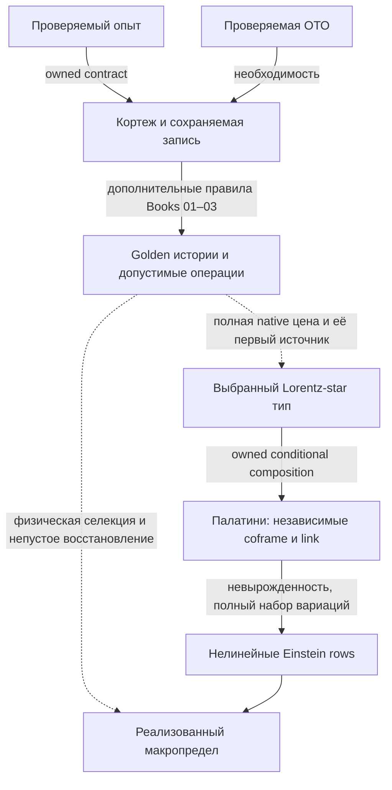

# D0 → ОТО: сборка оснований, источника и физического предела

17 октября 2026; дополнен 18 октября. Научный синтез интегратора в существующем Draft [#334](https://github.com/gvakhrushev/d0_15/pull/334).
Вход: `ec4256c9146530d3e98774cad755024b4aaa247d`; отдельно прочитан принятый
main `1aa3ff8b35133b1209164e0cd7da62ffefa647e2`, включая #367. Это не новая
очередь работ и не объявление закрытия исходного fixed-source/raw задания.

**Потреблённое продолжение:** [точная полная локальная решёточная семья](A4D_AF_STAR_FULL_LATTICE_STATIONARY_FAMILY_2026_10_17.md)
теперь закрывает локальную вакуумную recovery-часть на независимом
геометрическом носителе AF: все16 тетрадных и24 связевых строк во внутренних
узлах, настоящие golden веса, неплоский гладкий предел. Граница фиксирована;
физические N/P, материя и глобальное замыкание остаются открытыми.
Вход `275244e5` и [полная пятиисходная золотая цена](A4D_LABELLED_GOLDEN_RECORD_FULL_SOURCE_2026_10_18.md)
теперь добавляют собственные уравнения свободной подготовки и точный
ненулевой source на той же исходной метрике. Это уточняет остаток ниже,
не повышая построенный протокол до вынужденной динамики D0.

Проверка настоящей композиции теперь включена в §§7.1–8.3 того же
владельца. Два реальных старых исхода исключают независимую балансировку
его scene-флагов при естественной CAR-склейке. Общая подготовка должна
решать единый полный operator Euler. Геометрический запрос выражен
восемью CAR-словами и полным trace, но неплоские unipotent-плакетки
доказанно не входят в старый класс положительных изометрий. Поэтому
дальнейшая native сборка использует уже существующий full-Lorentz
positive-adjoint/Julia интерфейс со всеми его ветвями и источниками.
Ни подстановка adjoint вместо inverse, ни смена clock этого не исправляют.
В §7.3 уже решён единый preparation Euler настоящих128 исходов на
pure-time блоке: полный градиент скалярен при I16/16. Его ν-источник
строго положителен для любой подготовки на этом блоке, поэтому это
не совместный свободный ν-корень. Получен конкретный native source и
исключена его скрытая компенсация материей в указанном UV-секторе;
другие supports и общий continuum source остаются отдельной задачей.

Продолжение на входе `3447a184` теперь замыкает §§8.4–8.6 того же
владельца: весь Lorentz-перенос и coframe coefficients восстанавливаются
из actual raising X даже поперёк ненулевого null-направления. На заданном
addressed full-Lorentz Julia interface получена когерентная программа
star/golden запроса и строгий перенос её полного конечного первого
источника, включая work leakage. Не нужны отдельный U-oracle,
измерение элементов матрицы или дополнительная trace-копия материи.
Рабочие записи и их preparation остаются настоящими входными ресурсами.
Теперь остаток — физический допуск и вынужденность chiral программы,
её действительная старая история и независимая материя, затем exact
joint/global recovery. Доступность и реализация запроса ещё не выбирают
закон D0; повторять восстановление геометрии для этого не нужно.
§8.7 потребляет уже существующий Role/site selector: star-тип внутри
канонического oriented linear-curvature класса уже вынужден. Доказать
нужно ненулевую компоненту **полной native цены** в этом классе, сохранив
историю; I/Holst не является конкурентом внутри его исходных предпосылок.

Проверка этого forcing на входе `6c78c60e` теперь доведена до настоящей
source-пробы в §§8.8–8.9. Из когерентных путей выведен полный event source
с interference Gram и normalizer; scalar и amplitude веса не смешиваются.
Для всей заданной finite H+J+R найдена mixed coframe/link вариация с нулевым
источником, тогда как тот же Palatini stencil ненулевой. Прямое
отождествление двух источников исключено на этом carrier; stationary
reduction с настоящими observer/matter/torsion equations этим не исключена.
Проверка Book03 также различает явные penalty-функции и пока не заданные
S_coeff,J_coup,S_terminal и общий S_heat. Их нельзя считать вычисленным
полным действием по одному названию stack. Следующий шаг — source-preserving
stationary reduction реально заданной цены либо вывод полной собственной
geometry-history amplitude/price map. Новый compiler не заменяет этот шаг.

На входе `8c3a615c` эта stationary reduction уже выполнена в §§8.10–8.12:
все24 Lorentz-link и3 observer equations решаются вместе с полной
подготовкой над каждой близкой постоянной физической метрикой. Rank27
доказан через vacuum grade2 и tensor symmetry, а не численный minor.
Полная reduced цена сохраняет прежний отклик на форму плоского тора.
Но её faithful section не продолжается над всеми q(x): точное уравнение
на Q=e₀+e₁ запрещает одну реальную off-diagonal metric wave даже при
свободной связи и подготовке. На Q=2e₁, напротив, построен подъём всех
десяти metric slots; пять внутренних направлений ещё требуют своих
source equations. Поэтому старую stored-domain классификацию нельзя
просто перенести, а повторять homogeneous исключение для «закрытия ОТО»
больше не имеет смысла. Следующий научный переход должен предъявить
собственную пространственную stationary ветвь/полную history price с её
физической материей и источником. Общее отрицание D0→ОТО не получено.

## 1. Итог сборки

**Формулу нелинейной ОТО заново искать не требуется.** В корпусе уже есть
положительная композиция: выбранная конечная Lorentz-star запись → полная
цена построенного golden-AF опыта → предел Палатини → все десять вакуумных
уравнений Эйнштейна. Есть и непустые конечные кривые критические семейства
на всех внутренних coframe/link вариациях при фиксированной границе.
Для [полного пятиисходного опыта](A4D_LABELLED_GOLDEN_RECORD_FULL_SOURCE_2026_10_18.md)
уже решены и все свободные AF/scene/reference preparation rows;
геометрическая семья переносится в его полную ожидаемую Cost−Info.

**Открыт переход от построенного опыта к собственному закону D0.** Нужно
вывести его полную цену и источник из тех же допустимых историй, включая
геометрию, материю, подготовку, наблюдателя и архив. Затем нужен физический
переход к классическому уравнению с непустым полным восстановлением.
Способность реализовать нужный оператор и наличие правильного предела его
отклика сами по себе этого перехода не доказывают.

Обратная половина замысла пользователя уже имеет точную формулировку:
**любая проверяемая ОТО обязана реализовать функциональный кортеж D0**.
Это необходимость операционного основания, а не доказательство того, что
один лишь кортеж выбирает все динамические детали D0. Ни эту половину,
ни уже полученную геометрическую половину не следует повторно выводить.

Новые аналитические связки этого синтеза:

1. §4 отделяет условный прибор от совместного закона геометрии и указывает,
   почему нормировка источника ещё не доказывает классическую селекцию.
2. §5 даёт точное соотношение исходной raw-нормы и нормы макроскопического
   источника. Сильный старый терминал сохраняется; его необходимость для
   любого вывода ОТО из предыдущих результатов не следует.
3. §§6–7 сводят положительную сборку к полному первому источнику выбранного
   типа, а не к буквальному совпадению двух микроскопических приборов.
4. Обновлённый §8 связывает собственное CAR/clock чтение, новую полную
   цену с решённой подготовкой и достаточную Cartan-классификацию.
   Native программа, прежняя история и независимая материя остаются
   разными явно указанными предпосылками.

## 2. Что именно дают первые книги

Это карта прочитанных несущих разделов и их владельцев, а не заявление о
перепроверке каждого доказательства десяти книг. Основные входы: BOOK 00
§§00.3e–00.4, 00.8–00.9; BOOK 01 §§01.0–01.8, 01.15–01.16, 01.22a–01.24;
BOOK 02 — конечные операторы и тестовая экстенсиональность; BOOK 03
§03.3; BOOK 06 — история/переходы; BOOK 07 — операционное чтение и предел.

| Кирпич | Уже принадлежащий результат | Что из него не следует без следующей стрелки |
|---|---|---|
| [BOOK 00](../../01_BOOKS/BOOK_00_ENTRY_CONTRACT_AND_ADMISSIBILITY.md), [PopperianBootstrap](../../03_FORMALIZATION/D0/Foundation/PopperianBootstrap.lean) | Killing test эквивалентен принятому verification contract; из него следуют сохраняемая различимость, функциональный кортеж и независимость вердикта от catalogue | Единственная буквальная таблица состояний, полный физический процесс или уравнение Эйнштейна |
| [BOOK 01](../../01_BOOKS/BOOK_01_CONDENSED_FOUNDATIONS_AND_GRAPH_BIRTH.md): Σ=(C,C*,D_min,Δ,R,O) | Сначала код/канон/различение/архив/доступ; конечные инструменты и сцена — дальнейшее построение | Нельзя ставить гладкую геометрию вместо исходного носителя и затем считать её допустимость доказанной |
| Там же: condensed/profinite support | Совместимые конечные чтения и ограниченный admissible subfunctor: конечная факторизация, операторный подъём, положительный ответ, проективность и halt | Произвольный морфизм ambient condensed category не становится физической операцией D0 |
| φ, прямой ход и первый возврат | Для заданной примитивной семантики `p+p²=1`; golden cost/cylinder structure уже имеет владельцев | Возврат другого порядка меняет runtime; φ нельзя заново подбирать под нужный физический коэффициент |
| Сцена (9,11,13), §01.22a | Связаны торальные возвраты, ограничение ёмкости и typed preparation; это содержательные предпосылки, а не три выбранных числа | Полином, нулями которого назначены 9,11,13, не является независимым выводом сцены |
| π₀ и golden precision | Конечный фазовый инвариант и контролируемая шкала чтения | π₀ не заменяет π в обычной гладкой производной; масштаб точности сам не выбирает физическую связь |
| [EmpiricalTheoryFactorization](../../03_FORMALIZATION/D0/Foundation/EmpiricalTheoryFactorization.lean) | Фактор по полному заданному семейству тестов; injective evaluation и единственная факторизация любого согласованного summary | Физическая осуществимость и полнота семейства тестов не доказываются определением фактора |
| [BOOK 03](../../01_BOOKS/BOOK_03_FINITE_ACTION_OPERATORS_AND_SCENE_DYNAMICS.md) §03.3 | История имеет цену Cost−Info и вес; классическая вариация описывается через минимальную цену | Средняя условная энтропия произвольно сконструированного прибора не отождествлена автоматически с ценой геометрической истории |
| [BOOK 06](../../01_BOOKS/BOOK_06_EVOLUTION_FORGETTING_AND_TIME.md), [StaticToDynamicsOwner](../../03_FORMALIZATION/D0/Evolution/StaticToDynamicsOwner.lean) | Владельцы некоммутативности, архива циркуляций и golden ladder; границы self-reading/refinement явно описаны | Это не универсальная теорема о единственном переходе всех допустимых историй |

### 2.1. Обратное доказательство: почему проверяемая ОТО требует Σ

Пусть протокол проверки ОТО удовлетворяет принятому `KillingTest`.
Если разные проверяемые исходы x≠y дают одну запись, сравнение одной и той
же пары записей должно одновременно вернуть «same» и «different». Получено
противоречие. Поэтому запись инъективна на различаемых состояниях. Вместе
с остальными частями контракта это ровно уже доказанные
`killingTest_record_injective` и `killingTest_forces_functional_tuple`.
`alternative_burden` распространяет аргумент на любой альтернативный протокол.

Это относится и к косвенному детектированию: проверяется различие записей
и предсказаний, даже если объект не наблюдается непосредственно. Поэтому
интерпретация ускоренного расширения также нуждается в Σ. Аргумент не
выбирает конкретную модель тёмного сектора и не устанавливает её истинность.
Два различных `Line` в формальном контракте не следует без отдельного
аргумента переименовывать в причинно независимые физические лаборатории.

Точная логическая запись:

    VerifiedGR(P) ⇒ FunctionalTuple(P).

Она не равна `FunctionalTuple(P) ⇒ Einstein(P)`. Второе утверждение требует
динамической сборки ниже. Также не нужно доказывать изоморфизм всех сырых
внутренних состояний: [универсальная факторизация](../../03_FORMALIZATION/D0/Foundation/EmpiricalTheoryFactorization.lean)
уже говорит, какая эквивалентность действительно нужна — равенство всех
допустимых результатов. В тесты входят и будущие продолжения: равные
текущие маргинальные распределения не разрешают стереть различимую позднее
фазу или историю.

### 2.2. Как применять condensed математику и DAG

Condensed язык удерживает совместимость чтений и различие объекта от одной
его реализации. Он полезен для склейки диаграммы истории/операции/записи.
Само слово «склейка» не даёт оценки производной после умножения на растущий
масштаб. Это уже показано в [condensed-history source obstruction](A4D_CONDENSED_HISTORY_SOURCE_OBSTRUCTION.md):
конечные стадии и их предел могут вести себя по-разному для масштабируемого
источника; endpoint Gram не определяет cross comparison.
Первичный внешний контекст — [лекции Шольце по condensed mathematics](https://arxiv.org/html/2605.03658),
а физически ограниченный subfunctor берётся из BOOK 01, не из этих лекций.

Реестры используются как карта уже имеющихся владельцев. Но
`presupposition_edges.json` хранит концептуальные предпосылки, а не
компилированные доказательства композиции. `forcing_routes.json` отдельно
проверяет независимость заявленных маршрутов: 20 проверено, 0 сохранилось
до ремонта, 3 после ремонта. Это не число опровергнутых теорем D0.
В частности, `D0-SPECTRAL-EINSTEIN-001` с графовым `G=2L` и
`D0-GRAVITY-MACRO-EINSTEIN-INTERFACE-001` с набором конечных свойств нельзя
подставить вместо одного нелинейного Lorentz источника. Реальный DAG сборки
должен соединять совпадающие носители, действия, вариации и пределы.

## 3. Последние подходы: что сохраняется и почему возникал круг

| Подход 14–17 октября | Положительный результат, который сохраняем | Какой переход нельзя повторно считать закрытым |
|---|---|---|
| [Прямое вынуждение native цены](A4D_NATIVE_DIRECT_FORCING_ATTACK.md) | Конкретные return/code условия различают цены; построены строгие контроли неполных структурных требований | Совпадение вакуума, монотонность, cutoff и refinement ещё не выбирают всю Cost−Info |
| [Полная геометрия](A4D_COFRAME_TORSION_INTRINSIC_GR_RECONSTRUCTION.md) | Coframe, все24 LC-компоненты, нелинейный Einstein covector | Реконструкция геометрии не равна источнику цены прибора |
| [Центрированный конечный probe и φ/π₀](A4D_PHI_PI0_CONTINUUM_CLOSURE.md) | Непустые endpoint preparations, оценка O(h/ε+ε²), golden Cauchy-чтение | Точная sampled-Einstein source fibre выбранного warp пуста; измерение конечной разности не создаёт отсутствующих совместных корней |
| [Stored joint kernel](A4D_NATIVE_FULL_JOINT_KERNEL_AND_MATTER_REDUCTION.md) | Exact off-shell elimination и классификация ближайших faithful/rank8 корней как плоских | Новое сканирование тех же семейств не создаст неплоскую ветвь; crossing не равен совместной нелинейной ветви |
| [Foundation forcing](A4D_FOUNDATION_FORCING_NOT_CATALOGUE_SEARCH.md) | Генераторный intertwining с производными и оценками для слов; цена входит в ту же диаграмму | Представимость заданного Q ещё не вынуждает физический Q |
| [Полная история и feasible gain](A4D_NATIVE_FEASIBLE_GAIN_AND_ACTION_SOURCE.md) | Точная оптимальная цена/источник в указанном классе тестов; строгий gain deficit | Томографическая полнота не даёт полный quantum-information optimum |
| [Fixed-beta IR feedback](A4D_NATIVE_FEEDBACK_IR_EINSTEIN_TORSION_SELECTION_2026_10_17.md) | Настоящие curvature/torsion коэффициенты исходной цены, условное подавление torsion | Положительная вспомогательная метрика, surviving volume и observer source не исчезают от одного EH-коэффициента |
| [AF active-left / retained-right](A4D_AF_LEFT_RIGHT_ACTIVE_ARCHIVE_GR_COMPILATION_2026_10_17.md) | Конечный AF оператор сохраняет старый right provenance; старый commutant no-go нельзя переносить на другой регистр | Членство в алгебре не доказывает допустимость перехода и полную стоимость его исполнения |
| [v8/AF zero-mode boundary](A4D_AF_V8_FLAT_ZERO_MODE_INTERTWINER_BOUNDARY_2026_10_17.md) | Точное различие событий неизменённого v8 и AF уже доказано | Не нужно снова пытаться назвать один буквальный v8 round тем же AF round |
| [Free-actuator no-go](A4D_AF_ACTUATOR_ELIMINATION_EINSTEIN_SOURCE_NO_GO_2026_10_17.md) | Если вся цена F(E), независимая стационарность E зануляет этот источник | После on-shell устранения E нельзя вернуть потерянный источник через искусственно навязанную E(g) |
| [Принятый #367](https://github.com/gvakhrushev/d0_15/blob/1aa3ff8b35133b1209164e0cd7da62ffefa647e2/02_REGISTRY/research/A4D_AF_RECORD_COST_INFO_COUPLING_GAP_2026_10_17.md) | Старый AF probe не несёт lapse/shift/matter источников, необходимых его EH-identification | Это не опровержение новой явно star-зависимой конструкции; её физическая привязка остаётся отдельной |
| [AF-star nonlinear composition](A4D_AF_STAR_PALATINI_NONLINEAR_EINSTEIN_COMPOSITION_2026_10_17.md) | Один полный Book-pointer, C² Palatini limit, все10 Einstein rows, nonflat pp-wave и конечные 25m критические направления | Пока не доказаны native execution/full price, плотность этих направлений и unrestricted joint recovery |

Повторявшаяся схема была такой: находился правильный геометрический ответ,
затем выяснялось, что его вход, цена, вариации либо физическая подготовка
отличаются от исходного процесса; после этого начинался поиск другого
ответа. Последняя положительная композиция позволяет остановить этот круг:
теперь надо потребить её геометрическую часть и доказать оставшуюся связь
с полным native источником.

Пунктир обозначает незакрытую физическую предпосылку, а не ещё одну
геометрическую формулу. Обратная стрелка H→B не замыкает прямую стрелку C→G.

## 4. Условный прибор и закон геометрии — разные объекты

### 4.1. Лемма о недоопределённости совместного закона

Пусть G — конечный набор геометрических меток, Ω — конечный набор полных
записей, и для каждого g дано положительное нормированное q_g(ω).
Для любой положительной вероятности π на G положим

    Pπ(g,ω)=π(g)q_g(ω).

Тогда `Pπ(ω|g)=q_g(ω)` для всех π, а `Pπ(g)=π(g)`. Доказательство — деление
на `Σω Pπ(g,ω)=π(g)`. Следовательно, даже точное знание всех условных
опытов не определяет геометрический marginal.

Это логический контроль, а не два построенных M1-допустимых мира D0.
**Не предлагается добавить π как физический постулат.** Наоборот, нужно
из исходных историй вывести, какие записи представляют геометрию, как
они взвешены совместно с прибором и какая цена управляет её вариациями.
При вариационном пути вместо вероятностного требуется доказать соответствие
геометрической вариации действительной вариации полной native цены.

### 4.2. Нельзя смешивать цену истории, среднюю цену и free energy

В конечном положительном секторе с фиксированной reference measure пусть
истинные ненормированные веса заданы `exp(-a Sω(x))`, a=log φ. Тогда

    Z=Σω exp(-a Sω),       Γ=−log Z/a,
    DΓ=E[DS],
    D²Γ=E[D²S]−a Cov(DS,DS),
    D(E[S])=E[DS]−a Cov(S,DS).                         (4.1)

Все тождества следуют прямым дифференцированием конечной суммы. Для двух
направлений в Hessian берётся соответствующая билинейная covariance.
При движении reference measure нужны её настоящие производные; их нельзя
включить в «константу». Это тот же структурный вопрос, который уже решён
в [history-density synthesis, §2](A4D_HISTORY_DENSITY_PALATINI_SYNTHESIS.md):
после оптимизации массы с KL-членом получается free energy, а не средняя f.

Контроль: если `Sω=−log qω/a` и `Σqω=1`, то Z=1, Γ=0, но
`E[S]=H(q)/a` обычно непостоянна. Поэтому источник Shannon-энтропии
условного указателя нельзя без отдельного binding назвать источником
ненормированного веса геометрической истории. Обратное также неверно:
эти формулы не выбирают Γ вместо средней цены как физическое действие.
Выбор уже должен следовать из native процесса и конкретного Book consumer.
Квантовую coherent историю нельзя заменить этим положительным commuting
сектором без доказанной декомпозиции.

### 4.3. Нормировка источника сохраняет критические точки, но не создаёт классическую концентрацию

В AF-композиции `S=B+t² A`, где B не зависит от полей. При фиксированном
t>0 равенства `DS=0` и `DA=0` эквивалентны. Это законная математическая
нормировка, не контрчлен. Но если дополнительно пытаться назначить именно
этому S вес геометрии, для двух bounded A получим

    φ^(−S(g1))/φ^(−S(g2))=φ^(−t²(A(g1)−A(g2))) → 1.    (4.2)

Следовательно, C²-сходимость нормированного A сама не доказывает
концентрацию геометрических историй при t→0. Положение мод при положительном
перемасштабировании может сохраняться; концентрация вероятности — другое
утверждение. Также golden код не даёт её автоматически: exact-cost слов
`F_(n+1)`, каждое имеет вес p^n, а их суммарная масса стремится к φ/√5.
Число слов компенсирует экспоненциальный кодовый вес.

Для пути BOOK 03 «наиболее вероятная история → классический предел» нужно
потребить реальный native закон истории/макроскопического чтения и
контролировать этот предел. Для пути через принадлежащую конечную
вариационную задачу достаточно доказать её полное source/variation
соответствие и восстановление критических состояний. Не требуется
добавлять искусственную температуру, число повторений или Gibbs-подготовку.

## 5. Точное различие двух требований к пределу

### 5.1. Исходная raw задача сильнее сходимости макроскопического источника

Здесь только исходная нормировка [probe/source owner](A4D_PHI_PI0_CONTINUUM_CLOSURE.md):
`I_h=h² A_h`, h=1/L, L^4 ячеек; десять метрических компонент уже packed.
Пусть ΔXi — разность сырых метрических источников двух действий в одной
и той же конвенции. Определим

    r_h(x)=h^(-2) ΔXi_h(x),
    N_h=h^(-2) Σx ||ΔXi_h(x)||₁=Σx ||r_h(x)||₁,
    F_h[V]=h² Σx ΔXi_h(x)·V(x)=h⁴ Σx r_h(x)·V(x).       (5.1)

Для **всех решёточных** packed-проб с `max_(x,a)|V_a(x)|≤1` двойственность
ℓ¹/ℓ∞ даёт точное равенство

    sup |F_h[V]|=h⁴ N_h.                               (5.2)

Верхняя оценка — неравенство треугольника; равенство достигается выбором
знака каждой компоненты r. Если разрешены только гладкие пробы, остаётся
верхняя оценка, а равенство не утверждается.

Таким образом исходный терминал `N_h→0` требует `sup|F_h|=o(h⁴)`.
Обычная сходимость этого макроскопического источника требует `sup|F_h|→0`.
Они не эквивалентны. Например, для фиксированного ненулевого packed-тензора C
алгебраическое семейство `r_h(x)=h C` удовлетворяет

    N_h=||C||₁ h^(-3) → ∞,       sup|F_h|=||C||₁ h → 0. (5.3)

Это контрпример импликации между нормами, **не** построенный native
совместный корень. Для fixed-source корня r имеет специальный вид
`tau−rho_cmp,h`; (5.3) не утверждает реализуемости именно такого остатка.
Ничего здесь не доказывает даже слабую сходимость фактического native
источника. Члены volume/aether или lapse/shift residual, сохраняющиеся
после макроскопического pairing, остаются реальными препятствиями.

### 5.2. Следствие для стратегии, не изменение контракта

Первоначальная задача #216/#310/#334 с независимо заданными g,tau,
точными корнями и raw norm остаётся OPEN с прежним терминалом. Подменять
её средним или слабым результатом нельзя. Но более общий пользовательский
вопрос «выходит ли макроскопическая ОТО из D0?» требует собственной
точной теоремы, а не молчаливого добавления `o(h⁴)` как универсальной
необходимой предпосылки. Эти две математические задачи должны быть видны
вместе, без объявления одной решённой за счёт другой.

Для всех десяти Einstein rows достаточен полный предельный source pairing
со всеми гладкими компактно поддержанными метрическими пробами, вместе
с полными link/matter/observer условиями и правильным пределом решений.
Распределительное равенство становится поточечным при нужной регулярности.
Одна TT-проба, конечный заранее фиксированный набор или растущее число
однотипных проб этого не дают.

Операционная φ-точность совместима с таким утверждением: если для каждого
первого k тестов уже доказана количественная сходимость с константами,
можно заранее выбрать h_k так, чтобы все k ошибок были ≤φ^(−k).
Для расширения с плотного счётного семейства на все пробы нужна локальная
равномерная оценка источников в выбранной тестовой норме. Это расписание
чтения, не выбор новой физической clock law и не исходная raw-оценка.

## 6. Положительная сборка: универсальность полного первого источника

### 6.1. Не нужно требовать буквального v8=AF

Исходный v8 и построенный AF уже различены точным zero-mode событием.
Это закрывает буквальное неизменённое одношаговое отождествление. Для
макроскопической ОТО нужен более точный по назначению объект: одинаковый
полный предельный ковектор на физически допустимых вариациях.

Выбранный [Role-star owner](MEMO_A4D_STAR_DENSITY_VARIATION_PRESSURE.md)
имеет `d_A=1`, `d_E=1` **в объявленном типе**: локальная based plaquette,
нечётная curvature insertion, квадратичные relative-solder legs, фиксированная
комплементарная Role orientation, G₂ и internal star. Его старый `d_P=1`
сформулирован только для указанного плоского L=2 quotient. Новая
[нелинейная композиция, §2.1](A4D_AF_STAR_PALATINI_NONLINEAR_EINSTEIN_COMPOSITION_2026_10_17.md)
потребляет именно тип первого отклика, а не глобальную уникальность всех
действий. Коэффициент этого типа должен быть константой по полям;
произвольная λ(g) вносит дополнительный источник.

### 6.2. Лемма переноса источника через гладкую полную цену

Пусть X — компактный гладкий конечномерный chart **всех заявленных** полей
и их подготовок. Пусть μ_hw≥0 не зависит от X и имеет ограниченную сумму;
f_hw и Df_hw равномерно ограничены. Пусть F∈C² около e₀, F′(e₀)≠0, c₀≠0,
и истинная полная цена на этом chart имеет уже выведенный вид

    S_h,t=B_h+Σw μ_hw [F(e₀+c₀t² f_hw)−F(e₀)]+C_h,t,
    DB_h=0.                                                   (6.1)

Прямое дифференцирование и теорема о среднем дают, равномерно на chart,

    t^(−2) DS_h,t
      =c₀ F′(e₀) Σw μ_hw Df_hw + t^(−2) DC_h,t + O(t²).        (6.2)

Действительно, источник каждого слагаемого после деления на t² равен
`c₀ F′(e₀+c₀t²f) Df`; его отличие ограничено
`|c₀|² t² sup|F″| |f| ||Df||`. Сумма масс ограничена. Для C²-версии нужен
соответствующий дополнительный контроль производных; из одного F∈C²
здесь не объявляется O(t²) для второй производной.

Если существующий geometric/quadrature owner даёт
`Σ μ_hw Df_hw → γ D S_P`, γ≠0, и **полный** оставшийся источник сходится
к `D S_m`, то

    t^(−2) DS_h,t → c D S_P + D S_m,
    c=c₀ F′(e₀)γ ≠ 0.                                        (6.3)

При moving μ нужно также сохранить
`t^(−2)Σ Dμ [F(e₀+c₀t²f)−F(e₀)]`; при moving reference/clock/preparation
их источники входят туда же. C нельзя объявить постоянным по названию
«controller», «архив» или «нормировка».

Это общий аналитический consumer, а не ещё одна выбранная физическая
цена. Он дополняет имеющуюся [центральную variational equivalence](A4D_CENTRAL_RECORD_VARIATIONAL_EQUIVALENCE.md)
и показывает, почему после доказанного native binding не требуется
перебирать формы entropy/readout с одним и тем же ненулевым первым
откликом. Для конкретного AF опыта соответствующий более сильный C²
результат **уже доказан** его владельцем.

### 6.3. Главная несущая предпосылка

Нужно получить (6.3) для полной native цены без подстановки желаемого
результата в E(g), а до этого доказать принадлежность её leading response
выбранному типу и ненулевую чувствительность. Факт `d_A=1` работает после
этих предпосылок. Он не выводит из одного слова «натуральность» locality,
parity, quadratic solder degree, отсутствие самостоятельной плотности,
observer terms или всех higher-order contributions.

Это существенные, проверяемые условия. Уже [discrete target-span owner](MEMO_A4D_DISCRETE_PALATINI_TARGET_SPAN.md)
имеет легальные Vol_rel и torsion invariants вне выбранного star-only
типа. Одна gauge covariance не устраняет их. Нужно вывести их отсутствие,
подчинённый порядок либо собственную связанную динамику из того же
процесса. Геометрическую универсальность следует применять к доказанному
первому источнику, а не превращать её предпосылки в новый физический закон.

## 7. Составная теорема, которую теперь надо замкнуть

Пусть из D0 без внешнего выбора действия получены:

**N. Native source.** Один полный процесс/price map с реальной вариацией
всех полей. На регулярных charts его нормированный первый источник
сходится к `c D S_P + D S_m`, c≠0. Остаток включает подготовку, observer,
архив, reference и clock, а не только выбранную геометрическую строку.

**V. Variation and recovery.** Непустое семейство физически допустимых
совместно стационарных конечных состояний имеет регулярный невырожденный
предел. Каждая гладкая компактно поддержанная coframe/link/matter проба
имеет допустимый конечный подъём; источники и подъёмы сходятся с нужной
локальной равномерностью. При использовании плотного семейства имеется
оценка, позволяющая распространить равенство на все пробы.

**P. Physical classical selection.** Эти стационарные состояния действительно
являются рассматриваемым классическим сектором native истории, либо
входят в принадлежащую native вариационную задачу с доказанным source map.
Средняя условная цена прибора не подменяет эту предпосылку.

Тогда из нулевого конечного полного источника, N и V следует
`c D S_P + D S_m=0` на всех таких пробах. В вакууме 24 независимые link
вариации невырожденного coframe дают T=0. После этого 16 coframe rows
с шестью Lorentz frame identities дают все10 `Gμν=0`. Это nonlinear
Palatini consumer существующей композиции, без TT/линейного ограничения.
Утверждение о физической ОТО использует также P, а не только формальный
предел стационарных уравнений.

Для spin-free материи с независимо выведенным same-program S_m и
конвенцией `δS_m=½∫√|g| Tμν δgμν` получается `2c Gμν=Tμν`.
Для spinful CAR материи сначала остаётся Cartan spin source; нельзя
молча наложить torsion-free или заменить полную материю удобным скаляром.
Ненулевой c достаточен для вакуумного нулевого множества. Правильный знак
и относительная нормировка matter coupling — дополнительные физические
содержания, не исправляемые переименованием c.

Космологический член также должен иметь native владельца. Если полная
цена оставляет volume source, его нельзя вычеркнуть ради вакуумного
`G=0`: нужно вывести его коэффициент и соответствующее уравнение.
Отсутствие extensive baseline у построенного AF опыта не доказывает
отсутствия такого источника во всей D0. Операционная необходимость Σ
для космологических наблюдений из §2.1 не решает этот динамический вопрос.

**Где уже есть непустота.** AF владелец построил неплоский Ricci-flat pp-wave
и IFT-корни в 25 направлениях: один conformal bump и все24 Cartan.
На непересекающихся patches получены 25m направлений. Но увеличение их
числа не доказывает плотность во всех физических metric directions;
произвольные shear/lapse/shift пробы этим фактом не покрыты. Последующее
[полное локальное решение](A4D_AF_STAR_FULL_LATTICE_STATIONARY_FAMILY_2026_10_17.md)
снимает это ограничение на независимом геометрическом носителе внутри
фиксированной границы. V для полного физического семейства ещё не закрыта. Пустая exact-source
fibre старого warp также не служит положительной recovery теоремой.

## 8. Полный source: что теперь вычислено и что ещё требуется

### 8.1. Потреблённые входы 17–18 октября

Полное [операционное CAR/clock чтение](sources/d0_operational_car_clock_readout_2026-10-17/RESULT_RU.md)
восстанавливает исходные `q=FηFᵀ`, `g=q^-1` по сохранённым CAR
коэффициентам и clock, со всеми десятью metric entries. Оно не зависит
от выбора full16/reference128 состояния сцены. Допустимость самих probe
words — отдельная native предпосылка. Поэтому «метрика пока неизвестна»
больше не является общим остатком; нужно доказать её связь с тем же
физически выбранным source, сохраняя исходное чтение.

[Точная Cost−Info события](sources/d0_cost_info_event_source_2026-10-17/RESULT_RU.md)
даёт `S_mean=H(q)/log φ` для полного same-history среза при w=q, N=1.
Это не event surprisal и не literal H+J+R. Open Julia D-вакуум имеет
нулевую mean price и первый источник для всех геометрий; для этого
кандидата ненулевого c_native нет. У [полного spectral H+J+R](A4D_FULL_SPECTRAL_TENSOR_SIGNATURE_2026_10_17.md)
другая tensor signature: положительная метрика не становится Lorentz
метрикой простым переобозначением. Не следует смешивать эти цены ради
желаемого source.

[Регулярный natural-source → Cartan theorem](A4D_REGULAR_NATURAL_SOURCE_TO_CARTAN_2026_10_17.md)
даёт достаточный завершающий шаг без заранее выбранного полиномиального
действия. Нужны настоящие R1–R3: регулярный локальный источник с
продолжением к вырожденным coframes, чистая naturality без surviving
observer/clock/background, и differential одного действия. Тогда источник
имеет Palatini/Holst/volume вид; при ненулевом Palatini coefficient
spin-free Cartan equation даёт T=0 и все10 Einstein rows.
Теорема не вычисляет c_native и не доказывает R1–R3 для любой D0 цены.
Для matter источника остаются его независимый вывод и spin equation.

[Структурный stationary-fibre descent](sources/d0_structural_source_closure_2026-10-17/RESULT_RU.md)
снимает лишнее требование единственности внутреннего состояния: достаточно
связных регулярных stationary fibres. Но полный Schur kernel, Ward
условия и locality estimates должны принадлежать реальным полям и той же
цене. Томография геометрической истории не выбирает её динамику;
[macrohistory owner](sources/d0_geometric_macrohistory_2026-10-17/RESULT_RU.md)
сохраняет эту границу для действительных геометрических записей.

### 8.2. Новое положительное замыкание цены заданного протокола

[Пятиисходный owner](A4D_LABELLED_GOLDEN_RECORD_FULL_SOURCE_2026_10_18.md)
выводит полную same-history цену из настоящего закона вероятностей,
включая failure подготовки и два отдельных success-флага. При f=0
свободное prefix equation решается
`s_*=logistic(h(p²)+log2)`, а сцена — b=1/2. Canonical p^6 не решает
первое уравнение при свободной подготовке. Операторный градиент энтропии
равен const I на всём носителе: все normalized AF/scene/reference
preparation rows исчезают по своим уравнениям, включая entangling и
rank directions. Все528 scene-моды и полный reference128 сохраняются.

На этой конфигурации точный полный source есть

    DS_full=s_* p²t² Σ μ_y Df_y,    s_*>0.

Старая периодическая completion уже имеет f=0 глобально, даже вне
внутренней области. Поэтому свободная AF подготовка не видит внешнего
скалярного f, и прежняя искривлённая семья переносится в **полные
совместные корни данной configured цены**. Внешние геометрические строки
по-прежнему фиксированы и могут быть ненулевыми. Исходная метрика g
сохраняется; χg не вводится. Это закрывает preparation-часть для этого
протокола, не для произвольной native программы.

При реальных более ранних labels w после их сохранения остаётся

    DS_all=DH(w)/log φ+s_* p²t² Σ w_y Df_y.

Каждый решённый terminal block имеет одинаковую условную энтропию;
chain rule и зависимые от w lifts не устраняют DH(w). Нужны собственные
истинные уравнения старой истории, её доказанная неизменность либо
детерминированность. Геометрически управляемый E пока не выведен из
native primitives; если сделать E свободным actuator, старый no-go
вновь действует. Это и есть точная общая стрелка, которую нужно замкнуть.

Её primitive часть стала уже: §8.1 нового owner точно факторизует
настоящий четырёхкопийный T_E вдоль единственной существующей golden
rotation и вычисляет `DT=(√p/2)t²T_(p²)J DF_star` при F_star=0.
Следовательно не требуется новый произвольный matrix actuator. Требуется
native geometric SELECT с этим jet, действительными coframe/link данными
и собственными сохранёнными ресурсами/ценой. Фиксированный G/CNOT compiler
работает после предоставления такого query, но не создаёт его.

### 8.3. Сохранённая off-shell normal form и дальнейший consumer

**Потреблён следующий результат:** [полная AF source normal form](A4D_AF_FULL_SOURCE_EINSTEIN_NORMAL_FORM_2026_10_17.md)
соединяет фактический AF/scene feedback, точное logdet-развёртывание и
density/coframe-карту. Получена биекция всех совместных stationary sets
на объявленной области, без f=0 и замораживания сцены. Вычислены полный
графовый источник и изменение метрического чтения. Общий путь через
«Einstein + остаток» проверен: он не доказывает физическую ОТО, поскольку
остаток может полностью компенсировать выделенную гравитационную строку.
Кроме того, прежний row-only перенос dC не обязан оставаться exact one-form;
считать его отдельным действием материи было бы ошибкой. Полное действие
исправляет integrability, но не выбирает physical source.

Для полной цены вида t^-2 K_lead+G+O(t²) действительный следующий источник
есть DG на stationary manifold K_lead, если такой регулярный manifold
получен. Поэтому нужны реальные полные metric lifts на нём и совпадение
операционного чтения с метрикой источника. Формула ниже теперь потребляет
именно этот совместный объект; не требуется ещё один вакуумный коэффициент.

Первый потребляемый результат теперь формулируется так:

> Вывести из допустимых операций и полного Cost−Info native истории её
> leading first-response map на совместных полях и показать, что его
> геометрическая часть принадлежит выбранному ненулевому Lorentz-star
> типу; вычислить одновременно все остальные источники. Доказательство
> должно сохранять реальное происхождение геометрического чтения и цену
> его выполнения. Затем применить уже готовый Palatini consumer.

Проверка начинается с конечных примитивов и их полных source jets,
используя [имеющуюся generator/jet reduction](A4D_FOUNDATION_FORCING_NOT_CATALOGUE_SEARCH.md).
Она должна сразу различать три случая: кинематически выведенный E из
того же процесса; независимо варьируемый E с полным controller source;
условно поданный извне E. Последний даёт математический прибор, но не N.
Противоречие в конкретном primitive diagram меняет эту стрелку, а не
отбрасывает foundation tuple или всю геометрическую композицию.

После этого реально независимыми становятся: распространение полного
source на плотный класс вариаций/предел; непустое совместное recovery;
материальный источник и его относительная связь. Средним агентам имеет
смысл передавать именно зафиксированные леммы с одним носителем и одним
потребителем. Сейчас новый набор агентов и очередной каталог гипотез
не запускается: сначала интегратор закрепляет этот общий интерфейс.

Не возобновлять без изменившейся предпосылки: literal v8=AF single-round,
старые faithful/rank8 nonflat searches, φ/π₀ как подгонку continuum
коэффициента, tomography⇒maximal gain, free-actuator pullback, вывод всех
Einstein rows из одной curvature probe. Эти маршруты уже имеют конкретные
владельцы границ, перечисленные выше.

## 9. Статус и проверка этого результата

Сохранены сильная положительная AF-композиция, все исходные материалы и
точный исходный raw терминал. Добавлены аналитические доказательства
(4.1)–(4.2), (5.1)–(5.3), (6.1)–(6.3) и их прямой consumer §7; это
исследовательский текст, не новый Lean owner и не повышенный CORE claim.
Для них достаточно прямой проверки конечных тождеств, предпосылок и
масштабов; неизменённые дорогие расчёты повторно не запускались.

Полная physical D0→ОТО ещё не доказана. Однако остаток сформулирован
конкретно: N/P и полное V, при уже имеющемся геометрическом consumer.
Процент готовности не выводится из числа файлов, пройденных проверок или
числа закрытых промежуточных задач. Следующее продвижение должно закрыть
одну из этих связей в общей теореме, а не снова обнаружить формулу ОТО.
